+++
date = '2026-10-14T12:00:00+10:00'
draft = false
title = 'AI-DLC: AI-Driven Development Life Cycle'
tags = ['AI-DLC', 'AI', 'Agentic', 'Software Engineering', 'Methodology', 'AWS', 'Workflow']
summary = 'AI-DLC (AI-Driven Development Life Cycle) is a methodology and deterministic engine that turns AI coding assistants into structured, auditable software-delivery workflows from one harness-neutral core.'
+++

## Introduction

AI-DLC (AI-Driven Development Life Cycle) is a methodology for structuring AI-assisted software development into repeatable, traceable phases. It originated from the [AWS AI-DLC methodology](https://aws.amazon.com/blogs/devops/ai-driven-development-life-cycle/). This project implements the methodology natively from one harness-neutral core, so it runs inside the CLI harness you already use: Claude Code, Kiro CLI, Kiro IDE, Codex CLI, Cursor, opencode or GitHub Copilot.

You invoke the workflow with a single command:

```text
/aidlc Build a REST API for inventory management
```

AI-DLC then guides you from capturing intent through requirements, design, implementation, testing and deployment, while keeping you in control at every decision point.

- **Repository:** [github.com/awslabs/aidlc-workflows](https://github.com/awslabs/aidlc-workflows)
- **Documentation:** [awslabs.github.io/aidlc-workflows](https://awslabs.github.io/aidlc-workflows/)

### Philosophy: small mob, broad agents

Rather than dozens of narrow specialists, AI-DLC uses 11 broadly capable agents that each participate across multiple stages and phases. Each agent carries context across stages, which removes handoffs and reduces coordination overhead. This mirrors how effective human teams work: a mob of 3-5 people covers an entire feature, each bringing broad skills instead of a single narrow specialty.

### How the orchestrator works

A deterministic engine decides what happens next, and the conductor (the `/aidlc` session) carries it out before asking the engine for the next move. Across that loop the framework reads the 33 stage definitions, loads agent personas, tracks progress in `aidlc-state.md`, logs decisions to the intent's `audit/` shards, dispatches subagents and presents approval gates.

Most stages run inline, where the conductor adopts the agent's perspective and works directly with you. Four stages use dispatched topologies: Practices Discovery and Code Generation run as subagent hubs, Reverse Engineering as a pipeline and User Stories as a mob. The complete topology is 29 inline, 2 subagent, 1 pipeline and 1 mob.

### Key numbers

| Metric                                        | Value                                                            | What it means                                                                                                                                                                                                                                                                                                                                                                                    |
| --------------------------------------------- | ---------------------------------------------------------------- | ------------------------------------------------------------------------------------------------------------------------------------------------------------------------------------------------------------------------------------------------------------------------------------------------------------------------------------------------------------------------------------------------ |
| [Phases](#the-5-phases)                       | 5 (Initialization, Ideation, Inception, Construction, Operation) | - **Initialization**: bootstrap the workspace (automatic, no approval gates)<br/>- **Ideation**: validate the initiative (intent, feasibility, scope, team, approval)<br/>- **Inception**: elaborate requirements, design and the delivery plan<br/>- **Construction**: design, implement and test in reviewable slices<br/>- **Operation**: deploy, operate and feed learnings back to Ideation |
| [Stages](#the-33-stages)                      | 33                                                               | - The discrete steps spread across the 5 phases<br/>- Each stage declares its inputs, steps, outputs and lead agent<br/>- A scope runs a subset of the 33 in the same numbered order                                                                                                                                                                                                             |
| [Agents](#the-14-agents)                      | 14 total: 11 domain experts, 2 reviewers and the composer        | - **11 domain experts**: product, design, delivery, architect, AWS platform, compliance, devsecops, developer, quality, pipeline-deploy and operations<br/>- **2 reviewers**: product lead and architecture reviewer<br/>- **1 composer**: proposes tailored plans and reshapes pending stages                                                                                                   |
| [Scopes](#workflow-profiles-scopes)           | 11 (enterprise through express, plus workshop)                   | - 11 named workflow profiles: enterprise, feature, mvp, poc, bugfix, refactor, infra, security-patch, classic, workshop and express<br/>- Each scope selects which stages run, the depth and the test strategy<br/>- The composer can also propose a plan from your words                                                                                                                        |
| [Depth levels](#depth-levels)                 | 3 (Minimal, Standard, Comprehensive)                             | - How much detail each stage produces<br/>- Chosen by the scope and overridable per work<br/>- The three levels are Minimal, Standard and Comprehensive                                                                                                                                                                                                                                          |
| [Test strategy levels](#test-strategy-levels) | 3 (Minimal, Standard, Comprehensive)                             | - How many tests are generated<br/>- Chosen by the scope and overridable per work<br/>- The three levels are Minimal, Standard and Comprehensive                                                                                                                                                                                                                                                 |
| [Audit event types](#audit-event-types)       | 118                                                              | - The categories of traceability events AI-DLC logs to the intent's `audit/` shards<br/>- Records gate approvals, decisions and agent activity                                                                                                                                                                                                                                                   |

## Setup

### Prerequisites

AI-DLC has two prerequisites on macOS and Linux.

- **A harness, installed and signed in.** AI-DLC runs inside the CLI tool you already use: Claude Code, Kiro CLI, Kiro IDE, Codex CLI, Cursor, opencode or GitHub Copilot.
- **Git, for Codex CLI and Cursor.** Codex CLI finds a project's hooks only in a Git repository and Cursor may skip them outside one, so run `git init` before `aidlc config` when you use either tool.

Nothing else is required. The native installer brings everything AI-DLC runs, so you do not need Bun or Node.js.

### Install AI-DLC

```bash
curl -fsSL https://github.com/awslabs/aidlc-workflows/releases/latest/download/install.sh | sh
```

The installer downloads the native `aidlc` command and every harness runtime. When `~/.local/bin` is not on your PATH, it prints the `export` line to run:

```text
PASS installed AI-DLC X.Y.Z with all harness runtimes
Add AI-DLC to PATH for this shell:
  export PATH="/home/you/.local/bin:$PATH"
Then run: aidlc config
```

Confirm the installed command:

```text
$ aidlc version
aidlc X.Y.Z (runtime X.Y.Z)
```

### Configure a project

Run `aidlc config` in the project folder. AI-DLC records its workspace in `aidlc/` inside that folder and does not search upward for a Git root.

```bash
cd /path/to/your-project
aidlc config --harness opencode
```

The `--harness` flag names which tool to set up. Replace `opencode` in the example with the value from the table below.

| Harness                    | Configure                         | Open                                                | Invoke   |
| -------------------------- | --------------------------------- | --------------------------------------------------- | -------- |
| Claude Code                | `aidlc config --harness claude`   | `claude`                                            | `/aidlc` |
| Kiro IDE (>= 1.1.70)       | `aidlc config --harness kiro-ide` | Kiro IDE, then choose **aidlc** in the agent picker | `/aidlc` |
| Kiro CLI (>= 2.6)          | `aidlc config --harness kiro`     | `kiro-cli chat`                                     | `/aidlc` |
| Codex CLI (>= 0.145.0)     | `aidlc config --harness codex`    | `codex`                                             | `$aidlc` |
| Cursor                     | `aidlc config --harness cursor`   | `cursor`                                            | `/aidlc` |
| opencode (>= 1.17)         | `aidlc config --harness opencode` | `opencode`                                          | `/aidlc` |
| GitHub Copilot (>= 1.0.74) | `aidlc config --harness copilot`  | Copilot CLI or VS Code                              | `/aidlc` |

Without `--harness`, `aidlc config` runs an interactive wizard that detects the harness on your PATH. With `--yes`, it skips the questions for scripts and CI.

Setup writes files into the project. Commit the shared ones so your team gets the same configuration:

| Path                                 | What it is                                                                                                   | Commit it?      |
| ------------------------------------ | ------------------------------------------------------------------------------------------------------------ | --------------- |
| `aidlc/`                             | AI-DLC's records: `aidlc/spaces/default/memory/` holds the rules and each piece of work gets its record here | Yes             |
| Harness directory, e.g. `.opencode/` | The harness's AI-DLC files: the `/aidlc` command, agents, hooks and tools                                    | Yes             |
| `.gitignore`                         | AI-DLC's own marked block, added to yours if you had one                                                     | Yes             |
| `aidlc.settings.json`                | The model effort preset                                                                                      | Yes             |
| `aidlc.settings.local.json`          | Your own answers, when not committed                                                                         | No, git-ignored |

### Verify the setup

```text
$ aidlc doctor
AI-DLC doctor

Machine
  ...
  ok    9 checks passed

Project
  ...
  ok    49 checks passed

Framework integrity
  ok    all 12 checks passed
```

On a new project, `aidlc doctor` reports a few expected warnings: the runtime PATH warning matters only if you start the harness from a desktop icon, one warning clears after your first chat and another clears after you commit the records. A `fail` row is a real problem and comes with its fix. Inside a session, `/aidlc --doctor` runs the same check.

### Start a workflow

Open your harness in the configured project and describe what you want:

```text
/aidlc Build a REST API for inventory management
```

AI-DLC reads your words and proposes a plan, which is a ready-made set of stages for that kind of work. Confirm the plan or pick another, and AI-DLC creates the record for the work and starts the first stage, Intent Capture.

## AI-DLC: Phases, Stages, and Agents

AI-DLC has 5 phases, 33 stages, and 14 agents (11 domain experts, 2 reviewers, and 1 composer).

Which stages actually run depends on the scope you choose.

##### Workflow Profiles (Scopes)

AI-DLC does not force every task through the same lifecycle. A **workflow profile** (called a **scope** in the engine) selects which of the 33 stages run, the depth of each stage's artifacts and the test strategy. Choose one explicitly with `/aidlc <profile>` or describe the work and let AI-DLC propose one; the adaptive **composer** proposes a tailored route when no stock profile fits.

| Workflow profile | Best for                                                         | Stages  | Depth         | Test strategy | Invoke                  |
| ---------------- | ---------------------------------------------------------------- | ------- | ------------- | ------------- | ----------------------- |
| Classic          | V1-style ceremony through Inception and Construction             | 18 / 33 | Standard      | Standard      | `/aidlc classic`        |
| Express          | The lightest requirements-to-code-and-test path                  | 10 / 33 | Minimal       | Minimal       | `/aidlc express`        |
| Feature          | A production feature using the complete lifecycle                | 33 / 33 | Standard      | Standard      | `/aidlc feature`        |
| Enterprise       | Regulated or high-assurance work with full traceability          | 33 / 33 | Comprehensive | Comprehensive | `/aidlc enterprise`     |
| MVP              | A real first product increment without the Operation phase       | 23 / 33 | Standard      | Standard      | `/aidlc mvp`            |
| Proof of concept | Testing feasibility with the smallest useful implementation path | 8 / 33  | Minimal       | Minimal       | `/aidlc poc`            |
| Bugfix           | A known defect that needs a focused fix and regression test      | 9 / 33  | Minimal       | Minimal       | `/aidlc bugfix`         |
| Refactor         | Improving existing code without changing product behavior        | 10 / 33 | Minimal       | Minimal       | `/aidlc refactor`       |
| Infrastructure   | Environments, IaC, deployment foundations or cost work           | 13 / 33 | Standard      | Standard      | `/aidlc infra`          |
| Security patch   | A CVE or focused vulnerability response                          | 10 / 33 | Minimal       | Minimal       | `/aidlc security-patch` |
| Workshop         | A facilitated training or group delivery session                 | 26 / 33 | Standard      | Minimal       | `/aidlc workshop`       |

**Depth** controls how much detail each stage produces and **test strategy** controls how many tests are generated; both default from the profile and can be overridden. Stage counts describe the static route: a stage marked conditional can still self-skip when its condition does not apply, such as Reverse Engineering in a greenfield project.

##### Depth Levels

Depth controls the detail level of the artifacts a stage produces. The scope sets a default depth, and you can override it with `/aidlc --depth <level>` or at any approval gate.

| Depth             | Artifact detail                                                                                                                    | When to use                                   |
| ----------------- | ---------------------------------------------------------------------------------------------------------------------------------- | --------------------------------------------- |
| **Minimal**       | Core essentials only: short documents, key decisions and minimal supporting analysis                                               | Quick fixes, patches and proofs of concept    |
| **Standard**      | Balanced detail: complete requirements, architecture decisions with rationale and thorough test plans                              | Most features and MVPs                        |
| **Comprehensive** | Full enterprise detail: exhaustive requirements, compliance matrices, detailed NFR specifications and complete audit documentation | Regulated features and enterprise deployments |

##### Test Strategy Levels

Test strategy controls how many tests are generated and which test types are included. It is independent of depth, so a Standard-depth workflow can run with Minimal testing. Override it with `/aidlc --test-strategy <level>`.

| Test strategy     | Model                                                                             | Volume                                                                                                          | Best for                                                                 |
| ----------------- | --------------------------------------------------------------------------------- | --------------------------------------------------------------------------------------------------------------- | ------------------------------------------------------------------------ |
| **Minimal**       | Nyquist: the minimum tests needed to verify every requirement                     | 1 test per requirement plus a happy-path unit test per component, roughly 5-15 tests for a typical project      | Workshops, training sessions, proofs of concept and quick bugfixes       |
| **Standard**      | Per-component: balanced coverage that validates the boundaries between components | 5-8 tests per component (unit and integration), with E2E, performance and security only when NFRs call for them | Most features and MVPs                                                   |
| **Comprehensive** | Full coverage: thorough coverage across all test types                            | 10-15 tests per component across unit, integration, E2E, performance and security where NFRs exist              | Enterprise features and regulated systems needing test-coverage evidence |

##### The 5 phases

| #   | Phase          | Stages  | Purpose                                                             |
| --- | -------------- | ------- | ------------------------------------------------------------------- |
| 0   | Initialization | 0.1–0.3 | Bootstrap the workspace (automatic, no approval gates)              |
| 1   | Ideation       | 1.1–1.7 | Validate the initiative: intent, feasibility, scope, team, approval |
| 2   | Inception      | 2.1–2.9 | Elaborate requirements, design, and delivery plan                   |
| 3   | Construction   | 3.1–3.7 | Design, implement, and test in reviewable slices                    |
| 4   | Operation      | 4.1–4.7 | Deploy and operate, with a feedback loop back to Ideation           |

##### The 33 stages

| #   | Stage                                 | Lead                                               | Runs                     | Artifacts                                                                                                                                                                                                                                                                                                           |
| --- | ------------------------------------- | -------------------------------------------------- | ------------------------ | ------------------------------------------------------------------------------------------------------------------------------------------------------------------------------------------------------------------------------------------------------------------------------------------------------------------- |
| 0.1 | [Workspace Scaffold](#ref-0-1)        | orchestrator                                       | Always                   | - `scaffold-report.md`                                                                                                                                                                                                                                                                                              |
| 0.2 | [Workspace Detection](#ref-0-2)       | orchestrator                                       | Always                   | - `workspace-findings.md`<br>- updated `aidlc-state.md`                                                                                                                                                                                                                                                             |
| 0.3 | [State Initialization](#ref-0-3)      | orchestrator                                       | Always                   | - `state-init-summary.md`<br>- populated `aidlc-state.md`                                                                                                                                                                                                                                                           |
| 1.1 | [Intent Capture & Framing](#ref-1-1)  | aidlc-product-agent                                | Always                   | - `intent-capture-questions.md`<br>- `intent-statement.md`<br>- `stakeholder-map.md`                                                                                                                                                                                                                                |
| 1.2 | [Market Research](#ref-1-2)           | aidlc-product-agent                                | Conditional              | - `competitive-analysis.md`<br>- `build-vs-buy.md`                                                                                                                                                                                                                                                                  |
| 1.3 | [Feasibility & Constraints](#ref-1-3) | aidlc-architect-agent                              | Conditional              | - `feasibility-assessment.md`<br>- `constraint-register.md`<br>- `raid-log.md`                                                                                                                                                                                                                                      |
| 1.4 | [Scope Definition](#ref-1-4)          | aidlc-product-agent                                | Always                   | - `scope-document.md`<br>- `intent-backlog.md`                                                                                                                                                                                                                                                                      |
| 1.5 | [Team Formation](#ref-1-5)            | aidlc-delivery-agent                               | Conditional              | - `team-assessment.md`<br>- `mob-composition.md`                                                                                                                                                                                                                                                                    |
| 1.6 | [Rough Mockups](#ref-1-6)             | aidlc-design-agent                                 | Conditional              | - `wireframes.md`<br>- `user-flow.md`                                                                                                                                                                                                                                                                               |
| 1.7 | [Approval & Handoff](#ref-1-7)        | aidlc-delivery-agent                               | Always                   | - `initiative-brief.md`<br>- `decision-log.md`                                                                                                                                                                                                                                                                      |
| 2.1 | [Reverse Engineering](#ref-2-1)       | aidlc-developer-agent (then aidlc-architect-agent) | Brownfield projects      | 9 files to `aidlc/spaces/<space>/codekb/<repo>/`:<br>- `business-overview.md`<br>- `architecture.md`<br>- `code-structure.md`<br>- `api-documentation.md`<br>- `component-inventory.md`<br>- `technology-stack.md`<br>- `dependencies.md`<br>- `code-quality-assessment.md`<br>- `reverse-engineering-timestamp.md` |
| 2.2 | [Practices Discovery](#ref-2-2)       | aidlc-pipeline-deploy-agent                        | Conditional              | - `team-practices.md`<br>- `discovered-rules.md`<br>- `evidence.md`<br>- `practices-discovery-timestamp.md`<br>- promoted to `memory/team.md` and `project.md`                                                                                                                                                      |
| 2.3 | [Requirements Analysis](#ref-2-3)     | aidlc-product-agent                                | Always                   | - `requirements.md`                                                                                                                                                                                                                                                                                                 |
| 2.4 | [User Stories](#ref-2-4)              | aidlc-product-agent                                | User-facing features     | - `stories.md`<br>- `personas.md`<br>- `user-stories-assessment.md`<br>- `traceability.json`                                                                                                                                                                                                                        |
| 2.5 | [Refined Mockups](#ref-2-5)           | aidlc-design-agent                                 | UI projects              | - `mockups.md`<br>- `interaction-spec.md`<br>- `design-system-mapping.md`<br>- `accessibility-checklist.md`                                                                                                                                                                                                         |
| 2.6 | [Domain Design](#ref-2-6)             | aidlc-architect-agent                              | Per execution plan       | - `components.md`<br>- `decisions.md` (ADR log)<br>- `traceability.json`                                                                                                                                                                                                                                            |
| 2.7 | [Units Generation](#ref-2-7)          | aidlc-architect-agent                              | Always                   | - `unit-of-work.md`<br>- `unit-of-work-dependency.md`<br>- `unit-of-work-story-map.md`<br>- `traceability.json`                                                                                                                                                                                                     |
| 2.8 | [Contract Design](#ref-2-8)           | aidlc-architect-agent                              | Conditional              | - `contract-summary.md`                                                                                                                                                                                                                                                                                             |
| 2.9 | [Delivery Planning](#ref-2-9)         | aidlc-delivery-agent                               | Always                   | - `bolt-plan.md`<br>- `team-allocation.md`<br>- `risk-and-sequencing-rationale.md`<br>- `external-dependency-map.md`                                                                                                                                                                                                |
| 3.1 | [Functional Design](#ref-3-1)         | aidlc-architect-agent                              | Per Unit (conditional)   | - `entities.md`<br>- `rules.md`<br>- `functional-spec.md`<br>- `traceability.json`                                                                                                                                                                                                                                  |
| 3.2 | [NFR Requirements](#ref-3-2)          | aidlc-architect-agent                              | Per Unit (conditional)   | - `security-requirements.md`<br>- `performance-requirements.md`<br>- `scalability-requirements.md`<br>- `reliability-requirements.md`<br>- `observability-requirements.md`<br>- `tech-stack-decisions.md`<br>- `traceability.json`                                                                                  |
| 3.3 | [NFR Design](#ref-3-3)                | aidlc-architect-agent                              | Per Unit (conditional)   | - `security-design.md`<br>- `performance-design.md`<br>- `scalability-design.md`<br>- `reliability-design.md`<br>- `observability-design.md`<br>- `logical-components.md`<br>- `traceability.json`                                                                                                                  |
| 3.4 | [Infrastructure Design](#ref-3-4)     | aidlc-aws-platform-agent                           | Per Unit (conditional)   | - `infrastructure-specification.md`<br>- `monitoring-design.md`<br>- `cicd-pipeline.md`                                                                                                                                                                                                                             |
| 3.5 | [Code Generation](#ref-3-5)           | aidlc-developer-agent                              | Per Unit (always)        | - `code-generation-plan.md`<br>- `code-generation-questions.md`<br>- `unit-test-instructions.md`<br>- `code-summary.md`<br>- `traceability.json`<br>- `source-manifest.json`<br>- application code to the workspace repos                                                                                           |
| 3.6 | [Build and Test](#ref-3-6)            | aidlc-quality-agent                                | Always, once at end      | - `build-instructions.md`<br>- `test-results.md`                                                                                                                                                                                                                                                                    |
| 3.7 | [CI Pipeline](#ref-3-7)               | aidlc-pipeline-deploy-agent                        | Conditional, once at end | - `ci-config.md`<br>- `quality-gates.md`                                                                                                                                                                                                                                                                            |
| 4.1 | [Deployment Pipeline](#ref-4-1)       | aidlc-pipeline-deploy-agent                        | Conditional              | - `cd-config.md`<br>- `deployment-strategy.md`<br>- `rollback-runbook.md`                                                                                                                                                                                                                                           |
| 4.2 | [Environment Provisioning](#ref-4-2)  | aidlc-aws-platform-agent                           | Conditional              | - `environment-inventory.md`<br>- `validation-report.md`                                                                                                                                                                                                                                                            |
| 4.3 | [Deployment Execution](#ref-4-3)      | aidlc-pipeline-deploy-agent                        | Conditional              | - `deployment-log.md`<br>- `smoke-test-results.md`                                                                                                                                                                                                                                                                  |
| 4.4 | [Observability Setup](#ref-4-4)       | aidlc-operations-agent                             | Conditional              | - `dashboards.md`<br>- `alarms.md`<br>- `slo-config.md`                                                                                                                                                                                                                                                             |
| 4.5 | [Incident Response](#ref-4-5)         | aidlc-operations-agent                             | Conditional              | - `runbooks.md`<br>- `incident-plan.md`<br>- `escalation-matrix.md`                                                                                                                                                                                                                                                 |
| 4.6 | [Performance Validation](#ref-4-6)    | aidlc-quality-agent                                | Conditional              | - `load-test-plan.md`<br>- `nfr-validation-matrix.md`                                                                                                                                                                                                                                                               |
| 4.7 | [Feedback & Optimization](#ref-4-7)   | aidlc-operations-agent                             | Conditional              | - `slo-report.md`<br>- `cost-analysis.md`<br>- `feedback-loop.md`                                                                                                                                                                                                                                                   |

Every stage that collects input also writes its `{stage}-questions.md` beside its artifacts (e.g. `intent-capture-questions.md`), and every executed stage keeps a `memory.md` diary when the learnings ritual is on. Construction stages 3.1–3.5 repeat per unit of work, writing under `construction/{unit-name}/`, and per-unit artifacts are pruned to the unit's kind (`service`, `spec`, `ui`, `packaging`, or `library`). Reverse Engineering's 9 files are the only stage artifacts that land outside the record dir, in the per-repo CodeKB.

##### The 14 agents

###### 11 domain experts

| #   | Agent                         | Domain                                                        |
| --- | ----------------------------- | ------------------------------------------------------------- |
| 1   | `aidlc-product-agent`         | Requirements, scope, user stories, market research            |
| 2   | `aidlc-design-agent`          | UX/UI, wireframes, interaction design, accessibility          |
| 3   | `aidlc-delivery-agent`        | Team formation, capacity planning, delivery sequencing        |
| 4   | `aidlc-architect-agent`       | Application design, domain modelling, NFRs, decomposition     |
| 5   | `aidlc-aws-platform-agent`    | AWS infrastructure, IaC, FinOps, environment provisioning     |
| 6   | `aidlc-compliance-agent`      | GRC, regulatory mapping, data classification, risk            |
| 7   | `aidlc-devsecops-agent`       | Threat modelling, security pipeline, secure design review     |
| 8   | `aidlc-developer-agent`       | Code generation, reverse engineering, implementation guidance |
| 9   | `aidlc-quality-agent`         | Test strategy, acceptance criteria, performance validation    |
| 10  | `aidlc-pipeline-deploy-agent` | CI/CD pipelines, deployment strategy, release execution       |
| 11  | `aidlc-operations-agent`      | Observability, incident response, feedback loops              |

###### 2 reviewer agents

| Agent                               | Reviews                                                                                                                                                            |
| ----------------------------------- | ------------------------------------------------------------------------------------------------------------------------------------------------------------------ |
| `aidlc-product-lead-agent`          | Requirements, user stories, and UX/mockup artifacts                                                                                                                |
| `aidlc-architecture-reviewer-agent` | Technical design artifacts, including domain design, units generation, functional design, NFR requirements, NFR design, infrastructure design, and code generation |

###### 1 composer agent

| Agent                  | Role                                                      |
| ---------------------- | --------------------------------------------------------- |
| `aidlc-composer-agent` | Proposes tailored stage plans and reshapes pending stages |

##### The 33 stages by lead agent

Each stage sits inside its phase box, is filled with its lead agent's colour, and labels it with the lead agent's ID in square brackets beneath the stage name. The arrows chain the 33 stages in run order; a scope executes a subset of this chain in the same numbered order — skipped stages are left out of that run, not reordered.

```mermaid
flowchart TD
    subgraph INIT["Phase 0 — Initialization"]
        direction LR
        S01["0.1<br/>Workspace Scaffold<br/><sub>[orchestrator]</sub>"]:::orchestrator
        S02["0.2<br/>Workspace Detection<br/><sub>[orchestrator]</sub>"]:::orchestrator
        S03["0.3<br/>State Initialization<br/><sub>[orchestrator]</sub>"]:::orchestrator
        S01 --> S02 --> S03
    end
    subgraph IDEA["Phase 1 — Ideation"]
        direction LR
        S11["1.1<br/>Intent Capture & Framing<br/><sub>[aidlc-product-agent]</sub>"]:::product
        S12["1.2<br/>Market Research<br/><sub>[aidlc-product-agent]</sub>"]:::product
        S13["1.3<br/>Feasibility & Constraints<br/><sub>[aidlc-architect-agent]</sub>"]:::architect
        S14["1.4<br/>Scope Definition<br/><sub>[aidlc-product-agent]</sub>"]:::product
        S15["1.5<br/>Team Formation<br/><sub>[aidlc-delivery-agent]</sub>"]:::delivery
        S16["1.6<br/>Rough Mockups<br/><sub>[aidlc-design-agent]</sub>"]:::design
        S17["1.7<br/>Approval & Handoff<br/><sub>[aidlc-delivery-agent]</sub>"]:::delivery
        S11 --> S12 --> S13 --> S14 --> S15 --> S16 --> S17
    end
    subgraph INCP["Phase 2 — Inception"]
        direction LR
        S21["2.1<br/>Reverse Engineering<br/><sub>[aidlc-developer-agent]</sub>"]:::developer
        S22["2.2<br/>Practices Discovery<br/><sub>[aidlc-pipeline-deploy-agent]</sub>"]:::pipelinedeploy
        S23["2.3<br/>Requirements Analysis<br/><sub>[aidlc-product-agent]</sub>"]:::product
        S24["2.4<br/>User Stories<br/><sub>[aidlc-product-agent]</sub>"]:::product
        S25["2.5<br/>Refined Mockups<br/><sub>[aidlc-design-agent]</sub>"]:::design
        S26["2.6<br/>Domain Design<br/><sub>[aidlc-architect-agent]</sub>"]:::architect
        S27["2.7<br/>Units Generation<br/><sub>[aidlc-architect-agent]</sub>"]:::architect
        S28["2.8<br/>Contract Design<br/><sub>[aidlc-architect-agent]</sub>"]:::architect
        S29["2.9<br/>Delivery Planning<br/><sub>[aidlc-delivery-agent]</sub>"]:::delivery
        S21 --> S22 --> S23 --> S24 --> S25 --> S26 --> S27 --> S28 --> S29
    end
    subgraph CONS["Phase 3 — Construction"]
        direction LR
        S31["3.1<br/>Functional Design<br/><sub>[aidlc-architect-agent]</sub>"]:::architect
        S32["3.2<br/>NFR Requirements<br/><sub>[aidlc-architect-agent]</sub>"]:::architect
        S33["3.3<br/>NFR Design<br/><sub>[aidlc-architect-agent]</sub>"]:::architect
        S34["3.4<br/>Infrastructure Design<br/><sub>[aidlc-aws-platform-agent]</sub>"]:::awsplatform
        S35["3.5<br/>Code Generation<br/><sub>[aidlc-developer-agent]</sub>"]:::developer
        S36["3.6<br/>Build and Test<br/><sub>[aidlc-quality-agent]</sub>"]:::quality
        S37["3.7<br/>CI Pipeline<br/><sub>[aidlc-pipeline-deploy-agent]</sub>"]:::pipelinedeploy
        S31 --> S32 --> S33 --> S34 --> S35 --> S36 --> S37
    end
    subgraph OPER["Phase 4 — Operation"]
        direction LR
        S41["4.1<br/>Deployment Pipeline<br/><sub>[aidlc-pipeline-deploy-agent]</sub>"]:::pipelinedeploy
        S42["4.2<br/>Environment Provisioning<br/><sub>[aidlc-aws-platform-agent]</sub>"]:::awsplatform
        S43["4.3<br/>Deployment Execution<br/><sub>[aidlc-pipeline-deploy-agent]</sub>"]:::pipelinedeploy
        S44["4.4<br/>Observability Setup<br/><sub>[aidlc-operations-agent]</sub>"]:::operations
        S45["4.5<br/>Incident Response<br/><sub>[aidlc-operations-agent]</sub>"]:::operations
        S46["4.6<br/>Performance Validation<br/><sub>[aidlc-quality-agent]</sub>"]:::quality
        S47["4.7<br/>Feedback & Optimization<br/><sub>[aidlc-operations-agent]</sub>"]:::operations
        S41 --> S42 --> S43 --> S44 --> S45 --> S46 --> S47
    end

    VG1{{"Verification Gate 1"}}
    VG2{{"Verification Gate 2"}}
    VG3{{"Verification Gate 3"}}

    S03 -.->|auto-proceeds| S11
    S17 --> VG1
    VG1 --> S21
    S29 --> VG2
    VG2 --> S31
    S37 --> VG3
    VG3 --> S41
    S47 -.->|feedback loop| S11

    classDef orchestrator fill:#9e9e9e,stroke:#616161,color:#000,stroke-width:1px
    classDef product fill:#2196f3,stroke:#1565c0,color:#fff,stroke-width:1px
    classDef architect fill:#9c27b0,stroke:#6a1b9a,color:#fff,stroke-width:1px
    classDef delivery fill:#ff9800,stroke:#e65100,color:#000,stroke-width:1px
    classDef design fill:#e91e63,stroke:#ad1457,color:#fff,stroke-width:1px
    classDef developer fill:#4caf50,stroke:#2e7d32,color:#fff,stroke-width:1px
    classDef pipelinedeploy fill:#00bcd4,stroke:#00838f,color:#000,stroke-width:1px
    classDef quality fill:#ffc107,stroke:#f9a825,color:#000,stroke-width:1px
    classDef awsplatform fill:#f44336,stroke:#c62828,color:#fff,stroke-width:1px
    classDef operations fill:#795548,stroke:#4e342e,color:#fff,stroke-width:1px

    style VG1 fill:#ef9a9a,stroke:#c62828,color:#000
    style VG2 fill:#ef9a9a,stroke:#c62828,color:#000
    style VG3 fill:#ef9a9a,stroke:#c62828,color:#000
    style INIT fill:#f3f5f7,stroke:#9c27b0
    style IDEA fill:#f3f5f7,stroke:#4caf50
    style INCP fill:#f3f5f7,stroke:#2196f3
    style CONS fill:#f3f5f7,stroke:#ff9800
    style OPER fill:#f3f5f7,stroke:#e91e63
```



##### Human Approval Gates

Every stage except the three Initialization stages ends with an approval gate, so you review the agent's work before the workflow advances. A standard gate offers **Approve** or **Request Changes**, and the Approve line names the exact next stage (for example "Continue to NFR Requirements"). You answer in your own words rather than selecting a number, and AI-DLC reads the reply and acts on it.

- **Approve** marks the stage complete, updates `aidlc-state.md` and advances to the next stage.
- **Request Changes** records your feedback, and the agent revises its work and re-presents the gate.

Phases are separated by three **verification gates** (Ideation to Inception, Inception to Construction and Construction to Operation). Each verification gate runs automated traceability checks for missing links, orphaned artifacts or inconsistencies before the next phase builds on them. Operation feeds back to Ideation through a feedback loop at stage 4.7.

In Construction you can choose to let routine checkpoints pass automatically, but Plan Approval, any enabled summary confirmation, skeleton approval and every failure still stop for you. A gate needs a real message from you to approve it: a scope, a per-work setting or Guard Policy cannot lower that requirement, and only the machine-wide `AIDLC_SKIP_HUMAN_PRESENCE_GUARD=1` flag removes it.

##### Interaction Modes

When a stage gathers your input, it writes its questions to a `{stage}-questions.md` file and offers three answer modes:

- **Guide me** walks through each question interactively with structured prompts.
- **I'll edit the file** opens the questions file so you fill in answers directly.
- **Chat** lets you discuss freely while the agent extracts the decisions into the file.

You choose the mode once per piece of work; later stages reuse that choice and say so in one line. All three modes converge on the questions file as the canonical record of decisions.

##### Audit Event Types

The audit trail records the active intent's decisions and events for later stages and recovery. AI-DLC defines **118 event types** across 25 categories, written as plain Markdown shards under the intent's `audit/` directory.

| Category                         | Count | Representative events                                                          |
| -------------------------------- | ----: | ------------------------------------------------------------------------------ |
| Workflow Lifecycle               |     7 | `WORKFLOW_STARTED`, `WORKFLOW_COMPLETED`, `WORKFLOW_PARKED`                    |
| Phase Lifecycle                  |     4 | `PHASE_STARTED`, `PHASE_COMPLETED`, `PHASE_VERIFIED`                           |
| Stage Lifecycle                  |     6 | `STAGE_STARTED`, `STAGE_AWAITING_APPROVAL`, `STAGE_COMPLETED`                  |
| Session                          |     6 | `SESSION_STARTED`, `HUMAN_TURN`, `SESSION_ENDED`                               |
| Initialization                   |     3 | `WORKSPACE_SCAFFOLDED`, `WORKSPACE_SCANNED`, `WORKSPACE_INITIALISED`           |
| Navigation                       |     9 | `SCOPE_CHANGED`, `DEPTH_CHANGED`, `RECOMPOSED`                                 |
| Guard Policy                     |     5 | `GUARD_POLICY_SET`, `CHANGE_ACCEPTED`, `GUARD_STOOD_ASIDE`                     |
| Ceremony                         |     1 | `CEREMONY_SET`                                                                 |
| Interaction                      |    17 | `GATE_APPROVED`, `GATE_REJECTED`, `QUESTION_ANSWERED`                          |
| Unit Configuration and Lifecycle |     9 | `UNIT_STARTED`, `UNIT_COMPLETED`, `UNIT_MERGED`                                |
| Artifact                         |     3 | `ARTIFACT_CREATED`, `ARTIFACT_UPDATED`, `ARTIFACT_REUSED`                      |
| Subagent                         |     3 | `SUBAGENT_COMPLETED`                                                           |
| Reviewer Enforcement             |     2 | `REVIEWER_SCOPE_BLOCKED`, `REVIEW_FREEZE_BLOCKED`                              |
| Plan Approval                    |     2 | `PLAN_APPROVAL_BLOCKED`, `GUARD_DISABLED`                                      |
| Documents                        |     3 | `DOCUMENT_INDEXED`, `DOCUMENT_UPDATED`, `DOCUMENT_REMOVED`                     |
| Utility                          |     1 | `HEALTH_CHECKED`                                                               |
| Error/Recovery                   |     3 | `ERROR_LOGGED`, `RECOVERY_COMPLETED`, `COORDINATION_STOOD_ASIDE`               |
| Construction Bolt                |     4 | `BOLT_STARTED`, `BOLT_COMPLETED`, `AUTONOMY_MODE_SET`                          |
| Worktree                         |     7 | `WORKTREE_CREATED`, `WORKTREE_MERGED`, `STATE_FORKED`                          |
| Practices                        |     4 | `PRACTICES_DISCOVERED`, `PRACTICES_AFFIRMED`, `PRACTICES_OVERRIDE`             |
| Merge Dispatch                   |     3 | `MERGE_DISPATCH_INVOKED`, `MERGE_DISPATCH_RETURNED`, `MERGE_DISPATCH_FALLBACK` |
| Sensors                          |     5 | `SENSOR_FIRED`, `SENSOR_PASSED`, `SENSOR_FAILED`                               |
| Learning Loop                    |     3 | `MEMORY_EMPTY`, `RULE_LEARNED`, `SENSOR_PROPOSED`                              |
| Swarm                            |     7 | `SWARM_STARTED`, `SWARM_COMPLETED`, `SWARM_DEGRADED`                           |
| Commit Provenance                |     1 | `SOURCE_COMMITTED`                                                             |

The audit trail logs every stage start and completion, every approval-gate decision, every question answer, every subagent completion and every error and recovery.

## The Workspace: Spaces and Intents

AI-DLC organises many pieces of work in one place. When you run `aidlc config`, the engine is projected into your harness's own directory and everything AI-DLC produces lives under one neutral `aidlc/` directory at the project root, organised by what you are working on rather than by which harness you run.

- **A workspace** is the folder `aidlc config` installs into. It holds the harness directory, `aidlc/` and your code repos. AI-DLC does not search upward for a Git root.
- **An intent** is one piece of work, one run of the lifecycle. The engine auto-creates the first intent on your first `/aidlc`.
- **A space** is one team's world of intents, knowledge and practices, at `aidlc/spaces/<space>/`. Most people work in the single space called `default` and never think about spaces.

The workspace layout:

```text
my-project/
├── .claude/                       the engine: tools, hooks, skills, agents
│                                  (.kiro/ or .codex/ on those harnesses)
└── aidlc/                         everything AI-DLC, neutral and committed
    ├── active-space               cursor: which space you are in
    └── spaces/
        └── default/
            ├── memory/            the method: org.md, team.md, project.md, phases/
            ├── knowledge/         domain knowledge: documents/ and documentkb/
            ├── codekb/<repo>/     what each repo is
            └── intents/           the record, one subdir per piece of work
                ├── intents.json     the registry: every intent with its scope and status
                ├── 260624-export-bug/
                │   ├── aidlc-state.md
                │   ├── audit/
                │   └── inception/requirements-analysis/requirements.md
                └── ...
```

Manage them from the chat surface:

- `/aidlc intent [name]` lists intents in the active space or switches to one. `--all` includes archived intents.
- `/aidlc intent archive <name>` retires an intent without deleting its record, and `unarchive <name>` brings it back.
- `/aidlc space [name]` lists spaces or switches to one, and `/aidlc space-create <name>` creates a space from the default space's org rules.
- `/aidlc knowledge <verb>` indexes and reads your own documents, where the verbs are `onboard`, `sync`, `list`, `show`, `associate`, `dissociate`, `rebind` and `summarize`.

## State and Audit

Each intent keeps two committed records that give full traceability from intent to production.

- **The state file** at `<record>/aidlc-state.md` is the single source of truth for that intent's progress. The engine reads it on every session start to decide what is complete, what is in progress and what is next.
- **The audit trail** at `<record>/audit/` is the append-only event log, written as per-clone shards that readers merge by timestamp. It records all 118 event types.

The state file carries these sections: Project Information, Scope Configuration, Workspace State, Execution Plan Summary, Runtime State, Phase Progress, Stage Progress, Unit Progress, Current Status and Session Resume Point. Stage Progress tracks each stage with a completion checkbox; Phase Progress marks each phase `Pending`, `Active`, `Verified` or `Skipped`.

The initial project description is stored beside the state file in `project-description.json` as one JSON string, and the state file keeps only a safe single-line preview, so multiline input cannot introduce extra state fields.

Query progress without running a stage:

```text
/aidlc --status
```

## Rules and Knowledge

**Rules** are persistent prose instructions that shape how agents work on your project. They live in the active space memory layer at `aidlc/spaces/<active-space>/memory/`, one file per scope:

- `org.md` — framework and organization-wide defaults.
- `team.md` — your team's affirmed practices.
- `project.md` — this project's specialization.
- `phases/<phase>.md` — rules that apply to every stage in a phase.

There is no `scope:` field inside a rule file; the scope comes from the filename. Rules resolve through a five-layer chain: org, then team, then project, then phase, then stage. The model is strict-additive, so every applicable rule appears in the agent's context and nothing is silently dropped.

**The learning loop** turns a one-time correction into a durable rule. When the learnings ritual is on, the framework keeps an observation diary at `<record>/<phase>/<stage>/memory.md` under four headings: Interpretations, Deviations, Tradeoffs and Open questions. Before each approval gate the framework surfaces diary candidates and you confirm which to keep, and the framework writes the kept items into the rule layer for next time.

**Knowledge** is a two-tier system:

- **Tier 1, methodology knowledge** ships with the framework and lives in the harness directory's `knowledge/`, holding shared principles and per-agent methodology.
- **Tier 2, team knowledge** is yours and lives at `aidlc/knowledge/` in the space, holding `documents/` (your originals) and `documentkb/` (the catalog derived from them).

Agents load the resolved rule chain first, then Tier 1 shared and agent-specific knowledge, then Tier 2 shared and agent-specific knowledge.

## Session Management

A workflow may span multiple harness sessions, because all progress is persisted to disk.

- Run bare `/aidlc` in a new session to resume where the work stopped. `/aidlc --resume` does the same and `/aidlc --resume --stage <name>` jumps to a named stage.
- Run `/aidlc park` to park the active workflow at the current stage boundary for a later session or another person, and `/aidlc --resume` to bring it back.
- Ask to redo the current stage, jump to a stage or start fresh in your own words at any time.

When the context window fills, the harness compacts earlier conversation. AI-DLC preserves state across compaction through `aidlc-state.md` and the recovery breadcrumb at `.aidlc-engine/recovery.md`, which the PreCompact hook writes with the last validated stage and timestamp.

## CLI Commands

AI-DLC has two command planes. Chat commands drive a workflow through `/aidlc` (`$aidlc` on Codex CLI); the installed native `aidlc` command initialises projects and provides machine-lifecycle, diagnostic and lifecycle routes. The flags and behaviour are identical across harnesses and only the invocation prefix changes.

Common chat commands:

| Command                                    | Description                                                                               |
| ------------------------------------------ | ----------------------------------------------------------------------------------------- |
| `/aidlc [scope]` or `/aidlc [description]` | Start a new workflow, with an explicit scope or a description the agent turns into a plan |
| `/aidlc compose "<task>"`                  | Force the composer to propose a tailored EXECUTE/SKIP plan                                |
| `/aidlc`                                   | Resume the open workflow; with no work it asks what you want to build                     |
| `/aidlc --status`                          | Display a read-only status summary                                                        |
| `/aidlc --stage <slug>`                    | Jump to a specific stage                                                                  |
| `/aidlc --stage <slug> --single`           | Run one stage in isolation, without advancing your workflow                               |
| `/aidlc --phase <name>`                    | Jump to the start of a phase                                                              |
| `/aidlc --scope <name>`                    | Change the active scope                                                                   |
| `/aidlc --depth <level>`                   | Override depth (minimal, standard, comprehensive)                                         |
| `/aidlc --test-strategy <level>`           | Override test strategy (minimal, standard, comprehensive)                                 |
| `/aidlc --guard-policy <value>`            | Set how far the guards stand aside (strict, relaxed, off)                                 |
| `/aidlc --sensors <on\|off>`               | Set automatic sensor execution for this intent                                            |
| `/aidlc --learnings <on\|off>`             | Set the learning diary and gate ceremony for this intent                                  |
| `/aidlc --plan-approval <on\|off>`         | Set whether each code plan is shown for approval before it is built                       |
| `/aidlc --collaborators <on\|off>`         | Set whether stages bring in their support agents or run with the lead agent only          |
| `/aidlc --doctor`                          | Run a health check                                                                        |
| `/aidlc --doctor --export`                 | Write a small, redacted diagnostic report for sharing                                     |
| `/aidlc --version` / `/aidlc --help`       | Print the framework version or usage information                                          |

Native commands manage the machine, not an intent: `aidlc config` initialises or refreshes a project, and `aidlc doctor`, `aidlc version`, `aidlc update`, `aidlc use` and `aidlc uninstall` handle diagnostics and the release lifecycle.

## Customization

AI-DLC adapts to a team through per-intent settings and per-project defaults.

- **Scope, depth and test strategy** control which stages run and how much they produce. The scope sets defaults and you override any of them per work.
- **Guard Policy** (`strict`, `relaxed` or `off`) decides how far the guards stand aside for one piece of work. It was formerly called Change Control.
- **Five fences** are the guards a Guard Policy lowers: plan approval, review freeze, state transition, reviewer read scope and human presence. Human presence has no per-work switch.
- **Ceremony toggles** turn individual ceremonies on or off for this intent: `sensors`, `learnings`, `summary-confirmation`, `plan-approval` and `collaborators`.
- **A per-project default scope** is set with `AWS_AIDLC_DEFAULT_SCOPE` in the `env` block of the harness settings, or recorded with `aidlc config flags --default-scope <scope>`.
- **Agent models and effort** are set with presets. `aidlc config models --preset balanced --project --yes` records medium effort for the deciding, reviewing and writing-up groups; the other presets are `thorough` and `minimal`, and presets set effort only, never model IDs.

Read or change the active workflow settings in the chat:

```text
/aidlc config list
/aidlc config get guard-policy
/aidlc config set guard-policy relaxed
```

## Install and Lifecycle

The native release channel installs an `aidlc` command and every harness runtime together. Native installs are per-user: the Unix installer refuses root, does not need `sudo` and writes `$HOME/.local/bin/aidlc`. Windows uses a PowerShell installer that targets the account running it.

- `aidlc config` creates or refreshes a project from the local runtime.
- `aidlc update` moves the machine to a newer release, and `aidlc use <version>` selects a specific installed version.
- `aidlc uninstall` removes an install, deleting only verified files and reporting anything it preserves.
- The copy channel is an alternative manual install from a versioned release that requires Bun but not the native `aidlc` executable.

## References

- [AI-DLC Workflows repository](https://github.com/awslabs/aidlc-workflows)
- [AI-DLC Workflows documentation](https://awslabs.github.io/aidlc-workflows/)
- [AWS AI-DLC blog post](https://aws.amazon.com/blogs/devops/ai-driven-development-life-cycle/)
- [AI-DLC Method Definition Paper](https://prod.d13rzhkk8cj2z0.amplifyapp.com/)

## Glossary

Canonical definitions for AI-DLC terminology, condensed from the [AI-DLC user guide glossary](https://github.com/awslabs/aidlc-workflows/blob/main/docs/guide/glossary.md).

| Term                                  | Definition                                                                                                                                                                                                                                      |
| ------------------------------------- | ----------------------------------------------------------------------------------------------------------------------------------------------------------------------------------------------------------------------------------------------- |
| **Agent**                             | One of the 14 shipped personas: 11 domain experts, 2 review-only agents and the composer. The conductor activates each for its stage, review or composition role.                                                                               |
| **Answer mode**                       | The way you answer a stage's questions: Guide me (interactive), I'll edit the file or Chat. Chosen once and reused by later stages.                                                                                                             |
| **Approval gate**                     | A decision over completed work (a stage, verified Unit or completed swarm batch). Human-required gates wait for your actual answer; checkpoint-enabled workflows may auto-approve ordinary completion under a recorded grant.                   |
| **Artifact**                          | A file a stage produces and stores in the intent's record dir. Most are Markdown (for example `requirements.md`), a few are JSON (for example `traceability.json`).                                                                             |
| **Audit trail**                       | The append-only event log in the intent's record dir at `audit/`, written as per-clone shards that readers merge by timestamp. Records 118 event types for full traceability.                                                                   |
| **Autonomy mode**                     | The explicit approval preference stored as `Construction Autonomy Mode`: `unset`, `gated` or `autonomous`. It controls ordinary completion questions; Plan Approval, summary confirmation, skeleton approval and failures still need the human. |
| **Bolt**                              | A planned Construction delivery slice over one or more dependency-linked Units. Distinct from a Unit, its worktree or a swarm batch.                                                                                                            |
| **Claude Code tool**                  | A built-in Claude Code capability such as Read, Write, Edit, Bash, Glob, Grep, Task or AskUserQuestion.                                                                                                                                         |
| **CLI tool**                          | An external command-line utility the implementation runs. The native install needs none; the copy channel needs `bun`.                                                                                                                          |
| **Codex**                             | The OpenAI Codex CLI harness. Invoked with `$aidlc`.                                                                                                                                                                                            |
| **Command**                           | A user-facing invocation of AI-DLC: `/aidlc` (`$aidlc` on Codex) for workflows, or the native `aidlc` command for project, diagnostic, plugin and machine-lifecycle routes.                                                                     |
| **Compaction**                        | The harness's automatic summarising of earlier conversation context when the context window fills. AI-DLC preserves state across compaction via `aidlc-state.md` and `.aidlc-engine/recovery.md`.                                               |
| **Composer**                          | The adaptive agent that proposes tailored stage plans and reshapes pending stages when no stock scope fits.                                                                                                                                     |
| **Conductor**                         | The `/aidlc` session itself (`SKILL.md`): it calls the Engine for the next move, carries it out, reports the outcome and repeats. It owns execution quality, not routing.                                                                       |
| **Construction Verification Command** | The intent-level project check reused at every Unit/batch checkpoint. A recorded human receipt binds your Approve to the command before the state setter stores it.                                                                             |
| **Control loop**                      | The feedforward/feedback pairing of Rules (standing decisions applied before work) and Sensors (deterministic checks fired on outputs) that steers and verifies a stage.                                                                        |
| **Copy channel**                      | A manual project installation from a versioned release's `aidlc-copy-runtime-X.Y.Z.tar.gz`, copying a complete `runtime/<harness>/` root. Requires Bun but not the native `aidlc` executable.                                                   |
| **Core**                              | The hand-authored, harness-neutral source of truth at `core/` (engine, stages, agents, rules, scopes, sensors, knowledge, hooks and skills). Every harness distribution is generated from it.                                                   |
| **Cursor**                            | The Cursor harness. Invoked with `/aidlc`.                                                                                                                                                                                                      |
| **Depth**                             | One of three detail levels (Minimal, Standard, Comprehensive) controlling how much detail each stage produces. Scopes have default depths; override at any approval gate.                                                                       |
| **Directive**                         | The typed instruction the Engine emits on each `next` (for example `run-stage`, `ask`, `print`, `done`, `invoke-swarm`) telling the Conductor what to do next.                                                                                  |
| **Distribution**                      | A generated projection for one harness, produced from the Core by the Packager. Maintainers never hand-edit generated outputs.                                                                                                                  |
| **Engine**                            | The deterministic orchestration tool that owns all between-stage routing (scope resolution, stage sequencing, jumps, resume, gate status) and emits a typed Directive the Conductor acts on.                                                    |
| **External tool**                     | A third-party tool or service used by a stage (for example AWS CLI, Maven, npm).                                                                                                                                                                |
| **Fence**                             | A guard that refuses an action no step of the running workflow calls for. Five exist: plan approval, review freeze, state transition, reviewer read scope and human presence.                                                                   |
| **Guard Policy**                      | The per-intent setting (`strict`, `relaxed`, `off`) deciding how far the guards stand aside for one piece of work. Formerly called Change Control.                                                                                              |
| **Guardrail**                         | The prescriptive body sections inside a Rule file (`## Forbidden`, `## Mandated`). The container is a Rule; the guardrail is the prescriptive content within it.                                                                                |
| **Harness**                           | A CLI distribution of the AI-DLC core (today Claude Code, Kiro CLI, Kiro IDE, Codex CLI, Cursor, opencode and GitHub Copilot).                                                                                                                  |
| **Hook**                              | A script the harness runs automatically on an event. AI-DLC uses 17 hooks for audit logging, sensor dispatch, runtime-graph compile, statusline sync, state validation, subagent tracking and the guard fences.                                 |
| **Inline execution**                  | The default execution mode where the orchestrator loads an agent persona and runs the stage directly in conversation.                                                                                                                           |
| **Intent**                            | A unit of work with its own record dir at `aidlc/spaces/<space>/intents/<YYMMDD>-<label>/`. The engine auto-creates the first intent on your first `/aidlc`.                                                                                    |
| **Kiro**                              | The Kiro harness (CLI and IDE). Invoked with `/aidlc`.                                                                                                                                                                                          |
| **Knowledge**                         | Reference material loaded by agents at stage start: methodology knowledge (ships with the framework) and team knowledge (space-level, user-managed).                                                                                            |
| **Ladder prompt**                     | The explicit "Continue automatically" / "Review each checkpoint" choice offered at Construction entry in eligible checkpoint workflows.                                                                                                         |
| **Learning loop**                     | The mechanism that turns in-stage corrections into durable practices and Sensors. The orchestrator records observations in `memory.md`; at the approval gate you confirm which to keep.                                                         |
| **Lifecycle**                         | The AI-DLC methodology as a whole. A single execution of it is a workflow.                                                                                                                                                                      |
| **Machine lifecycle command**         | A native `aidlc` route that manages per-user releases or configuration without mutating project workflow data.                                                                                                                                  |
| **Manifest**                          | A harness's `harness/<name>/manifest.ts`, the declarative contract telling the Packager how to project the Core into that harness's Distribution.                                                                                               |
| **MCP server**                        | An external tool server declared in `.mcp.json` at the project root. AI-DLC ships five: `context7` plus the four AWS servers (`aws-mcp`, `aws-pricing`, `aws-iac`, `aws-serverless`).                                                           |
| **memory.md**                         | The per-stage observation diary at `<record>/<phase>/<stage>/memory.md`, maintained by the orchestrator. Records interpretations, deviations, tradeoffs and open questions for the learning loop.                                               |
| **Mob execution**                     | A dispatched mesh (`mode: mob`) in bounded rounds. The lead drafts, mutually blind collaborators write in parallel, then the lead integrates. User Stories (2.4) is the shipped mob.                                                            |
| **Multi-repo intent**                 | An intent whose work spans more than one sibling code repo, captured at creation via `--repos` or sibling auto-discovery.                                                                                                                       |
| **Native channel**                    | The recommended per-user install path: a native `aidlc` binary plus version-matched harness runtimes. Its installer and project bootstrap do not require Bun, Node.js or Git.                                                                   |
| **Offline package**                   | The release asset set transferred intact for installation without network access.                                                                                                                                                               |
| **opencode**                          | The opencode harness. The engine tree ships at `.aidlc/` and `.opencode/` carries the native shell. Invoked with `/aidlc`.                                                                                                                      |
| **GitHub Copilot**                    | The GitHub Copilot harness; one install serves both Copilot CLI and VS Code agent mode. Invoked with `/aidlc`.                                                                                                                                  |
| **Orchestrator**                      | Umbrella term for how a workflow is driven: the deterministic Engine (routing) and the Conductor (`SKILL.md`, execution). Two halves of one orchestration.                                                                                      |
| **Packager**                          | `scripts/package.ts`, the build that materialises every distribution from the Core plus each Manifest.                                                                                                                                          |
| **Parallel batch**                    | A runtime group of dependency-ready Units that do not depend on each other and can run concurrently. Not a Bolt-plan grouping.                                                                                                                  |
| **Phase**                             | One of the 5 major divisions of the lifecycle: Initialization (0), Ideation (1), Inception (2), Construction (3), Operation (4).                                                                                                                |
| **Phase boundary verification**       | Traceability checks run by the last stage of Ideation, Inception and Construction to catch missing links, orphaned artifacts or inconsistencies before downstream stages build on them. Also called a verification gate.                        |
| **Pipeline execution**                | A dispatched chain (`mode: pipeline`) whose links run in declared order, each seeing all upstream work. Reverse Engineering (2.1) is the shipped pipeline.                                                                                      |
| **Plane**                             | One of the three concerns the framework separates: the control plane (stage definitions, Rules, Sensors), the data plane (stage runs, Bolts, audit telemetry) and the management plane (`/aidlc --doctor`, audit queries).                      |
| **Project pin**                       | The committed `.aidlc-version` file selecting a retained native engine for engine commands.                                                                                                                                                     |
| **Projection stamp**                  | Generated `tools/data/aidlc-stamp.json` recording a projected tree's framework version, distribution and harness directory, used to detect version skew.                                                                                        |
| **Record dir**                        | The per-intent directory holding one intent's artifacts, `memory.md` diaries, `aidlc-state.md` and `audit/` shards.                                                                                                                             |
| **Recovery breadcrumb**               | The hidden file `.aidlc-engine/recovery.md` written by the PreCompact hook, holding the last validated stage and timestamp.                                                                                                                     |
| **Refresh baseline**                  | Init-owned `tools/data/aidlc-manifest.json` recording hashes of framework-owned files, used by `aidlc config` to classify refresh actions and detect local edits.                                                                               |
| **Release channel**                   | See Native channel.                                                                                                                                                                                                                             |
| **Retained version**                  | A complete native binary, release manifest and harness runtimes stored side by side; active, rollback and pinned versions are protected from pruning.                                                                                           |
| **Reviewer**                          | A quality-gate agent (`aidlc-product-lead-agent` or `aidlc-architecture-reviewer-agent`) invoked after a stage produces its artifacts. It writes one review (READY / NOT-READY plus findings) and never blocks, since the human always decides. |
| **Root integration**                  | A project-root file contribution (managed block, JSON map, JSON array or whole file) reconciled by `aidlc config`; unrelated project content is preserved.                                                                                      |
| **Rule**                              | A persistent behavioural rule authored in the active-space memory layer. Rules resolve through a five-layer chain (org, team, project, phase, stage) and are the feedforward half of the control loop.                                          |
| **Runtime graph**                     | The per-workflow `runtime-graph.json` artefact: a data-plane mirror of the stage graph materialised from the audit log on every approval gate.                                                                                                  |
| **Scope**                             | One of 11 named configurations (enterprise, feature, mvp, poc, bugfix, refactor, infra, security-patch, classic, workshop, express) determining which stages execute and at what depth.                                                         |
| **Sensor**                            | A deterministic verification check defined by a manifest in `.claude/sensors/`. Sensors run on matching Write/Edit calls or at an approval gate and record `SENSOR_*` audit rows. The feedback half of the control loop.                        |
| **Session**                           | A single conversation in your harness in which you run `/aidlc`. A workflow may span multiple sessions via the resume mechanism.                                                                                                                |
| **Skill**                             | A Markdown file with YAML frontmatter that a harness offers as a command. AI-DLC's orchestrator is implemented as the `aidlc` skill.                                                                                                            |
| **Space**                             | A per-team area of the workspace at `aidlc/spaces/<space>/` holding its own `memory/`, `knowledge/` and `intents/`. Single-team users only see `spaces/default/`.                                                                               |
| **Stage**                             | One of the 33 discrete steps in the lifecycle, each with a lead agent and defined inputs/outputs. Numbered by phase (for example 1.1, 2.4, 3.5).                                                                                                |
| **State file**                        | The persistent per-intent workflow state at `aidlc-state.md`, tracking stage progress, scope, workspace context and session resume info with six-state checkboxes.                                                                              |
| **Subagent execution**                | A dispatched hub (`mode: subagent`) where the conductor invokes a separate agent context. Code Generation (3.5) is a focused one-agent run; Practices Discovery (2.2) is hub-and-spoke.                                                         |
| **Swarm**                             | A Construction mode where dependency-ready Units build in parallel batches under an autonomous flow, converging each DAG batch before one Code Generation gate.                                                                                 |
| **Test strategy**                     | One of three test volume levels (Minimal, Standard, Comprehensive) controlling how many tests are generated and which types. Independent of depth.                                                                                              |
| **Transaction**                       | A project or machine mutation staged on the destination filesystem, checked against expected live state and committed with atomic renames.                                                                                                      |
| **Unit of work**                      | An independently implementable piece of the solution, decomposed during Units Generation (2.7). One or more dependency-linked Units supply the scope of a Bolt.                                                                                 |
| **Utility command**                   | A terminal flag passed to `/aidlc` such as `--status`, `--config`, `--doctor`, `--version`, `--stage`, `--phase` or `--scope`, performing a query, config change or navigation without running a stage.                                         |
| **Verification gate**                 | See Phase boundary verification.                                                                                                                                                                                                                |
| **Walk order**                        | The Construction order: unit-major (one Unit through every applicable per-unit stage before the next, the default for new solo Unit work) or stage-major.                                                                                       |
| **Walking skeleton**                  | The smallest working integrated slice, planned as the first DAG Unit when skeleton-on. It passes the recorded, human-authorized verification command and human approval before later Units begin.                                               |
| **Workflow**                          | A single end-to-end execution of the AI-DLC lifecycle, scoped to a specific task.                                                                                                                                                               |
| **Workflow profile**                  | The user-facing name for a scope: a curated lifecycle for a kind of work, such as Classic, Express, Feature or Bugfix.                                                                                                                          |
| **Workspace**                         | The folder `aidlc config` installs into. It holds the harness folder, `aidlc/` and your code repo(s). AI-DLC does not look upward for a git root.                                                                                               |
| **Worktree**                          | The git isolation mechanism used for a Unit in swarm execution, with its own directory and `bolt-<id8>_<slug>` branch.                                                                                                                          |
