+++
date = '2026-10-14T12:00:00+10:00'
draft = false
title = 'AI-DLC: AI-Driven Development Life Cycle'
tags = ['AI-DLC', 'AI', 'Agentic', 'Software Engineering', 'Methodology', 'AWS', 'Workflow']
summary = 'AI-DLC (AI-Driven Development Life Cycle) is a methodology and deterministic engine that turns AI coding assistants into structured, auditable software-delivery workflows from one harness-neutral core.'
+++

## Introduction

AI-DLC (AI-Driven Development Life Cycle) is a methodology for structuring AI-assisted software development into repeatable, traceable phases. It originated from the [AWS AI-DLC methodology](https://aws.amazon.com/blogs/devops/ai-driven-development-life-cycle/). This project implements the methodology natively from one harness-neutral core, so it runs inside the CLI harness you already use: Claude Code, Kiro CLI, Kiro IDE, Codex CLI, Cursor, opencode or GitHub Copilot.

You invoke the workflow with a single command:

```text
/aidlc Build a REST API for inventory management
```

AI-DLC then guides you from capturing intent through requirements, design, implementation, testing and deployment, while keeping you in control at every decision point.

- **Repository:** [github.com/awslabs/aidlc-workflows](https://github.com/awslabs/aidlc-workflows)
- **Documentation:** [awslabs.github.io/aidlc-workflows](https://awslabs.github.io/aidlc-workflows/)

### Philosophy: small mob, broad agents

Rather than dozens of narrow specialists, AI-DLC uses 11 broadly capable agents that each participate across multiple stages and phases. Each agent carries context across stages, which removes handoffs and reduces coordination overhead. This mirrors how effective human teams work: a mob of 3-5 people covers an entire feature, each bringing broad skills instead of a single narrow specialty.

### How the orchestrator works

A deterministic engine decides what happens next, and the conductor (the `/aidlc` session) carries it out before asking the engine for the next move. Across that loop the framework reads the 33 stage definitions, loads agent personas, tracks progress in `aidlc-state.md`, logs decisions to the intent's `audit/` shards, dispatches subagents and presents approval gates.

Most stages run inline, where the conductor adopts the agent's perspective and works directly with you. Four stages use dispatched topologies: Practices Discovery and Code Generation run as subagent hubs, Reverse Engineering as a pipeline and User Stories as a mob. The complete topology is 29 inline, 2 subagent, 1 pipeline and 1 mob.

### Key numbers

| Metric                                        | Value                                                            | What it means                                                                                                                                                                                                                                                                                                                                                                                    |
| --------------------------------------------- | ---------------------------------------------------------------- | ------------------------------------------------------------------------------------------------------------------------------------------------------------------------------------------------------------------------------------------------------------------------------------------------------------------------------------------------------------------------------------------------ |
| [Phases](#the-5-phases)                       | 5 (Initialization, Ideation, Inception, Construction, Operation) | - **Initialization**: bootstrap the workspace (automatic, no approval gates)<br/>- **Ideation**: validate the initiative (intent, feasibility, scope, team, approval)<br/>- **Inception**: elaborate requirements, design and the delivery plan<br/>- **Construction**: design, implement and test in reviewable slices<br/>- **Operation**: deploy, operate and feed learnings back to Ideation |
| [Stages](#the-33-stages)                      | 33                                                               | - The discrete steps spread across the 5 phases<br/>- Each stage declares its inputs, steps, outputs and lead agent<br/>- A scope runs a subset of the 33 in the same numbered order                                                                                                                                                                                                             |
| [Agents](#the-14-agents)                      | 14 total: 11 domain experts, 2 reviewers and the composer        | - **11 domain experts**: product, design, delivery, architect, AWS platform, compliance, devsecops, developer, quality, pipeline-deploy and operations<br/>- **2 reviewers**: product lead and architecture reviewer<br/>- **1 composer**: proposes tailored plans and reshapes pending stages                                                                                                   |
| [Scopes](#workflow-profiles-scopes)           | 11 (enterprise through express, plus workshop)                   | - 11 named workflow profiles: enterprise, feature, mvp, poc, bugfix, refactor, infra, security-patch, classic, workshop and express<br/>- Each scope selects which stages run, the depth and the test strategy<br/>- The composer can also propose a plan from your words                                                                                                                        |
| [Depth levels](#depth-levels)                 | 3 (Minimal, Standard, Comprehensive)                             | - How much detail each stage produces<br/>- Chosen by the scope and overridable per work<br/>- The three levels are Minimal, Standard and Comprehensive                                                                                                                                                                                                                                          |
| [Test strategy levels](#test-strategy-levels) | 3 (Minimal, Standard, Comprehensive)                             | - How many tests are generated<br/>- Chosen by the scope and overridable per work<br/>- The three levels are Minimal, Standard and Comprehensive                                                                                                                                                                                                                                                 |
| [Audit event types](#audit-event-types)       | 118                                                              | - The categories of traceability events AI-DLC logs to the intent's `audit/` shards<br/>- Records gate approvals, decisions and agent activity                                                                                                                                                                                                                                                   |

## Setup

### Prerequisites

AI-DLC has two prerequisites on macOS and Linux.

- **A harness, installed and signed in.** AI-DLC runs inside the CLI tool you already use: Claude Code, Kiro CLI, Kiro IDE, Codex CLI, Cursor, opencode or GitHub Copilot.
- **Git, for Codex CLI and Cursor.** Codex CLI finds a project's hooks only in a Git repository and Cursor may skip them outside one, so run `git init` before `aidlc config` when you use either tool.

Nothing else is required. The native installer brings everything AI-DLC runs, so you do not need Bun or Node.js.

### Install AI-DLC

```bash
curl -fsSL https://github.com/awslabs/aidlc-workflows/releases/latest/download/install.sh | sh
```

The installer downloads the native `aidlc` command and every harness runtime. When `~/.local/bin` is not on your PATH, it prints the `export` line to run:

```text
PASS installed AI-DLC X.Y.Z with all harness runtimes
Add AI-DLC to PATH for this shell:
  export PATH="/home/you/.local/bin:$PATH"
Then run: aidlc config
```

Confirm the installed command:

```text
$ aidlc version
aidlc X.Y.Z (runtime X.Y.Z)
```

### Configure a project

Run `aidlc config` in the project folder. AI-DLC records its workspace in `aidlc/` inside that folder and does not search upward for a Git root.

```bash
cd /path/to/your-project
aidlc config --harness opencode
```

The `--harness` flag names which tool to set up. Replace `opencode` in the example with the value from the table below.

| Harness                    | Configure                         | Open                                                | Invoke   |
| -------------------------- | --------------------------------- | --------------------------------------------------- | -------- |
| Claude Code                | `aidlc config --harness claude`   | `claude`                                            | `/aidlc` |
| Kiro IDE (>= 1.1.70)       | `aidlc config --harness kiro-ide` | Kiro IDE, then choose **aidlc** in the agent picker | `/aidlc` |
| Kiro CLI (>= 2.6)          | `aidlc config --harness kiro`     | `kiro-cli chat`                                     | `/aidlc` |
| Codex CLI (>= 0.145.0)     | `aidlc config --harness codex`    | `codex`                                             | `$aidlc` |
| Cursor                     | `aidlc config --harness cursor`   | `cursor`                                            | `/aidlc` |
| opencode (>= 1.17)         | `aidlc config --harness opencode` | `opencode`                                          | `/aidlc` |
| GitHub Copilot (>= 1.0.74) | `aidlc config --harness copilot`  | Copilot CLI or VS Code                              | `/aidlc` |

Without `--harness`, `aidlc config` runs an interactive wizard that detects the harness on your PATH. With `--yes`, it skips the questions for scripts and CI.

Setup writes files into the project. Commit the shared ones so your team gets the same configuration:

| Path                                 | What it is                                                                                                   | Commit it?      |
| ------------------------------------ | ------------------------------------------------------------------------------------------------------------ | --------------- |
| `aidlc/`                             | AI-DLC's records: `aidlc/spaces/default/memory/` holds the rules and each piece of work gets its record here | Yes             |
| Harness directory, e.g. `.opencode/` | The harness's AI-DLC files: the `/aidlc` command, agents, hooks and tools                                    | Yes             |
| `.gitignore`                         | AI-DLC's own marked block, added to yours if you had one                                                     | Yes             |
| `aidlc.settings.json`                | The model effort preset                                                                                      | Yes             |
| `aidlc.settings.local.json`          | Your own answers, when not committed                                                                         | No, git-ignored |

### Verify the setup

```text
$ aidlc doctor
AI-DLC doctor

Machine
  ...
  ok    9 checks passed

Project
  ...
  ok    49 checks passed

Framework integrity
  ok    all 12 checks passed
```

On a new project, `aidlc doctor` reports a few expected warnings: the runtime PATH warning matters only if you start the harness from a desktop icon, one warning clears after your first chat and another clears after you commit the records. A `fail` row is a real problem and comes with its fix. Inside a session, `/aidlc --doctor` runs the same check.

### Start a workflow

Open your harness in the configured project and describe what you want:

```text
/aidlc Build a REST API for inventory management
```

AI-DLC reads your words and proposes a plan, which is a ready-made set of stages for that kind of work. Confirm the plan or pick another, and AI-DLC creates the record for the work and starts the first stage, Intent Capture.

## AI-DLC: Phases, Stages, and Agents

AI-DLC has 5 phases, 33 stages, and 14 agents (11 domain experts, 2 reviewers, and 1 composer).

Which stages actually run depends on the scope you choose.

##### Workflow Profiles (Scopes)

AI-DLC does not force every task through the same lifecycle. A **workflow profile** (called a **scope** in the engine) selects which of the 33 stages run, the depth of each stage's artifacts and the test strategy. Choose one explicitly with `/aidlc <profile>` or describe the work and let AI-DLC propose one; the adaptive **composer** proposes a tailored route when no stock profile fits.

| Workflow profile | Best for                                                         | Stages  | Depth         | Test strategy | Invoke                  |
| ---------------- | ---------------------------------------------------------------- | ------- | ------------- | ------------- | ----------------------- |
| Classic          | V1-style ceremony through Inception and Construction             | 18 / 33 | Standard      | Standard      | `/aidlc classic`        |
| Express          | The lightest requirements-to-code-and-test path                  | 10 / 33 | Minimal       | Minimal       | `/aidlc express`        |
| Feature          | A production feature using the complete lifecycle                | 33 / 33 | Standard      | Standard      | `/aidlc feature`        |
| Enterprise       | Regulated or high-assurance work with full traceability          | 33 / 33 | Comprehensive | Comprehensive | `/aidlc enterprise`     |
| MVP              | A real first product increment without the Operation phase       | 23 / 33 | Standard      | Standard      | `/aidlc mvp`            |
| Proof of concept | Testing feasibility with the smallest useful implementation path | 8 / 33  | Minimal       | Minimal       | `/aidlc poc`            |
| Bugfix           | A known defect that needs a focused fix and regression test      | 9 / 33  | Minimal       | Minimal       | `/aidlc bugfix`         |
| Refactor         | Improving existing code without changing product behavior        | 10 / 33 | Minimal       | Minimal       | `/aidlc refactor`       |
| Infrastructure   | Environments, IaC, deployment foundations or cost work           | 13 / 33 | Standard      | Standard      | `/aidlc infra`          |
| Security patch   | A CVE or focused vulnerability response                          | 10 / 33 | Minimal       | Minimal       | `/aidlc security-patch` |
| Workshop         | A facilitated training or group delivery session                 | 26 / 33 | Standard      | Minimal       | `/aidlc workshop`       |

**Depth** controls how much detail each stage produces and **test strategy** controls how many tests are generated; both default from the profile and can be overridden. Stage counts describe the static route: a stage marked conditional can still self-skip when its condition does not apply, such as Reverse Engineering in a greenfield project.

##### Depth Levels

Depth controls the detail level of the artifacts a stage produces. The scope sets a default depth, and you can override it with `/aidlc --depth <level>` or at any approval gate.

| Depth             | Artifact detail                                                                                                                    | When to use                                   |
| ----------------- | ---------------------------------------------------------------------------------------------------------------------------------- | --------------------------------------------- |
| **Minimal**       | Core essentials only: short documents, key decisions and minimal supporting analysis                                               | Quick fixes, patches and proofs of concept    |
| **Standard**      | Balanced detail: complete requirements, architecture decisions with rationale and thorough test plans                              | Most features and MVPs                        |
| **Comprehensive** | Full enterprise detail: exhaustive requirements, compliance matrices, detailed NFR specifications and complete audit documentation | Regulated features and enterprise deployments |

##### Test Strategy Levels

Test strategy controls how many tests are generated and which test types are included. It is independent of depth, so a Standard-depth workflow can run with Minimal testing. Override it with `/aidlc --test-strategy <level>`.

| Test strategy     | Model                                                                             | Volume                                                                                                          | Best for                                                                 |
| ----------------- | --------------------------------------------------------------------------------- | --------------------------------------------------------------------------------------------------------------- | ------------------------------------------------------------------------ |
| **Minimal**       | Nyquist: the minimum tests needed to verify every requirement                     | 1 test per requirement plus a happy-path unit test per component, roughly 5-15 tests for a typical project      | Workshops, training sessions, proofs of concept and quick bugfixes       |
| **Standard**      | Per-component: balanced coverage that validates the boundaries between components | 5-8 tests per component (unit and integration), with E2E, performance and security only when NFRs call for them | Most features and MVPs                                                   |
| **Comprehensive** | Full coverage: thorough coverage across all test types                            | 10-15 tests per component across unit, integration, E2E, performance and security where NFRs exist              | Enterprise features and regulated systems needing test-coverage evidence |

##### The 5 phases

| #   | Phase          | Stages  | Purpose                                                             |
| --- | -------------- | ------- | ------------------------------------------------------------------- |
| 0   | Initialization | 0.1–0.3 | Bootstrap the workspace (automatic, no approval gates)              |
| 1   | Ideation       | 1.1–1.7 | Validate the initiative: intent, feasibility, scope, team, approval |
| 2   | Inception      | 2.1–2.9 | Elaborate requirements, design, and delivery plan                   |
| 3   | Construction   | 3.1–3.7 | Design, implement, and test in reviewable slices                    |
| 4   | Operation      | 4.1–4.7 | Deploy and operate, with a feedback loop back to Ideation           |

##### The 33 stages

| #   | Stage                                 | Lead                                               | Runs                     | Artifacts                                                                                                                                                                                                                                                                                                           |
| --- | ------------------------------------- | -------------------------------------------------- | ------------------------ | ------------------------------------------------------------------------------------------------------------------------------------------------------------------------------------------------------------------------------------------------------------------------------------------------------------------- |
| 0.1 | [Workspace Scaffold](#ref-0-1)        | orchestrator                                       | Always                   | - `scaffold-report.md`                                                                                                                                                                                                                                                                                              |
| 0.2 | [Workspace Detection](#ref-0-2)       | orchestrator                                       | Always                   | - `workspace-findings.md`<br>- updated `aidlc-state.md`                                                                                                                                                                                                                                                             |
| 0.3 | [State Initialization](#ref-0-3)      | orchestrator                                       | Always                   | - `state-init-summary.md`<br>- populated `aidlc-state.md`                                                                                                                                                                                                                                                           |
| 1.1 | [Intent Capture & Framing](#ref-1-1)  | aidlc-product-agent                                | Always                   | - `intent-capture-questions.md`<br>- `intent-statement.md`<br>- `stakeholder-map.md`                                                                                                                                                                                                                                |
| 1.2 | [Market Research](#ref-1-2)           | aidlc-product-agent                                | Conditional              | - `competitive-analysis.md`<br>- `build-vs-buy.md`                                                                                                                                                                                                                                                                  |
| 1.3 | [Feasibility & Constraints](#ref-1-3) | aidlc-architect-agent                              | Conditional              | - `feasibility-assessment.md`<br>- `constraint-register.md`<br>- `raid-log.md`                                                                                                                                                                                                                                      |
| 1.4 | [Scope Definition](#ref-1-4)          | aidlc-product-agent                                | Always                   | - `scope-document.md`<br>- `intent-backlog.md`                                                                                                                                                                                                                                                                      |
| 1.5 | [Team Formation](#ref-1-5)            | aidlc-delivery-agent                               | Conditional              | - `team-assessment.md`<br>- `mob-composition.md`                                                                                                                                                                                                                                                                    |
| 1.6 | [Rough Mockups](#ref-1-6)             | aidlc-design-agent                                 | Conditional              | - `wireframes.md`<br>- `user-flow.md`                                                                                                                                                                                                                                                                               |
| 1.7 | [Approval & Handoff](#ref-1-7)        | aidlc-delivery-agent                               | Always                   | - `initiative-brief.md`<br>- `decision-log.md`                                                                                                                                                                                                                                                                      |
| 2.1 | [Reverse Engineering](#ref-2-1)       | aidlc-developer-agent (then aidlc-architect-agent) | Brownfield projects      | 9 files to `aidlc/spaces/<space>/codekb/<repo>/`:<br>- `business-overview.md`<br>- `architecture.md`<br>- `code-structure.md`<br>- `api-documentation.md`<br>- `component-inventory.md`<br>- `technology-stack.md`<br>- `dependencies.md`<br>- `code-quality-assessment.md`<br>- `reverse-engineering-timestamp.md` |
| 2.2 | [Practices Discovery](#ref-2-2)       | aidlc-pipeline-deploy-agent                        | Conditional              | - `team-practices.md`<br>- `discovered-rules.md`<br>- `evidence.md`<br>- `practices-discovery-timestamp.md`<br>- promoted to `memory/team.md` and `project.md`                                                                                                                                                      |
| 2.3 | [Requirements Analysis](#ref-2-3)     | aidlc-product-agent                                | Always                   | - `requirements.md`                                                                                                                                                                                                                                                                                                 |
| 2.4 | [User Stories](#ref-2-4)              | aidlc-product-agent                                | User-facing features     | - `stories.md`<br>- `personas.md`<br>- `user-stories-assessment.md`<br>- `traceability.json`                                                                                                                                                                                                                        |
| 2.5 | [Refined Mockups](#ref-2-5)           | aidlc-design-agent                                 | UI projects              | - `mockups.md`<br>- `interaction-spec.md`<br>- `design-system-mapping.md`<br>- `accessibility-checklist.md`                                                                                                                                                                                                         |
| 2.6 | [Domain Design](#ref-2-6)             | aidlc-architect-agent                              | Per execution plan       | - `components.md`<br>- `decisions.md` (ADR log)<br>- `traceability.json`                                                                                                                                                                                                                                            |
| 2.7 | [Units Generation](#ref-2-7)          | aidlc-architect-agent                              | Always                   | - `unit-of-work.md`<br>- `unit-of-work-dependency.md`<br>- `unit-of-work-story-map.md`<br>- `traceability.json`                                                                                                                                                                                                     |
| 2.8 | [Contract Design](#ref-2-8)           | aidlc-architect-agent                              | Conditional              | - `contract-summary.md`                                                                                                                                                                                                                                                                                             |
| 2.9 | [Delivery Planning](#ref-2-9)         | aidlc-delivery-agent                               | Always                   | - `bolt-plan.md`<br>- `team-allocation.md`<br>- `risk-and-sequencing-rationale.md`<br>- `external-dependency-map.md`                                                                                                                                                                                                |
| 3.1 | [Functional Design](#ref-3-1)         | aidlc-architect-agent                              | Per Unit (conditional)   | - `entities.md`<br>- `rules.md`<br>- `functional-spec.md`<br>- `traceability.json`                                                                                                                                                                                                                                  |
| 3.2 | [NFR Requirements](#ref-3-2)          | aidlc-architect-agent                              | Per Unit (conditional)   | - `security-requirements.md`<br>- `performance-requirements.md`<br>- `scalability-requirements.md`<br>- `reliability-requirements.md`<br>- `observability-requirements.md`<br>- `tech-stack-decisions.md`<br>- `traceability.json`                                                                                  |
| 3.3 | [NFR Design](#ref-3-3)                | aidlc-architect-agent                              | Per Unit (conditional)   | - `security-design.md`<br>- `performance-design.md`<br>- `scalability-design.md`<br>- `reliability-design.md`<br>- `observability-design.md`<br>- `logical-components.md`<br>- `traceability.json`                                                                                                                  |
| 3.4 | [Infrastructure Design](#ref-3-4)     | aidlc-aws-platform-agent                           | Per Unit (conditional)   | - `infrastructure-specification.md`<br>- `monitoring-design.md`<br>- `cicd-pipeline.md`                                                                                                                                                                                                                             |
| 3.5 | [Code Generation](#ref-3-5)           | aidlc-developer-agent                              | Per Unit (always)        | - `code-generation-plan.md`<br>- `code-generation-questions.md`<br>- `unit-test-instructions.md`<br>- `code-summary.md`<br>- `traceability.json`<br>- `source-manifest.json`<br>- application code to the workspace repos                                                                                           |
| 3.6 | [Build and Test](#ref-3-6)            | aidlc-quality-agent                                | Always, once at end      | - `build-instructions.md`<br>- `test-results.md`                                                                                                                                                                                                                                                                    |
| 3.7 | [CI Pipeline](#ref-3-7)               | aidlc-pipeline-deploy-agent                        | Conditional, once at end | - `ci-config.md`<br>- `quality-gates.md`                                                                                                                                                                                                                                                                            |
| 4.1 | [Deployment Pipeline](#ref-4-1)       | aidlc-pipeline-deploy-agent                        | Conditional              | - `cd-config.md`<br>- `deployment-strategy.md`<br>- `rollback-runbook.md`                                                                                                                                                                                                                                           |
| 4.2 | [Environment Provisioning](#ref-4-2)  | aidlc-aws-platform-agent                           | Conditional              | - `environment-inventory.md`<br>- `validation-report.md`                                                                                                                                                                                                                                                            |
| 4.3 | [Deployment Execution](#ref-4-3)      | aidlc-pipeline-deploy-agent                        | Conditional              | - `deployment-log.md`<br>- `smoke-test-results.md`                                                                                                                                                                                                                                                                  |
| 4.4 | [Observability Setup](#ref-4-4)       | aidlc-operations-agent                             | Conditional              | - `dashboards.md`<br>- `alarms.md`<br>- `slo-config.md`                                                                                                                                                                                                                                                             |
| 4.5 | [Incident Response](#ref-4-5)         | aidlc-operations-agent                             | Conditional              | - `runbooks.md`<br>- `incident-plan.md`<br>- `escalation-matrix.md`                                                                                                                                                                                                                                                 |
| 4.6 | [Performance Validation](#ref-4-6)    | aidlc-quality-agent                                | Conditional              | - `load-test-plan.md`<br>- `nfr-validation-matrix.md`                                                                                                                                                                                                                                                               |
| 4.7 | [Feedback & Optimization](#ref-4-7)   | aidlc-operations-agent                             | Conditional              | - `slo-report.md`<br>- `cost-analysis.md`<br>- `feedback-loop.md`                                                                                                                                                                                                                                                   |

Every stage that collects input also writes its `{stage}-questions.md` beside its artifacts (e.g. `intent-capture-questions.md`), and every executed stage keeps a `memory.md` diary when the learnings ritual is on. Construction stages 3.1–3.5 repeat per unit of work, writing under `construction/{unit-name}/`, and per-unit artifacts are pruned to the unit's kind (`service`, `spec`, `ui`, `packaging`, or `library`). Reverse Engineering's 9 files are the only stage artifacts that land outside the record dir, in the per-repo CodeKB.

##### The 14 agents

###### 11 domain experts

| #   | Agent                         | Domain                                                        |
| --- | ----------------------------- | ------------------------------------------------------------- |
| 1   | `aidlc-product-agent`         | Requirements, scope, user stories, market research            |
| 2   | `aidlc-design-agent`          | UX/UI, wireframes, interaction design, accessibility          |
| 3   | `aidlc-delivery-agent`        | Team formation, capacity planning, delivery sequencing        |
| 4   | `aidlc-architect-agent`       | Application design, domain modelling, NFRs, decomposition     |
| 5   | `aidlc-aws-platform-agent`    | AWS infrastructure, IaC, FinOps, environment provisioning     |
| 6   | `aidlc-compliance-agent`      | GRC, regulatory mapping, data classification, risk            |
| 7   | `aidlc-devsecops-agent`       | Threat modelling, security pipeline, secure design review     |
| 8   | `aidlc-developer-agent`       | Code generation, reverse engineering, implementation guidance |
| 9   | `aidlc-quality-agent`         | Test strategy, acceptance criteria, performance validation    |
| 10  | `aidlc-pipeline-deploy-agent` | CI/CD pipelines, deployment strategy, release execution       |
| 11  | `aidlc-operations-agent`      | Observability, incident response, feedback loops              |

###### 2 reviewer agents

| Agent                               | Reviews                                                                                                                                                            |
| ----------------------------------- | ------------------------------------------------------------------------------------------------------------------------------------------------------------------ |
| `aidlc-product-lead-agent`          | Requirements, user stories, and UX/mockup artifacts                                                                                                                |
| `aidlc-architecture-reviewer-agent` | Technical design artifacts, including domain design, units generation, functional design, NFR requirements, NFR design, infrastructure design, and code generation |

###### 1 composer agent

| Agent                  | Role                                                      |
| ---------------------- | --------------------------------------------------------- |
| `aidlc-composer-agent` | Proposes tailored stage plans and reshapes pending stages |

##### The 33 stages by lead agent

Each stage sits inside its phase box, is filled with its lead agent's colour, and labels it with the lead agent's ID in square brackets beneath the stage name. The arrows chain the 33 stages in run order; a scope executes a subset of this chain in the same numbered order — skipped stages are left out of that run, not reordered.

```mermaid
flowchart TD
    subgraph INIT["Phase 0 — Initialization"]
        direction LR
        S01["0.1<br/>Workspace Scaffold<br/><sub>[orchestrator]</sub>"]:::orchestrator
        S02["0.2<br/>Workspace Detection<br/><sub>[orchestrator]</sub>"]:::orchestrator
        S03["0.3<br/>State Initialization<br/><sub>[orchestrator]</sub>"]:::orchestrator
        S01 --> S02 --> S03
    end
    subgraph IDEA["Phase 1 — Ideation"]
        direction LR
        S11["1.1<br/>Intent Capture & Framing<br/><sub>[aidlc-product-agent]</sub>"]:::product
        S12["1.2<br/>Market Research<br/><sub>[aidlc-product-agent]</sub>"]:::product
        S13["1.3<br/>Feasibility & Constraints<br/><sub>[aidlc-architect-agent]</sub>"]:::architect
        S14["1.4<br/>Scope Definition<br/><sub>[aidlc-product-agent]</sub>"]:::product
        S15["1.5<br/>Team Formation<br/><sub>[aidlc-delivery-agent]</sub>"]:::delivery
        S16["1.6<br/>Rough Mockups<br/><sub>[aidlc-design-agent]</sub>"]:::design
        S17["1.7<br/>Approval & Handoff<br/><sub>[aidlc-delivery-agent]</sub>"]:::delivery
        S11 --> S12 --> S13 --> S14 --> S15 --> S16 --> S17
    end
    subgraph INCP["Phase 2 — Inception"]
        direction LR
        S21["2.1<br/>Reverse Engineering<br/><sub>[aidlc-developer-agent]</sub>"]:::developer
        S22["2.2<br/>Practices Discovery<br/><sub>[aidlc-pipeline-deploy-agent]</sub>"]:::pipelinedeploy
        S23["2.3<br/>Requirements Analysis<br/><sub>[aidlc-product-agent]</sub>"]:::product
        S24["2.4<br/>User Stories<br/><sub>[aidlc-product-agent]</sub>"]:::product
        S25["2.5<br/>Refined Mockups<br/><sub>[aidlc-design-agent]</sub>"]:::design
        S26["2.6<br/>Domain Design<br/><sub>[aidlc-architect-agent]</sub>"]:::architect
        S27["2.7<br/>Units Generation<br/><sub>[aidlc-architect-agent]</sub>"]:::architect
        S28["2.8<br/>Contract Design<br/><sub>[aidlc-architect-agent]</sub>"]:::architect
        S29["2.9<br/>Delivery Planning<br/><sub>[aidlc-delivery-agent]</sub>"]:::delivery
        S21 --> S22 --> S23 --> S24 --> S25 --> S26 --> S27 --> S28 --> S29
    end
    subgraph CONS["Phase 3 — Construction"]
        direction LR
        S31["3.1<br/>Functional Design<br/><sub>[aidlc-architect-agent]</sub>"]:::architect
        S32["3.2<br/>NFR Requirements<br/><sub>[aidlc-architect-agent]</sub>"]:::architect
        S33["3.3<br/>NFR Design<br/><sub>[aidlc-architect-agent]</sub>"]:::architect
        S34["3.4<br/>Infrastructure Design<br/><sub>[aidlc-aws-platform-agent]</sub>"]:::awsplatform
        S35["3.5<br/>Code Generation<br/><sub>[aidlc-developer-agent]</sub>"]:::developer
        S36["3.6<br/>Build and Test<br/><sub>[aidlc-quality-agent]</sub>"]:::quality
        S37["3.7<br/>CI Pipeline<br/><sub>[aidlc-pipeline-deploy-agent]</sub>"]:::pipelinedeploy
        S31 --> S32 --> S33 --> S34 --> S35 --> S36 --> S37
    end
    subgraph OPER["Phase 4 — Operation"]
        direction LR
        S41["4.1<br/>Deployment Pipeline<br/><sub>[aidlc-pipeline-deploy-agent]</sub>"]:::pipelinedeploy
        S42["4.2<br/>Environment Provisioning<br/><sub>[aidlc-aws-platform-agent]</sub>"]:::awsplatform
        S43["4.3<br/>Deployment Execution<br/><sub>[aidlc-pipeline-deploy-agent]</sub>"]:::pipelinedeploy
        S44["4.4<br/>Observability Setup<br/><sub>[aidlc-operations-agent]</sub>"]:::operations
        S45["4.5<br/>Incident Response<br/><sub>[aidlc-operations-agent]</sub>"]:::operations
        S46["4.6<br/>Performance Validation<br/><sub>[aidlc-quality-agent]</sub>"]:::quality
        S47["4.7<br/>Feedback & Optimization<br/><sub>[aidlc-operations-agent]</sub>"]:::operations
        S41 --> S42 --> S43 --> S44 --> S45 --> S46 --> S47
    end

    VG1{{"Verification Gate 1"}}
    VG2{{"Verification Gate 2"}}
    VG3{{"Verification Gate 3"}}

    S03 -.->|auto-proceeds| S11
    S17 --> VG1
    VG1 --> S21
    S29 --> VG2
    VG2 --> S31
    S37 --> VG3
    VG3 --> S41
    S47 -.->|feedback loop| S11

    classDef orchestrator fill:#9e9e9e,stroke:#616161,color:#000,stroke-width:1px
    classDef product fill:#2196f3,stroke:#1565c0,color:#fff,stroke-width:1px
    classDef architect fill:#9c27b0,stroke:#6a1b9a,color:#fff,stroke-width:1px
    classDef delivery fill:#ff9800,stroke:#e65100,color:#000,stroke-width:1px
    classDef design fill:#e91e63,stroke:#ad1457,color:#fff,stroke-width:1px
    classDef developer fill:#4caf50,stroke:#2e7d32,color:#fff,stroke-width:1px
    classDef pipelinedeploy fill:#00bcd4,stroke:#00838f,color:#000,stroke-width:1px
    classDef quality fill:#ffc107,stroke:#f9a825,color:#000,stroke-width:1px
    classDef awsplatform fill:#f44336,stroke:#c62828,color:#fff,stroke-width:1px
    classDef operations fill:#795548,stroke:#4e342e,color:#fff,stroke-width:1px

    style VG1 fill:#ef9a9a,stroke:#c62828,color:#000
    style VG2 fill:#ef9a9a,stroke:#c62828,color:#000
    style VG3 fill:#ef9a9a,stroke:#c62828,color:#000
    style INIT fill:#f3f5f7,stroke:#9c27b0
    style IDEA fill:#f3f5f7,stroke:#4caf50
    style INCP fill:#f3f5f7,stroke:#2196f3
    style CONS fill:#f3f5f7,stroke:#ff9800
    style OPER fill:#f3f5f7,stroke:#e91e63
```



##### Human Approval Gates

Every stage except the three Initialization stages ends with an approval gate, so you review the agent's work before the workflow advances. A standard gate offers **Approve** or **Request Changes**, and the Approve line names the exact next stage (for example "Continue to NFR Requirements"). You answer in your own words rather than selecting a number, and AI-DLC reads the reply and acts on it.

- **Approve** marks the stage complete, updates `aidlc-state.md` and advances to the next stage.
- **Request Changes** records your feedback, and the agent revises its work and re-presents the gate.

Phases are separated by three **verification gates** (Ideation to Inception, Inception to Construction and Construction to Operation). Each verification gate runs automated traceability checks for missing links, orphaned artifacts or inconsistencies before the next phase builds on them. Operation feeds back to Ideation through a feedback loop at stage 4.7.

In Construction you can choose to let routine checkpoints pass automatically, but Plan Approval, any enabled summary confirmation, skeleton approval and every failure still stop for you. A gate needs a real message from you to approve it: a scope, a per-work setting or Guard Policy cannot lower that requirement, and only the machine-wide `AIDLC_SKIP_HUMAN_PRESENCE_GUARD=1` flag removes it.

##### Interaction Modes

When a stage gathers your input, it writes its questions to a `{stage}-questions.md` file and offers three answer modes:

- **Guide me** walks through each question interactively with structured prompts.
- **I'll edit the file** opens the questions file so you fill in answers directly.
- **Chat** lets you discuss freely while the agent extracts the decisions into the file.

You choose the mode once per piece of work; later stages reuse that choice and say so in one line. All three modes converge on the questions file as the canonical record of decisions.

##### Audit Event Types

The audit trail records the active intent's decisions and events for later stages and recovery. AI-DLC defines **118 event types** across 25 categories, written as plain Markdown shards under the intent's `audit/` directory.

| Category                         | Count | Representative events                                                          |
| -------------------------------- | ----: | ------------------------------------------------------------------------------ |
| Workflow Lifecycle               |     7 | `WORKFLOW_STARTED`, `WORKFLOW_COMPLETED`, `WORKFLOW_PARKED`                    |
| Phase Lifecycle                  |     4 | `PHASE_STARTED`, `PHASE_COMPLETED`, `PHASE_VERIFIED`                           |
| Stage Lifecycle                  |     6 | `STAGE_STARTED`, `STAGE_AWAITING_APPROVAL`, `STAGE_COMPLETED`                  |
| Session                          |     6 | `SESSION_STARTED`, `HUMAN_TURN`, `SESSION_ENDED`                               |
| Initialization                   |     3 | `WORKSPACE_SCAFFOLDED`, `WORKSPACE_SCANNED`, `WORKSPACE_INITIALISED`           |
| Navigation                       |     9 | `SCOPE_CHANGED`, `DEPTH_CHANGED`, `RECOMPOSED`                                 |
| Guard Policy                     |     5 | `GUARD_POLICY_SET`, `CHANGE_ACCEPTED`, `GUARD_STOOD_ASIDE`                     |
| Ceremony                         |     1 | `CEREMONY_SET`                                                                 |
| Interaction                      |    17 | `GATE_APPROVED`, `GATE_REJECTED`, `QUESTION_ANSWERED`                          |
| Unit Configuration and Lifecycle |     9 | `UNIT_STARTED`, `UNIT_COMPLETED`, `UNIT_MERGED`                                |
| Artifact                         |     3 | `ARTIFACT_CREATED`, `ARTIFACT_UPDATED`, `ARTIFACT_REUSED`                      |
| Subagent                         |     3 | `SUBAGENT_COMPLETED`                                                           |
| Reviewer Enforcement             |     2 | `REVIEWER_SCOPE_BLOCKED`, `REVIEW_FREEZE_BLOCKED`                              |
| Plan Approval                    |     2 | `PLAN_APPROVAL_BLOCKED`, `GUARD_DISABLED`                                      |
| Documents                        |     3 | `DOCUMENT_INDEXED`, `DOCUMENT_UPDATED`, `DOCUMENT_REMOVED`                     |
| Utility                          |     1 | `HEALTH_CHECKED`                                                               |
| Error/Recovery                   |     3 | `ERROR_LOGGED`, `RECOVERY_COMPLETED`, `COORDINATION_STOOD_ASIDE`               |
| Construction Bolt                |     4 | `BOLT_STARTED`, `BOLT_COMPLETED`, `AUTONOMY_MODE_SET`                          |
| Worktree                         |     7 | `WORKTREE_CREATED`, `WORKTREE_MERGED`, `STATE_FORKED`                          |
| Practices                        |     4 | `PRACTICES_DISCOVERED`, `PRACTICES_AFFIRMED`, `PRACTICES_OVERRIDE`             |
| Merge Dispatch                   |     3 | `MERGE_DISPATCH_INVOKED`, `MERGE_DISPATCH_RETURNED`, `MERGE_DISPATCH_FALLBACK` |
| Sensors                          |     5 | `SENSOR_FIRED`, `SENSOR_PASSED`, `SENSOR_FAILED`                               |
| Learning Loop                    |     3 | `MEMORY_EMPTY`, `RULE_LEARNED`, `SENSOR_PROPOSED`                              |
| Swarm                            |     7 | `SWARM_STARTED`, `SWARM_COMPLETED`, `SWARM_DEGRADED`                           |
| Commit Provenance                |     1 | `SOURCE_COMMITTED`                                                             |

The audit trail logs every stage start and completion, every approval-gate decision, every question answer, every subagent completion and every error and recovery.

## References

- [AI-DLC Workflows repository](https://github.com/awslabs/aidlc-workflows)
- [AI-DLC Workflows documentation](https://awslabs.github.io/aidlc-workflows/)
- [AWS AI-DLC blog post](https://aws.amazon.com/blogs/devops/ai-driven-development-life-cycle/)
- [AI-DLC Method Definition Paper](https://prod.d13rzhkk8cj2z0.amplifyapp.com/)
