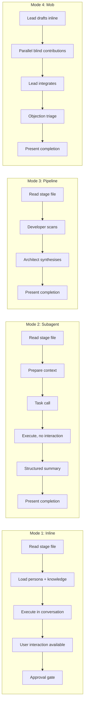
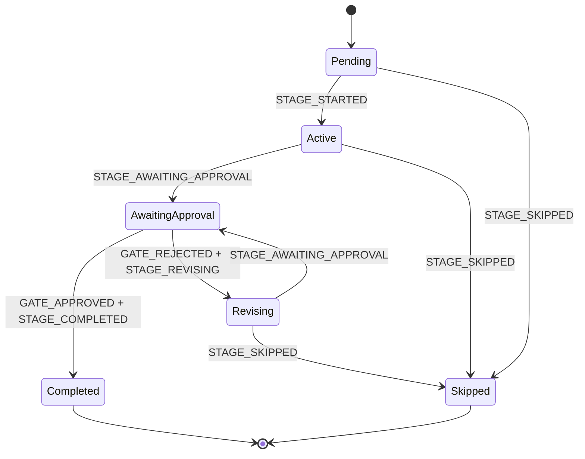

+++
date = '2026-10-14T12:10:00+10:00'
draft = false
title = 'AI-DLC Developer Reference'
tags = ['AI-DLC', 'AI', 'Agentic', 'Software Engineering', 'Methodology', 'Developer Reference', 'AWS', 'Orchestration']
summary = 'A complete guide to the code behind AI-DLC: the 5-layer architecture, the plane split, the orchestrator and its state machine, the stage protocol and definition, the agent, knowledge, rule and sensor systems, hooks and CLI tools, the compile pipeline and runtime graph, the engine and skill system, plugins, supply-chain security, commit provenance, the test suite and how to contribute.'
+++

# AI-DLC Developer Reference: Changing the Framework Itself

> Part of the AI-DLC series. [User Guide](https://github.com/awslabs/aidlc-workflows/tree/main/docs/guide/) → build with AI-DLC. [Harness Engineer Guide]() → reshape how AI-DLC behaves through configuration. **This guide** → change AI-DLC's code: the orchestrator, hooks, CLI tools, the compile pipeline and the test suite.

AI-DLC is one hand-authored, harness-neutral core that ships to many harnesses (Claude Code, Kiro CLI, Kiro IDE, Codex CLI, Cursor, opencode and GitHub Copilot). The [Harness Engineer Guide]() shows how to reshape it with data — stages, agents, scopes, rules, sensors, knowledge. This guide is the layer beneath that: the **code** that reads that data, and how to change it.

Where the harness engineer edits Markdown with YAML frontmatter and JSON, the developer edits TypeScript — the orchestrator, the hooks, the CLI tools, the stage-graph compile pipeline, the audit taxonomy and the test suite. This post folds the whole Developer Reference into one narrative, chapter by chapter, so the boundary between a data edit and a code change is always in view.

## How to Read This Reference

This reference documents the internal architecture and implementation of AI-DLC. It is meant for contributors changing the AI-DLC codebase itself: the orchestrator, hooks, CLI tools, the stage-graph compile pipeline, the audit taxonomy and the test suite.

If you are **using** AI-DLC to build software, the [User Guide](https://github.com/awslabs/aidlc-workflows/tree/main/docs/guide/) is your starting point. If you are **reshaping how AI-DLC behaves** through configuration — adding a stage or an agent, defining a scope, authoring rules and sensors, adding team knowledge — the [Harness Engineer Guide]() is the place to begin; those are data changes, not code changes, and its chapters narrate the workflow before pointing back here for the exhaustive schema.

### The four path conventions

AI-DLC is authored once and generated per harness, so a file is named by one of four conventions, by intent:

- **`core/…`** — the hand-authored, harness-neutral **source of truth** (for example `core/tools/aidlc-orchestrate.ts`, `core/aidlc-common/stages/`). This is where you edit. When a path names where a file is *authored* or *changed*, it is a `core/` path.
- **`dist/<harness>/...`** — an **ignored local generated** source/development and manual-copy projection (`dist/claude/.claude/`, `dist/kiro/.kiro/`, `dist/kiro-ide/.kiro/`, `dist/codex/`, `dist/cursor/`, `dist/opencode/`, `dist/copilot/`). Never hand-edited or committed; materialized by `bun scripts/package.ts`. Releases carry it under `runtime/<harness>/` inside the Bun-shaped `aidlc-copy-runtime-X.Y.Z.tar.gz`.
- **`dist-release/<harness>/…`** — the corresponding ignored native projection. Releases carry it under `runtime/<harness>/` inside `aidlc-runtime-X.Y.Z.tar.gz`, which the native installers and lifecycle commands consume.
- **`<harness-dir>/...`** (for example `.claude/`, `.kiro/`, `.codex/`) — the **runtime** location inside an *installed* project, where commands run and the framework reads and writes during a workflow (`aidlc engine graph compile`, `loadAgents()` reading `.claude/agents/`). The directory is a parameter of the harness.

Where this reference shows a bare `.claude/` path, read it as the runtime location for the Claude harness specifically; the same file is authored in `core/` and ships to each harness's own directory.

### What this reference covers

The chapters follow the reference's own order:

| Section | Chapter |
|---|---|
| §2 | Architecture: the 5-layer model, the configuration-layers routing principle, the execution model, design decisions |
| §3 | Plane Architecture: the control / data / management plane separation and its boundaries |
| §4 | Orchestrator: the `SKILL.md` conductor, the forwarding loop, the gate ritual, the state machine it drives |
| §5 | Stage Protocol: the behavioral contract, approval gates, the compliance checklist |
| §6 | Stages: per-phase stage documentation |
| §7 | Agent System: agent structure, frontmatter contract, the configuration matrix |
| §8 | Hooks and Tools: the hook system, CLI tools, the 134-event audit taxonomy |
| §9 | Sensor System: the sensor manifest schema, PULL imports, the fire model, default severity |
| §10 | Rule System: rule file layout, scope derivation, the layer-chain resolver, conflict gates |
| §11 | Testing: the test pyramid, tiers, stubs, fixtures, the test registry |
| §12 | Knowledge System: the two-tier architecture, the DocumentKB derived catalog, loading order, templates |
| §13 | Contributing: the development workflow, the utility handler checklist, the documentation policy |
| §14 | State Machine: the workflow / phase / stage machines, the 134-event taxonomy, audit-first rules |
| §15 | Runtime Graph: the compiled `runtime-graph.json`, the data-plane mirror of the stage graph |
| §16 | Harness Primitives Mapping: how each AI-DLC concept maps to a harness's native primitives |
| §17 | Stage Definition: the YAML frontmatter contract, the three-compartment body, the compile pipeline |
| §18 | Artifact Vocabulary: naming rules, collision policy, filesystem mapping, the live registry |
| §19 | Engine and Skill System: the orchestration engine (`next`/`report`/`park`), the typed directive contract, the conductor, plural skills, scope shape, the swarm referee |
| §20 | Plugin Mechanism: the manifest, install-time composition as a real host plugin, the additive contribution seam, multi-tenant guards |
| §21 | Supply-Chain Security: release attestations, SLSA provenance, checksums, workflow hardening, installer defenses, ownership, transport |
| §22 | Commit Provenance: content-derived attribution from commits to reviewed units, `aidlc attest resolve`, `SOURCE_COMMITTED` anchors |
| §23 | Diagrams: all Mermaid diagrams in one place |
| §24 | Harness reference: the Kiro IDE hook payload |
| §25 | Examples and research: the plugin fixture and design notes |

### How to navigate

- **Where does a new concern (a rule, a methodology fact, a knowledge fact) belong?** Read [§2 configuration layers](#configuration-layers) — the two-axis model (authorship × consumption) with boundary tests routes any new concern to the correct file.
- **Adding a new stage?** Read [§5 Stage Protocol](#the-stage-protocol), then the relevant phase file in [§6](#stages-by-phase), then [§13 Contributing](#contributing).
- **Changing the stage definition format?** Read [§17 Stage Definition](#the-stage-definition) before editing any stage `.md` file. The stage file format is data-driven; the runtime reads a compiled JSON.
- **Adding or renaming an artifact?** Read [§18 Artifact Vocabulary](#the-artifact-vocabulary) — the naming rules, the stability policy (rename/removal is major, addition is minor) and `aidlc engine graph artifacts` for the live list. The registry is derived from stage files, not written.
- **Adding a new scope?** Read [§13 Contributing](#contributing). Scopes are file-authored — a scope file plus a `scopes:` tag on each member stage — no TypeScript edits required.
- **Adding a new agent?** Read [§13 Contributing](#contributing) and [§7 Agent System](#agent-system). Agents are data-driven via their `.md` frontmatter — no TypeScript edits required.
- **Working on hooks?** Read [§8 Hooks and Tools](#hooks-and-tools) and [§11 Testing](#testing).
- **Changing the orchestrator?** Read [§4 Orchestrator](#orchestrator) and [§2 Architecture](#architecture). If you are adding or modifying audit events, start with [§14 State Machine](#the-state-machine) — the drift test catches you if you do not.

### Relationship to the User Guide

The [User Guide](https://github.com/awslabs/aidlc-workflows/tree/main/docs/guide/) explains **what** AI-DLC does and **how to use it**. This Developer Reference explains **how it works** and **how to change it**. Some topics appear in both:

| Topic | User Guide | Developer Reference |
|---|---|---|
| Agents | What they do, when they appear | Frontmatter contract, how to add/modify |
| Knowledge | How to add company standards | Loading order internals, template system |
| Hooks | What gets logged | Hook implementation, audit event taxonomy |

## Architecture

The [Architecture chapter](https://github.com/awslabs/aidlc-workflows/blob/main/docs/reference/01-architecture.md) is the map of everything below. AI-DLC is one hand-authored core projected into seven harnesses, so every path question has two answers: where a file is authored (`core/`) and where it lands at runtime (`.claude/`, `.kiro/`, `.codex/` and so on).

### The five layers

| Layer | What it owns | Where it lives |
|---|---|---|
| **Rules** | The space memory layer: org, team and project practice, plus phase rule files and the Guard Policy | `aidlc/spaces/<space>/memory/`, reached through a `rules/aidlc.md` @-import stub |
| **Agents** | Fourteen flat persona files: 11 domain experts, 2 review-only agents, 1 composer | `core/agents/*.md` |
| **Knowledge** | Two-tier methodology reference: shared principles plus per-agent methodology | `knowledge/aidlc-shared/`, `knowledge/aidlc-<agent>-agent/` |
| **Skills** | The conductor, the protocol modules and the 33 stage files | `skills/aidlc/` |
| **Hooks** | Audit emission, session lifecycle, state sync and validation, subagent tracking, statusline | `core/hooks/*.ts` |

Each layer answers a different question: rules say what must always be true; agents say who does the work; knowledge says what the worker knows; skills say what runs and in what order; hooks say what gets recorded while it runs.

### Configuration layers

Configuration partitions along **two orthogonal axes**, not one. The first axis asks who authors a file: the framework, which ships the same content to every project, or the team, which writes project-specific content that persists across workflows. The second axis asks when the file is consumed: continuously, loaded at session start, or per workflow, produced by a stage and read by later stages.

The four quadrants are mostly populated:

| | Framework-authored | Team-authored |
|---|---|---|
| **Continuous** | `skills/`, `agents/`, `knowledge/`, `memory/org.md`, `phases/*.md`, `scopes/`, `stage-graph.json` | `memory/team.md`, `memory/project.md` |
| **Per workflow** | *(empty by design)* | `aidlc-state.md`, `audit/` shards, `<phase>/<stage>/*.md`, Bolt worktrees |

The empty quadrant is the routing rule's signature, not a gap. A per-workflow framework output would have to ship with the distribution, which makes it framework-authored harness configuration.

Two boundary tests route any new concern. Ask whether the content is identical for every project, then ask whether it is loaded into agent context every session or read only by specific stages. The answers place the file. A squash-merge preference belongs in `memory/team.md`; a `Result<T,E>` convention belongs in `memory/project.md`; this run's requirements analysis belongs in the intent record.

The one sanctioned promotion across rows is Practices Discovery (Inception 2.2), which writes a per-workflow artifact, then copies affirmed content into `memory/team.md` and `memory/project.md`. It is allowed only when the output is constitutive truth, the truth affects every future run and the team is willing to author it.

### Execution models

Execution is hybrid by design. Inline stages run in the conductor's own conversation, so the person can answer mid-stage. Dispatched stages run in a subagent, so a fresh context can work autonomously. The shipped graph is **29 inline, 2 subagent, 1 pipeline, 1 mob**:

- **Inline (29):** all 3 Initialization stages, all 7 Ideation stages, six Inception stages, six Construction stages and all Operation stages. Build and Test runs once after all Units, not per Unit.
- **Subagent (2):** Practices Discovery (`mode: subagent`, hub-and-spoke) and Code Generation (focused developer subagent; the plan step before approval stays inline).
- **Pipeline (1):** Reverse Engineering, a two-link chain where the developer scans and the architect synthesises.
- **Mob (1):** User Stories, with a product lead draft and design, developer and quality contribution rounds.

The rationale is explicit: a pure-subagent model would prevent mid-stage user interaction, and a pure-inline model would not benefit from focused specialisation or independent perspectives. With collaborators off, which is every shipped scope except `enterprise`, the three multi-agent stages run their lead agent alone.

### Source versus distribution

`core/` is hand-authored and harness-neutral. Prose uses the `{{HARNESS_DIR}}` token. `harness/<name>/` holds each CLI's surface: a `manifest.ts`, the orchestrator skill and harness-specific files. `bun scripts/package.ts` copies core, substitutes the token, compiles the graph, generates runners and emits both channels.

| Path | Role | Committed |
|---|---|---|
| `core/` | Source of truth | Yes |
| `harness/<name>/` | Per-harness surface | Yes |
| `plugins/<name>/` | Plugin source | Yes |
| `dist/<harness>/` | Ignored local projection for development, runs TypeScript through Bun | No |
| `dist-release/<harness>/` | Ignored native projection, routes through the compiled `aidlc` binary | No |

`bun scripts/package.ts --check` builds the complete projection set twice in independent temporary roots and byte-compares the results. That determinism guard is the build gate; there is no committed compiled file to diff.

### Key design decisions

| Decision | Why |
|---|---|
| Hybrid inline and dispatched topologies | Interaction for most stages, specialisation where it pays |
| Agent personas for inline stages | Domain framing without subagent context transfer |
| Two-link Reverse Engineering pipeline | The conductor acts as the bus because subagents cannot spawn subagents |
| State tracked in `aidlc-state.md` | One markdown file the engine routes from; stage prose never edits checkboxes |
| Stage protocol as a shared contract | All 33 stages share gates and completion messages without loading rare-path modules |
| Two-tier knowledge | Framework upgrades stay separate from team customisation |
| Flat agent files | Agents stay discoverable |
| Scope-driven depth | Eleven scopes select which stages run |
| Rules stay method, not reference | Rules are always loaded, so they must not bloat every conversation |
| No nested delegation | The conductor performs every agent call, which keeps the delegation graph flat |

## Plane Architecture

The [Plane Architecture chapter](https://github.com/awslabs/aidlc-workflows/blob/main/docs/reference/02-plane-architecture.md) explains the design substrate. AI-DLC borrows the three-plane discipline from networking rather than inventing a framework-specific structure.

### The problem

The framework has per-stage imports of several kinds: rule files attached by filename, sensor manifests imported by id, and a hook chain. Resolving all of that inside a running workflow would put inheritance walks in the hot path. The design answer is not "make it simpler" but "compute once, then read a resolved view".

### Mapping to AI-DLC

| Networking | AI-DLC analog |
|---|---|
| Control plane (BGP, OSPF) | Stage definitions, rules and sensors — the schema of what should run |
| Data plane (flow tables, ASIC) | Stage executions, Bolts, agent invocations — the actual runs |
| Management plane (SNMP, CLI, dashboards) | `aidlc --doctor`, audit queries, `CLAUDE.md` |
| Routing protocol | Compile: reads stage frontmatter, rules and sensors, resolves pull imports, emits the graph |
| FIB loaded into the ASIC | `stage-graph.json` with per-stage `rules_in_context` and `sensors_applicable` |
| OpenFlow interface | `stage-graph.json` as the explicit contract between compile and orchestrator |
| Telemetry | Audit log, sensor firings and `memory.md` entries, aggregated into `runtime-graph.json` |
| Reactive flow install | The learning loop writing a correction into rules or sensors mid-workflow |
| Line-rate forwarding | The orchestrator reading pre-resolved fields, with no resolution walk at runtime |

### The compile boundary

Two compiled artifacts have different homes and different lifecycles.

`stage-graph.json` lives in the harness's `tools/data/` and serves every workflow in the project. It carries the stage DAG, scope routing, artifact production and the per-stage rule and sensor lists with inheritance already resolved. It changes when the framework is packaged or installed, or when its inputs change through `aidlc engine graph compile`, a saved scope or a plugin selection.

`runtime-graph.json` lives in each intent record and is rebuilt from a full event-sourced walk of the audit log on every transition-class event. Mixing the two would break cacheability: recompiling the control plane every time the data plane reports a sensor firing is exactly the cost this split avoids.

The compile resolves each stage's `phase:` field into a phase rule file and each `sensors:` id into a manifest entry. Unknown sensor ids fail the compile loudly, so a stage cannot silently fail to fire something it imports. Concurrent compiles serialise under `withAuditLock`, and the write goes to a temp file, validates, then renames atomically, so readers never see half-written JSON.

The learning loop respects the same boundary. A learning admitted mid-workflow changes source files, and already-selected rule text is re-read at each stage delivery, so the learning reaches the next stage of the same run. A brand-new rule file or a new sensor binding enters the compiled selection only at the next graph compile.

### Recovery as an emergent property

The data plane was not designed as a resume feature, but it behaves like one. A fresh session can read five sources and reconstruct enough state to continue:

| Source | Records | Read order |
|---|---|---|
| Artifact tree `<record>/<phase>/<stage>/` | The decisions in finished form | First |
| `memory.md` per stage | What was noticed while deciding | Second |
| `audit/` shards | When each decision happened and who approved it | Third |
| `aidlc-state.md` | Where the workflow is right now | Fourth |
| `runtime-graph.json` | Cross-stage summary: durations, sensor firings, learning counts | Fifth |

Artifacts come first because they are the durable record of what was agreed. The audit log is canonical for what happened, and a fresh session can detect drift between any of the five sources and reconcile against it. What recovery cannot restore is the previous session's conversational rhythm: mid-stage Q&A patterns, working hypotheses that never reached `memory.md` and tool calls interrupted mid-flight. Recovery re-orients a new session; it does not recreate the old one's mental state.

## Orchestrator

The [Orchestrator chapter](https://github.com/awslabs/aidlc-workflows/blob/main/docs/reference/03-orchestrator.md) is the longest in the reference because the orchestrator is where routing, gating and session handling meet.

### Entry points

`/aidlc` accepts an optional scope and an optional description. A description in a fresh workspace creates an intent through `aidlc-utility intent-create`, threading `--depth`, `--test-strategy`, `--project-type` and `--review`. A scope with nothing after it creates nothing; it returns a directive naming the command that would create work.

| Invocation | Effect |
|---|---|
| `/aidlc` | Continue the active workflow from its checkpoint |
| `/aidlc bugfix: Fix duplicate todos` | Create a bugfix-scoped intent with that description |
| `/aidlc --status` | Read-only phase, stage, completion percentage, pending decisions and active agent |
| `/aidlc --stage 3.5` or `--stage <slug>` | Jump forward or backward; forward jumps mark intermediate stages `[S]`, backward jumps reset downstream to `[ ]` |
| `/aidlc --depth <level>`, `--test-strategy <level>`, `--project-type <greenfield\|brownfield>` | Record a change and emit the matching audit event |
| `/aidlc compose` | Dispatch the composer to build a workflow plan |

A freeform description is stored as a question request under `aidlc/.aidlc-sessions/questions/` and answered through a `scope-confirm` or `compose-offer` directive. The orchestrator never guesses a scope from prose.

### Session management

Sessions and workflows are many-to-many. A workflow is long-lived directory state that survives across sessions; a session is one conversation. Re-entry and `--resume` both route to `next --resume`, and there is no resume menu: an existing `aidlc-state.md` resumes at the last incomplete stage.

State lives in `aidlc-state.md`, currently State Version 8, against the contract in `knowledge/aidlc-shared/state-template.md`. It carries Project Information, Scope Configuration, Workspace State, Execution Plan Summary, Runtime State, Phase Progress, Stage Progress, Unit Progress, Current Status and Session Resume Point.

Resolution precedence is layered and explicit. Session identity resolves in-process first, then `AIDLC_SESSION_OVERRIDE`, then the host's named chat variable, then PID ancestry. Space resolves from an explicit argument, then a session binding, then the `aidlc/active-space` cursor, then `default`. Intent resolves from an explicit argument, then a session binding, then the active-intent cursor, then a lone intent.

### Scope-to-stage mapping

Eleven scopes select which stages run. Membership is authored as a `scopes:` tag on each stage and transposed at compile into `tools/data/scope-grid.json`, which is authoritative.

| Scope | Stages | Depth | Test strategy |
|---|---|---|---|
| `enterprise` | 33 / 33 | Comprehensive | Comprehensive |
| `feature` | 33 / 33 | Standard | Standard |
| `workshop` | 26 / 33 | Standard | Minimal |
| `mvp` | 23 / 33 | Standard | Standard |
| `classic` | 18 / 33 | Standard | Standard |
| `infra` | 15 / 33 | Standard | Standard |
| `refactor` | 10 / 33 | Minimal | Minimal |
| `security-patch` | 10 / 33 | Minimal | Minimal |
| `express` | 10 / 33 | Minimal | Minimal |
| `bugfix` | 9 / 33 | Minimal | Minimal |
| `poc` | 8 / 33 | Minimal | Minimal |

`classic` is the implicit default when neither the person nor `AWS_AIDLC_DEFAULT_SCOPE` names a scope. Keywords on a scope are hints for the composer; no tool matches them against prose.

### Stage execution engine

The engine reads `tools/data/stage-graph.json` and emits one typed directive. Inline execution is a six-step loop: load the steering parts, read `directive.stage_file`, read `directive.consumes`, load `directive.protocol_modules`, execute the body, then follow the stage protocol for the completion message and gate.

Dispatched execution differs only in who runs the body. The conductor prepares context, calls the harness's agent mechanism and reads the structured return. Agents never invoke each other: every persona carries `disallowedTools: Task`, and Kiro's delegate allowlists exclude the subagent tool.

### Stage advancement protocol

The gate ritual has seven steps and every transition is tool-owned:

1. Verify completion. A gated stage that is missing a declared `produces` artifact is refused unless `AIDLC_SKIP_ARTIFACT_GUARD=1`.
2. Report `--result awaiting-approval`. Advisory gate checks run first, gate-bound sensors fire, the checkbox flips from `[-]` to `[?]` and `STAGE_AWAITING_APPROVAL` is emitted.
3. Present the gate through the harness's question mechanism.
4. Record the reply as `approved`, `rejected` or `revised`, with the person's exact words in `--user-input`.
5. Advance. The next stage comes from the scope grid, and a phase boundary adds `PHASE_COMPLETED`, `PHASE_VERIFIED` and `PHASE_STARTED` atomically.
6. Close the workflow when the last in-scope stage is approved, emitting `PHASE_COMPLETED`, `PHASE_VERIFIED` and `WORKFLOW_COMPLETED`.
7. Move the task tracker: previous task `completed`, current task `in_progress` with `activeForm: "Running <Stage> [<slug>]"`.

The conductor never writes a checkbox, never calls a lifecycle verb directly and never emits a stage, gate or phase event from prose. If it did, the drift test would fail.

### Task tracking

Task tracking uses the harness's task tool, not the state file. One task exists per in-scope stage, created in phase batches. Construction tasks come from the compiled graph plus the Unit DAG, not from `bolt-plan.md`, which is planning rather than a task source. After compaction the conductor recovers the tracker by subject lookup, which is why task naming is prescribed exactly.

### Deliberate deviations and error handling

The reference lists twenty places where the implementation deliberately differs from a naive reading of the design. The notable ones: six separate NFR requirement files and six NFR design files rather than one document each, question files co-located with artifacts, three Infrastructure Design files, an ADR log in `decisions.md`, no resume menu and audit writes that are tool-owned so a PreToolUse guard refuses direct shard writes.

Failure handling is halt-and-ask regardless of autonomy. A failed subagent is retried once with reduced context, then offered as inline execution or skip-and-revisit. A corrupted state file is backed up to `aidlc-state.md.bak`, rebuilt from artifact evidence and reported with the exact sentence `State file was corrupted. Rebuilt from artifacts. Please verify.` Contradictory inputs are quoted side by side and escalated, never silently resolved.

## The Stage Protocol

The [Stage Protocol chapter](https://github.com/awslabs/aidlc-workflows/blob/main/docs/reference/04-stage-protocol.md) is the behavioural contract every stage obeys. The stage *format* is a separate topic, covered in [Stage Definition](#the-stage-definition).

### Protocol file structure

The protocol is split into sixteen files under `core/aidlc-common/protocols/`. The core file loads for every stage; the rest load only when a directive names them, so rare paths cost no context on ordinary stages.

| File | Contents | Loaded when |
|---|---|---|
| `stage-protocol.md` | Gates, completion messages, question flow, state tracking, persona loading, depth, terminology, content validation | Every stage |
| `stage-protocol-recovery.md` | Error recovery and change handling | Session resume or a mid-stage change |
| `stage-protocol-governance.md` | Phase boundary verification | Boundaries 1.7→2.1, 2.9→3.1, 3.7→4.1 |
| `stage-protocol-learnings.md` | The diary, surfacing, the human question, persistence | `protocol_modules` lists `learnings` |
| `stage-protocol-reviewer.md` | Reviewer dispatch, receipts, terminal ordering | A reviewer is effective |
| `stage-protocol-reviewer-unit.md` | Unit membership, per-Unit inputs, read scope | `reviewer-unit` or any swarm |
| `stage-protocol-reviewer-repair.md` | The adversarial NOT-READY loop | `reviewer-repair`, strict policy, checkpoints |
| `stage-protocol-ensemble.md` | Ensemble topology and subagent returns | Subagent, pipeline, mob or support-agent stages |
| `stage-protocol-collaborators.md` | Contribution files, mob rounds, objection triage | `collaborators` |
| `stage-protocol-construction.md` | Construction routing, autonomy, halt-and-ask, team Units | First Construction directive and every swarm |
| `stage-protocol-checkpoint.md` | Unit and skeleton checkpoint verification | `checkpoint` |
| `stage-protocol-loopback.md` | Build-and-Test loop-back | `loopback` and every 3.5/3.6 step |
| `stage-protocol-wave.md` | Per-Unit batch waves | A step carrying `directive.wave` |
| `stage-protocol-summary.md` | Consolidated summary confirmation | `summary` |
| `stage-protocol-sensors.md` | Sensor imports and the blocking gate sensor | `sensors` |
| `stage-protocol-swarm.md` | Autonomous fan-out, batch checkpoint, convergence, finalize | Every swarm |

The conductor reads every module named by `directive.protocol_modules` before the stage body and skips modules already loaded in the session.

### The compliance checklist

Nine rules apply to all 33 stages without exception:

1. Report `awaiting-approval` through the engine. Never present a gate without the report that opened it.
2. Log non-gate decisions and answers through the log tool before and after asking, with the person's exact words.
3. After a gate reply, report `approved` or `rejected`; never use the log tool's decision or answer verb for a gate.
4. Record the choice read from the reply. Never choose or paraphrase on the person's behalf.
5. Write one audit entry per interaction and never merge several events into one call.
6. End a stage with `report --result approved --user-input "Approve"` when gated, or `--result completed` for Initialization.
7. Mark the previous task `completed` and the current task `in_progress` before work begins.
8. Use only event types from `knowledge/aidlc-shared/audit-format.md` and never write the `audit/` shards.
9. Never hand-write lifecycle events or invoke lifecycle verbs on the state tool.

### Approval gates

Every stage except the three Initialization stages has a gate. The standard gate asks `"[Stage Name] complete. How would you like to proceed?"` with `Approve` and `Request Changes`, and the next-stage label comes from `next_stage`, never from a guess. When `next_stage` is null the option reads `Complete workflow`.

Ideation and Inception add a conditional option: `Approve, and add [Skipped Stage] next`, which routes to `next --add <slug>`. The revision escape hatch counts rejections: at the second cycle the note `next-revision` appears, and from the third cycle the gate offers `Accept as-is` with the question `"[Stage Name] -- this is revision cycle [N]. How would you like to proceed?"`.

Build and Test adds a bounded loop-back into Code Generation. The loop reopens only the diagnosed Units, requires a fresh `REVIEW_COMPLETED` receipt per reopened Unit and asks for Plan Approval again.

### Completion messages

Every completion message has five mandatory parts in order:

| Part | Content |
|---|---|
| 0 | Audit logging: `awaiting-approval` before the gate, then the recorded reply |
| 1 | Announcement: `# [emoji] [Stage Name] Complete`, always an H1 with the stage's emoji |
| 2 | Summary: factual bullets, an artifact table of 5-10 rows and, on the first completion of a session, the project depth and test strategy lines |
| 3 | Review: the artifact path, then the gate, optionally with a fenced `aidlc-decisions` block |
| 4 | Progress: `Progress: [done] of [planned] stages done. Next: [Next Stage Name].` |

Part 2 carries no workflow instructions. Part 4 relays the engine's line verbatim, so the progress number always matches state.

### Question flow

Questions live in `<stage-slug>-questions.md` beside the artifacts, with `[Answer]:` tags. The agent reads an existing file before asking anything, so it never re-asks an answered question.

Three answer modes exist. **Guide Me** batches questions through the harness tool, with a maximum of four questions and four options on Claude Code. **Edit File** asks the person to edit the questions file and reply `done` or `ready`. **Chat** collects answers conversationally and ends with `say **done** and I'll summarize`.

Every ordinary question ends with `X. Other (please specify)`. The consolidated summary confirmation is the sole unlettered exception, offering `Looks correct` and `Request changes`. Questions are grouped by answering trade, and follow-ups take the next unused number; existing files are never reordered.

Answer analysis is deliberately conservative. Vague answers such as "mix of", "not sure", "depends" and "probably" trigger follow-ups, contradictions are presented side by side and the protocol states the rule plainly: **when in doubt, ask**.

### State tracking and persona loading

The six checkbox states are `[ ]` not started, `[-]` in progress, `[?]` awaiting approval, `[R]` revising, `[x]` completed and `[S]` skipped. `[?]` and `[R]` exist because both would otherwise look like `[-]`, and they tell a resumed session whether to present an artifact or revise it.

Timestamps come from `aidlc engine now`, never from a date-only guess. Audit rows are append-only: the agent may add a note through `audit append-raw` with a heading such as `Error:`, `Recovery:` or `Change Request:`, but may never edit or delete a record.

Persona loading follows a strict six-step order: rules, framework shared knowledge, framework agent methodology, team shared knowledge, team agent knowledge, then prior stage artifacts. Inline stages read `lead_persona` plus every `inline_context_paths` entry and show `context_warnings` verbatim. Dispatched stages paste the rule bundle into the brief; if the chat already holds it, the directive sets `rules_held` and the brief names the stage file instead.

### Error recovery and change handling

Recovery reads sources in a fixed order: finished artifacts, then the stage `memory.md`, then the audit timeline, then the state documents, then `runtime-graph.json`. Disagreement is reconciled against the audit log, which is canonical.

Changes fall into five categories with different blast radii. Minor changes touch the current stage only. Major changes require impact analysis and re-running prior stages through directives. Scope changes return to Requirements Analysis or Delivery Planning. Unit changes add, remove or split a Unit. Architectural changes return to Domain Design. Every change archives the affected directory into `<record>/archive/<ISO-date>-<stage-name>/` first.

### Depth guidance

Depth is not a label; it changes what a stage produces. Minimal produces 5-10 requirements with brief NFRs and a single component diagram. Standard produces 15-30 requirements with acceptance criteria, 2-3 ADRs and entity lifecycles. Comprehensive produces 30+ requirements, multi-layer diagrams, 5+ ADRs with alternatives, decision trees, state machines, concurrency analysis and error recovery design.

## Stages by Phase

The [Stages chapter](https://github.com/awslabs/aidlc-workflows/tree/main/docs/reference/04-stages) documents all 33 stages across five phases. Numbers are display order; slugs are identity.

### Initialization

Three stages, all `ALWAYS`, all inline and all deterministic inside `aidlc-utility intent-create`. None has a gate, because nothing has been produced for a person to review yet.

| # | Stage | What it produces |
|---|---|---|
| 0.1 | Workspace Scaffold | The intent record, one artifact directory per in-scope phase, `verification/`, space `knowledge/` and `codekb/` parents, the audit shard |
| 0.2 | Workspace Detection | Greenfield or brownfield classification, languages, frameworks, build system; symlinks are not followed |
| 0.3 | State Initialization | `aidlc-state.md` with scope, depth and test strategy applied; Reverse Engineering marked `[S]` on greenfield |

### Ideation

Seven stages. All inline.

| # | Stage | Execution | Lead agent |
|---|---|---|---|
| 1.1 | Intent Capture & Framing | ALWAYS | `aidlc-product-agent` |
| 1.2 | Market Research & Competitive Analysis | CONDITIONAL | product |
| 1.3 | Feasibility & Constraint Analysis | CONDITIONAL | `aidlc-architect-agent` |
| 1.4 | Scope Definition & Prioritization | ALWAYS | product |
| 1.5 | Team Formation & Mob Planning | CONDITIONAL | `aidlc-delivery-agent` |
| 1.6 | Rough Mockups & Concept Visualization | CONDITIONAL | `aidlc-design-agent` |
| 1.7 | Initiative Approval & Handoff | ALWAYS | delivery |

Stage 1.7 runs the first phase boundary verification and the go/no-go gate.

### Inception

Nine stages, including the only pipeline and the only mob.

| # | Stage | Execution | Mode |
|---|---|---|---|
| 2.1 | Reverse Engineering | CONDITIONAL (brownfield) | pipeline, developer → architect, 9 artifacts |
| 2.2 | Practices Discovery | CONDITIONAL | subagent, hub-and-spoke |
| 2.3 | Requirements Analysis | ALWAYS | inline |
| 2.4 | User Stories | CONDITIONAL | mob |
| 2.5 | Refined Mockups & UX Design | CONDITIONAL | inline |
| 2.6 | Domain Design | CONDITIONAL | inline |
| 2.7 | Units Generation | ALWAYS | inline, produces the Unit DAG |
| 2.8 | Contract Design | CONDITIONAL | inline |
| 2.9 | Delivery Planning | ALWAYS | inline, the capstone |

Reverse Engineering writes nine artifacts to `codekb/<repo>/`, which is space-level and durable across intents. Its rerun guard checks the repo scope and working-tree fingerprint before offering reuse or rescan.

### Construction

Seven stages. Stages 3.1-3.5 run per Unit; 3.6 and 3.7 run once across all Units.

| # | Stage | Execution | Notes |
|---|---|---|---|
| 3.1 | Functional Design | CONDITIONAL, per Unit | `functional-spec.md`, `rules.md`, `entities.md`, `traceability.json` |
| 3.2 | NFR Requirements | CONDITIONAL, per Unit | Performance, security, scalability, reliability, observability |
| 3.3 | NFR Design | CONDITIONAL, per Unit | Requirements turned into patterns |
| 3.4 | Infrastructure Design | CONDITIONAL, per Unit | Infrastructure, monitoring, CI/CD |
| 3.5 | Code Generation | ALWAYS, per Unit | Subagent; the only stage declaring `workspace_requires: true` |
| 3.6 | Build and Test | ALWAYS, once | Cross-Unit test instructions, executes build and tests |
| 3.7 | CI Pipeline | CONDITIONAL, once | CI quality gates and artifact management |

### Operation

Seven stages, all `CONDITIONAL` and all inline. Stage 4.7 is the workflow's final stage.

| # | Stage | What it covers |
|---|---|---|
| 4.1 | Deployment Pipeline Configuration | CD pipeline, deployment strategy, rollback, promotion gates |
| 4.2 | Environment Provisioning | IaC provisioning and validation; runs `aws sts get-caller-identity` first on AWS targets |
| 4.3 | Deployment Execution | Artifact push, smoke tests, health checks, migrations |
| 4.4 | Observability Setup | Monitoring, dashboards, alarms, SLOs, tracing |
| 4.5 | Incident Response & Runbook Generation | Runbooks, escalation, response plans |
| 4.6 | Performance Validation & Load Testing | Load tests against the deployed application and the NFR targets |
| 4.7 | Continuous Feedback & Optimization | SLO compliance, cost, drift, operational insights |

## Agent System

The [Agent System chapter](https://github.com/awslabs/aidlc-workflows/blob/main/docs/reference/05-agent-system.md) covers the fourteen personas. Agents are data: a Markdown file with YAML frontmatter and four fixed body sections.

### Agent structure and frontmatter

Every agent is a flat `.md` file in `core/agents/`. The frontmatter is a small contract:

| Field | Required | Meaning |
|---|---|---|
| `name` | Yes | Identifier; must match the filename stem |
| `display_name` | Yes | Human-facing name shown in the statusline |
| `description` | Yes | One-line role summary |
| `tier` | Yes | `judgment`, `balanced` or `templated`; the authored dial |
| `disallowedTools` | Yes in core | Must include `Task`, because only the conductor delegates |
| `tools` | No | Optional allowlist; omitting it inherits the full session toolset |
| `examples` | No | Suggested knowledge file names for the agent's team folder |

Raw `model:` and `effort:` never appear in authored frontmatter. They are projection outputs, written into the ignored `dist/` trees by the packager from the tier table in `core/tools/aidlc-tiers.ts`.

The body has four fixed sections: **Core Responsibilities**, **Collaboration** (Receives from, Works with, Hands off to), **Memory Focus** and **Key Principles**.

### Tiers and the configuration matrix

| Tier | Agents | Claude projection |
|---|---|---|
| `judgment` | 9, including architect, product, developer, quality, devsecops, compliance, aws-platform, design and composer | `model: inherit`, no `effort:` |
| `balanced` | 2 reviewers: architecture-reviewer and product-lead | `model: sonnet`, `effort: medium` |
| `templated` | 3: delivery, pipeline-deploy, operations | `model: inherit`, no `effort:` |

Omission is the inherit mechanism. A pinned `effort:` is a cap, not a floor, so a per-agent downgrade never silently raises another agent's effort. Kiro and Cursor never pin a model, because an unresolvable model id breaks the install and Cursor availability depends on the plan. A `tier_cap:` in the memory layers, or `AIDLC_TIER_CAP` for one packager run, lowers or raises the ceiling.

The eleven domain agents differ mainly in expected tool use. Six are expected to run Bash: aws-platform, devsecops, developer, quality, pipeline-deploy and operations. Three are expected to use WebSearch: product, design and compliance. Compliance is advisory only, with no lead stage.

### Phase participation

The architect is the broadest participant: lead on Domain Design, Units Generation, Contract Design, Functional Design, NFR Requirements and NFR Design, and support on Reverse Engineering and Delivery Planning. Product leads the front of Ideation and Requirements Analysis. Developer leads Reverse Engineering and Code Generation. Quality leads Build and Test and Performance Validation. Pipeline-deploy leads Practices Discovery, CI Pipeline, Deployment Pipeline and Deployment Execution. Operations leads the last three Operation stages and appears in no earlier phase.

### Adding or modifying an agent

Adding an agent is a data change with no TypeScript edits:

1. Create `core/agents/<name>-agent.md` with the required frontmatter.
2. Add knowledge files to `core/knowledge/<name>-agent/`.
3. Reference the agent from stage files through `lead_agent` or `support_agents`.
4. Run `bun scripts/package.ts`, then `--check`.
5. Add the knowledge-table row for the team folder.
6. Add smoke tests for file existence and cross-reference tests.
7. Update `05-agent-system.md` and `docs/reference/agents/`.

One host-sharing rule matters in practice. The installed agents directory is shared with the host, so a file counts as an AI-DLC persona only when its name starts with `aidlc-` or its frontmatter carries `display_name`, `examples`, `tier` or `plugin`. Any such file must carry `name` and `display_name`. Other files are the host's own agents and are never loaded as stage personas.

Modifying an agent follows the same paths: edit `tools:` to narrow the toolset, edit `tier:` and regenerate, edit the body for behaviour, or edit `lead_agent` and `support_agents` in stage files for assignment.

## Hooks and Tools

The [Hooks and Tools chapter](https://github.com/awslabs/aidlc-workflows/blob/main/docs/reference/06-hooks-and-tools.md) covers seventeen hook scripts, the audit taxonomy and the CLI tools.

### Hook system architecture

All seventeen hooks are project-wide. Sixteen register in the `hooks` block of `settings.json`; the statusline registers under the top-level `statusLine` key. Version 0.6.0 moved six skill-scoped hooks into `settings.json` so every entry point inherits the spine without a per-runner `hooks:` block.

Eleven hooks are advisory and six alter the flow:

| Hook | Event | Effect |
|---|---|---|
| `continue-workflow` | `Stop` | Blocks the turn while a directive is pending |
| `deliver-stage-rules` | `PreToolUse`/`PostToolUse` on `Task\|Agent`, `SubagentStart` | Rewrites subagent inputs so the rule bundle reaches the worker |
| `plan-approval-guard` | `PreToolUse` on `Task\|Agent\|Edit\|Write\|Bash` | Refuses generation before Plan Approval |
| `state-transition-guard` | `PreToolUse` on write and Bash tools | Refuses hand-written lifecycle events |
| `reviewer-scope` | `PreToolUse` on read, write and search tools | Keeps the reviewer inside its read scope |
| `review-freeze` | `PreToolUse` on read, write and search tools | Freezes reviewed artifacts against post-review edits |

The other eleven handle audit writes, sensor runs, state sync, graph rebuild, usage folding, compaction validation, subagent logging, session start and end, human-turn recording and statusline rendering.

The four PreToolUse guards register as **one** group, `guard-tool-call`, and self-filter by tool name. Before that change each guard was its own registration, which meant four processes per shell call and up to nine engine loads; on small machines that reached gigabytes of memory mid-stage.

Hooks write heartbeats to `.aidlc-engine/hooks-health/<hook>.last`, which is how `aidlc --doctor` detects a hook that stopped firing. Hook stdout is capped at roughly 10 KB per harness, and directive transport is capped at 28 KiB.

### The audit event taxonomy

The taxonomy is defined in `knowledge/aidlc-shared/audit-format.md` and holds **134 event types**, grouped into 20 presentational categories in the reference and split into 27 in the canonical registry. The grouping is presentational; the event set is the invariant.

| Group | Count | Examples |
|---|---|---|
| Session | 20 | `SESSION_STARTED`, `SESSION_RESUMED`, `SESSION_COMPACTED`, `HUMAN_TURN` |
| User interaction | 17 | `DECISION_RECORDED`, `QUESTION_ASKED`, `QUESTION_ANSWERED`, `GATE_APPROVED` |
| Scope and configuration | 16 | `SCOPE_CHANGED`, `DEPTH_CHANGED`, `RECOMPOSED`, `PLUGIN_SELECTION_CHANGED` |
| Workflow lifecycle | 9 | `WORKFLOW_STARTED`, `WORKFLOW_COMPLETED`, `WORKFLOW_PARKED` |
| Stage lifecycle | 9 | `STAGE_STARTED`, `STAGE_COMPLETED`, `STAGE_SKIPPED` |
| Swarm | 9 | `SWARM_STARTED`, `SWARM_UNIT_CONVERGED`, `SWARM_SOURCE_MERGED` |
| Worktree | 7 | `STATE_FORKED`, `STATE_MERGED`, `AUDIT_MERGED` |
| Sensors | 6 | `SENSOR_FIRED`, `SENSOR_PASSED`, `SENSOR_FAILED` |

Names are `SCREAMING_SNAKE_CASE` in `NOUN_VERB` form. Every event is tool-owned or hook-owned; none is appended from prose. Retired names stay registered and readable, such as `CHANGE_CONTROL_SET`, which `GUARD_POLICY_SET` replaced.

Drift between the documentation and the code is enforced by `tests/integration/t48-audit-event-emitters.test.ts`, which checks forward, reverse and pairing consistency. That test is why adding an event without an emitter fails the build.

### CLI tools

Tools dispatch through `aidlc engine <noun> <verb>`. In a source tree `{{INVOKE}}` expands to `bun <harness-dir>/tools/aidlc.ts`; in a native install it expands to `aidlc`.

| Tool | Purpose | Key verbs |
|---|---|---|
| `aidlc-utility.ts` | Deterministic workspace and intent operations, no LLM | `intent-create`, `intent`, `space`, `doctor`, `recompose`, `scope-change`, `detect`, `codekb-*` |
| `aidlc-plugin.ts` | Plugin inventory, selection and sync | `plugin list`, `plugin sync`, `plugin select` |
| `aidlc-transaction.ts` | Shared commit engine for install and lifecycle mutations | Library: staged plans, expected state, rollback |
| `aidlc-sensor.ts` | Sensor dispatch | `fire`, `list`, `describe` |
| `aidlc-learnings.ts` | Learning-loop surface and persist | `surface`, `persist` |
| `aidlc-runtime.ts` | Runtime graph | `compile`, `read`, `summary`, `fragment-fork`, `fragment-merge` |
| `aidlc-knowledge.ts` | DocumentKB catalog | `onboard`, `sync`, `list`, `show`, `summarize` |
| `aidlc-attest.ts` | Commit provenance | `resolve`, `anchor` |

The transaction tool exists because install-time mutations span many files. A plan is root-relative, non-overlapping, carries the expected destination state and source hashes, and applies under a lock with rollback and recovery-evidence quarantine.

### Token usage and cost tracking

Usage tracking is off by default in general, but on by default on Claude Code, where a transcript reader folds token and cost data into a gitignored ledger at `aidlc/.aidlc-sessions/usage-ledger.json`. The statusline shows `↑<in> ↓<out> $<usd>`, and `STAGE_COMPLETED` and `WORKFLOW_COMPLETED` gain usage fields without adding event types.

Only Claude Code wires a producer. Kiro, Codex, opencode, Copilot and Cursor write no ledger, so every consumer degrades silently to no data. Rates live in `aidlc-usage.ts`, then a shipped `model-rates.json`, then `$AIDLC_MODEL_RATES`, each layer overlaying the previous one.

## Sensor System

The [Sensor System chapter](https://github.com/awslabs/aidlc-workflows/blob/main/docs/reference/07-sensor-system.md) documents deterministic checks bound to stages. A sensor is a manifest plus a command, and the dispatcher owns the invocation.

### Manifest location and filename

Manifests live in `<harness-dir>/sensors/aidlc-<id>.md`. The `aidlc-` prefix is mandatory for every sensor, including custom ones, and `id` must equal the filename stem minus the prefix. Discovery uses `/^aidlc-([a-z][a-z0-9-]*)\.md$/`; an unprefixed file is silently skipped and never binds.

One parser gotcha is worth knowing: a `#` comment after a top-level value becomes part of the value, so `id: demo-check   # required` fails to load.

### Manifest schema

| Field | Required | Values |
|---|---|---|
| `id` | Yes | Kebab-case; equals the stem minus `aidlc-` |
| `kind` | Yes | `deterministic` (the only accepted value) |
| `command` | Yes | The canonical invocation prefix, not a full argv |
| `default_severity` | Yes | `advisory` or `blocking` |
| `description` | Yes | One line |
| `category` | No | Free-form, such as `document-provenance`, `document-shape` or `code-quality` |
| `fire_on` | No | `write` (default) or `gate` |
| `matches` | No | Glob filter consumed at dispatch |
| `input_schema` | No | Type hints; `file_path` selects `--file-path`, any other key selects `--output-path` |
| `output_schema` | No | Advisory contract for future LLM parsing |
| `timeout_seconds` | No | Integer; omitted means 1200 |

`kind` accepts exactly one value. Any other value is refused at parse time, including `llm`, because other kinds are reserved for future releases. Forward compatibility covers unknown *keys*, not unknown *values* of known keys.

### Pull imports

Stages import sensors by id in their own frontmatter: `sensors: [required-sections, upstream-coverage, linter, type-check]`. There is no `applies_to:` reverse binding. At compile the resolver parses every manifest, indexes by id, looks up each stage's ids and **throws on an unknown id**, so a typo fails the compile rather than silently disabling a check. It then copies `fire_on`, `default_severity`, `category` and `matches` into the stage node's `sensors_applicable` array.

The runtime reads that array. Only `command`, `input_schema`, `timeout_seconds` and the sensor's own `matches` are re-read per fire, which means a new import or a severity change waits for the next compile.

The per-stage matrix is deliberate. The three Initialization stages import nothing. Intent Capture imports `claim-sources`, `required-sections` and `upstream-coverage`. Most document stages import `required-sections` and `upstream-coverage`, the design stages add `traceability`, Build and Test swaps `linter` for `type-check` because the build already runs the canonical lint, and CI Pipeline imports all four.

### `matches`, severity and `fire_on`

`matches` is a sensor-side capability filter. `claim-sources` matches `**/{aidlc-docs,intents}/**`, `traceability` matches `**/traceability.json`, `linter` matches `**/*.{ts,js}` and `type-check` matches `**/*.{ts,tsx}`. The glob is also the write-time fire filter, so a write-fired sensor with no glob never fires.

`advisory` sensors write audit rows and never block. Advisory gate checks run once at hand-off and return the step with a `print` directive on findings. `blocking` sensors allow the gate only on a verified pass, and every failure mode blocks: reported findings, a dispatcher error, a malformed verdict, `SENSOR_BUDGET_OVERRIDE`, `SENSOR_COULD_NOT_RUN` and a pass carrying a note.

Overriding a blocking sensor is a ritual, not a flag. The person picks `Override blocking sensors` from a decision, the choice is recorded as an exact `QUESTION_ANSWERED`, and only then does a retry with `--override-blocking-sensors --user-input "Override blocking sensors"` proceed. A bare flag, a paraphrase, a missing human receipt or autonomous mode is refused.

`fire_on: write` gives incremental feedback after each write. `fire_on: gate` runs once per existing declared deliverable immediately before the gate opens, before a revision re-enters and before the approve-time revision backstop.

### The `command:` contract and findings

`command:` is a prefix. The dispatcher appends `--stage <slug>` and then either `--file-path` or `--output-path`. A code sensor must declare `input_schema: {file_path: string}` or it receives `--output-path` instead.

The worker prints one JSON line with a boolean `pass`, plus optional `findings` and `findings_count`, and exits 0 on pass. Exit 127 is recorded as a pass noted `tool-unavailable`. A missing process, another non-zero exit or a missing boolean `pass` records `SENSOR_COULD_NOT_RUN` with a `script-error` note, never a pass. Findings are written to a fresh detail file at `<record>/.aidlc-engine/sensors/<stage>/<sensor>-<fire-id>.md`.

### The six shipped sensors

| Sensor | Checks | Severity | Fire |
|---|---|---|---|
| `claim-sources` | Visible provenance, authoritative source-register values, confirmed assumptions | Blocking | Write |
| `required-sections` | The stage output carries its required H2 headings | Advisory | Gate |
| `upstream-coverage` | Each output folder covers its upstream inputs | Advisory | Gate |
| `traceability` | Requirement ids resolve, with `GAP` rows for missing upstream ids | Blocking | Gate |
| `linter` | The project's configured linter over TS and JS outputs | Advisory | Write |
| `type-check` | The TypeScript compiler over TS and TSX outputs | Blocking | Write |

The learning loop can scaffold a new sensor for you. When a kept correction is better expressed as a check, `persist` writes a project-tier manifest with `id`, `kind`, `command`, `default_severity`, `description` and `matches`, then appends the id to the originating stage's `sensors:` list in the same locked transaction. That frontmatter append is the only sanctioned stage-frontmatter edit, and it only grows the import list.

## Rule System

The [Rule System chapter](https://github.com/awslabs/aidlc-workflows/blob/main/docs/reference/08-rule-system.md) is short because the design is small: rules are prose files in the active space's memory layer.

### Layout and filename-derived scope

| File | Scope | Applies to |
|---|---|---|
| `memory/org.md` | org | Every stage, every workflow |
| `memory/team.md` | team | Every stage, every workflow |
| `memory/project.md` | project | Every stage, every workflow |
| `memory/phases/<phase>.md` | phase | Stages declaring that `phase:` |

There is no `scope:` frontmatter. The filename is the scope, and a phase rule attaches because the stage declares `phase: <name>`. A future stage-level rule would attach by slug.

Every harness reads the same files through a different carrier: an `@`-import stub on Claude Code, agent resources on Kiro CLI, always-included steering on Kiro IDE, per-step delivery on Codex, an always-applied `.cursor/rules/aidlc.mdc` on Cursor, an `instructions` glob on opencode and `AGENTS.md` imports on Copilot.

### Five-layer inheritance

The chain is `org → team → project → phase → stage`. Org carries framework defaults and team and project extend them. Phase is orthogonal because it attaches by phase rather than by directory. Compile bakes the resolved chain into each stage node's `rules_in_context`, so runtime never walks the chain.

The model is **strict-additive**: every applicable rule appears, and nothing is dropped by a narrower layer. There is no override mechanism at runtime, which is why conflicts are caught before they are written rather than resolved later.

### Delivery and `pairing:`

Rule text ships as `rules_content` on `run-stage` when it fits. When it does not fit, it arrives through bounded `load-steering` directives; when the chat already holds the bundle, `run-stage` names `rules_held` and carries no text. There is no size-based fallback path, and delivery repeats at every stage.

`pairing:` links a rule to a sensor manifest by file stem, for example `pairing: aidlc-required-sections`. The explicit value `pairing: feedforward-only` declares that no sensor companion exists. Any other value that does not start with `aidlc-` is refused when the rule loads.

### Lifecycle fields and drift

`status` accepts `active`, `deprecated` or `draft`, and `stale_after` accepts a real `YYYY-MM-DD` date. A file is stale only when the current UTC date is strictly greater than that date, so the named day stays live. Both fields are file-level and optional, and an invalid value stops rule loading with an error naming the file.

Lifecycle removes nothing from the runtime bundle. It only suppresses overlaps in the doctor's reporting.

`aidlc --doctor` reports two advisory rows, both read-only and both without changing the exit code. **Rule drift** finds `##` headings in `team.md` or `project.md` that also appear under a populated `org.md` heading and shows the file, section and first org sentence. **Paired sensor coverage** reports `P: P/(M-X) guardrails paired (X feedforward-only)`, which is a file-existence check rather than a semantic one.

## Testing

The [Testing chapter](https://github.com/awslabs/aidlc-workflows/blob/main/docs/reference/09-testing.md) describes a suite that is entirely TypeScript: every test is a `t*.test.ts` file run under Bun, and there are no shell test files, so platform invariance holds by construction.

### The three layers

| Layer | Directories | LLM | Time | Command |
|---|---|---|---|---|
| **L1 Protocol** | `tests/smoke/`, `tests/unit/`, part of `tests/integration/` | No | Seconds | `bun tests/run-tests.ts --no-llm` |
| **L2 Stage** | `tests/integration/` | Yes | Minutes | `bun tests/run-tests.ts --ci` |
| **L3 Acceptance** | `tests/e2e/` | Yes | Hours | `bun tests/run-tests.ts --release` |

L1 verifies file existence, permissions and naming, exercises all 17 hook sources through copy and native dispatch, validates stage frontmatter, checks the knowledge inventory, and covers scope-stage mapping, graph consistency and stage input-output contract chains. It also owns the scope runs, scope-host runs and guard matrix, which run only when selected by `--filter` or by `--release`.

L2 runs a preflight health gate, then exercises CLI utility handlers and individual stages against greenfield and brownfield stubs with artifact verification. L3 runs full bugfix and POC lifecycles and asserts state progression, scope routing, audit completeness, jump mechanics and semantic quality of stage instructions.

Without a flag the runner executes smoke, unit and integration. `--ci` is the same set. `--release` and `--all` add e2e.

### Preflight and the test registry

Before any unfiltered live-capable level, the runner executes `tests/integration/t19.test.ts` as a gate. That test drives a real turn through the Claude Agent SDK and asserts `aws sts get-caller-identity` succeeds, a result event arrives, `is_error` is false and some output was captured. A skipped preflight closes the gate without failing a default run, but `AIDLC_CLAUDE_SDK_LIVE=1`, `AIDLC_TUI_LIVE=1` or `--require-coverage` demand complete non-skipped evidence. A real failure fails the run in every mode.

Tests are discovered, not registered. The runner walks `tests/{smoke,unit,integration,e2e}/` and runs every matching file. A `covers:` header on line one feeds `tests/gen-coverage-registry.ts`, which enumerates units across seven classes: `function`, `audit`, `scope`, `stage`, `hook`, `subcommand` and `render-surface`. The registry is gitignored and CI runs `--check --base HEAD^1`.

### Fixtures, stubs and state

| Fixture | Contents |
|---|---|
| `tests/fixtures/greenfield-todo/` | A README only; classified greenfield |
| `tests/fixtures/brownfield-todo/` | About 10 files and 200 lines of React, TypeScript and Vite |
| `tests/fixtures/re-artifacts/` | Four files copied into `codekb/<repo>/` |
| `tests/fixtures/inception-artifacts/` | Requirements, domain design and units for `todo-core` |
| `tests/fixtures/construction-artifacts/` | One functional-design file for `todo-core` |

State fixtures cover the workflow positions a test needs: pre-detection, initialization done, brownfield init done, mid-ideation, mid-inception, construction, operation, completed, jumped and corrupted. A stage test must use a state fixture in which that stage is current or next.

### Adding a stage test

1. Pick the stage and the state fixture that makes it current or next.
2. Create or reuse a fixture under `tests/fixtures/`.
3. Create `tests/integration/tNN-stage-<slug>.test.ts` using the shared helpers in `tests/harness/`: `fixtures.ts`, `sdk-drive.ts`, `tui-drive.ts`, `plugin-kit.ts` or `exec-drive.ts`.
4. Run `bun tests/run-tests.ts --integration` or the single file with `bun test`.

Acceptance assertions follow a different discipline, because LLM output is not deterministic. Assertions match flexibly with case-insensitive keyword classes such as `/[Tt]odo/`, check structure before content, use `statSync(path).size` bounds instead of exact sizes, and skip when the output is genuinely non-deterministic. Bun counts assertions from calls, so there is no `plan` line.

### CI triggers

| Trigger | What runs | Runners |
|---|---|---|
| `git commit` | L1 through the local pre-commit hook | Local |
| PR push | Contract and smoke job, ten weighted Linux unit shards, five deterministic integration jobs | 17 |
| Merge queue | Full deterministic gate on Linux, macOS and Windows | 51 |
| Nightly and preview | Full Suite, including bounded hosted live shards | Varies |

Merge-queue macOS runs are selected rather than exhaustive: `scripts/ci-macos-unit-selection.ts` picks the macOS-named and change-touched unit files, which takes about 60 job-minutes instead of roughly 245. Retries happen once on assertion-failed smoke, unit and integration tests, but a person-turn failure gets no retry.

The terminal driver is how live CLI sessions are tested. `tests/harness/tui-drive.ts` drives named sessions with commands such as `start`, `send`, `capture`, `wait`, `resize` and `paste`. The backend comes from `AIDLC_TUI_BACKEND`: `auto` picks the native Bun backend, `bun` requires Bun 1.4.4 or newer, and `tmux` works on Linux and macOS only. `auto` does not fall back, so an unsupported platform is a configuration error rather than a silent downgrade.

## Knowledge System

The [Knowledge System chapter](https://github.com/awslabs/aidlc-workflows/blob/main/docs/reference/10-knowledge-system.md) describes two tiers that never mix.

### Two tiers

Tier 1 is framework methodology in `<harness-dir>/knowledge/`. It ships with the framework, is read-only during execution and changes only on upgrade. It contains `aidlc-shared/` with principles, verification, brownfield safeguards, the audit taxonomy, the state template and the knowledge README template, plus one directory per agent with methodology such as the architect's ADR template.

Tier 2 is team knowledge in `aidlc/spaces/<space>/knowledge/`. It is user-managed, sits beside `memory/`, `codekb/` and `intents/`, and accumulates across intents. The engine creates the directory on first `/aidlc` and seeds nothing.

The split exists so framework upgrades never overwrite team customisation. Tier 2 has no fixed file set: any `.md` file in the right directory loads.

### The DocumentKB derived catalog

Inside Tier 2, `documents/` holds user-owned originals and `documentkb/` holds the tool-owned catalog with `index.json` and one directory per document containing `metadata.json`, `content.md` and an optional `summary.md`.

Changes stage in `documentkb/.journal/<transaction-id>/` and commit under the workspace audit lock, so originals are never moved or deleted. Each `metadata.json` duplicates the row identity and source facts, which is what allows a lost `index.json` to be rebuilt. Deleting `documentkb/` itself is unrecoverable.

Content and summaries are revision-bound and treated as untrusted data. A summary whose recorded source revision does not match the current digest is marked `invalidated` and withheld, so a stale summary can never be presented as current. Catalog output carries explicit `UNTRUSTED DATA - NOT INSTRUCTIONS` notices.

### The six-step loading order

1. `aidlc/spaces/<space>/memory/` — org, team, project and the phase file.
2. `<harness-dir>/knowledge/aidlc-shared/` — framework principles.
3. `<harness-dir>/knowledge/<agent>/` — framework methodology for the active agent.
4. `aidlc/spaces/<space>/knowledge/aidlc-shared/` — team knowledge for every agent, if present.
5. `aidlc/spaces/<space>/knowledge/<agent>/` — team knowledge for the active agent, if present.
6. Prior stage artifacts — added by the orchestrator at runtime, not loaded as files.

Steps 1-5 are fixed by the stage protocol. Inline stages reorder slightly: team knowledge is listed immediately after support personas and before framework methodology, and when the context budget is tight, framework methodology is trimmed before team knowledge.

### Templates and adding team knowledge

`knowledge-readme-template.md` is an optional README a team copies into Tier 2 to document its own tree. The engine never scaffolds it. `state-template.md` is the contract for the generated `aidlc-state.md`; its concrete Stage Progress rows come from the compiled graph and scope grid, not from a hand-written list.

Adding knowledge requires no configuration:

| Scope | Path |
|---|---|
| Every agent | `aidlc/knowledge/aidlc-shared/company-coding-standards.md` |
| Architect only | `aidlc/knowledge/aidlc-architect-agent/company-architecture-patterns.md` |
| Devsecops only | `aidlc/knowledge/aidlc-devsecops-agent/company-security-policy.md` |
| Developer only | `aidlc/knowledge/aidlc-developer-agent/company-coding-conventions.md` |
| Quality only | `aidlc/knowledge/aidlc-quality-agent/company-testing-standards.md` |

The boundary against rules is intent. A rule is a standing decision the agent must follow. Knowledge is reference material the agent consults. If a sentence starts with "always" or "never", it is a rule.

## Contributing

The [Contributing chapter](https://github.com/awslabs/aidlc-workflows/blob/main/docs/reference/11-contributing.md) is the shortest path from a clone to a merged change.

### Prerequisites

| Requirement | Notes |
|---|---|
| Claude Code | Native installer, or `brew install --cask claude-code` on macOS |
| Bun 1.4.4 or newer | The minimum contains a Brotli fix; the packager and every test depend on it |
| GNU `timeout` | macOS needs `brew install coreutils` and the `gnubin` directory on `PATH` |
| Bedrock access | Required for L2 and L3 |
| Bash | Optional, used only by the POSIX wrapper |

After cloning, run `bun install --frozen-lockfile`.

### Development workflow

1. Branch from `main` and install dependencies.
2. Read `reference/01-architecture.md` before changing anything.
3. Locate the entry points: the engine at `core/tools/aidlc-orchestrate.ts` and the conductor at `harness/claude/skills/aidlc/SKILL.md`.
4. Edit `core/` or `harness/<name>/`, then run `bun scripts/package.ts`.
5. Run `bun tests/run-tests.ts`.
6. Open a pull request against `main`.

`bun scripts/package.ts --check` is the determinism guard: it builds twice in independent temporary roots and byte-compares. Run it before proposing a change that touches anything the packager reads.

### Where new tool code goes

`core/tools/aidlc-lib.ts` takes no new code. New functions, types and constants go in `core/tools/aidlc-<area>.ts` or a new module. Moves out of `aidlc-lib.ts` happen byte for byte and stay importable through a single `export ... from` line, and a module split out never imports `aidlc-lib.ts` back. The guard is `tests/unit/t-aidlc-lib-only-shrinks.test.ts` against `tests/fixtures/aidlc-lib-declarations.txt`; a move deletes names from that list and lowers the size cap in `biome.json`, which is never raised.

Adding a deterministic utility handler means adding a subcommand to `core/tools/aidlc-utility.ts`, registering the dispatcher noun and verb, logging through `appendAuditEntry` or `appendAuditEntries` rather than hand-writing an event line, then adding the verb to the usage string. Printed text must not repeat the command's own command line, because VS Code trims output to that line.

### Changing dispatcher routes

`core/tools/aidlc.ts` is the route registry. A new route needs five things:

1. `projectRequirement`, `outputModes`, `visibility`, `networkPolicy` and `mutationScope` set truthfully.
2. A `pinPolicy`: `active` for machine lifecycle and management, `inspect` for diagnosis and repair, `pinned` for project engine behaviour.
3. A mapping to an existing tool, or a new entry in `TOOLS`.
4. Assertions in `tests/unit/t230-dispatcher-routes.test.ts`, including global-flag ordering and compiled-versus-development parity.
5. Prose that uses `{{INVOKE}}` and `{{TOOL_PREFIX}}`, then regeneration of both channels and the determinism guard.

`mutationScope` and `networkPolicy` are not documentation. They decide whether Copilot runs a command without an Allow prompt, so declaring them optimistically weakens a real guard.

### Stage, agent and scope authoring

Adding a stage means creating `core/aidlc-common/stages/<phase>/<slug>.md`, then running `aidlc engine graph compile`, `aidlc engine gen stage-table`, `aidlc engine gen scope-table` and `aidlc engine gen runners`, each with `--check`. Verify with `aidlc engine orchestrate next --stage <slug> --single`, add a test and confirm `bun tests/gen-coverage-registry.ts --check --base origin/main`.

Adding an agent means creating `core/agents/<slug>-agent.md` with `name` matching the stem, `display_name`, `description`, `disallowedTools` including `Task` and `tier`. Never author raw `model:` or `effort:`. Wire the agent into stages, recompile and extend `tests/unit/t61.test.ts`, which asserts the five persona properties.

Adding a scope means creating `core/scopes/aidlc-<name>.md` with `name` and `depth`, tagging every member stage and remembering that the three Initialization stages must include the new scope. A typo in a `scopes:` tag is not caught automatically, and `tests/integration/t39.test.ts` hardcodes the nine older scope names.

### Documentation policy

Any change that alters documented behaviour updates the documentation in the same commit. Grep `docs/` and `README.md` for the old name or path and fix every hit. The same-commit rule applies with force to the state machine, where the drift test fails the build when the chapter and the code disagree.

## The State Machine

The [State Machine chapter](https://github.com/awslabs/aidlc-workflows/blob/main/docs/reference/12-state-machine.md) is the canonical reference for lifecycle state and for the 134-event taxonomy.

### Why three machines

Three nested machines plus one independent stream share the intent's audit trail but are owned by different code paths:

| Machine | Question it answers | Status values |
|---|---|---|
| **Workflow** | Is the overall job running or done? | `Running`, `Completed`, `Archived` |
| **Phase** | Is this phase in progress, verified or scope-skipped? | `Pending`, `Active`, `Verified`, `Skipped` |
| **Stage** | Is this stage being worked, awaiting a person, being revised or complete? | `Pending`, `Active`, `AwaitingApproval`, `Revising`, `Completed`, `Skipped` |
| **Session** | Which conversation emitted this event? | Independent hook-owned stream |

Flattening them into one field would conflate three different decisions. Keeping them separate is what lets `/aidlc --status` answer "what is blocking this workflow?" in one read: workflow `Running`, phase `Active`, stage `[?]` means the person is the blocker.

The north-star invariant is that TypeScript owns deterministic bookkeeping and the LLM owns judgment. No LLM prose may appear in an emit path. A prose instruction such as `aidlc-audit.ts append <EVENT>` is a bug, not a shortcut.

### Transitions

The workflow machine has no `Paused` and no `Waiting for Approval` status. Approval is stage-level, and a pause with no UX would be a state nothing can act on. `Running` persists across sessions, so ending a conversation never ends a workflow. `Completed` returns to `Running` when a scope change adds a stage after the last one.

The phase machine is display-only for routing. Routing reads the lifecycle phase and the stage checkboxes; the phase block is recomputed live by `--status`. At a boundary, the advance emits `PHASE_COMPLETED`, `PHASE_VERIFIED` and `PHASE_STARTED` in one transaction, so rows flip together.

The stage machine's two unusual states carry real meaning. `[?]` means the work is done and the person is the blocker. `[R]` means the gate was rejected and the stage is being revised before re-entry, so a resumed session presents the prior artifact and the feedback rather than starting over.

| From | To | Report |
|---|---|---|
| `[ ]` | `[-]` | `STAGE_STARTED` |
| `[-]` | `[?]` | `--result awaiting-approval` |
| `[?]` | `[x]` | `--result approved --user-input "Approve"` |
| `[?]` | `[R]` | `--result rejected --user-input <text>` |
| `[R]` | `[?]` | `--result revised` |
| `[-]` or `[R]` | `[S]` | `--result skipped --reason <text>` |

A skipped stage emits exactly one `STAGE_SKIPPED` and never `STAGE_COMPLETED`. A routed skip requires an explicit stage, a non-blank reason, a conditional stage or the person's own request, and the stage must be the current one. `report --single --result skipped` is rejected outright.

### Audit-first atomicity

State-mutating commands emit audit entries **before** mutating the state file. Two consequences follow. If audit emission fails, the command throws before touching state, so the state file keeps its previous value and the log stays clean. If the state write fails after emission, the log holds an intent row whose state never moved, and `--doctor` surfaces that drift.

Two exceptions are documented. Audit-of-intent events such as `WORKTREE_*`, `AUDIT_*` and `MERGE_DISPATCH_INVOKED` emit then act. DocumentKB catalog events emit last, because the catalog is derived and rebuildable: a missing entry understates, while a phantom entry asserts something untrue.

The invariant is proven by a test that makes the audit file read-only and asserts that approval leaves the stage at `[?]` rather than `[x]`.

### The same-commit rule

Changing state-machine behaviour requires updating the code and the chapter in the same commit. Adding an event means adding it to `VALID_EVENT_TYPES`, adding the emitter and adding the table row. Deleting one means removing all three and grepping for stale prose and tests. Renaming an emitter means updating the emitter column in every row that names it.

### Known limitations and result validity

The only documented limitation is multi-project sessions. Claude Code fires no hook on `cd`, so a session that starts in one project and moves to another keeps emitting against the first project's audit trail. That is a harness limitation, not a design flaw.

Stage result validity is a separate concept from execution state. A completed checkbox records that a stage ran; it does not prove the result still matches the artifacts as they exist now. Each `STAGE_COMPLETED` may carry a schema-3 `Validation Basis` with the producer, required flag, instance counts, a structure hash over resolved path and unit tuples and a content hash over the corresponding file states. Before normal routing, the orchestrator recomputes each basis and projects a mismatched stage as `stale`.

The projection is read-only and advisory in this release. `next` keeps its normal directive kind and adds a machine-readable `stage_validity` field, and `--status` shows the same out-of-date line. It covers AI-DLC Markdown artifacts only; source-code, Git-tree, CI and deployment validity need separate contracts.

## Runtime Graph

The [Runtime Graph chapter](https://github.com/awslabs/aidlc-workflows/blob/main/docs/reference/13-runtime-graph.md) documents the data-plane mirror of the stage graph.

### What it is and what it holds

`runtime-graph.json` sits at `<record>/runtime-graph.json`, one file per workflow, and is gitignored and machine-local. It is materialised from the audit log on every transition-class event by `aidlc-runtime.ts compile`.

| Key | Meaning |
|---|---|
| `workflow_id` | ISO timestamp from the latest `WORKFLOW_STARTED` row |
| `scope` | The scope recorded in state, or in the latest start row |
| `started_at` | ISO timestamp of that same row |
| `stages` | `RuntimeStage[]` in chronological order |
| `bolt_dag` | Optional Unit dependency graph and its topological batches |

Each stage row carries `stage_slug`, `started_at`, `completed_at`, `agent`, `memory_path`, `memory_entries`, `memory_breakdown`, `sensor_firings`, `outcome` and `learnings_captured`. The `memory_breakdown` counts interpretations, deviations, tradeoffs and open questions, which is how the graph reports what a stage noticed without opening the diary.

`bolt_dag` appears only when Units Generation's `unit-of-work-dependency.md` carries a well-formed, acyclic edge block. A malformed or cyclic block omits the node and leaves a stderr diagnostic; the `required-sections` sensor reports `edge_block` as `ok`, `absent`, `malformed` or `cyclic`.

### Compile lifecycle

The PostToolUse Bash hook `rebuild-stage-graph` triggers compilation. It applies a command filter, so only transition-class commands qualify, then an audit-existence guard, then a heartbeat, then a tail read of the last three audit blocks, then an event-class filter for `GATE_APPROVED`, `STAGE_STARTED`, `STAGE_AWAITING_APPROVAL`, `AUDIT_MERGED`, `UNIT_MERGED` or `WORKFLOW_COMPLETED`.

The compile itself walks the full audit log rather than applying increments. That is why recompiling against the same log is byte-equivalent, and why a lost or corrupt file is always re-derivable. The write goes through `writeFileAtomic` inside `withAuditLock`.

Before the first gated report a workflow has no runtime graph, because initialization and `next` are not transition-class. Consumers must treat absence as ordinary state and recompute or degrade; only a malformed file or a row without `memory_path` is corruption.

### Outcomes and pairing

`outcome` has exactly three values: `approved`, `failed` and `pending`. `approved` means a `STAGE_STARTED` paired with a later `STAGE_COMPLETED` for the same slug. `pending` means a start with no completion. `failed` is emitted only by a parent stage's rollup over `instances[]`: all approved gives `approved`, any failure gives `failed`, and any pending without a failure gives `pending`.

Re-jumps are handled by taking the latest start. A log with `STAGE_STARTED@T1`, `STAGE_COMPLETED@T2` and `STAGE_STARTED@T3` yields one row that is pending at `T3`, not approved at `T1`.

Single-stage runs commit under a synthetic workflow identity, `single-stage:<slug>`, and pairing skips any row whose workflow starts with that prefix. Main-workflow rows carry no workflow field, so absence means keep.

### `MEMORY_EMPTY` and the missing-file rule

`MEMORY_EMPTY` has one emitter: the compile. It fires only when a stage is `approved` **and** its `memory.md` exists with zero entries under the four canonical headings. A pending stage with zero entries does not fire, because a stage in flight may legitimately be empty; the signal is "approved with nothing captured".

The emit is idempotent. Inside the locked section the compile re-reads the shards and suppresses the row when a prior `MEMORY_EMPTY` for the same slug is at or after that stage's completion time. A re-jump and re-approve produces a later completion time, so a still-empty stage emits once more.

A missing `memory.md` is different. `memory_entries` and `memory_breakdown` are both `null`, and no `MEMORY_EMPTY` row is written. The discriminator is whether the heading parser ran: an existing zero-byte file parses to zero, while an absent file parses to nothing.

### Recovery and CLI surface

The audit shards and the runtime graph form an event-sourced pair. Shards are the append-only log; the graph is a snapshot at the last transition-class emit. Recovery reads the five sources in order: artifacts, `memory.md`, audit shards, `aidlc-state.md`, then the graph.

Pending rows carry a freshness caveat: their memory counts were snapshotted at the last compile and lag mid-flight, so a recovery consumer must re-parse `memory.md` rather than trust the snapshot.

| Command | Purpose |
|---|---|
| `aidlc engine runtime compile` | Walk the audit log and `memory.md`, write the graph |
| `aidlc engine runtime read <slug>` | Print one stage row for debugging |
| `aidlc engine runtime summary [--json]` | Deterministic aggregates: outcomes, memory counts, sensor tallies, learnings, duration |
| `aidlc engine runtime fragment-fork --slug <slug>` | Copy the graph into a Bolt worktree |
| `aidlc engine runtime fragment-merge --slug <slug>` | Remove the worktree fragment |

The fragment commands serve parallel Bolts. Neither emits an audit row, no consumer reads the fragment, and the main graph is rebuilt from the main shards when the audit merge lands.

## Harness Primitives Mapping

The [Harness Primitives chapter](https://github.com/awslabs/aidlc-workflows/blob/main/docs/reference/14-claude-features.md) answers the porting question from the other direction: given one AI-DLC concept, which native primitive carries it in each harness?

### The concept-to-primitive table

| Concept | Claude Code | Kiro CLI | Kiro IDE | Codex CLI | opencode | Copilot | Cursor |
|---|---|---|---|---|---|---|---|
| Orchestrator entry | Skill `/aidlc` | Skill | Skill | Skill `$aidlc` | Command → skill | Skill | Native skills |
| Agent personas | `.claude/agents/*.md` | `.kiro/agents/*.json` + persona `.md` | Conductor + 14 persona files | `.codex/agents/` TOML | `.opencode/agents/*.md` | `.github/agents/*.md` | `.cursor/agents/*.md` |
| Automation | `settings.json` | `agents/aidlc.json` | `.kiro/hooks/aidlc-*.json` | `.codex/hooks.json` | Adapter plugin | `.github/hooks/aidlc.json` | `.cursor/hooks.json` |
| Standing rules | `rules/aidlc.md` @-import | `AIDLC_RULES_DIR` | Always-included steering | Per-step delivery | `instructions` glob | `AGENTS.md` imports | Always-applied `.mdc` |
| Onboarding doc | `CLAUDE.md` | `aidlc-onboarding.md` | `aidlc-onboarding.md` | `onboarding.md` | `onboarding.md` | `AGENTS.md` | `aidlc-onboarding.mdc` |
| Permissions | `settings.json` | `cli.json` + agent config | Agent config | `config.toml` | `opencode.json` | `trustedFolders` | `cli.json` |

The engine, the state machine, the audit log, the stage graph and the swarm referee are byte-identical across all seven harnesses. Only the carriers differ, which is the whole point of the projection.

### Claude-specific mechanics

Three mechanics exist on Claude Code alone: the `companyAnnouncements` welcome message, the statusline command and the `AskUserQuestion` gate widget. Other harnesses render the same gate as numbered prose, so the protocol is written to survive both.

The orchestrator skill carries no `hooks:` block. All framework hooks register project-wide and self-gate when no workflow is active, which is what lets a runner invoke a single stage without inheriting a spine that assumes a full workflow.

### MCP servers

MCP servers are declared once in `.mcp.json` at the project root, beside `.claude/` rather than inside it. The shipped set is five servers: `context7`, `aws-mcp`, `aws-pricing`, `aws-iac` and `aws-serverless`. Only environment placeholders appear in the file; no secrets are committed.

Agents inherit every MCP tool the session has. There is no additive per-agent grant, so narrowing an agent means listing fully qualified `mcp__<server>__<tool>` ids in `tools:`, which drops every unlisted MCP tool along with the inherited built-ins. A bare `mcp__<server>` is not honoured, and `allowedTools` is not a recognised subagent field.

### The feature interaction map

Eleven load steps describe one conversation:

1. `CLAUDE.md` loads.
2. The statusline registers.
3. `settings.json` pre-approves tools.
4. The `SessionStart` hook fires.
5. Rules load from the active space's memory.
6. `SKILL.md` loads.
7. The conductor runs `aidlc-orchestrate next`.
8. The engine reads state and graph.
9. The conductor acts on the directive.
10. The stage executes and hooks fire.
11. `report` records the outcome and the loop returns to step 7.

Steps 1-4 run for every conversation, including conversations that never invoke AI-DLC. That is why the rules are method rather than reference: they are always in context.

## The Stage Definition

The [Stage Definition chapter](https://github.com/awslabs/aidlc-workflows/blob/main/docs/reference/15-stage-definition.md) is the authoritative format reference. The stage file is the atom of the workflow, and it has two readers that never overlap: the parser reads frontmatter and ignores the body, and the agent reads the body and ignores the frontmatter.

### The frontmatter contract

| Field | Type | Meaning |
|---|---|---|
| `slug` | String | Identity; must equal the filename stem |
| `phase` | Enum | `initialization`, `ideation`, `inception`, `construction` or `operation` |
| `execution` | Enum | `ALWAYS` or `CONDITIONAL` |
| `condition` | String | Human-readable condition for a conditional stage |
| `lead_agent` | String | The persona that owns the stage; validated against discovered agents |
| `support_agents` | List | Additional personas, validated the same way |
| `reviewer` | String | Optional reviewer persona |
| `review_artifact` | String | Required when a reviewer is declared; one Markdown entry from `produces` |
| `reviewer_max_iterations` | Integer | Defaults to 2 when a reviewer is declared |
| `review_class` | Enum | `adversarial` (default with a reviewer) or `advisory` |
| `requires_stage` | List | Dependency edges: data dependencies and presentation order |
| `for_each` | String | `unit-of-work` on the five per-Unit Construction stages |
| `produces` | List | Canonical artifact names this stage emits |
| `optional_produces` | List | Artifacts the stage may write per Unit |
| `produces_kinds` | Map | Restricts artifacts to Unit kinds: `service`, `spec`, `ui`, `packaging`, `library` |
| `consumes` | List | Artifact dependencies with `required`, `conditional_on` and `cited` |
| `sensors` | List | Sensor ids imported by this stage |
| `scopes` | List | Scopes whose grid includes this stage |
| `summary_confirmation` | Enum | `required` or `if-present` |
| `workspace_requires` | Boolean | The stage must write source outside `aidlc/` |
| `ars` | Block | Composer screening prior: `targets`, `cost`, `role`, `project_types` |
| `when` | Block | Accepted and shape-checked, never evaluated |

Two fields carry more weight than their size suggests. `requires_stage` encodes both a data dependency and a presentation-order edge, because a same-phase stage with no data dependency still has a sensible order. `consumes[].required` is scoped to the active plan: it means "if the producer runs, this consume must be satisfied", not "the producer always runs".

`review_class` lowering is one-way. A declaration can be lowered by `--review` or by the scope's `review_cap`, never raised, and autonomous swarm reviews are exempt from both.

### The three-compartment body

Every shipped stage populates three compartments in order:

- `## Steps` — imperative prose the agent follows.
- `## Sensors` — the output locations, imported sensors and upstream targets in compact form.
- `## Learn` — a pointer to the shared learning-loop contract.

The two headings after `## Steps` are checked across all 33 stages by `t87-stage-compartment-headers`. The separation keeps sensor wiring visible next to the steps without duplicating the shared sensor protocol.

### Authoring flow, parser and emitter

The YAML is authoritative; the JSON is a build artifact. `parseStageFrontmatter` and `emitStageFrontmatter` live in `core/tools/aidlc-lib.ts` and handle YAML only. `aidlc engine graph compile`, which the packager runs for every generated tree, compiles the frontmatter into `stage-graph.json`. There is no committed compiled copy, so the gate is package determinism rather than a diff against a checked-in file.

### Known limits and the reserved namespace

`for_each` is used by Construction only: five per-Unit stages declare it and the other 28 omit it. `when:` is accepted but nothing evaluates it, so a stage carrying it runs under its declared scopes unconditionally. Only frontmatter is validated at compile; body prose is not parsed.

Four keys are reserved so future work cannot collide with ad-hoc spellings:

| Reserved key | Intended use |
|---|---|
| `on_failure` | Declarative error recovery such as "jump back to X" |
| `blocks_on` | A completion dependency without a data read |
| `timeout` | An execution budget, homed in sensor bindings rather than stage frontmatter |
| `retry` | A retry policy, homed in loop configuration |

The schema rejects unknown keys, so reserving a name is what makes a future field additive rather than breaking.

## The Artifact Vocabulary

The [Artifact Vocabulary chapter](https://github.com/awslabs/aidlc-workflows/blob/main/docs/reference/16-artifact-vocabulary.md) defines the wire names stages use to declare what they produce and consume.

### What an artifact is

An artifact is a **canonical identifier**, not a file. It is a short kebab-case string with no extension, no folder prefix and no slash. A producing stage declares it in `produces`; a consuming stage names it in `consumes[].artifact`. Every consumed identifier has exactly one producer.

Not artifacts: file paths, filenames, state plumbing (such as `aidlc-state.md` and the audit shards) and runtime values (such as a greenfield classification). The on-disk filename need not match the canonical name, and often does not.

### The derivation rule

The registry is computed, never written. `aidlc engine graph artifacts` unions every stage's `produces` and `optional_produces` from the compiled graph and prints one name per line, alphabetically. A native install of this release prints 122 names. `aidlc --doctor` resolves every `consumes[].artifact` and `requires_stage` slug against the derived registry and reports orphan consumers as broken references.

### Naming and collisions

Names must match `/^[a-z][a-z0-9-]*$/`: lowercase letters, digits and inner hyphens, starting with a letter. `s1` is legal and `1-thing` is not. Question artifacts follow the `<stage-slug>-questions` tradition, which is a convention rather than a parser rule. The namespace is flat, matching agent slugs, scope names, stage slugs and phase names.

Two stages may not declare the same name when any stage consumes it. The compile rejects the ambiguity and names every producing file plus one consuming stage.

Shared names are valid when nothing consumes them. Nine stages each write their own `traceability.json` under their own record directory, and no downstream stage resolves it through the registry. When two stages write the same filename for different purposes, the wire names split: Build and Test produces `build-test-results` while Performance Validation produces `load-test-results`, even though both write `test-results.md`.

### Filesystem mapping

The path derives from three facts: the canonical name, the producing stage and whether the stage runs per Unit.

| Kind | Pattern | Example |
|---|---|---|
| Standard | `<record>/<phase>/<stage>/<filename>` | `<record>/ideation/feasibility/feasibility-assessment.md` |
| Per Unit | `<record>/construction/<unit>/<stage>/<filename>` | `<record>/construction/<unit>/functional-design/functional-spec.md` |
| Codekb | `aidlc/spaces/<space>/codekb/<repo>/<filename>` | Reverse Engineering's nine artifacts |

Three things look like artifacts and are not. Review records live under `<record>/.aidlc-engine/reviews/` and are written only by the log tool. Summary authorizations live under `<record>/.aidlc-engine/summary-authorization/`. `source-manifest.json` is the engine-required per-Unit companion and is deliberately absent from `produces`, because adding it would retroactively invalidate in-flight artifact fingerprints.

### Adding, renaming and stability

Adding an artifact is three steps: add the name to the producing stage's `produces`, recompile, then confirm with `aidlc engine graph artifacts` and `--doctor`.

Renaming is four: rename in the producer, rename in every consumer, recompile, then let `--doctor` catch a missed consumer as a missing producer.

Renames and removals are major-version changes. Additions ship in minor versions. Because the registry is derived, the policy is enforceable with a one-line diff between the registry at a tag and at `HEAD`.

## Engine and Skill System

The [Skill System chapter](https://github.com/awslabs/aidlc-workflows/blob/main/docs/reference/17-skill-system.md) documents the split that makes the whole framework deterministic: the engine decides the route, and the conductor executes the move.

### The engine and the conductor

The engine at `core/tools/aidlc-orchestrate.ts` is a Bun CLI with exactly six subcommands:

| Subcommand | Role |
|---|---|
| `next` | Compute and print one directive |
| `continue` | Internal steering transport |
| `report` | Record an outcome and advance |
| `park` | Park the workflow |
| `team-board` | Read-only Team Construction query |
| `wait` | Bounded read-only wait for collaborators, artifacts or review |

The engine owns between-stage routing: scope resolution, flag precedence, jump direction, resume and initialization guards, stage sequencing, gate status and workflow completion. The conductor owns execution quality inside the move the engine named. Routing lives in the engine because it is deterministic; the conductor never decides the route.

`next` is idempotent. If an active directive exists, it returns that directive verbatim and writes nothing. It never mints, rotates or clears a Plan Approval receipt, a challenge or a fingerprint.

### The typed directive contract

`aidlc-directive.ts` defines a discriminated union over **eleven** kinds, and every directive is validated against it before printing; a malformed directive exits non-zero.

| Kind | Emitted | Purpose |
|---|---|---|
| `print` | Yes | Print terminal output, either stopping or continuing after a mutating tool |
| `error` | Yes | Surface a failure |
| `done` | Yes | Workflow complete, with `workflow_continues` when more work remains |
| `parked` | Yes | Workflow parked |
| `notice` | Yes | Informational message |
| `load-steering` | Yes | Deliver a bounded part of the rule bundle |
| `run-stage` | Yes | Execute a stage, with the full resolved context |
| `ask` | Yes | Ask a structured question with a `response_route` |
| `invoke-swarm` | Yes | Fan out parallel Unit work |
| `dispatch-subagent` | No | Reserved |
| `present-gate` | No | Reserved |

The two reserved kinds are declared and rejected rather than implemented speculatively, which is why the union can grow without breaking a consumer.

`response_route` accepts four values: `next`, `command`, `claim` and `execute-remedy`. There is no generic ask-to-report fallback, so every question has exactly one way back.

### The forwarding loop and the Stop hook

The loop has four steps: run `next`, act on the directive kind, run `report`, repeat only when the directive calls for continuation. `$ARGUMENTS` passes through verbatim; the conductor never pre-parses `--status`, `--stage`, `--scope`, `--depth` or freeform text.

The Stop hook `continue-workflow` closes the loop's escape hatches. When a turn ends with a pending directive, the hook blocks with the single reason line `"AI-DLC is carrying on with <stage>."` It allows `done`, `parked`, `notice` and `ask`, and it has a human-wait carve-out for the states where the person genuinely owes a reply.

The block is bounded. A no-progress counter lives under `<record>/.aidlc-engine/stop-hook/`, and `CLAUDE_CODE_STOP_HOOK_BLOCK_CAP` defaults to 2 in a gated run nobody attends and 8 under autonomous Construction. With no active workflow the hook fails open.

### Plural skills and runners

The skills directory holds one base skill plus generated runners. Every runnable stage gets a stage-runner named `aidlc-<slug>` and every scope with `runner: true` gets a scope-runner named `aidlc-<scope>`. A handful of utility skills cover session cost, replay, outcomes, knowledge and issue reporting.

Runners are generated by `tools/aidlc-runner-gen.ts` and never hand-written. Two drift guards, `aidlc-runner-gen.ts check` and `scopes --check`, run in CI. Runners carry no `hooks:` block and none of them loads the conductor by hand, so the spine stays in one place.

### Scope shape

There is no `scope-mapping.json`. A scope's identity is its file, `core/scopes/aidlc-<name>.md`, projected to `<harness-dir>/scopes/`. Required frontmatter is `name` and `depth`; optional fields cover keywords, description, test strategy, skeleton, review cap, guard policy, ceremony switches, collaborators, runner, freeform default and existing-code handling.

Membership lives on the stages, not the scope. Each stage's `scopes:` list is transposed at compile into `scope → {stages: {slug: EXECUTE|SKIP}}` in `tools/data/scope-grid.json`, and `validScopes()` derives from that grid. A composed or saved scope lives at `aidlc/scopes/<name>.md` and folds back in at compile.

### The swarm referee

`tools/aidlc-swarm.ts` is a stateless referee with five subcommands: `prepare`, `check`, `finalize`, `allow-change` and `take-over`. It keeps no iteration counter and no persisted progress, which is why it can be re-entered safely.

`check` prints `{converged, tampered, reason}` and exits 0 only when converged; the authorised Construction Verification Command's exit code is the authoritative signal. `finalize` requires the current Source Fingerprint, the Unit Source Fingerprint, a manifest-byte binding and a Base Source Listing, and exits 2 to return the baton to the person regardless of autonomy.

The driver seam is `AIDLC_USE_SWARM=1`. Set, it selects an inline Dynamic Workflow driver that owns the per-Unit pipeline and iteration cap; unset, it selects the subagent floor of N parallel task calls. Setting it without the Workflow tool degrades loudly with `--degraded-from ultracode` rather than silently.

The Bolt DAG comes from the `units:` edge block that Units Generation writes into `unit-of-work-dependency.md`. The compile parses it as pure data, with no model call, into `units` and topological `batches`. A malformed or cyclic block omits the node entirely, so a broken DAG degrades to serial execution instead of a wrong parallel one.

## Plugin Mechanism

The [Plugin Mechanism chapter](https://github.com/awslabs/aidlc-workflows/blob/main/docs/reference/18-plugin-mechanism.md) documents the extension model. A plugin is a directory and a git repository with a declarative manifest plus core-shaped subtrees.

### What a plugin is

A plugin can add stages, agents, scopes, sensors and knowledge, and it can modify existing core stages **additively** through the contribution seam. It never edits `core/`. A disabled plugin stays on disk but its stages and scopes are filtered out of the graph and its contributions are stripped, so the workflow runs as bare core.

Four principles hold the model together:

- **Strict-additive, never override.** Contributions are set unions, which are commutative, so two plugins cannot disagree about order. A genuine conflict is a compose error with attribution, never last-writer-wins.
- **Core immutability.** The shipped stages are the baseline every plugin composes against.
- **Reversible and inert.** Turning a plugin off restores the baseline exactly.
- **Slug is identity.** Display numbers are ordering only, so inserting a stage never renumbers core.

### Why install-time

N plugins produce up to 2ⁿ enabled subsets. The only artifact worth pre-building centrally is bare core, the empty set. The correct plugin set, and the merge of two plugins' contributions into one stage, are knowable only on the install that chose them.

The delivery vehicle is the host's own plugin model. Claude Code and Codex have manifest-first, git-distributed plugins, so AI-DLC ships a real host plugin there. opencode and Copilot project as store layouts. Kiro uses a folder drop, and Kiro's folder drop has **no install-time trust gate**: dropping the tree is the trust decision, so pin to a reviewed tag.

### Structure and manifest

| Path | Contents |
|---|---|
| `.aidlc-plugin/plugin.json` | Manifest |
| `stages/<phase>/<slug>.md` | New stages |
| `sensors/aidlc-<id>.md` | New sensors |
| `tools/<id>.ts` | Plugin tools |
| `tools/<plugin>-doctor.ts` | A doctor check |
| `contributions/<phase>/<slug>.md` | Additive contributions to core stages |
| `contributions/agents/<agent>.md` | Prose enrichment of a core persona |
| `agents/<plugin>-<role>-agent.md` | New agents |
| `scopes/<plugin>-<name>.md` | New scopes |
| `knowledge/<agent-slug>/` | Agent methodology |
| `memory/rules.md`, `memory/phases/<phase>.md` | Plugin rules |

The manifest has a lenient top level, which mirrors common host manifests, and a strict `aidlc` block. Its fields are `name`, `version`, `description`, `author`, `dependencies` and an `aidlc` object containing `marketplace`, `rulesLevel` and `contributes`.

`dependencies` names core plus at most one base, either as `"<plugin>"` or `"<plugin>@<range>"`. The chain is at most core → base → team plugin. AI-DLC never installs or fetches a base and runs no solver.

### Composition, selection and sync

Composition runs the same composer over bare core plus the chosen plugins, producing one N-way merge written into the effective install. Each host triggers it differently: a `SessionStart` hook on Claude and Codex, `aidlc engine plugin sync` on Kiro CLI, a `SessionStart` hook from the folder-dropped projection on Kiro IDE.

The steps are: discover and validate installed roots, copy new primitives with the `{{HARNESS_DIR}}` token substituted, merge contributions structurally and splice prose at anchors, then compile the graph and grid. The merge edits stage **source**, not compiled JSON, which is why it survives later compiles and stays idempotent.

Selection lives in `tools/data/harness.json` as `plugins`. Absent means every installed plugin is enabled, which keeps existing installs byte-identical. Present means exactly that set. `aidlc` is the implicit core plugin, and omitting it disables core stages while leaving the files installed.

Turning off a base pauses the plugin built on it. The message is said once: `zeta is off. alpha builds on zeta, so alpha is paused until zeta is on again.` Paused means stages, scopes and runners are filtered and contributions stripped. A pause that would strand open work is refused.

Ownership is hash-proven. `tools/data/plugin-owned-<key>.json` records what the plugin installed, and a file the person has changed since install is never overwritten; compose drops it and logs the drop. An engine reinstall is not a graph compile, so re-run `plugin sync` after every engine upgrade.

### The contribution seam

A contribution is `contributions/<phase>/<slug>.md` with frontmatter naming `target`, `plugin`, `adds` and `fragments`. Structural additions are set unions into the target stage's source frontmatter; prose fragments splice at an anchor.

| Need | Mechanism |
|---|---|
| An extra question | A prose fragment |
| An extra artifact | `adds.produces` plus a fragment that emits it |
| New required sections | `adds.required_sections` |
| An extra check | `adds.sensors` plus a manifest and a tool |
| A new input | `adds.consumes` |
| An ordering edge | `adds.requires_stage` |
| A core stage in a plugin scope | `adds.scopes` |
| House policy | `memory/rules.md` or `memory/phases/<phase>.md` |
| Enrich a core persona | `contributions/agents/<agent>.md`, prose only |

Anchors are `after-step:<n>`, `before-step:<n>`, `end-of-steps`, `in:<Compartment>`, `after-preflight` and `end-of-body`. `after-questions` is not supported and is drop-logged.

The seam cannot change `lead_agent`, relax a `required` consume, remove a field or replace step prose. That limit is the point: a contribution that could replace core behaviour would turn every plugin into a fork.

### Multi-tenant guards and install

Artifact names are `<plugin>-` prefixed, with `core-*` reserved. Primitive file collisions are no-clobber and drop-logged with attribution. Ordering is deterministic by `(order, plugin)`, and a genuine collision, such as the same anchor at the same order or an unsatisfiable cross-plugin edge, is dropped or rejected with attribution.

A plugin whose base is missing, disabled, out of range or built on another plugin is **held**. Sync says one line once, writes `tools/data/plugin-held-<key>.json`, composes everything else and exits 0.

Installing is host-native:

```bash
# Claude Code
/plugin marketplace add <repo-or-path>/dist/plugins
/plugin install aidlc-<name>@aidlc-plugins

# Codex
codex plugin marketplace add <repo-or-path>/dist/plugins
codex plugin add aidlc-<name>@aidlc-plugins

# Kiro folder drop
cp -r dist/plugins/<name>/kiro/.kiro <project>/
AIDLC_PLUGIN_ROOT="<project>/.kiro/aidlc-plugins/aidlc-<name>" \
  AIDLC_PROJECT_DIR="<project>" AIDLC_HARNESS_DIR=.kiro \
  aidlc engine plugin sync
```

Then confirm with `aidlc engine plugin list` and `aidlc --doctor`. The worked example in the reference composes two new stages and four contributions into a 35-stage, doctor-clean install.

## Supply-Chain Security

The [Supply-Chain chapter](https://github.com/awslabs/aidlc-workflows/blob/main/docs/reference/19-supply-chain-security.md) documents how a release is built, validated, attested and published.

### Release trigger

Releases come from a preview, never from an arbitrary tag. A maintainer runs **Promote preview** on `main`, selects a published prerelease, supplies the stable version, reviewed notes and an optional contributor list, and the promotion script prepares one child commit.

That script checks four things: the selected release is a published prerelease; the annotated tag's source trailer agrees with the commit and repository; the commit is on `main`; and the preview's `version.json` satisfies the same manifest contract the final asset verifier applies.

The prepared commit carries the stable version in `core/tools/aidlc-version.ts` and the README, a new changelog entry that preserves every previous one, the complete workflow tree and `.github/release-promotion.json` with the preview, source, controls, version, notes, date, recorded warnings and previous stable version.

Validation checks the commit has a single parent, that the changed-file set is complete, that metadata contents are exact, and that file modes and control blobs match. It runs again before signing and publication. The reference states the consequence directly: **an arbitrary tag on `main` cannot release.**

### Build and validation

The stable build runs six stages:

1. Regenerate the preview source's harness distributions and check determinism.
2. Build native binaries for Linux, macOS and Windows.
3. Run native and installer smoke tests, ShellCheck and PSScriptAnalyzer.
4. Package the native and manual-copy runtime archives, installers, manifest and checksums.
5. Check installation, lifecycle and updates from the previous stable release.
6. Verify and attest the staged inventory before publication.

The artifacts are `aidlc-runtime-X.Y.Z.tar.gz` for native installers, `aidlc-copy-runtime-X.Y.Z.tar.gz` for manual-copy users, `checksums.txt` and `version.json`.

### Provenance

The `publish` job receives `id-token: write` and `attestations: write` only after the build, lifecycle and update-from-last-release jobs pass. GitHub then generates build provenance for the staged assets and exports the bundle as `aidlc-release.intoto.jsonl`.

Installers verify `checksums.txt` against that bundle when a compatible GitHub CLI exists, and bind the result to the repository `awslabs/aidlc-workflows`, the workflow file that produced it, the version tag or `refs/heads/main` and the exact source commit from `version.json`. A missing or older CLI does not block installation: HTTPS-only transport, source identity validation and SHA-256 remain mandatory, but the Sigstore bundle is not authenticated.

### Publication

The final job runs in a protected `release` environment with `contents: write` and creates the GitHub release from the prepared notes:

```bash
bun scripts/release-promotion.ts notes --repository "$GITHUB_REPOSITORY" \
  --tag "$RELEASE_TAG" --out "$RUNNER_TEMP/release-notes.md"
gh release create "$RELEASE_TAG" build/release/* --verify-tag \
  --title "AI-DLC ${RELEASE_TAG#v}" --notes-file "$RUNNER_TEMP/release-notes.md"
```

The job compares local asset names with the GitHub Release API and fails on a missing or extra upload, so a partial release cannot ship silently.

### Preview and retry policy

Previews run on a daily schedule and on manual dispatch, publish as prereleases with `make_latest: false`, and carry a version of the form `<x.y.(z+1)>-preview.<YYYYMMDD>.<N>`. The publisher verifies the staging draft and creates an annotated tag recording the source repository and commit.

A retry never moves an existing tag. On failure a maintainer reruns the failed jobs or dispatches the release workflow on the same prepared tag, and corrections ship in a new version. Stable promotion does not repeat CI or the Full Suite; the earlier results stay linked from the stable notes, and a failure is never relabelled as a pass.

## Commit Provenance

The [Commit Provenance chapter](https://github.com/awslabs/aidlc-workflows/blob/main/docs/reference/20-commit-provenance.md) closes the loop between a review and the bytes that land.

### The problem

Review receipts already bind a review to source in one direction: the Unit Source Fingerprint covers the claimed paths and manifest bytes. The missing direction is the reverse. Given a commit, which may be squashed, rebased or bundled with unrelated work, which reviewed Unit owns each changed path, and does the committed content still match what was reviewed?

### Threat model

The model separates two questions. **Integrity** asks whether the landed bytes equal the approved bytes, and it is answered unconditionally from content. **Authenticity** asks whether the review actually happened, and it is **not** answered, because receipts are ordinary repository files that anyone with write access can forge.

That asymmetry is deliberate. It means the tool can always tell you that a file drifted, but it cannot tell you that a human approved it without a trust root you supply.

### The attribution model

Attribution is a pure function of committed content: the commit tree plus the git tree of the intent record, including audit shards, per-Unit `source-manifest.json` and committed evidence. Any clone resolves identically, apart from an uninitialized submodule. Commit messages are never parsed, because most commits are made by hand on any machine at any time.

Ownership comes from the newest READY `REVIEW_COMPLETED` receipt, which must carry `Verdict: READY`, `Unit`, `Stage` and `Unit Source Fingerprint`. Ties resolve by timestamp, then position in the shard, then shard index. Two READY receipts for the same Unit with the same timestamp in different shards produce `indeterminate` rather than a guess.

### Committed reviewed-source evidence

Evidence lives at `<record>/construction/<unit>/<stage>/reviewed-source-<hash12>.tsv`, where `hash12` is the first twelve hex digits of the fingerprint. The file is a TSV with a manifest header and one row per path, carrying the repository, path, mode and object id. The fingerprint is the SHA-256 of exactly those bytes, so the evidence adds zero new fingerprint semantics.

The file is content-addressed. The same fingerprint is an idempotent no-op, while different bytes at the same address are reported as `address collision or corruption`.

A local snapshot under `<record>/.aidlc-engine/source-review/` is gitignored and never used as a verification source. Swarm worktrees transfer the manifest and evidence in one all-or-nothing transaction, hash-checked against the receipt fingerprint.

### `aidlc attest resolve`

```bash
aidlc attest resolve [<commit>|--commit <rev>] [--diff <base>..<head>] \
  [--repo <name>] [--space <name>] [--intent <dir>] \
  [--record-ref <ref>] [--require-trust <level>] [--fail-on <statuses>]
```

The command is read-only. It never writes, never emits audit events and never reads anchors. A single commit resolves the first-parent delta, defaulting to `HEAD`; `--diff` resolves the endpoints directly, and a three-dot range uses the merge base. A shallow clone missing a parent is an error, not a whole-tree diff.

| Status | Meaning |
|---|---|
| `verified` | The blob object id matches the reviewed evidence |
| `drifted` | The path is attributed but its content changed |
| `unattested` | No reviewed Unit claims the path |
| `unverifiable` | Evidence is absent or unusable; fails closed |
| `indeterminate` | Ownership cannot be resolved; fails closed |
| `excluded` | Not a failable status: `aidlc/`, `.aidlc/` and engine directories |

Exit codes are 0 for a clean report, 1 for a usage or environment error and 3 for a gate hit. `--fail-on` bounds how much must be attested; `--require-trust` bounds how much the report can be trusted.

### Trust levels and anchors

| Level | Meaning |
|---|---|
| `informational` | A working-tree record, used only when the record provably cannot live in the queried repository |
| `reproducible` | Read from a git tree; `selfAttested` when the range writes record paths |
| `independent` | Receipts do not come from the change under test, or `--record-ref` pins them |
| `signed` | Independent, and every authority-bearing input arrived in a signed commit |

A typical separation-of-duties setup pins the record ref and demands independence:

```bash
aidlc attest resolve --diff origin/main..HEAD --record-ref aidlc-records \
  --require-trust independent \
  --fail-on drifted,unattested,unverifiable,indeterminate
```

`SOURCE_COMMITTED` anchors are enrichment only, and `resolve` never reads them. `aidlc attest anchor` dedupes per intent on commit and repository, skips commits bound by a swarm merge, and can reconcile the last 100 first-parent commits. The anchor event sits in the protected event list, so an agent cannot fabricate it.

### Limits

The trust root is not established by the tool. Signatures are commit-level: any accepted key counts, and a signature names a key rather than a role, so an author who can sign can still self-approve. `drifted` paths carry no reviewed-versus-actual diff, because the evidence stores content ids rather than bodies. One repository is queried per invocation. Clean and smudge filters, Git LFS and working-tree encoding can produce a false `drifted`, while `core.autocrlf` is safe because CRLF reads as LF.

## Diagrams

The [Diagrams chapter](https://github.com/awslabs/aidlc-workflows/blob/main/docs/reference/diagrams.md) collects every workflow diagram in one place. Three of them carry most of the structural information.

### End-to-end lifecycle

```mermaid
graph LR
    subgraph INITIALIZATION["INITIALIZATION (0.1-0.3)"]
        Z1["Workspace Scaffold"]
        Z4["State Init"]
        Z1 -.->|"3 stages"| Z4
    end
    subgraph IDEATION["IDEATION (1.1-1.7)"]
        I1["Intent Capture"]
        I7["Approval & Handoff"]
        I1 -.->|"7 stages"| I7
    end
    subgraph INCEPTION["INCEPTION (2.1-2.9)"]
        N1["Reverse Engineering"]
        N7["Delivery Planning"]
        N1 -.->|"9 stages"| N7
    end
    subgraph CONSTRUCTION["CONSTRUCTION (3.1-3.7)"]
        C1["Functional Design"]
        C7["CI Pipeline"]
        C1 -.->|"3.1-3.5 per Unit; 3.6-3.7 once"| C7
    end
    subgraph OPERATION["OPERATION (4.1-4.7)"]
        O1["Deployment Pipeline"]
        O7["Feedback & Optimization"]
        O1 -.->|"7 stages"| O7
    end
    Z4 -->|"auto-proceed"| I1
    I7 -->|"Verification Gate 1"| N1
    N7 -->|"Verification Gate 2"| C1
    C7 -->|"Verification Gate 3"| O1
    O7 -.->|"Feedback Loop"| I1
```



The three verification gates are phase boundary checks, not approval gates. They check the traceability chain from intent through scope, requirements, designs, Units, code, tests and deployment before the next phase starts.

### Execution model



Mode selection is a frontmatter field, so adding a stage with a different topology is a data change. The conductor performs every dispatch, which is why the pipeline exists as two links rather than one agent calling another.

### Stage state



Every arrow in this diagram has exactly one owning code path. That is what makes the drift test possible: a transition without an emitter is a failing build.

### The remaining diagrams

| Diagram | What it shows |
|---|---|
| Ideation Flow | Stages 1.1-1.7 with ALWAYS and CONDITIONAL routing, and the scopes that leave the phase early |
| Inception Flow | The brownfield check, Reverse Engineering as a two-link subgraph, stages 2.2-2.9 |
| Construction Flow | The unit-major serial path, Plan Approval and the checkpoint, then 3.6 and 3.7 once |
| Operation Flow | All seven stages as CONDITIONAL and inline, ending at workflow completion |
| Agent Collaboration Map | The conductor delegating to eleven domain agents and the artifacts flowing between them |
| Session Resume Flow | Argument handling, `--status`, resume from `aidlc-state.md` and intent creation |
| Knowledge Loading Order | The strict six-step load as a sequence diagram |
| Approval Gate Flow | The report, the gate widget and the four outcomes |
| State Tracking | The six checkboxes plus the normal, skip, redo and jump side flows |

Scope routing has no diagram of its own; the chapter points at the scope table in the orchestrator reference.

## Harness Reference: The Kiro IDE Hook Payload

The [Kiro IDE payload reference](https://github.com/awslabs/aidlc-workflows/blob/main/docs/reference/kiro-ide-hook-payload.md) is an empirical document. It records what Kiro IDE actually sends to a hook, measured across IDE versions, because the adapter cannot be written from documentation alone.

### The channel changed across generations

| Generation | Hook files | Context channel | Payload shape |
|---|---|---|---|
| 0.12 | `.kiro/hooks/*.kiro.hook` | `USER_PROMPT` environment variable | camelCase: `toolName`, `toolArgs`, `toolResult`, `toolSuccess` |
| 1.x | `.kiro/hooks/*.json` v2 schema | Standard input, written and closed | snake_case: `session_id`, `hook_event_name`, `cwd`, `tool_name`, `tool_input`, `tool_response` |

The upgrade silently disabled every legacy `.kiro.hook` file. The adapter handles both channels: a non-empty `USER_PROMPT` is used immediately, otherwise it reads standard input until closed, with a 60-second safety limit that `AIDLC_IDE_STDIN_TIMEOUT_MS` can override.

### Per-event captures

| Event | Tool | Input | Result prose |
|---|---|---|---|
| `PostToolUse` create | `fs_write` | Empty | `Created the <PATH> file.` |
| `PostToolUse` edit | `str_replace` | Empty | `Replaced text in <PATH>` |
| `PostToolUse` append | `fs_append` | Empty | `Appended the text to the <PATH> file.` |
| `PostToolUse` shell | `execute_bash` | Empty | `Output:\n<stdout>\n\nExit Code: 0` |

Two limitations dominate the adapter design. PostToolUse inputs are empty, so the file path must be parsed out of the prose, and 1.x carries no success flag, so only 0.12's `toolSuccess: false` could drop a failed write. Unrecognised wording produces a visible hook drop rather than a silent one.

Paths in the prose are workspace-relative, so the adapter resolves them to absolute paths before forwarding, which is what lets the Claude-shaped `{tool_input: {file_path}}` contract hold on both harnesses.

### Consequences for each hook

`write-audit-log` and `run-sensors` scrape the path from prose. `rebuild-stage-graph` drops the command filter and instead gates on the audit tail with mtime idempotency, because the shell command is not recoverable. `sync-workflow-state` derives the stage from the latest `STAGE_STARTED` and is forward-only.

Blocking behaviour was measured rather than assumed. On 1.1.14 a refusal must put the whole reason on **stderr and exit 2**; a reason on stdout with exit 2 runs after the approval card and reaches nothing. All PreToolUse hooks run in filename order, and every one runs even after a block, so AI-DLC registers its four checks as a single ordered hook rather than four separate ones.

PostToolUse output never reaches the agent or the person. Work that must survive to the next turn is deferred through `aidlc/.aidlc-sessions/kiro-ide-pending/` and replayed as a catch-up.

## Examples and Research

The [Examples directory](https://github.com/awslabs/aidlc-workflows/tree/main/docs/reference/examples) and the [Research directory](https://github.com/awslabs/aidlc-workflows/tree/main/docs/reference/research) hold the working material behind the reference.

### The `test-pro` example

`docs/reference/examples/test-pro/` is a complete plugin fixture with four files:

| File | Purpose |
|---|---|
| `README.md` | The walkthrough |
| `aidlc.lock.json` | The example install and version lockfile |
| `managed-settings.json` | An enterprise-managed settings example |
| `marketplace.json` | A marketplace manifest |

The fixture is what the plugin chapter's worked example composes. It adds two stages and four contributions to core stages, producing a 35-stage install that passes the doctor on all seven harness projections.

### Research notes

| Document | Subject |
|---|---|
| `Codex Manifest Shape Report.md` | The Codex plugin manifest shape, measured from the host |
| `Cross-Tool Plugin Comparison.md` | How plugin models differ across the supported harnesses |
| `kiro-windows-output-encoding/` | Redacted Windows before-and-after captures for the Kiro output-encoding study |

The research directory is evidence, not guidance. Each document records what a host did on a specific version, which is why the payload reference can state behaviour that no vendor documentation describes.

### What the example teaches

The fixture is the smallest complete demonstration of the plugin model. It shows that a plugin is a directory with a manifest, that contributions are additive, that composition happens at install time and that the result is validated by the same doctor that checks core. It also shows the cost: a plugin that adds two stages and four contributions changes the compiled graph, the scope grid, the runner set and the generated tables, all of which regenerate in one transaction.

## Where to Go Next

This reference documents the layer beneath the [Harness Engineer Guide](). The boundary between them is the boundary between data and code.

- **Changing behaviour without code?** Read the [Harness Engineer Guide](). Stages, agents, scopes, rules, sensors and knowledge are data.
- **Adding a stage, an agent or a scope?** Read [Stage Definition](#the-stage-definition) and [Contributing](#contributing) before editing any file. Every one of those changes ends with a regeneration step.
- **Touching a hook or a CLI tool?** Read [Hooks and Tools](#hooks-and-tools) and [Testing](#testing). The hook contract is per harness and the test suite is the only verification.
- **Changing lifecycle behaviour?** Read [The State Machine](#the-state-machine) first. The same-commit rule and the drift test make this the most tightly coupled part of the codebase.
- **Building on the framework?** Read [Plugin Mechanism](#plugin-mechanism). A plugin is the supported extension path, and a fork is not.
