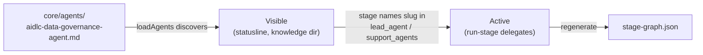

+++
date = '2026-10-17T00:00:00+10:00'
draft = false
title = 'AI-DLC Harness Engineering: A Complete Guide to Shaping the Factory'
tags = ['AI-DLC', 'Agentic AI', 'Harness Engineering', 'Agents', 'Process']
summary = "A clear, practical guide to reshaping AI-DLC without writing code: stages, agents, scopes, rules, sensors, knowledge, swarm construction, porting harnesses, and authoring plugins."
aliases = ['/blog/ai/aidlc/harness-engineering/']
+++

# AI-DLC Harness Engineering: A Complete Guide to Shaping the Factory

> Part of the AI-DLC series. [User Guide](https://welldesignedsystem.github.io/docs/guide/) → build with AI-DLC. **This guide** → reshape how AI-DLC behaves for your team. [Developer Reference](https://welldesignedsystem.github.io/docs/reference/) → change AI-DLC's code.

AI-DLC is a spec-driven development factory that runs out of the box across Claude Code, Kiro CLI, Kiro IDE, Codex CLI, Cursor, opencode, and GitHub Copilot. It ships with 14 agents (11 domain experts, 2 reviewers, 1 composer), 33 stages, 11 scopes, plus rules and sensors.

This guide shows you how to **reshape AI-DLC for your team without writing code**. Change which stages run, add agents, tune scopes, teach standing rules, wire deterministic checks, add team knowledge, control Construction autonomy, port to a new harness, or author a plugin—all declaratively.

## 1. Three Roles, Three Guides

| Guide | Who | What You Change |
|---|---|---|
| [User Guide](https://welldesignedsystem.github.io/docs/guide/) | Building *with* AI-DLC | Nothing in harness configs. Run `/aidlc`, answer gates, review artifacts. |
| **Harness Engineering Guide (this one)** | Shaping *how* AI-DLC behaves | Declarative data: stages, agents, scopes, rules, sensors, knowledge. |
| [Developer Reference](https://welldesignedsystem.github.io/docs/reference/) | Changing AI-DLC *itself* | Code: orchestrator, hooks, CLI tools, graph compiler, tests. |

The rule is simple: **data vs code**. If you edit Markdown with YAML frontmatter or JSON, you're in this guide. If you edit TypeScript, you're in the Developer Reference.

## 2. Core Mental Model: What vs Who

Two primitives drive everything.

- **Stage** = *what* happens. A unit of work that declares consumed/produced artifacts, lead agent, and execution. Stages form the workflow graph.
- **Agent** = *who* does the work. A persona with domain expertise, tool allowlist, and model. Agents are loaded into stages.

Stages name their lead agent. Agents never name stages. This keeps work and workers decoupled—you can reassign by editing a stage, or add an agent without changing workflows until a stage opts in.

### 2.1 How Work Flows

- **Engine** (`core/tools/aidlc-orchestrate.ts`) — Deterministic. Reads `aidlc-state.md` and compiled `stage-graph.json`, picks next step, emits one typed directive. Subcommands: `next`, `continue` (internal), `report`, `park`, `team-board` (read-only), `wait` (bounded read-only).
- **Conductor** (`skills/aidlc/SKILL.md`) — Thin forwarding loop that executes each directive.

**Routing lives in the engine.** Your stage files, scopes, and rules are the inputs that steer it—the conductor never decides the route.

Everything else shapes their inputs:

- **Scopes** — Which stages run for a given work type (e.g. a bugfix runs 9 of the 33 stages; an enterprise feature runs all of them).
- **Rules** — Standing "always do this" decisions applied to every workflow.
- **Sensors** — Deterministic checks bound to stages (advisory or blocking).
- **Knowledge** — Domain/project context agents load before working.

## 3. What You Can Change Without Code

Author in **`core/`** (harness-neutral source). Regenerate per-harness distributions.

| Change | Where | See |
|---|---|---|
| Edit a stage | `core/aidlc-common/stages/<phase>/<slug>.md` | §4 |
| Add a new stage | New file in phase + wire dependencies | §5 |
| Add/modify an agent | `core/agents/<name>-agent.md` | §6 |
| Define/tune a scope | `core/scopes/aidlc-<name>.md` + stage `scopes:` | §7 |
| Teach standing rules | `core/memory/{team,project}.md` (framework baseline) or space memory | §8 |
| Wire a deterministic check | `core/sensors/<id>.md` + stage `sensors:` | §9 |
| Add team domain knowledge | `aidlc/knowledge/<agent>-agent/` (space-level, runtime) | §10 |
| Shape Construction & swarm | `core/memory/` + `units-generation` stage | §11 |
| Port to a new harness | `harness/<name>/` + manifest/emit | §12 |
| Author a reusable plugin | `plugins/<name>/` | §13 |

**Team knowledge is the only exception**: it lives at `aidlc/knowledge/` in your project space and is never overwritten by framework updates.

### 3.1 Naming Rules & Validation

- Stage filename stem must equal frontmatter `slug`. `aidlc-graph compile` rejects mismatches, duplicate slugs, multiple producers of same consumed artifact (names files/consumer).
- Sensor filename/id consistency is compile-time enforced.
- Duplicate scope/agent names are loader errors naming both files. Filename↔name drift is reported by `/aidlc --doctor` as advisory.
- One owner per invariant (approval/transition/presence/plan fingerprint). Same check may appear at multiple boundaries, but duplicating logic is a defect.

### 3.2 Build Model: Author in `core/`, Regenerate

**Never edit `dist/` or `dist-release/`**. They are generated.

```bash
# 1. Edit source in core/ (never dist/)
$EDITOR core/aidlc-common/stages/inception/my-stage.md

# 2. Regenerate all harness projections
bun scripts/package.ts

# 3. Verify determinism (CI guard)
bun scripts/package.ts --check
```

Commit `core/`, `harness/`, `plugins/` only. `--check` builds twice in independent temp roots and byte-compares. When instructed to run `aidlc engine graph compile`, run it against your installed harness projection.

### 3.3 When to Cross Into Developer Reference

Cross over when changing code, not data:

- Orchestrator routing/state or engine/conductor/directive contract ([Orchestrator](https://welldesignedsystem.github.io/docs/reference/03-orchestrator/), [State Machine](https://welldesignedsystem.github.io/docs/reference/12-state-machine/), [Skill System](https://welldesignedsystem.github.io/docs/reference/17-skill-system/))
- Hooks/CLI tools ([Hooks and Tools](https://welldesignedsystem.github.io/docs/reference/06-hooks-and-tools/))
- Graph compile pipeline or audit taxonomy
- Test suite ([Testing](https://welldesignedsystem.github.io/docs/reference/09-testing/))

Adding stages/agents changes graph data—not the code that reads it. Changing *how* the graph compiles is code.

## 4. Anatomy of a Stage

A **stage** is the atom of the AI-DLC workflow — *what* happens at one step. Every other change a harness engineer makes builds on the stage file, so read this first.

A stage file is a **single Markdown file**: YAML frontmatter on top, prose body below. The frontmatter declares the graph node (the artifacts the stage consumes and produces, its lead agent, how it executes). The body is the prose the agent follows. Both live in one file on purpose.

### 4.1 Two Readers, One File

A stage file has two readers, and they never overlap:

- **The parser** reads only the YAML frontmatter. It produces a structured graph entry — the edges, the lead agent, the execution mode — and ignores the body entirely.
- **The agent** executing the stage reads only the body. It follows the prose steps, produces the artifacts, and never touches the frontmatter.

Keeping both in one file means you see the graph edges and the execution steps side by side. A reviewer sees both at once: which artifacts the stage produces *and* the instructions that produce them. Splitting them (one YAML file for the graph, one prose file for the agent) would break that inline visibility, which is what makes stages reviewable.

This split is the key to knowing what you're editing:

- Change a **frontmatter** field → you've changed the **graph** (a dependency edge, the leading agent, the execution mode).
- Change the **body** → you've changed the **work** (what the agent actually does).

The two are independent. A real stage is authored at `core/aidlc-common/stages/<phase>/<slug>.md` — for example `stages/inception/domain-design.md` (phases: `initialization`, `ideation`, `inception`, `construction`, `operation`).

### 4.2 The Frontmatter at a Glance

The frontmatter is a flat block of YAML keys. Some are mechanical (`slug`, `phase`) and copied from a neighbouring stage. A handful carry real judgment. Here is a real stage's frontmatter (from `stages/inception/domain-design.md`, trimmed):

```yaml
---
slug: domain-design
phase: inception
execution: CONDITIONAL
condition: Execute when new components are needed. Skip for modifications to existing components only.
lead_agent: aidlc-architect-agent
support_agents:
  - aidlc-aws-platform-agent
  - aidlc-design-agent
mode: inline
summary_confirmation: required
reviewer: aidlc-architecture-reviewer-agent
review_artifact: components
reviewer_max_iterations: 2
review_class: advisory
produces:
  - components
  - decisions
  - traceability
consumes:
  - artifact: requirements
    required: true
  - artifact: stories
    required: false
  - artifact: architecture
    required: false
    conditional_on: brownfield
requires_stage:
  - requirements-analysis
  - refined-mockups
sensors:
  - required-sections
  - upstream-coverage
  - traceability
scopes:
  - enterprise
  - feature
  - mvp
  - classic
  - workshop
inputs: <record>/inception/requirements-analysis/requirements.md, ...
outputs: components.md, decisions.md, and traceability.json — under this stage's record dir
---
```

The judgment-bearing fields:

| Field | What it decides | The judgment call |
|---|---|---|
| `requires_stage` | Dependency and ordering edges | Does this stage genuinely consume another's output, or just need to run after it? |
| `consumes` | The artifacts this stage reads | Per artifact: is it `required`, `conditional_on` brownfield/greenfield, and `cited`? |
| `consumes[].cited` | Which optional inputs the output must cite when they exist | Is there an optional input that, whenever present, the output builds on? Mark `cited: true`; the `upstream-coverage` check then asks for its citation. |
| `produces` | The artifacts this stage writes | These are the forward edges other stages discover. |
| `lead_agent` / `support_agents` | Who runs the stage | One persona owns it; supporters add perspective. |
| `mode` | Communication topology | `inline` (voices in the conductor's context), `subagent` (hub-and-spoke dispatch), `pipeline` (chain), or `mob` (mesh in bounded rounds). |
| `for_each` | Whether it iterates | Names an artifact whose instances drive a once-per-instance run. |
| `reviewer` / `review_artifact` | Independent quality review | If a reviewer is declared, name the one required Markdown output the review is about (the record is keyed to it and the gate names it); never rely on `produces` order. |

The calls that bite hardest:

- **`consumes[].required` is scoped to the active plan, not global.** `required: true` means "if the producing stage runs in *this* workflow, this consume must be satisfied" — not "the producer always runs." Scopes deliberately skip upstream stages, so a flat global requirement would make those scopes structurally invalid. The stage body handles the absent-input case gracefully (prose like "if produced").
- **`consumes[].conditional_on` captures the brownfield/greenfield split.** A consume marked `conditional_on: brownfield` is only required when the workflow is brownfield. For an unconditional consume, omit the field entirely — there is no `always` value.
- **`mode` is the communication topology** — who talks to whom while the body runs. `inline` runs short stages in the conductor's own context with supporters as adopted voices; `subagent` delegates the lead to a fresh context (long stages like Construction code generation) and, when supporters are declared, dispatches each as a mutually-blind spoke; `pipeline` chains supporters in declared order, each seeing all upstream work; `mob` runs all supporters in parallel against the lead's draft with one bounded objection round. **WHO** participates is `support_agents`; **HOW** they participate is `mode`. `pipeline` and `mob` require non-empty `support_agents`.
- **`for_each` names the iteration artifact.** The five Construction stages (`functional-design`, `nfr-requirements`, `nfr-design`, `infrastructure-design`, `code-generation`) run once per Unit and each declare `for_each: unit-of-work`; the other stages omit the field and run once. Aggregation is inferred from the graph, not declared.
- **`lead_agent` and `support_agents` validate against `core/agents/*.md`.** There's no hardcoded list — adding an agent means dropping its file in that directory (see [§6](#6-adding-an-agent)).

This is orientation, not the full contract. For the complete field table with types and constraints, see the Developer Reference's [Stage Definition](https://welldesignedsystem.github.io/docs/reference/15-stage-definition/).

### 4.3 The Three-Compartment Body

Below the frontmatter, the body has three compartments, always in this order: `## Steps`, `## Sensors`, `## Learn`.

- **`## Steps`** — the imperative prose the agent follows: load personas, read prior context, create the questions file, generate the artifacts, present the approval gate. This is where the stage's domain work lives, and it's the compartment you'll edit most when changing *what a stage does* without touching the graph.
- **`## Sensors`** — a compact local summary: where outputs land, an `Imports:` line that mirrors the frontmatter `sensors:` list, and an `Upstream targets:` line that mirrors `consumes:` when `upstream-coverage` is imported. Stage-specific exceptions live here (an intentionally omitted sensor, ownership of a structured output); shared behavior lives in `stage-protocol-sensors.md`. See [§9 Sensors](#9-sensors).
- **`## Learn`** — points to the conditional learning-loop contract in `stage-protocol-learnings.md` §13. Only when `directive.protocol_modules` lists `learnings`, maintain the four-heading diary at `directive.memory_path` while working, then surface and persist confirmed learnings before a human gate. When absent, keep no diary and skip the ritual. Workflow-time learning never rewrites the stage body.

The three compartments are fixed so a stage's sensor bindings and learning-loop pointer always have a place of their own, and adding one never restructures the body.

**One boundary worth internalizing:** a stage file is a framework artifact, immutable in shape. The body's `## Steps` / `## Sensors` / `## Learn` structure is never rewritten by a workflow. The single sanctioned in-workflow edit is the learning loop appending a new sensor id to the frontmatter `sensors:` import list. Everything else you change in a stage file, you change deliberately as a harness engineer.

### 4.4 consumes and produces from the Graph

The dependency graph isn't written anywhere directly — it **emerges** from the `consumes` and `produces` declarations across every stage.

- A stage's `produces` list is its **forward edges**: when another stage asks "who produces `scope-document`?", the answer is whichever stage declares it.
- A stage's `consumes` list is its **backward edges**: a `required` artifact must exist when this stage runs *if its producer is in this plan*, and an optional one is read when it is there.

`requires_stage` makes the dependency explicit and also encodes pure ordering. It carries two roles:

1. **A semantic data dependency** — "I consume artifact X, which stage Y produces," so Y goes in `requires_stage`.
2. **A presentation-order edge** — two stages in the same phase with no data dependency but a fixed order. Author the weak edge so the computed display order lands stably rather than relying on an alphabetical tiebreak.

These three lists are what wire a stage into the workflow. Get them right and the stage appears in the correct scopes, in the correct order, with its inputs satisfied. Wiring a brand-new stage is covered step by step in [§5 Adding a Stage](#5-adding-a-stage).

### 4.5 stage-graph.json Is Compiled — Never Hand-Edit It

The graph is compiled into a JSON build artifact. In a source build, the generated Claude projection runs the graph from `dist/claude/.claude/tools/data/stage-graph.json`; the installed runtime carries the same relative file under `.claude/tools/data/`. The JSON is a **build artifact, not a source file**. The YAML frontmatter across the stage files is authoritative; the JSON is what you get when you compile it.

```
edit stage .md YAML  →  compile  →  stage-graph.json  →  runtime reads it
```

After editing a stage's frontmatter in `core/`, run `bun scripts/package.ts`, which compiles the graph into every generated tree, and commit only the `core/` edit (the generated trees are ignored and CI rebuilds them). In an installed project tree, `aidlc engine graph compile` regenerates that tree's `stage-graph.json`, and `aidlc engine graph compile --check` says when it is out of date:

```text
$ aidlc engine graph compile --check
stage-graph.json is out of date. Run `aidlc engine graph compile` to regenerate.
```

**The rule: do not hand-edit `stage-graph.json`.** Edit the YAML, recompile. A hand-edit either gets clobbered by the next compile or trips the drift check.

### 4.6 What a Stage *Contains* versus What It *Does*

This section is about what a stage file *contains* — its format ([Stage Definition](https://welldesignedsystem.github.io/docs/reference/15-stage-definition/)). A companion contract covers what a stage *does* at runtime: the approval gate, the question flow, the state checkboxes, the completion message. That behavioural contract is the same for every stage regardless of domain, and it lives in [Stage Protocol](https://welldesignedsystem.github.io/docs/reference/04-stage-protocol/). When a stage body says "follow stage-protocol.md for approval gates," that's the contract it points at.

Keep the two separate: the stage *definition* is the file format you edit; the stage *protocol* is the runtime behaviour that wraps around every stage's work, which you mostly leave alone.

## 5. Adding a Stage

A new stage is the most structural change a harness engineer makes — you introduce a new step into the methodology. The recipe is end-to-end: pick a phase, author the file, wire the dependency edges, compile the graph, and confirm the stage lands where you expect.

**Is a new stage the right move?** A new stage earns its place when it produces an artifact no existing stage produces, or consumes one in a way no existing stage covers. If you only want to change *what an existing stage does* (reword its steps, retarget its lead agent, attach a sensor), edit that stage file in place — no new node needed. Adding a stage is pure **data work**: a Markdown file with YAML frontmatter, then a recompiled JSON artifact. No TypeScript.

### 5.1 Step 1 — Decide the Phase

Stage files live under `core/aidlc-common/stages/<phase>/<slug>.md`. The phase is the directory:

```text
core/aidlc-common/stages/
├── initialization/
├── ideation/
├── inception/
├── construction/
└── operation/
```

The phase is not cosmetic: it determines which `phases/<phase>.md` rule layer attaches to the stage at compile time (a construction stage inherits the construction rule, an inception stage the inception rule; initialization has no phase rule file). Put the stage where its work actually happens in the lifecycle.

### 5.2 Step 2 — Create the File with Required Frontmatter

Drop a new `<slug>.md` in the chosen phase directory. The slug is the filename stem and the stage's identity everywhere else — in `requires_stage` edges, scope mappings, and the audit log. Pick it carefully; renaming later ripples.

The frontmatter fields that carry the structural weight:

| Field | What it does |
|---|---|
| `requires_stage` | The dependency edges — which stages must precede this one |
| `consumes` | The artifacts this stage reads, each with a `required` boolean |
| `produces` | The artifacts this stage writes (its forward edges) |
| `lead_agent` | The persona that owns the stage |
| `support_agents` | Optional perspectives the conductor loads after the lead; pipeline chains require unique agents |
| `mode` | `inline`, `subagent`, `pipeline`, `mob`, or the reserved `agent-team` |
| `for_each` | Optional — names an artifact whose instances drive iteration |
| `summary_confirmation` | Optional — `required` for stages that always collect file-backed answers, `if-present` for conditional question flows |
| `reviewer` / `review_artifact` | Optional pair — the review agent and the required Markdown `produces` entry the review is about (its review record is keyed to that artifact) |

A complete small stage — a glossary step after Requirements Analysis that runs only under `feature` — looks like this (it compiles as it stands):

```markdown
---
slug: glossary-capture
phase: inception
execution: CONDITIONAL
condition: Execute when the requirements use domain terms the team must agree on. Skip when every term is already defined.
lead_agent: aidlc-product-agent
support_agents: []
mode: inline
produces:
  - glossary
consumes:
  - artifact: requirements
    required: true
requires_stage:
  - requirements-analysis
sensors:
  - required-sections
scopes:
  - feature
inputs: <record>/inception/requirements-analysis/requirements.md
outputs: glossary.md (under this stage's record dir, engine-resolved)
---

# Glossary Capture

Collect the domain terms the requirements use and agree one meaning for each.

## Steps

1. Read `<record>/inception/requirements-analysis/requirements.md` and list every domain term it uses.
2. For each term, write one plain definition and the requirement IDs that use it.
3. Write `glossary.md` with `## Terms` and `## Open Terms` sections.
4. Follow stage-protocol.md for the approval gate.

## Sensors

This stage's output is a markdown artefact under `<record>/inception/glossary-capture/`.

Imports: `required-sections`.

## Learn

When `directive.protocol_modules` lists `learnings`, follow
`stage-protocol-learnings.md`: keep the diary at `directive.memory_path` while
working and run the ritual before the approval gate. When the module is absent,
skip both the diary and the ritual.
```

The body opens with `## Steps` (the imperative prose the lead agent follows), then `## Sensors` (output location, exact frontmatter imports, upstream targets), then `## Learn` (points to `stage-protocol-learnings.md` §13 only when the module is listed).

### 5.3 Step 3 — Wire the Dependency Edges

This is where the stage slots into the workflow. Three fields do the wiring, and they must agree:

- **`requires_stage`** — the edges. Two kinds: a *semantic data dependency* ("I consume artifact X, which stage Y produces" → add `Y`) and a *presentation-order edge* (two stages in one phase with no data dependency but a fixed order). Author the order edge explicitly rather than relying on the compiler's alphabetical tiebreak.
- **`consumes`** — the artifacts the stage reads. Each entry carries a `required` boolean, scoped *to the active plan*: `required: true` means "if the producing stage runs in this scope, the consume must be satisfied" — not "the producer always runs." A brownfield-only consume takes `conditional_on: brownfield`; an unconditional consume omits the field entirely.
- **`produces`** — the forward edges. Every consumed artifact must resolve to exactly one producer across `produces` and `optional_produces`; the compiler rejects duplicates and names both producer files. Reusing an artifact name is valid only when no stage consumes it.

Get these consistent and the compiler places the stage automatically; you never hand-edit `stage-graph.json` to position it.

### 5.4 Step 4 — Regenerate the Harnesses

The YAML you authored in `core/` is authoritative. Run the packager to materialize the ignored local `dist/<harness>/` (Bun copy) and `dist-release/<harness>/` (native), copying your new stage into both channels and recompiling each graph:

```bash
bun scripts/package.ts            # materialize both channels for every harness
bun scripts/package.ts --check    # build twice and byte-compare
```

The runtime reads `<harness-dir>/tools/data/stage-graph.json` (e.g. `.claude/tools/data/stage-graph.json` in an installed Claude tree). If iterating on an installed tree, recompile directly:

```bash
aidlc engine graph compile
```

Never hand-edit `stage-graph.json`; a hand-edit is overwritten on the next compile.

### 5.5 Step 5 — Verify It Appears, and in Which Scopes

```bash
aidlc engine graph topo                      # topological order — your slug should appear
aidlc engine graph producers <artifact>      # who produces an artifact
aidlc engine graph consumers <artifact>      # who consumes it
aidlc engine graph scope <scope-name>        # stages on a scope's path
aidlc engine graph validate-scope <scope>    # dependency sanity for a scope
```

Two behaviors to note:

- A new stage takes the next free number in its phase, after the stages already there; no existing stage is renumbered. An edge from an earlier stage *to* the new one is refused at compile (dependencies must be lower-numbered).
- A brand-new stage does **not** automatically run in any scope. Its frontmatter `scopes:` list names every scope it runs under; a stage that names no scope is `SKIP` everywhere. Authoring the body makes it *exist*; the `scopes:` tag makes it *run*.

### 5.6 The Runner Is Opt-In Sugar

The extensibility contract: **to add a stage, you write a stage file.** Once it compiles, it runs on its own with no registration:

```bash
aidlc engine orchestrate next --stage <your-slug> --single
```

The `--single` mode runs that one stage in isolation (emits a `run-stage` directive, conductor runs it, synthetic-id lifecycle in the audit log) and **never touches the main workflow's Current Stage**, so it can't derail an in-flight workflow. Every shipped runnable stage also gets a thin runner skill at `skills/aidlc-<slug>/SKILL.md` so it's typeable as `/aidlc-<slug>` — a generator emits one per compiled stage, so runners can't drift from stages. Regenerate them after adding/removing a stage:

```bash
aidlc engine gen runners          # regenerate every runner dir
aidlc engine gen runners --check  # CI drift guard
```

Delete every runner and every stage still runs via `/aidlc --stage <slug> --single`.

### 5.7 What Validates Automatically vs. What You Check

**Automatic:**
- **Graph placement** — once you compile, `requires_stage`/`consumes`/`produces` resolve into the graph (topological order, producer/consumer lookups, cycle detection).
- **Compile-time field validation** — `lead_agent`/`support_agents` are checked against the actual agents files; a typo fails the compile (`lead_agent "<name>" has no matching .claude/agents/*.md`) rather than 404-ing at run time. The reserved `orchestrator` slug is exempt. Pipeline stages reject duplicate chain identities.
- **Drift checks** — `bun scripts/package.ts --check` builds twice and byte-compares; `aidlc engine graph compile --check` exits `1` and prints `stage-graph.json is out of date...` when a stage was edited without recompiling.
- **Phase rule attachment** — the `phases/<phase>.md` rule layer attaches at compile time from the directory.

**Check yourself:**
- **Scope participation** — the compiler places the stage but doesn't decide which scopes run it. Add each scope name to the stage's `scopes:` list (then recompile so the transpose updates `scope-grid.json`).
- **Body prose** — only frontmatter is parsed; the `## Steps` body is read only by the lead agent.
- **Prose-to-edge consistency** — `requires_stage` and the `## Steps` prose can drift; keep them in sync by hand.
- **`required` semantics under your scopes** — a `required: true` consume is moot in a scope that skips the producer; confirm the body handles the absence gracefully.
- **Documentation** — if the new stage changes a hand-enumerated count/table, update the docs in the same change.

### 5.8 The Boundary Case: Data Work vs. Code Work

Authoring the file and recompiling is data work — Markdown, YAML, JSON, no `.ts`. The line you must not cross silently: if making your stage work requires the graph *compiler* to behave differently (a frontmatter key it doesn't recognize, a new edge type, a new traversal rule), that's a change to the code that reads the data and belongs in the Developer Reference. The reserved-key namespace (`on_failure`, `blocks_on`, `timeout`, `retry`) exists so future extensions land predictably; until a consumer ships, the schema rejects them. `when:` is different: the schema accepts and checks it, but nothing acts on it yet, so a stage with `when:` runs under its `scopes:` as if it weren't there.

## 6. Adding an Agent

An **agent** is the *who* of the framework — a persona with a domain, a tool allowlist, and a tier. The 14 shipped agents comprise 11 domain experts (product, design, delivery, architecture, AWS platform, compliance, DevSecOps, development, quality, pipeline-deploy, operations), two review-only agents (`aidlc-product-lead-agent`, `aidlc-architecture-reviewer-agent`), and the adaptive-workflows composer (`aidlc-composer-agent`). When your team needs a domain the framework doesn't cover — a data-governance reviewer or a mobile specialist, say — add a persona by dropping a single Markdown file into `core/agents/`. No TypeScript.

The one thing to internalize is the two-step truth: dropping the file makes the agent **visible**; wiring it into a stage makes it **active**. Both steps are required, or you get an agent that exists and never runs.

### 6.1 What a persona file is, and where it lives

Every agent is one flat file at `core/agents/<slug>-agent.md`: YAML frontmatter on top, a Markdown body below. The shipped files all carry the `aidlc-` prefix (`aidlc-architect-agent.md`, `aidlc-developer-agent.md`); a file you add is yours and need not use that prefix.

Treat the shipped 14 as framework files: in an installed project, a local edit to one stops the next `aidlc config` refresh until you move your copy away or take the shipped one with `--force`:

```text
$ aidlc config --harness claude --yes
error: 1 config conflict(s): .claude/agents/aidlc-architect-agent.md (locally modified or unowned)
fix: to keep your version, move .claude/agents/aidlc-architect-agent.md somewhere else and run the same command again; to take the shipped version over it, run it again with --force.
```

Customize *what an existing agent knows* through team knowledge ([§10](#10-team-knowledge)) rather than editing the file. A genuinely new persona — a new file, owned by you — is a different move, and survives upgrades.

Only the frontmatter is machine-read. The body is prose the agent reads about itself when it activates — its responsibilities, collaboration, memory focus, and working principles — and you write it to match the structure of the shipped files. The packager adds the mandatory delegated knowledge preflight to every harness projection.

### 6.2 The frontmatter, from a real agent

Here is the frontmatter from a real agent, authored at `core/agents/aidlc-architect-agent.md`:

```yaml
---
name: aidlc-architect-agent
display_name: Architect Agent
examples:
  - tech-stack.md
  - infrastructure-preferences.md
description: >
  Solutions architect responsible for domain design, contract design, NFR patterns, and component decomposition.
  Leads Feasibility, Domain Design, Units Generation, Contract Design, Functional Design, NFR Requirements, and NFR Design stages,
  and serves as the dispatched final link of the Reverse Engineering pipeline.
disallowedTools: Task
tier: judgment
---
```

### 6.3 The fields, and the calls you make

| Field | Required | What it does |
|---|---|---|
| `name` | Yes | Must match the filename stem. The parser keys off it, and a mismatch is the easiest way to author an agent that never resolves. The loader rejects duplicate agent `name` values across files and names both files in the error. |
| `display_name` | Yes | The human-readable label the statusline renders (the architect shows as "Architect Agent"). |
| `description` | Yes | A short summary of the persona's domain and the stages it leads. |
| `examples` | Yes | Suggested knowledge filenames documented in the agent→examples table. They are *suggestions surfaced to the user*; the runtime never loads them and the engine never writes them to disk. |
| `disallowedTools` | Yes | **Must include `Task`** — not optional (see below). |
| `tier` | Yes | The kind of work; the packager projects it into per-harness model/effort keys (see below). |
| `tools:` | Optional | A tool allowlist that narrows the persona. Omit it to inherit the full session toolset. |
| `maxTurns:` | Optional | Caps the agent's turn budget. |

Four of these carry real judgment. Here is what each decides.

**`disallowedTools` must include `Task`.** Agents run as delegated workers; the conductor (the live `/aidlc` session) performs the `Task` call when the engine's `run-stage` directive carries `mode: subagent`. Allowing `Task` would let an agent spawn its own subagents, cascading the delegation chains the framework is built to prevent. Every shipped agent disallows `Task`, and so must yours. The Kiro projections remove this Claude-only frontmatter key and enforce the same no-nested-delegation boundary through Kiro's native agent tool configuration; any other `disallowedTools` value fails packaging or is drop-logged during plugin compose.

**`tier` names the kind of work.** You never author raw `model:` or `effort:` in core agent frontmatter — those are projection OUTPUTS in the ignored local `dist/<harness>/` tree and versioned release runtime, derived from the tier table in `core/tools/aidlc-tiers.ts`. Pick:

- **`judgment`** — for any persona whose work is multi-constraint reasoning that cascades downstream: interpreting ambiguous intent, weighing architectural trade-offs under dense context. A judgment agent inherits the session's model AND effort unless an explicit model policy overrides it.
- **`balanced`** — for reviewer-shaped personas that judge novel input against explicit criteria.
- **`templated`** — only when the output is dominantly pattern-following and the methodology is already encoded in the agent's knowledge files, as with delivery plans, CI/CD YAML, and runbook scaffolding.

With no recorded policy, the `balanced` reviewer tier uses Sonnet at `medium` effort on Claude Code; on Codex and opencode it inherits the session model and applies medium reasoning effort. `judgment` and `templated` inherit session model and effort. When in doubt, use `judgment`: the projection table (and a project's `tier_cap`) can always step cost down later, but a persona authored too low silently under-reasons.

**`tools:` narrows the persona — rarely needed.** None of the 14 shipped agents declare a `tools:` allowlist, so each one reaches every tool the session provides — `Read`, `Edit`, `Write`, `Glob`, `Grep`, `AskUserQuestion`, `Bash`, `WebSearch`, and the inherited MCP tools alike. Listing `tools:` narrows the persona to exactly the tools it names, and it drops the inherited MCP tools unless you also name the fully-qualified `mcp__<server>__<tool>` ids. Reach for it only when a domain genuinely needs a smaller surface; most personas are best left to inherit everything.

**`maxTurns:` caps the turn budget.** Binding on Claude Code, projected to opencode's native `steps:` key, and inert (persona-prose-only) on Codex CLI, Cursor, GitHub Copilot, and both Kiro surfaces, which expose no per-agent cap key. The two review-only agents ship it today.

### 6.4 MCP servers are inherited, not granted per agent

The five MCP servers declared in the project-root `.mcp.json` are provisioned to the session, and every agent inherits all of them automatically — there is no per-agent grant to author. To keep a persona *away* from a server, narrow its `tools:` allowlist to a fully-qualified `mcp__<server>__<tool>` list that omits that server (a bare `mcp__<server>` token is a no-op, not a server-level grant). The inheritance and restriction model is exercised by the `t110` registry-integrity test.

### 6.5 Visible is not active: the two-step truth

Dropping the file makes the agent *visible*; wiring it into a stage makes it *active*. Both steps are required.

- **Discovery makes it visible.** `loadAgents()` in `aidlc-lib.ts` reads every persona `.md` file in `.claude/agents/` (one named `aidlc-*` or carrying `display_name`, `examples`, `tier`, or `plugin`) on the next invocation and derives the metadata map. No code edit, no registration step — the file's presence is the registration. From this point the statusline can render its display name, and the team can add standards under its space-level `aidlc/knowledge/<slug>-agent/` directory.
- **Stage binding makes it active.** A stage names its lead and support agents by slug in its frontmatter `lead_agent` / `support_agents` fields (compiled into `stage-graph.json`). Until some stage references your slug, no `run-stage` directive names it, so the conductor never delegates to the persona.

This mirrors the framework's core asymmetry — a stage names its agent; an agent never names its stages. So the agent file alone is inert by design. To put your new persona to work, edit the stage that should use it.

Each agent also pairs with a knowledge directory you author at `core/knowledge/aidlc-<slug>-agent/` (framework methodology) and an optional team overlay at the space level, `aidlc/knowledge/<slug>-agent/` (your standards). The space-level `aidlc/knowledge/` directory is free-form and empty at bootstrap; the team creates the per-agent subdirectory when it has content — the engine does not scaffold it.

### 6.6 The steps, end to end

1. **Create the agent file** — `core/agents/<slug>-agent.md` with the required frontmatter: `name`, `display_name`, `examples`, `description`, `disallowedTools` (including `Task`), `tier`. An optional `tools:` allowlist narrows the persona; omit it to inherit the full session toolset. An optional `maxTurns: <n>` caps the turn budget. Write the body to match the shipped files' structure (Core Responsibilities, Collaboration, optional Memory Focus, Key Principles).
2. **Add knowledge files** under `core/knowledge/aidlc-<slug>-agent/` for the methodology the persona should load on activation.
3. **Wire it into stages** — add the slug to the `lead_agent` / `support_agents` frontmatter of each stage file (`core/aidlc-common/stages/<phase>/<slug>.md`) where it leads or supports, then regenerate with `bun scripts/package.ts` (or, in an installed tree, `aidlc engine graph compile`) so `stage-graph.json` regenerates. Never hand-edit `stage-graph.json`. This is the step that makes it active.
4. **Document the team-knowledge directory** — note that a team adds its standards under the space-level `aidlc/knowledge/<slug>-agent/`. The engine does not create this directory; the team creates it when it has content.
5. **Update the hand-maintained doc tables** — the Phase Participation matrix and the agent→examples table do not regenerate themselves.



### 6.7 What validates automatically vs. what you check

**Automatic:**

- `loadAgents()` discovers any new persona `.md` file on next invocation — no code edit, no registration. A persona is a file named `aidlc-*` or one whose frontmatter carries `display_name`, `examples`, `tier`, or `plugin`; any other file there is the host's own agent and is left alone.
- The parser throws if a persona's `name` or `display_name` is missing, naming the file, the missing field, and (for a file not named `aidlc-*`) the key that made it a persona.
- Agents are returned alphabetically sorted by slug, so discovery order is identical on every platform.
- Intent creation creates the empty space-level `aidlc/knowledge/` directory; it does not seed per-agent subdirectories or READMEs.
- The statusline renders the display name from the derived metadata.

**Check yourself:**

- **Stage-graph participation.** `stage-graph.json` references agents by slug; add an agent without wiring it there and it exists but never runs. Discovery and activation are separate steps.
- **Knowledge-file existence.** `examples` are suggested filenames documented in the agent→examples table — nothing creates or checks them. You place the real content under `aidlc/knowledge/<slug>-agent/`.
- **The hand-maintained doc tables.** The Phase Participation matrix and the agent→examples table are edited by hand. Update them in the same change that adds the agent.
- **The agent file's body.** Only the frontmatter is parsed; the body prose is read by the agent itself when it activates, so write it carefully to match the shipped 14.

A genuinely new persona is a file you own; a new stage's `lead_agent` reference to it is checked at compile time, so a typo fails the compile (`lead_agent "<name>" has no matching .claude/agents/*.md`) rather than 404-ing at run time.

## 7. Scopes

A **scope** is the dial that decides *which* of the framework's 33 stages run for a given kind of work, and which sit out. A bugfix doesn't need market research or environment provisioning, but it still runs the deployment pipeline and execution stages; a regulated enterprise feature needs the full lifecycle. Rather than asking the user to hand-pick stages every time, AI-DLC ships **eleven named scopes** — each one a curated EXECUTE/SKIP verdict over the full stage set, paired with workflow defaults such as depth, test strategy, and an optional review ceiling. Pick the scope and the rest cascades.

The eleven shipped scopes are `classic`, `enterprise`, `feature`, `mvp`, `poc`, `workshop`, `bugfix`, `refactor`, `security-patch`, `infra`, and `express`. The incremental scopes (`bugfix`, `refactor`, `security-patch`) and `poc`/`infra`/`express` never run `units-generation`, so they run Construction single-pass with nothing for the swarm to fan out across.

For a harness engineer, a scope is pure data, authored the same way every other primitive is — as a file. Adding or tuning a scope requires no TypeScript.

### 7.1 Two-part definition

A scope is authored in two places, and the split is the whole idea: the scope's *identity* lives in its own file, and its *membership* (which stages run under it) lives transposed onto the stages.

1. **The scope file** — `core/scopes/aidlc-<name>.md`. One file per scope, mirroring `core/sensors/`. The `feature` scope's frontmatter looks like this:

```yaml
---
name: feature
depth: Standard
keywords: []
description: Full lifecycle for new features, practical depth
skeleton: on
runner: true
guard_policy: off
sensors: on
learnings: on
summary_confirmation: on
plan_approval: on
collaborators: off
---

# feature scope

The full-lifecycle scope for new feature work at practical depth. ...
```

2. **The membership tag** — each stage's `scopes:` frontmatter, in `core/aidlc-common/stages/<phase>/<slug>.md`:

```yaml
scopes:
  - enterprise
  - feature
  - mvp
```

A stage that names a scope is `EXECUTE` under it; absence is `SKIP`. Packaging *transposes* every stage's `scopes:` list into the compiled EXECUTE/SKIP grid at `<harness-dir>/tools/data/scope-grid.json`. The grid is an ignored generated projection that the runtime reads; you never hand-edit or commit it. The 3 initialization stages name every scope (they always run).

### 7.2 The scope frontmatter fields

| Field | Required | What it does |
|---|---|---|
| `name` | Yes | The scope name. Core files use `aidlc-<name>.md`; plugin scope files use a stem equal to `name`. |
| `depth` | Yes | The default detail level — `Minimal`, `Standard`, or `Comprehensive`. |
| `testStrategy` | No | Overrides test volume independent of depth. Defaults to matching `depth`. |
| `review_cap` | No | Maximum review class under this scope: `adversarial`, `advisory`, or `none`. Absence means no scope-level lowering. A cap can lower but never raise a stage's `review_class`; a per-work `--review` level replaces the cap for that piece of work; autonomous swarm reviews retain the stage's declared class. |
| `keywords` | No | Hint words the agent reads when it proposes a plan for `/aidlc <freeform text>` (no tool matches them). Flat string lists may use block (`- item`) or flow (`[item, item]`) form; an empty list opts out. |
| `description` | No | The one-liner rendered in `/aidlc --help`. |
| `skeleton` | No | `on` opts the scope into the walking-skeleton ceremony when practices are scope-dependent; `off` or absence opts out. |
| `existing_code` | No | `true` marks a scope that changes code that already exists, so a new project's custom plan runs on another scope when one fits; `false` or absence means the scope suits new work too. Any other value is rejected. |
| `runner` | No | `true` includes the scope in the default generated scope-runner set. |
| `freeform_default` | No | `true` nominates this scope as the selection-aware fallback when the preferred core default (`classic`) is not enabled. |
| `guard_policy` | No | The scope's Guard Policy default — `strict`, `relaxed`, or `off`. Absence means off, so a plugin or composed scope that wants strict declares it. Shipped defaults are strict on `enterprise` and off on the rest. |
| `sensors` | No | `on` or `off`; controls sensor execution and sensor gate checks. Absence means on. |
| `learnings` | No | `on` or `off`; controls the stage learnings read/write ritual. Absence means on. |
| `summary_confirmation` | No | `on` or `off`; controls the separate pre-output summary confirmation, not stage approval. Absence means on. Distinct from a stage's `required` / `if-present` declaration. |
| `plan_approval` | No | `on` or `off`; whether the person is asked to approve each code plan before Code Generation builds it. `off` builds the plan as written after one line naming it and records `PLAN_APPROVAL_SKIPPED`. Absence means on. Shipped defaults are off on `express` and `poc` and on elsewhere. Only the person turns it off. |
| `collaborators` | No | `on` or `off`; whether a stage runs with its support agents (collaborators) or lead-only. `off` makes the engine hand every stage an empty effective `support_agents`, so on every topology the lead runs alone — no mutually-blind subagent spokes, no mob round, and a pipeline's lead becomes its sole and final link (it authors the artifacts the chain would otherwise split). The stage's authored `support_agents` list is untouched, so flipping back on re-enables the full ensemble. Absence means on. Shipped defaults are on on `enterprise` and off on the other ten. |

The loader rejects duplicate scope `name` values across files and names both files in the error. Invalid ceremony values are rejected with the file, key, and the two allowed values.

### 7.3 The ceremony defaults, scope by scope

Every shipped scope declares all five ceremony keys explicitly rather than leaning on the default:

- `classic` declares sensors, learnings, and plan approval on and summary confirmation off. Its gated flow also caps reviews to one advisory pass and disables walking-skeleton ceremony, while explicit autonomy keeps the single pre-merge review.
- `bugfix` declares sensors and plan approval on, learnings and summary confirmation off.
- `express` declares all four of those off; `poc` declares plan approval off and the other three on.
- The other seven declare those four on.
- `collaborators` is on only on `enterprise` and off on every other scope.

Each ceremony has a per-intent override and a global kill switch:

| Ceremony | Per-intent override | Global kill switch |
|---|---|---|
| Sensors | `/aidlc --sensors on\|off` | `AIDLC_DISABLE_SENSORS=1` |
| Learnings | `/aidlc --learnings on\|off` | `AIDLC_DISABLE_LEARNINGS=1` |
| Summary confirmation | `/aidlc --summary-confirmation on\|off` | `AIDLC_DISABLE_SUMMARY_CONFIRMATION=1` |
| Plan approval | `/aidlc --plan-approval on\|off` | `AIDLC_DISABLE_PLAN_APPROVAL_GUARD=1` |
| Collaborators | `/aidlc --collaborators on\|off` | `AIDLC_DISABLE_COLLABORATORS=1` |

Resolution is kill switch (`1`) → valid intent line → scope default → on.

### 7.4 The judgment calls: depth, skeleton, existing code, guard policy

**Depth and test strategy are independent.** Depth controls how much detail each stage's artifacts carry; test strategy controls how many tests get generated. Most shipped scopes leave `testStrategy` off so it inherits from `depth` — `classic` is Standard/Standard and `express` is Minimal/Minimal. `workshop` demonstrates the explicit split with Standard depth and Minimal testing. If your scope wants a split, declare both.

**Walking-skeleton default.** The optional `skeleton:` field controls the scope-dependent walking-skeleton stance. `skeleton: on` means that when the team's `## Walking Skeleton` practices resolve to `scope-dependent`, Construction opens with the walking-skeleton ceremony for this scope. `skeleton: off` means the first Bolt runs as a regular Bolt. Absence defaults to off.

**Scopes for existing code.** The optional `existing_code: true` field marks a scope that changes code that already exists (`bugfix`, `refactor`, and `security-patch` ship with it). A plan the composer tailors for a new project does not run on such a scope when a scope meant for new work fits, so new work is not recorded as a fix; and creating work on one in a folder that scans as a new project drops its Reverse Engineering and prints a note that the scope usually targets existing code.

**Freeform default.** `freeform_default: true` lets an install nominate the scope used when the internal `classic` default is unavailable after plugin selection. The nomination is checked before the sole-enabled-plugin fallback, so a plugin with several scopes can choose its lean default instead of accepting the alphabetically first scope. At most one **enabled** scope may declare it; graph compilation fails and names every claimant when the selected core/plugin set contains more than one.

**Guard Policy default.** `guard_policy` is the value a new intent on this scope starts with, written to its state file at creation as `- **Guard Policy**: <value> (from scope <name>)`. It decides two things:

- **What happens when an input changes after a human approved or confirmed something** (a plan edited after approval, a reviewed document edited after its review, an output saved without the current summary confirmation). `strict` reopens that approval; `relaxed` and `off` record the change once, tell the human in one line, and continue. Workspace source that moved after a plan was approved is recorded and continued under every value.
- **Which authority fences hold.** `strict` lowers none; `relaxed` lowers `plan-approval` and `review-freeze`; `off` lowers those two plus `state-transition` and `reviewer-scope`. `human-presence` is never lowered by the word.

The human can change it for one intent by typing `/aidlc --guard-policy <value>` or by asking in their own words; either way the agent runs the setter, and lowering it to `relaxed` or `off` takes a message from the person since the last decision. To hold a value for everyone on the repo, do not edit eleven scope files: declare it once in memory (`## Guard Policy` with `Mode: strict` in `org.md`, `team.md`, or `project.md`). A memory `strict` wins over every scope default and refuses chat or flag flips by naming the file.

`change_control` is the retired spelling of this key, read for one release and never written; a scope file naming both keys with different values is rejected naming the file and both values.

### 7.5 How scopes relate to stages

A scope and a stage point at each other from opposite ends. A **stage** declares its own identity — its phase, its lead agent, the artifacts it consumes and produces, and the scopes it runs under (its `scopes:` list). A **scope** declares its identity, routing metadata, and workflow defaults in its own `.md` file, with no per-stage membership inside it; membership lives on the stages. The binding between them is the scope name.

That separation is the same data-versus-code line the rest of this guide rests on. The scope file is data about *identity*; the stage's `scopes:` list is data about *membership*; the compiled grid is the transpose of the two.

### 7.6 Adding a team scope

Suppose your team wants a `hotfix` scope — leaner than `bugfix`, for the urgent production patch where you want a regression test and a deploy, nothing else. The change is a new scope file, a `scopes:` tag on each stage that should run, and regenerated local projections.

1. **Drop `core/scopes/aidlc-hotfix.md`.** Copy `aidlc-bugfix.md` (the closest existing scope) and edit the frontmatter: set `name: hotfix`, pick `depth`, add `keywords` as hints the agent reads when proposing a plan for freeform text (`[hotfix, urgent]`), a `description` for the help text, `skeleton: on|off`, keep `existing_code: true` from `aidlc-bugfix.md` since a hotfix changes code that already exists, `freeform_default: true` only if this is the selected install's unique fallback nomination, `testStrategy` only if it should diverge from `depth`, and `review_cap` only if the scope should lower stage reviews. Write a short prose body explaining the intent. Set `sensors`, `learnings`, and `summary_confirmation` to `off` only for ceremonies the scope should omit; absent keys stay on.
2. **Tag the stages that should run under `hotfix`.** In each stage you want `EXECUTE` (under `core/aidlc-common/stages/<phase>/`), add `hotfix` to its frontmatter `scopes:` list. A stage you don't tag is `SKIP` for the scope. The 3 initialization stages must include it (they always run).
3. **Regenerate.** Run `bun scripts/package.ts` to rebuild the ignored harness projections, including `scope-grid.json` and the compiled scope table. Run `bun scripts/package.ts --check` to confirm two independent source-only builds are byte-identical.
4. **Verify the scope resolves and is accepted.** Run `/aidlc --doctor`. Then confirm an init under the new scope produces a state file with the right `Scope:` line, and that it's accepted as an env default and as a mid-workflow `--scope` change.
5. **Check the plan's hints** (only if you populated `keywords`; the agent reads them in the plan proposal step, no tool matches them).
6. **Update the scope-aware docs and add a routing test.** Several docs enumerate scopes by hand — the User Guide's scope reference and routing table, the customization chapter's valid-values list, and the orchestrator reference's scope-to-stage mapping. Update them in the same change.
7. **(Optional) Generate a typeable runner.** A scope is fully usable via `/aidlc --scope <name>` the moment its file lands; no runner is needed. If you want a one-word command (`/aidlc-hotfix`), add `runner: true` to the scope frontmatter and run `aidlc engine gen runner-scopes`; `aidlc engine gen runner-scopes --all` emits `skills/aidlc-<scope>/SKILL.md` for every scope file regardless of that flag.

### 7.7 Tuning an existing scope

Tuning is a smaller edit, but it lands on the stage, not the scope. Two changes come up often:

- **Flip a stage in or out.** Add or remove the scope name from a stage's `scopes:` list. This is how you'd add `mvp` to `observability-setup`'s `scopes:` because your team always wires monitoring even for a first cut. One tag, then regenerate with `bun scripts/package.ts` and run `--doctor`.
- **Change a default depth, test strategy, or review ceiling.** Adjust `depth`, add/remove `testStrategy`, or add/remove `review_cap` in the scope's frontmatter. The first two recalibrate artifact and test volume; `review_cap` lowers stage review classes without ever raising them.
- **Change a ceremony default.** Set `sensors`, `learnings`, `summary_confirmation`, `plan_approval`, or `collaborators` to `on` or `off` in the scope file. Existing intent lines retain their choice; a scope change refreshes scope-sourced lines but preserves per-intent overrides. Apart from `plan_approval: off` and `collaborators: off`, no ceremony switch removes stage approval, human-turn authority, audit, team write protection, or the reviewer.

A note on layering: tuning the shipped scopes edits framework-shipped files directly. That's legitimate for a fork that wants different defaults, but a framework upgrade may want to reconcile them. Adding a net-new scope file alongside the shipped eleven is the cleaner path when you want a team-specific behavior without touching the defaults everyone else relies on.

### 7.8 What validates automatically vs. what you check

**Automatic:** the valid-scope list is derived from `scopes/*.md` presence at runtime through `validScopes()`, so a new file is valid everywhere at once — `init`, `--scope` change, env-default resolution, and `doctor` all consult the same helper. Error messages list your scope in alphabetical order with no change. Packaging always derives the grid from the current stage YAML, so stale local generated bytes are not release inputs.

**Check yourself:**

- **A `scopes:` tag with a typo'd scope name still parses.** A stage naming `hotfx` instead of `hotfix` compiles cleanly — it just produces a grid column nobody asks for. But a mistyped tag on a stage silently drops that stage from the real scope. `/aidlc --doctor` and a per-scope test are the guardrails.
- **A stale local projection can mislead manual inspection.** If you edit a stage's `scopes:` and keep using an old ignored `dist/` tree, that local runtime still contains the old grid. Regenerate before local runtime checks.
- **Per-scope phase-sequence coverage.** The shipped phase-sequence test iterates a hardcoded list of the known scope names; add your scope to it in the same change.
- **The hand-maintained docs.** The User Guide's stage-by-scope matrix and scope routing table are checked against the compiled grid (`t244-scope-matrix-doc-sync`), so a new scope fails that test until its column and row are there.

### 7.9 Where saved scopes come from (runtime, not authored)

The transpose above is the mechanism for *authored* scopes. A scope saved at runtime from a composed plan (`scope save`) has no stage declaring it, so it cannot be transposed: its durable definition lives in the user's own tree at `aidlc/scopes/<name>.md` and compile projects it into the harness grid. You do not author those. A composed plan the person does not save writes no scope at all: it runs on a stock scope with its own stage changes recorded in that piece of work's state.

## 8. Rules and the Learning Loop

**Rules** are standing "how" decisions that apply to every workflow. They encode conventions, constraints, preferences. **Knowledge** (§10) is "what" (context). **Sensors** (§9) are deterministic checks.

### 8.1 Where Rules Live

Runtime space memory:

```
aidlc/spaces/<space>/memory/
├── org.md      # Org/framework defaults
├── team.md     # Team affirmed practices
└── project.md  # Project overrides
```

Framework baseline patterns live in `core/memory/`. Phase guidance in `core/memory/phases/<phase>.md`. Space memory is team/project editable and takes precedence in practice (project > team > org on conflicts).

### 8.2 Authoring Rules

Write clear, actionable Markdown. Prefer concrete over vague.

```markdown
## Coding Standards
- Always use TypeScript strict mode
- Prefer named exports over default exports
- Never log secrets or keys

## Review Expectations
- All public APIs must have docstrings
- Breaking changes require explicit justification
```

### 8.3 Learning Loop: Corrections → Rules or Sensors

1. **Detect** — Human corrects/rejects.
2. **Capture** — What's wrong, why, correct form.
3. **Propose** — Promote to **rule** ("always do") or **sensor** (deterministic check).
4. **Confirm** — Human approves writing to memory or adding sensor.
5. **Apply** — Future runs see it.

This teaches AI-DLC your team's preferences over time without hardcoding.

### 8.4 Guard Policy in Rules

`## Guard Policy` with `Mode: strict|relaxed|off` in memory:

- `strict` — Wins over scope defaults; blocks chat/flag flips (names file).
- `relaxed`/`off` — Replaces scope defaults for that layer.
- One owner per rule; avoid unintentional duplication.

### 8.5 Editing Safely

- Space memory (`aidlc/spaces/.../memory/`) for team/project rules—no rebuild needed.
- Use `project.md` for one-off constraints, `team.md` cross-project.
- If checkable deterministically, consider a **sensor** instead of prose rule.
- Be explicit about "never" vs "avoid" and conflict resolution.

### 8.6 Effects

Space memory edits take effect next step. `core/memory/phases/*.md` is framework source—edit in `core/` and regenerate if shipping changes. Layer precedence: project > team > org.

## 9. Sensors

**Sensors** are deterministic checks bound to stages. They verify objective criteria and return **advisory** or **blocking** results. Run on matching writes or at approval gates.

### 9.1 Location

`core/sensors/<id>.md`

Shipped examples: `aidlc-required-sections`, `aidlc-claim-sources`, `aidlc-upstream-coverage`, `aidlc-traceability`, `aidlc-linter`, `aidlc-type-check`.

### 9.2 Manifest

```yaml
---
id: aidlc-required-sections
title: "Required Sections Check"
description: "Verifies required sections exist in key artifacts"
applies_to: ["artifact.spec", "artifact.plan"]
on: gate
binding: advisory  # or blocking
---
# aidlc-required-sections

## Check Logic
...

## Failure Message
...

## Remediation
...
```

### 9.3 Bind to Stages

```yaml
sensors:
  - sensor: aidlc-required-sections
    on: gate
    binding: advisory
  - sensor: aidlc-linter
    on: write
    binding: blocking
```

- `sensor` — references sensor `id`
- `on` — `gate`, `write`, or other supported events
- `binding` — `advisory` (warn, proceed) or `blocking` (must pass)

### 9.4 Add a New Sensor

1. **Design deterministically** — regex, file presence, counts, command output. No LLM.
2. **Create manifest** — `core/sensors/<id>.md` with frontmatter + logic/fail/remediation.
3. **Bind to stages** — Add to relevant stage(s) only.
4. **Regenerate + compile** — `bun scripts/package.ts` → `aidlc engine graph compile`.
5. **Test** — Verify advisory vs blocking behavior.

### 9.5 Guidelines

- **Deterministic only** — If needs semantic judgment, use rule/gate.
- **Clear failures** — Name exact issue + how to fix (file/section/command).
- **Least blocking** — Start advisory; promote to blocking only if correctness non-negotiable.
- **Scoped binding** — Only where `applies_to` artifacts appear.
- **Idempotent** — Safe to run multiple times.
- **One owner** — Don't duplicate same invariant.

### 9.6 Validation

Filename/id consistency compile-time hard error. Unknown sensor ref in stage fails validation. Invalid `binding`/`on` rejected.

## 10. Team Knowledge

**Knowledge** is domain/project "what" context agents load before working. Lives at **space level** (`aidlc/knowledge/`) in your project—never overwritten by framework.

### 10.1 Location

```text
aidlc/knowledge/
└── <agent>-agent/
    ├── README.md
    ├── domain.md
    ├── conventions.md
    └── ... (your docs)
```

Each dir named after agent (e.g. `aidlc-product-agent/`, `aidlc-architect-agent/`, `aidlc-developer-agent/`). Cross-agent shared material under `aidlc-shared/` where referenced.

### 10.2 What to Put

- **Domain facts** — Business rules, terminology, entities, workflows
- **Project context** — Architecture, modules, data models, integration points
- **Constraints** — Compliance, SLAs, security boundaries, third-party limits
- **Patterns/examples** — Preferred implementations, anti-patterns, real code snippets
- **Style guides** — API design, naming specific to this codebase
- **References** — Links to ADRs, runbooks, internal docs

Don't put "always do" in knowledge—put in memory rules. Knowledge is reference/context.

### 10.3 Authoring

1. Create per-agent dirs in project: `mkdir -p aidlc/knowledge/aidlc-developer-agent`
2. Write clear Markdown (agents read it). Use headings, tables, lists.
3. Be concrete—include file paths, module names from your codebase.
4. Organize logically (`api-design.md`, `database.md`, `testing.md`).
5. Commit to repo—it's team context.

Example:

```markdown
## Module Boundaries
- Core domain in `core/domain/`; adapters in `adapters/`
- Never import adapters from domain

## Error Handling
- Use Result types for expected failures
- Throw only for unrecoverable programmer errors

## Testing
- Unit tests co-located as `*.test.ts`
- Integration under `tests/integration/`
```

### 10.4 Usage

Lead agent (and collaborators if enabled) loads their knowledge dir before executing stage instructions. Changes take effect next stage run.

### 10.5 Knowledge vs Rules vs Stage Body

| Type | Location | Purpose | When | Editable |
|---|---|---|---|---|
| **Stage body** | `core/aidlc-common/stages/*/*.md` | Step-by-step for that stage | Stage runs | Harness engineer (core) |
| **Rules** | `aidlc/spaces/*/memory/{org,team,project}.md` | Standing "how" | Composed runtime | Team (space) |
| **Knowledge** | `aidlc/knowledge/<agent>-agent/` | Domain/project "what" | Agent loads pre-stage | Team/project (space) |

### 10.6 Best Practices

- Keep knowledge DRY—summarize and link to existing docs/ADRs.
- Focus on what agents need for *your* codebase.
- Update when architecture changes.
- Respect per-agent split—product doesn't need deep impl details; developer does.

## 11. Construction and the Swarm

Construction is where approved spec/plan becomes code. Control **autonomy posture**: how independently agents generate, whether to split into parallel Units (Bolts), and swarm behavior.

### 11.1 Autonomy Posture

Set in memory rules (`team.md`/`project.md`):

- **Guided** — Small sequential units, frequent checks
- **Pragmatic** — Balanced with gates
- **Autonomous swarm** — Split into independent Units, generate in parallel where safe, integrate later

### 11.2 Units, Bolts, Swarm

- **Unit** — A self-contained piece of planned work.
- **Bolt** — Implementation of a Unit.
- **Swarm** — Parallel execution of independent Bolts.

Flow: `units-generation` (or related) deconstructs plan → identify independent Units → run independent Bolts in parallel → integrate → verify (tests/lint/typecheck) → gates apply.

### 11.3 Configure Posture

Example memory:

```markdown
## Construction Posture
- Autonomy: pragmatic  # guided | pragmatic | autonomous
- Max parallel units: 3
- Prefer vertical slices over horizontal layers
- Each unit must be independently testable
```

Keys vary by team convention—keep declarative in memory.

### 11.4 Shape Parallelism via `units-generation`

Tune `core/aidlc-common/stages/construction/units-generation.md` body to define:

- How plan splits into Units
- Independence vs dependencies (serial where coupled)
- Acceptance criteria per Unit
- Max parallelism constraints

**Guided:** few larger Units, mostly sequential. **Autonomous:** small vertical slices, minimal cross-deps to maximize parallelism. **Constrained:** serialize where shared state/migrations couple.

### 11.5 Collaboration vs Lead-Only

`collaborators` setting (scope/intent) controls ensemble vs lead-only. `collaborators: off` → empty effective support agents; lead runs alone. Reviewers independent. Parallel Bolts follow same setting.

### 11.6 Guards, Sensors, Verification

Swarm respects:

- **Plan approval** — Code plans approved before generation unless explicitly off with proper recording
- **Sensors** — linter, type-check, traceability, required sections etc (can block)
- **Guard Policy** — How strictly guards re-check on changes
- **Gates** — Human judgement where `gate: approval` set

Autonomy shifts *when* humans judge, not *if*.

### 11.7 Best Practices

- **Design for independence** — Vertical Units with clear contracts.
- **Define per-Unit done** — Concrete acceptance (tests, artifacts).
- **Start conservative** — Pragmatic first; increase parallelism after sensors/verification prove reliable.
- **Traceability** — Link Units to plan/spec (use `aidlc-traceability`).
- **Integration discipline** — Swarm pieces must integrate cleanly; integration stage verifies whole system.

## 12. Porting to a New Harness

AI-DLC runs from single `core/`. To add a new harness, add thin surface in `harness/<name>/`—**no `core/` edits**. Packager emits `dist/<name>/`.

### 12.1 Required Files

In `harness/<name>/`:

- `manifest.ts` — Maps `core/` → harness layout; handles `{{HARNESS_DIR}}` token substitution
- Orchestrator skill: `skills/aidlc/SKILL.md`
- `emit.ts` — Per-shell emissions for shell-based harnesses (Codex/opencode/Copilot)
- Any other harness-specific files

Use existing harnesses as reference.

### 12.2 Manifest Contract

`manifest.ts` defines projection rules (file mappings, transforms, substitutions). Keep minimal/declarative. See `harness/claude/manifest.ts`, `harness/codex/manifest.ts`, `harness/opencode/manifest.ts`.

### 12.3 Emit Layer

For shell-emitting harnesses, `emit.ts` produces harness-native runtime from neutral core.

### 12.4 Workflow

1. **Create**: `mkdir -p harness/<newname>`
2. **Copy reference**: Start from closest similar harness
3. **Write `manifest.ts`**: Map `core/` → target; handle `{{HARNESS_DIR}}`
4. **Add skill + emit**: Add `skills/aidlc/SKILL.md` and `emit.ts` if needed
5. **Update packaging**: Ensure `scripts/package.ts` includes/handles this harness per convention
6. **Regenerate**: `bun scripts/package.ts` → produces `dist/<newname>/`
7. **Verify determinism**: `bun scripts/package.ts --check`
8. **Spot-check**: Inspect emitted files in `dist/<newname>/`
9. **Test**: Run relevant tests

### 12.5 Principles

- **No core edits** — Only `harness/<name>/` (+ packaging config if needed)
- **Thin surface** — Adaptation only; logic stays in core
- **Deterministic** — Byte-stable emissions (`--check` enforces)
- **Follow references** — Mirror existing harness patterns
- **Respect tokens** — Handle `{{HARNESS_DIR}}` correctly

See [Porting to a New Harness](https://welldesignedsystem.github.io/docs/harness-engineering/09-porting-to-a-new-harness/) for full details.

## 13. Authoring a Plugin

Plugins add reusable, optional extensions **without** changing core. Additive only—with all plugins disabled, install is bare core. Plugins live in `plugins/<name>/`, emitted per harness to `dist/plugins/<name>/<harness>/`, composed via `tools/data/harness.json` `plugins` filter.

### 13.1 Structure

```text
plugins/<name>/
├── .aidlc-plugin/
│   └── plugin.json        # Manifest
├── stages/                # New stages (core-shaped)
├── agents/                # New agents
├── scopes/                # New scopes
├── sensors/               # New sensors
├── contributions/         # Additive contributions to existing core stages
├── tools/                 # Plugin tools (if any)
├── hooks/                 # Plugin hooks (if any)
├── knowledge/             # Plugin knowledge
└── tests/                 # Plugin tests
```

### 13.2 Manifest (`plugin.json`)

```json
{
  "name": "test-pro",
  "version": "1.0.0",
  "description": "Reference test plugin",
  "provides": {
    "stages": ["plugins/test-pro/stages/*"],
    "agents": ["plugins/test-pro/agents/*"],
    "scopes": ["plugins/test-pro/scopes/*"],
    "sensors": ["plugins/test-pro/sensors/*"]
  },
  "contributes": {
    "stageAdditions": [
      "plugins/test-pro/contributions/stage-additions.json"
    ]
  }
}
```

Use `plugins/test-pro/` as canonical reference.

### 13.3 Additive Contributions

Plugins never override core. Extend existing core stages via `contributions/` (additive seam). Merged at compose time—core stays intact and plugins remain optional/reversible.

### 13.4 Workflow

1. **Create**: `mkdir -p plugins/<name>/.aidlc-plugin`
2. **Manifest**: Write `.aidlc-plugin/plugin.json`
3. **Add content**: Stages/agents/scopes/sensors in core-shaped layout
4. **Contribute**: Add `contributions/stage-additions.json` if extending core
5. **Tests**: Add `plugins/<name>/tests/`
6. **Package**: `bun scripts/package.ts` emits per-harness plugin trees
7. **Enable**: Add `<name>` to `tools/data/harness.json` `plugins` array
8. **Compose/verify**: New stages appear only when enabled
9. **Test**: Run `t188-plugin-compose.serial.test.ts` (mechanism) + plugin content tests

### 13.5 Principles

- **Additive only** — Never override core files
- **Optional by design** — All off = bare core
- **Declarative** — Everything in `plugin.json`
- **Core-shaped** — Mirror core structure for consistency
- **Re-enableable** — Installed files remain toggleable via harness.json
- **Tested** — Mechanism + content covered

Refs: [Plugin Mechanism](https://welldesignedsystem.github.io/docs/reference/18-plugin-mechanism/), [Authoring a Plugin](https://welldesignedsystem.github.io/docs/harness-engineering/10-authoring-a-plugin/), `plugins/test-pro/`.

## 14. Practical Tips & Next Steps

- **Edit source, never dist** — Work in `core/`, `harness/`, `plugins/`. Regenerate with `bun scripts/package.ts`; verify `--check`.
- **Compile early** — After stage/scope/agent/sensor changes run `aidlc engine graph compile` (catches slug mismatches, duplicate producers, unknown refs).
- **Start advisory** — New sensors `advisory` first; promote to `blocking` only when correctness is non-negotiable.
- **One owner per rule/check** — Don't duplicate invariants across sensors/hooks.
- **Choose the right bucket**: "Always do X" → **Rules** (memory). "Here's X context" → **Knowledge** (`aidlc/knowledge/`). "Verify X objectively" → **Sensor**.
- **Scope membership on stages** — Set `scopes:` in stage frontmatter; it's auditable per stage.
- **Doctor first** — `/aidlc --doctor` surfaces filename/name drift and common issues.
- **Test** — Use `bash tests/run-tests.sh --help` for appropriate levels (smoke/unit/integration/e2e).

**Next Step:** Start with [§4 Anatomy of a Stage](#4-anatomy-of-a-stage)—it's the foundation every other change builds on.