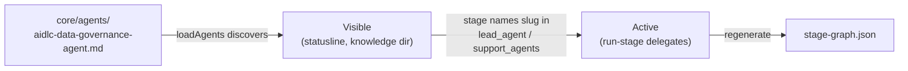
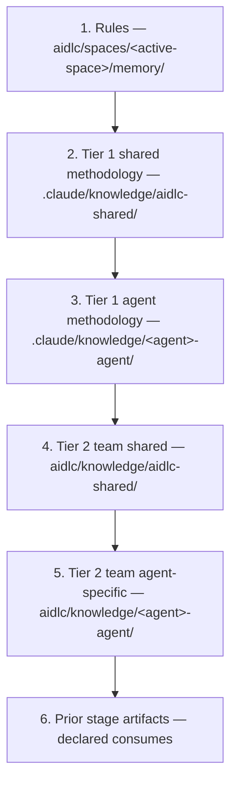
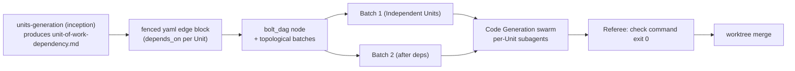

+++
date = '2026-10-17T00:00:00+10:00'
draft = false
title = 'AI-DLC Harness Engineering: A Complete Guide to Shaping the Factory'
tags = ['AI-DLC', 'Agentic AI', 'Harness Engineering', 'Agents', 'Process']
summary = "A clear, practical guide to reshaping AI-DLC without writing code: stages, agents, scopes, rules, sensors, knowledge, swarm construction, porting harnesses, and authoring plugins."
aliases = ['/blog/ai/aidlc/harness-engineering/']
+++

# AI-DLC Harness Engineering: A Complete Guide to Shaping the Factory

> Part of the AI-DLC series. [User Guide](https://github.com/awslabs/aidlc-workflows/tree/main/docs/guide/) → build with AI-DLC. **This guide** → reshape how AI-DLC behaves for your team. [Developer Reference](https://github.com/awslabs/aidlc-workflows/tree/main/docs/reference/) → change AI-DLC's code.

AI-DLC is a spec-driven development factory that runs out of the box across Claude Code, Kiro CLI, Kiro IDE, Codex CLI, Cursor, opencode, and GitHub Copilot. It ships with 14 agents (11 domain experts, 2 reviewers, 1 composer), 33 stages, 11 scopes, plus rules and sensors.

This guide shows you how to **reshape AI-DLC for your team without writing code**. Change which stages run, add agents, tune scopes, teach standing rules, wire deterministic checks, add team knowledge, control Construction autonomy, port to a new harness, or author a plugin—all declaratively.

## 1. Three Roles, Three Guides

| Guide | Who | What You Change |
|---|---|---|
| [User Guide](https://github.com/awslabs/aidlc-workflows/tree/main/docs/guide/) | Building *with* AI-DLC | Nothing in harness configs. Run `/aidlc`, answer gates, review artifacts. |
| **Harness Engineering Guide (this one)** | Shaping *how* AI-DLC behaves | Declarative data: stages, agents, scopes, rules, sensors, knowledge. |
| [Developer Reference](https://github.com/awslabs/aidlc-workflows/tree/main/docs/reference/) | Changing AI-DLC *itself* | Code: orchestrator, hooks, CLI tools, graph compiler, tests. |

The rule is simple: **data vs code**. If you edit Markdown with YAML frontmatter or JSON, you're in this guide. If you edit TypeScript, you're in the Developer Reference.

## 2. Core Mental Model: What vs Who

Two primitives drive everything.

- **Stage** = *what* happens. A unit of work that declares consumed/produced artifacts, lead agent, and execution. Stages form the workflow graph.
- **Agent** = *who* does the work. A persona with domain expertise, tool allowlist, and model. Agents are loaded into stages.

Stages name their lead agent. Agents never name stages. This keeps work and workers decoupled—you can reassign by editing a stage, or add an agent without changing workflows until a stage opts in.

### 2.1 How Work Flows

- **Engine** (`core/tools/aidlc-orchestrate.ts`) — Deterministic. Reads `aidlc-state.md` and compiled `stage-graph.json`, picks next step, emits one typed directive. Subcommands: `next`, `continue` (internal), `report`, `park`, `team-board` (read-only), `wait` (bounded read-only).
- **Conductor** (`skills/aidlc/SKILL.md`) — Thin forwarding loop that executes each directive.

**Routing lives in the engine.** Your stage files, scopes, and rules are the inputs that steer it—the conductor never decides the route.

Everything else shapes their inputs:

- **Scopes** — Which stages run for a given work type (e.g. a bugfix runs 9 of the 33 stages; an enterprise feature runs all of them).
- **Rules** — Standing "always do this" decisions applied to every workflow.
- **Sensors** — Deterministic checks bound to stages (advisory or blocking).
- **Knowledge** — Domain/project context agents load before working.

## 3. What You Can Change Without Code

Author in **`core/`** (harness-neutral source). Regenerate per-harness distributions.

| Change | Where | See |
|---|---|---|
| Edit a stage | `core/aidlc-common/stages/<phase>/<slug>.md` | §4 |
| Add a new stage | New file in phase + wire dependencies | §5 |
| Add/modify an agent | `core/agents/<name>-agent.md` | §6 |
| Define/tune a scope | `core/scopes/aidlc-<name>.md` + stage `scopes:` | §7 |
| Teach standing rules | `core/memory/{team,project}.md` (framework baseline) or space memory | §8 |
| Wire a deterministic check | `core/sensors/<id>.md` + stage `sensors:` | §9 |
| Add team domain knowledge | `aidlc/knowledge/<agent>-agent/` (space-level, runtime) | §10 |
| Shape Construction & swarm | `core/memory/` + `units-generation` stage | §11 |
| Port to a new harness | `harness/<name>/` + manifest/emit | §12 |
| Author a reusable plugin | `plugins/<name>/` | §13 |

**Team knowledge is the only exception**: it lives at `aidlc/knowledge/` in your project space and is never overwritten by framework updates.

### 3.1 Naming Rules & Validation

- Stage filename stem must equal frontmatter `slug`. `aidlc-graph compile` rejects mismatches, duplicate slugs, multiple producers of same consumed artifact (names files/consumer).
- Sensor filename/id consistency is compile-time enforced.
- Duplicate scope/agent names are loader errors naming both files. Filename↔name drift is reported by `/aidlc --doctor` as advisory.
- One owner per invariant (approval/transition/presence/plan fingerprint). Same check may appear at multiple boundaries, but duplicating logic is a defect.

### 3.2 Build Model: Author in `core/`, Regenerate

**Never edit `dist/` or `dist-release/`**. They are generated.

```bash
# 1. Edit source in core/ (never dist/)
$EDITOR core/aidlc-common/stages/inception/my-stage.md

# 2. Regenerate all harness projections
bun scripts/package.ts

# 3. Verify determinism (CI guard)
bun scripts/package.ts --check
```

Commit `core/`, `harness/`, `plugins/` only. `--check` builds twice in independent temp roots and byte-compares. When instructed to run `aidlc engine graph compile`, run it against your installed harness projection.

### 3.3 When to Cross Into Developer Reference

Cross over when changing code, not data:

- Orchestrator routing/state or engine/conductor/directive contract ([Orchestrator](https://github.com/awslabs/aidlc-workflows/blob/main/docs/reference/03-orchestrator.md), [State Machine](https://github.com/awslabs/aidlc-workflows/blob/main/docs/reference/12-state-machine.md), [Skill System](https://github.com/awslabs/aidlc-workflows/blob/main/docs/reference/17-skill-system.md))
- Hooks/CLI tools ([Hooks and Tools](https://github.com/awslabs/aidlc-workflows/blob/main/docs/reference/06-hooks-and-tools.md))
- Graph compile pipeline or audit taxonomy
- Test suite ([Testing](https://github.com/awslabs/aidlc-workflows/blob/main/docs/reference/09-testing.md))

Adding stages/agents changes graph data—not the code that reads it. Changing *how* the graph compiles is code.

## 4. Anatomy of a Stage

A **stage** is the atom of the AI-DLC workflow — *what* happens at one step. Every other change a harness engineer makes builds on the stage file, so read this first.

A stage file is a **single Markdown file**: YAML frontmatter on top, prose body below. The frontmatter declares the graph node (the artifacts the stage consumes and produces, its lead agent, how it executes). The body is the prose the agent follows. Both live in one file on purpose.

### 4.1 Two Readers, One File

A stage file has two readers, and they never overlap:

- **The parser** reads only the YAML frontmatter. It produces a structured graph entry — the edges, the lead agent, the execution mode — and ignores the body entirely.
- **The agent** executing the stage reads only the body. It follows the prose steps, produces the artifacts, and never touches the frontmatter.

Keeping both in one file means you see the graph edges and the execution steps side by side. A reviewer sees both at once: which artifacts the stage produces *and* the instructions that produce them. Splitting them (one YAML file for the graph, one prose file for the agent) would break that inline visibility, which is what makes stages reviewable.

This split is the key to knowing what you're editing:

- Change a **frontmatter** field → you've changed the **graph** (a dependency edge, the leading agent, the execution mode).
- Change the **body** → you've changed the **work** (what the agent actually does).

The two are independent. A real stage is authored at `core/aidlc-common/stages/<phase>/<slug>.md` — for example `stages/inception/domain-design.md` (phases: `initialization`, `ideation`, `inception`, `construction`, `operation`).

### 4.2 The Frontmatter at a Glance

The frontmatter is a flat block of YAML keys. Some are mechanical (`slug`, `phase`) and copied from a neighbouring stage. A handful carry real judgment. Here is a real stage's frontmatter (from `stages/inception/domain-design.md`, trimmed):

```yaml
---
slug: domain-design
phase: inception
execution: CONDITIONAL
condition: Execute when new components are needed. Skip for modifications to existing components only.
lead_agent: aidlc-architect-agent
support_agents:
  - aidlc-aws-platform-agent
  - aidlc-design-agent
mode: inline
summary_confirmation: required
reviewer: aidlc-architecture-reviewer-agent
review_artifact: components
reviewer_max_iterations: 2
review_class: advisory
produces:
  - components
  - decisions
  - traceability
consumes:
  - artifact: requirements
    required: true
  - artifact: stories
    required: false
  - artifact: architecture
    required: false
    conditional_on: brownfield
requires_stage:
  - requirements-analysis
  - refined-mockups
sensors:
  - required-sections
  - upstream-coverage
  - traceability
scopes:
  - enterprise
  - feature
  - mvp
  - classic
  - workshop
inputs: <record>/inception/requirements-analysis/requirements.md, ...
outputs: components.md, decisions.md, and traceability.json — under this stage's record dir
---
```

The judgment-bearing fields:

| Field | What it decides | The judgment call |
|---|---|---|
| `requires_stage` | Dependency and ordering edges | Does this stage genuinely consume another's output, or just need to run after it? |
| `consumes` | The artifacts this stage reads | Per artifact: is it `required`, `conditional_on` brownfield/greenfield, and `cited`? |
| `consumes[].cited` | Which optional inputs the output must cite when they exist | Is there an optional input that, whenever present, the output builds on? Mark `cited: true`; the `upstream-coverage` check then asks for its citation. |
| `produces` | The artifacts this stage writes | These are the forward edges other stages discover. |
| `lead_agent` / `support_agents` | Who runs the stage | One persona owns it; supporters add perspective. |
| `mode` | Communication topology | `inline` (voices in the conductor's context), `subagent` (hub-and-spoke dispatch), `pipeline` (chain), or `mob` (mesh in bounded rounds). |
| `for_each` | Whether it iterates | Names an artifact whose instances drive a once-per-instance run. |
| `reviewer` / `review_artifact` | Independent quality review | If a reviewer is declared, name the one required Markdown output the review is about (the record is keyed to it and the gate names it); never rely on `produces` order. |

The calls that bite hardest:

- **`consumes[].required` is scoped to the active plan, not global.** `required: true` means "if the producing stage runs in *this* workflow, this consume must be satisfied" — not "the producer always runs." Scopes deliberately skip upstream stages, so a flat global requirement would make those scopes structurally invalid. The stage body handles the absent-input case gracefully (prose like "if produced").
- **`consumes[].conditional_on` captures the brownfield/greenfield split.** A consume marked `conditional_on: brownfield` is only required when the workflow is brownfield. For an unconditional consume, omit the field entirely — there is no `always` value.
- **`mode` is the communication topology** — who talks to whom while the body runs. `inline` runs short stages in the conductor's own context with supporters as adopted voices; `subagent` delegates the lead to a fresh context (long stages like Construction code generation) and, when supporters are declared, dispatches each as a mutually-blind spoke; `pipeline` chains supporters in declared order, each seeing all upstream work; `mob` runs all supporters in parallel against the lead's draft with one bounded objection round. **WHO** participates is `support_agents`; **HOW** they participate is `mode`. `pipeline` and `mob` require non-empty `support_agents`.
- **`for_each` names the iteration artifact.** The five Construction stages (`functional-design`, `nfr-requirements`, `nfr-design`, `infrastructure-design`, `code-generation`) run once per Unit and each declare `for_each: unit-of-work`; the other stages omit the field and run once. Aggregation is inferred from the graph, not declared.
- **`lead_agent` and `support_agents` validate against `core/agents/*.md`.** There's no hardcoded list — adding an agent means dropping its file in that directory (see [§6](#6-adding-an-agent)).

This is orientation, not the full contract. For the complete field table with types and constraints, see the Developer Reference's [Stage Definition](https://github.com/awslabs/aidlc-workflows/blob/main/docs/reference/15-stage-definition.md).

<details>
<summary>What does <code>for_each: unit-of-work</code> mean in practice?</summary>

<p><code>for_each</code> tells the engine to run a stage once for each instance of the named artifact. Here, <code>unit-of-work</code> is the artifact produced by the <code>units-generation</code> stage. That artifact is one file containing multiple Unit definitions; it is not one file per Unit.</p>

<p>The Units are proposed and approved during <code>units-generation</code>. Its <code>unit-of-work.md</code> describes each Unit, while <code>unit-of-work-dependency.md</code> lists the same Unit names and their dependencies. If those artifacts define <code>u1-catalog</code>, <code>u2-identity</code> and <code>u3-orders</code>, a Construction stage with <code>for_each: unit-of-work</code> runs three times: once for each Unit. Each run writes its Construction artifacts under that Unit's directory, such as <code>construction/u1-catalog/</code>.</p>

<p><strong>Illustrative example:</strong> These fictional online-shop Units show how one output file can define several Units. The actual number and boundaries are proposed from the project context and approved by the human; the workflow does not prescribe a fixed count.</p>

<table>
<thead>
<tr><th>Unit ID</th><th>Directory</th><th>Kind</th><th>Responsibility</th><th>Complexity</th><th>Deployment model</th></tr>
</thead>
<tbody>
<tr><td>U1</td><td><code>u1-catalog</code></td><td><code>service</code></td><td>Provide product details and search</td><td>M</td><td>standalone</td></tr>
<tr><td>U2</td><td><code>u2-identity</code></td><td><code>service</code></td><td>Register customers and authenticate them</td><td>M</td><td>standalone</td></tr>
<tr><td>U3</td><td><code>u3-orders</code></td><td><code>service</code></td><td>Create orders using the catalog and customer identity</td><td>L</td><td>standalone</td></tr>
<tr><td>U4</td><td><code>u4-storefront</code></td><td><code>ui</code></td><td>Let customers browse products and place orders</td><td>M</td><td>embedded</td></tr>
<tr><td>U5</td><td><code>u5-packaging</code></td><td><code>packaging</code></td><td>Package the services and storefront for deployment</td><td>S</td><td>shared</td></tr>
</tbody>
</table>

<p>The matching dependency block in <code>unit-of-work-dependency.md</code> lists each Unit once and names only declared Units in <code>depends_on</code>:</p>

<pre><code class="language-yaml">units:
  - name: u1-catalog
    kind: service
    depends_on: []
  - name: u2-identity
    kind: service
    depends_on: []
  - name: u3-orders
    kind: service
    depends_on: [u1-catalog, u2-identity]
  - name: u4-storefront
    kind: ui
    depends_on: [u1-catalog, u2-identity, u3-orders]
  - name: u5-packaging
    kind: packaging
    depends_on: [u3-orders, u4-storefront]</code></pre>

<p>In this example, <code>u1-catalog</code> and <code>u2-identity</code> have no dependency on each other, so they can be in the same parallel batch. <code>u3-orders</code> waits for both. A <code>code-generation</code> stage with <code>for_each: unit-of-work</code> has one run for each of the five Units, with each Unit's artifacts written under its own <code>construction/&lt;unit-name&gt;/</code> directory.</p>

<p>A stage without <code>for_each</code> runs once for the workflow. When that stage consumes outputs from per-Unit stages, the graph makes it an aggregation step: for example, <code>build-and-test</code> runs once after the per-Unit Construction work and consumes the resulting outputs. No separate aggregation field is needed.</p>

<p>For the complete field contract, see the <a href="https://github.com/awslabs/aidlc-workflows/blob/main/docs/reference/15-stage-definition.md#for_each">Developer Reference's <code>for_each</code> definition</a> and the <a href="https://github.com/awslabs/aidlc-workflows/blob/main/core/aidlc-common/stages/inception/units-generation.md">Units Generation stage instructions</a>.</p>

</details>

### 4.3 The Three-Compartment Body

Below the frontmatter, the body has three compartments, always in this order: `## Steps`, `## Sensors`, `## Learn`.

- **`## Steps`** — the imperative prose the agent follows: load personas, read prior context, create the questions file, generate the artifacts, present the approval gate. This is where the stage's domain work lives, and it's the compartment you'll edit most when changing *what a stage does* without touching the graph.
- **`## Sensors`** — a compact local summary: where outputs land, an `Imports:` line that mirrors the frontmatter `sensors:` list, and an `Upstream targets:` line that mirrors `consumes:` when `upstream-coverage` is imported. Stage-specific exceptions live here (an intentionally omitted sensor, ownership of a structured output); shared behavior lives in `stage-protocol-sensors.md`. See [§9 Sensors](#9-sensors).
- **`## Learn`** — points to the conditional learning-loop contract in `stage-protocol-learnings.md` §13. Only when `directive.protocol_modules` lists `learnings`, maintain the four-heading diary at `directive.memory_path` while working, then surface and persist confirmed learnings before a human gate. When absent, keep no diary and skip the ritual. Workflow-time learning never rewrites the stage body.

The three compartments are fixed so a stage's sensor bindings and learning-loop pointer always have a place of their own, and adding one never restructures the body.

**One boundary worth internalizing:** a stage file is a framework artifact, immutable in shape. The body's `## Steps` / `## Sensors` / `## Learn` structure is never rewritten by a workflow. The single sanctioned in-workflow edit is the learning loop appending a new sensor id to the frontmatter `sensors:` import list. Everything else you change in a stage file, you change deliberately as a harness engineer.

### 4.4 consumes and produces from the Graph

The dependency graph isn't written anywhere directly — it **emerges** from the `consumes` and `produces` declarations across every stage.

- A stage's `produces` list is its **forward edges**: when another stage asks "who produces `scope-document`?", the answer is whichever stage declares it.
- A stage's `consumes` list is its **backward edges**: a `required` artifact must exist when this stage runs *if its producer is in this plan*, and an optional one is read when it is there.

`requires_stage` makes the dependency explicit and also encodes pure ordering. It carries two roles:

1. **A semantic data dependency** — "I consume artifact X, which stage Y produces," so Y goes in `requires_stage`.
2. **A presentation-order edge** — two stages in the same phase with no data dependency but a fixed order. Author the weak edge so the computed display order lands stably rather than relying on an alphabetical tiebreak.

These three lists are what wire a stage into the workflow. Get them right and the stage appears in the correct scopes, in the correct order, with its inputs satisfied. Wiring a brand-new stage is covered step by step in [§5 Adding a Stage](#5-adding-a-stage).

### 4.5 stage-graph.json Is Compiled — Never Hand-Edit It

The graph is compiled into a JSON build artifact. In a source build, the generated Claude projection runs the graph from `dist/claude/.claude/tools/data/stage-graph.json`; the installed runtime carries the same relative file under `.claude/tools/data/`. The JSON is a **build artifact, not a source file**. The YAML frontmatter across the stage files is authoritative; the JSON is what you get when you compile it.

```
edit stage .md YAML  →  compile  →  stage-graph.json  →  runtime reads it
```

After editing a stage's frontmatter in `core/`, run `bun scripts/package.ts`, which compiles the graph into every generated tree, and commit only the `core/` edit (the generated trees are ignored and CI rebuilds them). In an installed project tree, `aidlc engine graph compile` regenerates that tree's `stage-graph.json`, and `aidlc engine graph compile --check` says when it is out of date:

```text
$ aidlc engine graph compile --check
stage-graph.json is out of date. Run `aidlc engine graph compile` to regenerate.
```

**The rule: do not hand-edit `stage-graph.json`.** Edit the YAML, recompile. A hand-edit either gets clobbered by the next compile or trips the drift check.

<details>
<summary>Which command should I run?</summary>

These commands are for different environments; you do not normally run both:

- **When editing AIDLC itself:** the AIDLC source repository is the repository where AIDLC is developed and maintained, rather than a project that uses an installed copy. Editing stage frontmatter under `core/` is harness engineering; running `bun scripts/package.ts` from that repository's root is the developer/build step that packages the change and compiles the graph into each generated harness tree.
- **When working in a project with AIDLC already installed:** run `aidlc engine graph compile` from that project only when its local stage files or plugin composition have changed and its graph needs updating. Run `aidlc engine graph compile --check` to check for an outdated graph without regenerating it.

In short: harness engineering changes AIDLC's source; the packaging script builds those changes. Compile local changes in an installed project separately—the installed-project command is not an extra step after packaging.

</details>

### 4.6 What a Stage *Contains* versus What It *Does*

This section is about what a stage file *contains* — its format ([Stage Definition](https://github.com/awslabs/aidlc-workflows/blob/main/docs/reference/15-stage-definition.md)). A companion contract covers what a stage *does* at runtime: the approval gate, the question flow, the state checkboxes, the completion message. That behavioural contract is the same for every stage regardless of domain, and it lives in [Stage Protocol](https://github.com/awslabs/aidlc-workflows/blob/main/docs/reference/04-stage-protocol.md). When a stage body says "follow stage-protocol.md for approval gates," that's the contract it points at.

Keep the two separate: the stage *definition* is the file format you edit; the stage *protocol* is the runtime behaviour that wraps around every stage's work, which you mostly leave alone.

<details>
<summary>What does the protocol add? (Example)</summary>

A stage definition might tell the agent to create a design document. The stage protocol supplies the shared runtime rules for completing that work, such as how to report completion, update workflow state and request human approval.

Some protocol modules apply only in particular workflow situations. For example, when the Learnings module applies, the agent records useful observations while working and asks whether anything should be saved for next time before presenting the approval gate. The module defines that extra behavior without changing the stage's instructions. See [Stage Protocol](https://github.com/awslabs/aidlc-workflows/blob/main/docs/reference/04-stage-protocol.md) and the [Learnings Protocol](https://github.com/awslabs/aidlc-workflows/blob/main/core/aidlc-common/protocols/stage-protocol-learnings.md).

</details>

## 5. Adding a Stage

A new stage is the most structural change a harness engineer makes — you introduce a new step into the methodology. The recipe is end-to-end: pick a phase, author the file, wire the dependency edges, compile the graph, and confirm the stage lands where you expect.

**Is a new stage the right move?** A new stage earns its place when it produces an artifact no existing stage produces, or consumes one in a way no existing stage covers. If you only want to change *what an existing stage does* (reword its steps, retarget its lead agent, attach a sensor), edit that stage file in place — no new node needed. Adding a stage is pure **data work**: a Markdown file with YAML frontmatter, then a recompiled JSON artifact. No TypeScript.

### 5.1 Step 1 — Decide the Phase

Stage files live under `core/aidlc-common/stages/<phase>/<slug>.md`. The phase is the directory:

```text
core/aidlc-common/stages/
├── initialization/
├── ideation/
├── inception/
├── construction/
└── operation/
```

The phase is not cosmetic: it determines which `phases/<phase>.md` rule layer attaches to the stage at compile time (a construction stage inherits the construction rule, an inception stage the inception rule; initialization has no phase rule file). Put the stage where its work actually happens in the lifecycle.

### 5.2 Step 2 — Create the File with Required Frontmatter

Drop a new `<slug>.md` in the chosen phase directory. The slug is the filename stem and the stage's identity everywhere else — in `requires_stage` edges, scope mappings, and the audit log. Pick it carefully; renaming later ripples.

The frontmatter fields that carry the structural weight:

| Field | What it does |
|---|---|
| `requires_stage` | The dependency edges — which stages must precede this one |
| `consumes` | The artifacts this stage reads, each with a `required` boolean |
| `produces` | The artifacts this stage writes (its forward edges) |
| `lead_agent` | The persona that owns the stage |
| `support_agents` | Optional perspectives the conductor loads after the lead; pipeline chains require unique agents |
| `mode` | `inline`, `subagent`, `pipeline`, `mob`, or the reserved `agent-team` |
| `for_each` | Optional — names an artifact whose instances drive iteration |
| `summary_confirmation` | Optional — `required` for stages that always collect file-backed answers, `if-present` for conditional question flows |
| `reviewer` / `review_artifact` | Optional pair — the review agent and the required Markdown `produces` entry the review is about (its review record is keyed to that artifact) |

A complete small stage — a glossary step after Requirements Analysis that runs only under `feature` — looks like this (it compiles as it stands):

```markdown
---
slug: glossary-capture
phase: inception
execution: CONDITIONAL
condition: Execute when the requirements use domain terms the team must agree on. Skip when every term is already defined.
lead_agent: aidlc-product-agent
support_agents: []
mode: inline
produces:
  - glossary
consumes:
  - artifact: requirements
    required: true
requires_stage:
  - requirements-analysis
sensors:
  - required-sections
scopes:
  - feature
inputs: <record>/inception/requirements-analysis/requirements.md
outputs: glossary.md (under this stage's record dir, engine-resolved)
---

# Glossary Capture

Collect the domain terms the requirements use and agree one meaning for each.

## Steps

1. Read `<record>/inception/requirements-analysis/requirements.md` and list every domain term it uses.
2. For each term, write one plain definition and the requirement IDs that use it.
3. Write `glossary.md` with `## Terms` and `## Open Terms` sections.
4. Follow stage-protocol.md for the approval gate.

## Sensors

This stage's output is a markdown artefact under `<record>/inception/glossary-capture/`.

Imports: `required-sections`.

## Learn

When `directive.protocol_modules` lists `learnings`, follow
`stage-protocol-learnings.md`: keep the diary at `directive.memory_path` while
working and run the ritual before the approval gate. When the module is absent,
skip both the diary and the ritual.
```

The body opens with `## Steps` (the imperative prose the lead agent follows), then `## Sensors` (output location, exact frontmatter imports, upstream targets), then `## Learn` (points to `stage-protocol-learnings.md` §13 only when the module is listed).

### 5.3 Step 3 — Wire the Dependency Edges

This is where the stage slots into the workflow. Three fields do the wiring, and they must agree:

- **`requires_stage`** — the edges. Two kinds: a *semantic data dependency* ("I consume artifact X, which stage Y produces" → add `Y`) and a *presentation-order edge* (two stages in one phase with no data dependency but a fixed order). Author the order edge explicitly rather than relying on the compiler's alphabetical tiebreak.
- **`consumes`** — the artifacts the stage reads. Each entry carries a `required` boolean, scoped *to the active plan*: `required: true` means "if the producing stage runs in this scope, the consume must be satisfied" — not "the producer always runs." A brownfield-only consume takes `conditional_on: brownfield`; an unconditional consume omits the field entirely.
- **`produces`** — the forward edges. Every consumed artifact must resolve to exactly one producer across `produces` and `optional_produces`; the compiler rejects duplicates and names both producer files. Reusing an artifact name is valid only when no stage consumes it.

Get these consistent and the compiler places the stage automatically; you never hand-edit `stage-graph.json` to position it.

### 5.4 Step 4 — Regenerate the Harnesses

The YAML you authored in `core/` is authoritative. Run the packager to materialize the ignored local `dist/<harness>/` (Bun copy) and `dist-release/<harness>/` (native), copying your new stage into both channels and recompiling each graph:

```bash
bun scripts/package.ts            # materialize both channels for every harness
bun scripts/package.ts --check    # build twice and byte-compare
```

The runtime reads `<harness-dir>/tools/data/stage-graph.json` (e.g. `.claude/tools/data/stage-graph.json` in an installed Claude tree). If iterating on an installed tree, recompile directly:

```bash
aidlc engine graph compile
```

Never hand-edit `stage-graph.json`; a hand-edit is overwritten on the next compile.

### 5.5 Step 5 — Verify It Appears, and in Which Scopes

```bash
aidlc engine graph topo                      # topological order — your slug should appear
aidlc engine graph producers <artifact>      # who produces an artifact
aidlc engine graph consumers <artifact>      # who consumes it
aidlc engine graph scope <scope-name>        # stages on a scope's path
aidlc engine graph validate-scope <scope>    # dependency sanity for a scope
```

Two behaviors to note:

- A new stage takes the next free number in its phase, after the stages already there; no existing stage is renumbered. An edge from an earlier stage *to* the new one is refused at compile (dependencies must be lower-numbered).
- A brand-new stage does **not** automatically run in any scope. Its frontmatter `scopes:` list names every scope it runs under; a stage that names no scope is `SKIP` everywhere. Authoring the body makes it *exist*; the `scopes:` tag makes it *run*.

### 5.6 The Runner Is Opt-In Sugar

Adding a stage requires writing a stage file. Run `bun scripts/package.ts` to copy the source stage into the harnesses and compile their runtime graphs; when working in an installed harness, run `aidlc engine graph compile`. Compilation turns the stage definitions into the `stage-graph.json` artifact the runtime reads, resolving the stage's placement and dependencies. Once compiled, run the stage directly with `--single`:

```bash
aidlc engine orchestrate next --stage <your-slug> --single
```

The engine emits one `run-stage` directive containing the stage's lead agent, resolved `consumes` and `produces` paths, rules and sensors. The conductor runs the stage and reports completion. The engine records a synthetic-ID lifecycle in the audit log: `next --single` records `STAGE_STARTED` before dispatch, and `report --single` requires that event before recording `STAGE_COMPLETED`. The directive sets `single: true`, so the conductor runs the configured body, topology, reviewer and completion checks, reports once with `report --single --stage <slug> --result completed` and stops at `done`. A single-stage run does not run workflow learnings or open a workflow approval gate. It also **never changes the main workflow's `Current Stage`**, so it cannot advance or derail an in-flight workflow.

A runner skill is optional packaging for a shorter command. A generated skill at `skills/aidlc-<slug>/SKILL.md` makes the stage typeable as `/aidlc-<slug>`; the thin skill drives `next --stage <slug> --single`. The generator creates one for each runnable compiled stage, so the generated runner set follows the compiled stage set. After adding or removing a stage, regenerate the runners and check for drift:

```bash
aidlc engine gen runners          # regenerate every runner dir
aidlc engine gen runners --check  # CI drift guard
```

The three **bootstrap initialization stages have no per-stage runner** because they have no standalone `--single` meaning. Use `/aidlc-init` for the initialization phase. With `--scope` and a description, it packages the engine's intent-create move; with `--scope` alone, it asks what the work is for; with only a description, it asks the engine for new work and shows the plan offer first.

Runner skills carry no `hooks:` block because the deterministic spine (audit, sensors, runtime-graph compile and state validation) is registered project-wide in `settings.json`. The engine includes the conductor persona in the `run-stage` directive, so the runner does not load that persona itself. The runner body states what it does and the command it drives. Deleting all runner skills leaves every compiled stage runnable through `/aidlc --stage <slug> --single`; the stage file remains the definition.

### 5.7 What Validates Automatically vs. What You Check

**Automatic:**
- **Graph placement** — once you compile, `requires_stage`/`consumes`/`produces` resolve into the graph (topological order, producer/consumer lookups, cycle detection).
- **Compile-time field validation** — `lead_agent`/`support_agents` are checked against the actual agents files; a typo fails the compile (`lead_agent "<name>" has no matching .claude/agents/*.md`) rather than 404-ing at run time. The reserved `orchestrator` slug is exempt. Pipeline stages reject duplicate chain identities.
- **Drift checks** — `bun scripts/package.ts --check` builds twice and byte-compares; `aidlc engine graph compile --check` exits `1` and prints `stage-graph.json is out of date...` when a stage was edited without recompiling.
- **Phase rule attachment** — the `phases/<phase>.md` rule layer attaches at compile time from the directory.

**Check yourself:**
- **Scope participation** — the compiler places the stage but doesn't decide which scopes run it. Add each scope name to the stage's `scopes:` list (then recompile so the transpose updates `scope-grid.json`).
- **Body prose** — only frontmatter is parsed; the `## Steps` body is read only by the lead agent.
- **Prose-to-edge consistency** — `requires_stage` and the `## Steps` prose can drift; keep them in sync by hand.
- **`required` semantics under your scopes** — a `required: true` consume is moot in a scope that skips the producer; confirm the body handles the absence gracefully.
- **Documentation** — if the new stage changes a hand-enumerated count/table, update the docs in the same change.

### 5.8 The Boundary Case: Data Work vs. Code Work

Authoring the file and recompiling is data work — Markdown, YAML, JSON, no `.ts`. The line you must not cross silently: if making your stage work requires the graph *compiler* to behave differently (a frontmatter key it doesn't recognize, a new edge type, a new traversal rule), that's a change to the code that reads the data and belongs in the Developer Reference. The reserved-key namespace (`on_failure`, `blocks_on`, `timeout`, `retry`) exists so future extensions land predictably; until a consumer ships, the schema rejects them. `when:` is different: the schema accepts and checks it, but nothing acts on it yet, so a stage with `when:` runs under its `scopes:` as if it weren't there.

## 6. Adding an Agent

An **agent** is the *who* of the framework — a persona with a domain, a tool allowlist, and a tier. The 14 shipped agents comprise 11 domain experts (product, design, delivery, architecture, AWS platform, compliance, DevSecOps, development, quality, pipeline-deploy, operations), two review-only agents (`aidlc-product-lead-agent`, `aidlc-architecture-reviewer-agent`), and the adaptive-workflows composer (`aidlc-composer-agent`). When your team needs a domain the framework doesn't cover — a data-governance reviewer or a mobile specialist, say — add a persona by dropping a single Markdown file into `core/agents/`. No TypeScript.

The one thing to internalize is the two-step truth: dropping the file makes the agent **visible**; wiring it into a stage makes it **active**. Both steps are required, or you get an agent that exists and never runs.

### 6.1 What a persona file is, and where it lives

Every agent is one flat file at `core/agents/<slug>-agent.md`: YAML frontmatter on top, a Markdown body below. The shipped files all carry the `aidlc-` prefix (`aidlc-architect-agent.md`, `aidlc-developer-agent.md`); a file you add is yours and need not use that prefix.

Treat the shipped 14 as framework files: in an installed project, a local edit to one stops the next `aidlc config` refresh until you move your copy away or take the shipped one with `--force`:

```text
$ aidlc config --harness claude --yes
error: 1 config conflict(s): .claude/agents/aidlc-architect-agent.md (locally modified or unowned)
fix: to keep your version, move .claude/agents/aidlc-architect-agent.md somewhere else and run the same command again; to take the shipped version over it, run it again with --force.
```

Customize *what an existing agent knows* through team knowledge ([§10](#10-team-knowledge)) rather than editing the file. A genuinely new persona — a new file, owned by you — is a different move, and survives upgrades.

Only the frontmatter is machine-read. The body is prose the agent reads about itself when it activates — its responsibilities, collaboration, memory focus, and working principles — and you write it to match the structure of the shipped files. The packager adds the mandatory delegated knowledge preflight to every harness projection.

### 6.2 The frontmatter, from a real agent

Here is the frontmatter from a real agent, authored at `core/agents/aidlc-architect-agent.md`:

```yaml
---
name: aidlc-architect-agent
display_name: Architect Agent
examples:
  - tech-stack.md
  - infrastructure-preferences.md
description: >
  Solutions architect responsible for domain design, contract design, NFR patterns, and component decomposition.
  Leads Feasibility, Domain Design, Units Generation, Contract Design, Functional Design, NFR Requirements, and NFR Design stages,
  and serves as the dispatched final link of the Reverse Engineering pipeline.
disallowedTools: Task
tier: judgment
---
```

### 6.3 The fields, and the calls you make

| Field | Required | What it does |
|---|---|---|
| `name` | Yes | Must match the filename stem. The parser keys off it, and a mismatch is the easiest way to author an agent that never resolves. The loader rejects duplicate agent `name` values across files and names both files in the error. |
| `display_name` | Yes | The human-readable label the statusline renders (the architect shows as "Architect Agent"). |
| `description` | Yes | A short summary of the persona's domain and the stages it leads. |
| `examples` | Yes | Suggested knowledge filenames documented in the agent→examples table. They are *suggestions surfaced to the user*; the runtime never loads them and the engine never writes them to disk. |
| `disallowedTools` | Yes | **Must include `Task`** — not optional (see below). |
| `tier` | Yes | The kind of work; the packager projects it into per-harness model/effort keys (see below). |
| `tools:` | Optional | A tool allowlist that narrows the persona. Omit it to inherit the full session toolset. |
| `maxTurns:` | Optional | Caps the agent's turn budget. |

Four of these carry real judgment. Here is what each decides.

**`disallowedTools` must include `Task`.** Agents run as delegated workers; the conductor (the live `/aidlc` session) performs the `Task` call when the engine's `run-stage` directive carries `mode: subagent`. Allowing `Task` would let an agent spawn its own subagents, cascading the delegation chains the framework is built to prevent. Every shipped agent disallows `Task`, and so must yours. The Kiro projections remove this Claude-only frontmatter key and enforce the same no-nested-delegation boundary through Kiro's native agent tool configuration; any other `disallowedTools` value fails packaging or is drop-logged during plugin compose.

**`tier` names the kind of work.** You never author raw `model:` or `effort:` in core agent frontmatter — those are projection OUTPUTS in the ignored local `dist/<harness>/` tree and versioned release runtime, derived from the tier table in `core/tools/aidlc-tiers.ts`. Pick:

- **`judgment`** — for any persona whose work is multi-constraint reasoning that cascades downstream: interpreting ambiguous intent, weighing architectural trade-offs under dense context. A judgment agent inherits the session's model AND effort unless an explicit model policy overrides it.
- **`balanced`** — for reviewer-shaped personas that judge novel input against explicit criteria.
- **`templated`** — only when the output is dominantly pattern-following and the methodology is already encoded in the agent's knowledge files, as with delivery plans, CI/CD YAML, and runbook scaffolding.

With no recorded policy, the `balanced` reviewer tier uses Sonnet at `medium` effort on Claude Code; on Codex and opencode it inherits the session model and applies medium reasoning effort. `judgment` and `templated` inherit session model and effort. When in doubt, use `judgment`: the projection table (and a project's `tier_cap`) can always step cost down later, but a persona authored too low silently under-reasons.

**`tools:` narrows the persona — rarely needed.** None of the 14 shipped agents declare a `tools:` allowlist, so each one reaches every tool the session provides — `Read`, `Edit`, `Write`, `Glob`, `Grep`, `AskUserQuestion`, `Bash`, `WebSearch`, and the inherited MCP tools alike. Listing `tools:` narrows the persona to exactly the tools it names, and it drops the inherited MCP tools unless you also name the fully-qualified `mcp__<server>__<tool>` ids. Reach for it only when a domain genuinely needs a smaller surface; most personas are best left to inherit everything.

**`maxTurns:` caps the turn budget.** Binding on Claude Code, projected to opencode's native `steps:` key, and inert (persona-prose-only) on Codex CLI, Cursor, GitHub Copilot, and both Kiro surfaces, which expose no per-agent cap key. The two review-only agents ship it today.

### 6.4 MCP servers are inherited, not granted per agent

The five MCP servers declared in the project-root `.mcp.json` are provisioned to the session, and every agent inherits all of them automatically — there is no per-agent grant to author. To keep a persona *away* from a server, narrow its `tools:` allowlist to a fully-qualified `mcp__<server>__<tool>` list that omits that server (a bare `mcp__<server>` token is a no-op, not a server-level grant). The inheritance and restriction model is exercised by the `t110` registry-integrity test.

### 6.5 Visible is not active: the two-step truth

Dropping the file makes the agent *visible*; wiring it into a stage makes it *active*. Both steps are required.

- **Discovery makes it visible.** `loadAgents()` in `aidlc-lib.ts` reads every persona `.md` file in `.claude/agents/` (one named `aidlc-*` or carrying `display_name`, `examples`, `tier`, or `plugin`) on the next invocation and derives the metadata map. No code edit, no registration step — the file's presence is the registration. From this point the statusline can render its display name, and the team can add standards under its space-level `aidlc/knowledge/<slug>-agent/` directory.
- **Stage binding makes it active.** A stage names its lead and support agents by slug in its frontmatter `lead_agent` / `support_agents` fields (compiled into `stage-graph.json`). Until some stage references your slug, no `run-stage` directive names it, so the conductor never delegates to the persona.

This mirrors the framework's core asymmetry — a stage names its agent; an agent never names its stages. So the agent file alone is inert by design. To put your new persona to work, edit the stage that should use it.

Each agent also pairs with a knowledge directory you author at `core/knowledge/aidlc-<slug>-agent/` (framework methodology) and an optional team overlay at the space level, `aidlc/knowledge/<slug>-agent/` (your standards). The space-level `aidlc/knowledge/` directory is free-form and empty at bootstrap; the team creates the per-agent subdirectory when it has content — the engine does not scaffold it.

### 6.6 The steps, end to end

1. **Create the agent file** — `core/agents/<slug>-agent.md` with the required frontmatter: `name`, `display_name`, `examples`, `description`, `disallowedTools` (including `Task`), `tier`. An optional `tools:` allowlist narrows the persona; omit it to inherit the full session toolset. An optional `maxTurns: <n>` caps the turn budget. Write the body to match the shipped files' structure (Core Responsibilities, Collaboration, optional Memory Focus, Key Principles).
2. **Add knowledge files** under `core/knowledge/aidlc-<slug>-agent/` for the methodology the persona should load on activation.
3. **Wire it into stages** — add the slug to the `lead_agent` / `support_agents` frontmatter of each stage file (`core/aidlc-common/stages/<phase>/<slug>.md`) where it leads or supports, then regenerate with `bun scripts/package.ts` (or, in an installed tree, `aidlc engine graph compile`) so `stage-graph.json` regenerates. Never hand-edit `stage-graph.json`. This is the step that makes it active.
4. **Document the team-knowledge directory** — note that a team adds its standards under the space-level `aidlc/knowledge/<slug>-agent/`. The engine does not create this directory; the team creates it when it has content.
5. **Update the hand-maintained doc tables** — the Phase Participation matrix and the agent→examples table do not regenerate themselves.



### 6.7 What validates automatically vs. what you check

**Automatic:**

- `loadAgents()` discovers any new persona `.md` file on next invocation — no code edit, no registration. A persona is a file named `aidlc-*` or one whose frontmatter carries `display_name`, `examples`, `tier`, or `plugin`; any other file there is the host's own agent and is left alone.
- The parser throws if a persona's `name` or `display_name` is missing, naming the file, the missing field, and (for a file not named `aidlc-*`) the key that made it a persona.
- Agents are returned alphabetically sorted by slug, so discovery order is identical on every platform.
- Intent creation creates the empty space-level `aidlc/knowledge/` directory; it does not seed per-agent subdirectories or READMEs.
- The statusline renders the display name from the derived metadata.

**Check yourself:**

- **Stage-graph participation.** `stage-graph.json` references agents by slug; add an agent without wiring it there and it exists but never runs. Discovery and activation are separate steps.
- **Knowledge-file existence.** `examples` are suggested filenames documented in the agent→examples table — nothing creates or checks them. You place the real content under `aidlc/knowledge/<slug>-agent/`.
- **The hand-maintained doc tables.** The Phase Participation matrix and the agent→examples table are edited by hand. Update them in the same change that adds the agent.
- **The agent file's body.** Only the frontmatter is parsed; the body prose is read by the agent itself when it activates, so write it carefully to match the shipped 14.

A genuinely new persona is a file you own; a new stage's `lead_agent` reference to it is checked at compile time, so a typo fails the compile (`lead_agent "<name>" has no matching .claude/agents/*.md`) rather than 404-ing at run time.

## 7. Scopes

A **scope** is the dial that decides *which* of the framework's 33 stages run for a given kind of work, and which sit out. A bugfix doesn't need market research or environment provisioning, but it still runs the deployment pipeline and execution stages; a regulated enterprise feature needs the full lifecycle. Rather than asking the user to hand-pick stages every time, AI-DLC ships **eleven named scopes** — each one a curated EXECUTE/SKIP verdict over the full stage set, paired with workflow defaults such as depth, test strategy, and an optional review ceiling. Pick the scope and the rest cascades.

The eleven shipped scopes are `classic`, `enterprise`, `feature`, `mvp`, `poc`, `workshop`, `bugfix`, `refactor`, `security-patch`, `infra`, and `express`. The incremental scopes (`bugfix`, `refactor`, `security-patch`) and `poc`/`infra`/`express` never run `units-generation`, so they run Construction single-pass with nothing for the swarm to fan out across.

For a harness engineer, a scope is pure data, authored the same way every other primitive is — as a file. Adding or tuning a scope requires no TypeScript.

### 7.1 Two-part definition

A scope is authored in two places, and the split is the whole idea: the scope's *identity* lives in its own file, and its *membership* (which stages run under it) lives transposed onto the stages.

1. **The scope file** — `core/scopes/aidlc-<name>.md`. One file per scope, mirroring `core/sensors/`. The `feature` scope's frontmatter looks like this:

```yaml
---
name: feature
depth: Standard
keywords: []
description: Full lifecycle for new features, practical depth
skeleton: on
runner: true
guard_policy: off
sensors: on
learnings: on
summary_confirmation: on
plan_approval: on
collaborators: off
---

# feature scope

The full-lifecycle scope for new feature work at practical depth. ...
```

2. **The membership tag** — each stage's `scopes:` frontmatter, in `core/aidlc-common/stages/<phase>/<slug>.md`:

```yaml
scopes:
  - enterprise
  - feature
  - mvp
```

A stage that names a scope is `EXECUTE` under it; absence is `SKIP`. Packaging *transposes* every stage's `scopes:` list into the compiled EXECUTE/SKIP grid at `<harness-dir>/tools/data/scope-grid.json`. The grid is an ignored generated projection that the runtime reads; you never hand-edit or commit it. The 3 initialization stages name every scope (they always run).

### 7.2 The scope frontmatter fields

| Field | Required | What it does |
|---|---|---|
| `name` | Yes | The scope name. Core files use `aidlc-<name>.md`; plugin scope files use a stem equal to `name`. |
| `depth` | Yes | The default detail level — `Minimal`, `Standard`, or `Comprehensive`. |
| `testStrategy` | No | Overrides test volume independent of depth. Defaults to matching `depth`. |
| `review_cap` | No | Maximum review class under this scope: `adversarial`, `advisory`, or `none`. Absence means no scope-level lowering. A cap can lower but never raise a stage's `review_class`; a per-work `--review` level replaces the cap for that piece of work; autonomous swarm reviews retain the stage's declared class. |
| `keywords` | No | Hint words the agent reads when it proposes a plan for `/aidlc <freeform text>` (no tool matches them). Flat string lists may use block (`- item`) or flow (`[item, item]`) form; an empty list opts out. |
| `description` | No | The one-liner rendered in `/aidlc --help`. |
| `skeleton` | No | `on` opts the scope into the walking-skeleton ceremony when practices are scope-dependent; `off` or absence opts out. |
| `existing_code` | No | `true` marks a scope that changes code that already exists, so a new project's custom plan runs on another scope when one fits; `false` or absence means the scope suits new work too. Any other value is rejected. |
| `runner` | No | `true` includes the scope in the default generated scope-runner set. |
| `freeform_default` | No | `true` nominates this scope as the selection-aware fallback when the preferred core default (`classic`) is not enabled. |
| `guard_policy` | No | The scope's Guard Policy default — `strict`, `relaxed`, or `off`. Absence means off, so a plugin or composed scope that wants strict declares it. Shipped defaults are strict on `enterprise` and off on the rest. |
| `sensors` | No | `on` or `off`; controls sensor execution and sensor gate checks. Absence means on. |
| `learnings` | No | `on` or `off`; controls the stage learnings read/write ritual. Absence means on. |
| `summary_confirmation` | No | `on` or `off`; controls the separate pre-output summary confirmation, not stage approval. Absence means on. Distinct from a stage's `required` / `if-present` declaration. |
| `plan_approval` | No | `on` or `off`; whether the person is asked to approve each code plan before Code Generation builds it. `off` builds the plan as written after one line naming it and records `PLAN_APPROVAL_SKIPPED`. Absence means on. Shipped defaults are off on `express` and `poc` and on elsewhere. Only the person turns it off. |
| `collaborators` | No | `on` or `off`; whether a stage runs with its support agents (collaborators) or lead-only. `off` makes the engine hand every stage an empty effective `support_agents`, so on every topology the lead runs alone — no mutually-blind subagent spokes, no mob round, and a pipeline's lead becomes its sole and final link (it authors the artifacts the chain would otherwise split). The stage's authored `support_agents` list is untouched, so flipping back on re-enables the full ensemble. Absence means on. Shipped defaults are on on `enterprise` and off on the other ten. |

The loader rejects duplicate scope `name` values across files and names both files in the error. Invalid ceremony values are rejected with the file, key, and the two allowed values.

### 7.3 The ceremony defaults, scope by scope

Every shipped scope declares all five ceremony keys explicitly rather than leaning on the default:

- `classic` declares sensors, learnings, and plan approval on and summary confirmation off. Its gated flow also caps reviews to one advisory pass and disables walking-skeleton ceremony, while explicit autonomy keeps the single pre-merge review.
- `bugfix` declares sensors and plan approval on, learnings and summary confirmation off.
- `express` declares all four of those off; `poc` declares plan approval off and the other three on.
- The other seven declare those four on.
- `collaborators` is on only on `enterprise` and off on every other scope.

Each ceremony has a per-intent override and a global kill switch:

| Ceremony | Per-intent override | Global kill switch |
|---|---|---|
| Sensors | `/aidlc --sensors on\|off` | `AIDLC_DISABLE_SENSORS=1` |
| Learnings | `/aidlc --learnings on\|off` | `AIDLC_DISABLE_LEARNINGS=1` |
| Summary confirmation | `/aidlc --summary-confirmation on\|off` | `AIDLC_DISABLE_SUMMARY_CONFIRMATION=1` |
| Plan approval | `/aidlc --plan-approval on\|off` | `AIDLC_DISABLE_PLAN_APPROVAL_GUARD=1` |
| Collaborators | `/aidlc --collaborators on\|off` | `AIDLC_DISABLE_COLLABORATORS=1` |

Resolution is kill switch (`1`) → valid intent line → scope default → on.

### 7.4 The judgment calls: depth, skeleton, existing code, guard policy

**Depth and test strategy are independent.** Depth controls how much detail each stage's artifacts carry; test strategy controls how many tests get generated. Most shipped scopes leave `testStrategy` off so it inherits from `depth` — `classic` is Standard/Standard and `express` is Minimal/Minimal. `workshop` demonstrates the explicit split with Standard depth and Minimal testing. If your scope wants a split, declare both.

**Walking-skeleton default.** The optional `skeleton:` field controls the scope-dependent walking-skeleton stance. `skeleton: on` means that when the team's `## Walking Skeleton` practices resolve to `scope-dependent`, Construction opens with the walking-skeleton ceremony for this scope. `skeleton: off` means the first Bolt runs as a regular Bolt. Absence defaults to off.

**Scopes for existing code.** The optional `existing_code: true` field marks a scope that changes code that already exists (`bugfix`, `refactor`, and `security-patch` ship with it). A plan the composer tailors for a new project does not run on such a scope when a scope meant for new work fits, so new work is not recorded as a fix; and creating work on one in a folder that scans as a new project drops its Reverse Engineering and prints a note that the scope usually targets existing code.

**Freeform default.** `freeform_default: true` lets an install nominate the scope used when the internal `classic` default is unavailable after plugin selection. The nomination is checked before the sole-enabled-plugin fallback, so a plugin with several scopes can choose its lean default instead of accepting the alphabetically first scope. At most one **enabled** scope may declare it; graph compilation fails and names every claimant when the selected core/plugin set contains more than one.

**Guard Policy default.** `guard_policy` is the value a new intent on this scope starts with, written to its state file at creation as `- **Guard Policy**: <value> (from scope <name>)`. It decides two things:

- **What happens when an input changes after a human approved or confirmed something** (a plan edited after approval, a reviewed document edited after its review, an output saved without the current summary confirmation). `strict` reopens that approval; `relaxed` and `off` record the change once, tell the human in one line, and continue. Workspace source that moved after a plan was approved is recorded and continued under every value.
- **Which authority fences hold.** `strict` lowers none; `relaxed` lowers `plan-approval` and `review-freeze`; `off` lowers those two plus `state-transition` and `reviewer-scope`. `human-presence` is never lowered by the word.

The human can change it for one intent by typing `/aidlc --guard-policy <value>` or by asking in their own words; either way the agent runs the setter, and lowering it to `relaxed` or `off` takes a message from the person since the last decision. To hold a value for everyone on the repo, do not edit eleven scope files: declare it once in memory (`## Guard Policy` with `Mode: strict` in `org.md`, `team.md`, or `project.md`). A memory `strict` wins over every scope default and refuses chat or flag flips by naming the file.

`change_control` is the retired spelling of this key, read for one release and never written; a scope file naming both keys with different values is rejected naming the file and both values.

### 7.5 How scopes relate to stages

A scope and a stage point at each other from opposite ends. A **stage** declares its own identity — its phase, its lead agent, the artifacts it consumes and produces, and the scopes it runs under (its `scopes:` list). A **scope** declares its identity, routing metadata, and workflow defaults in its own `.md` file, with no per-stage membership inside it; membership lives on the stages. The binding between them is the scope name.

That separation is the same data-versus-code line the rest of this guide rests on. The scope file is data about *identity*; the stage's `scopes:` list is data about *membership*; the compiled grid is the transpose of the two.

### 7.6 Adding a team scope

Suppose your team wants a `hotfix` scope — leaner than `bugfix`, for the urgent production patch where you want a regression test and a deploy, nothing else. The change is a new scope file, a `scopes:` tag on each stage that should run, and regenerated local projections.

1. **Drop `core/scopes/aidlc-hotfix.md`.** Copy `aidlc-bugfix.md` (the closest existing scope) and edit the frontmatter: set `name: hotfix`, pick `depth`, add `keywords` as hints the agent reads when proposing a plan for freeform text (`[hotfix, urgent]`), a `description` for the help text, `skeleton: on|off`, keep `existing_code: true` from `aidlc-bugfix.md` since a hotfix changes code that already exists, `freeform_default: true` only if this is the selected install's unique fallback nomination, `testStrategy` only if it should diverge from `depth`, and `review_cap` only if the scope should lower stage reviews. Write a short prose body explaining the intent. Set `sensors`, `learnings`, and `summary_confirmation` to `off` only for ceremonies the scope should omit; absent keys stay on.
2. **Tag the stages that should run under `hotfix`.** In each stage you want `EXECUTE` (under `core/aidlc-common/stages/<phase>/`), add `hotfix` to its frontmatter `scopes:` list. A stage you don't tag is `SKIP` for the scope. The 3 initialization stages must include it (they always run).
3. **Regenerate.** Run `bun scripts/package.ts` to rebuild the ignored harness projections, including `scope-grid.json` and the compiled scope table. Run `bun scripts/package.ts --check` to confirm two independent source-only builds are byte-identical.
4. **Verify the scope resolves and is accepted.** Run `/aidlc --doctor`. Then confirm an init under the new scope produces a state file with the right `Scope:` line, and that it's accepted as an env default and as a mid-workflow `--scope` change.
5. **Check the plan's hints** (only if you populated `keywords`; the agent reads them in the plan proposal step, no tool matches them).
6. **Update the scope-aware docs and add a routing test.** Several docs enumerate scopes by hand — the User Guide's scope reference and routing table, the customization chapter's valid-values list, and the orchestrator reference's scope-to-stage mapping. Update them in the same change.
7. **(Optional) Generate a typeable runner.** A scope is fully usable via `/aidlc --scope <name>` the moment its file lands; no runner is needed. If you want a one-word command (`/aidlc-hotfix`), add `runner: true` to the scope frontmatter and run `aidlc engine gen runner-scopes`; `aidlc engine gen runner-scopes --all` emits `skills/aidlc-<scope>/SKILL.md` for every scope file regardless of that flag.

### 7.7 Tuning an existing scope

Tuning is a smaller edit, but it lands on the stage, not the scope. Two changes come up often:

- **Flip a stage in or out.** Add or remove the scope name from a stage's `scopes:` list. This is how you'd add `mvp` to `observability-setup`'s `scopes:` because your team always wires monitoring even for a first cut. One tag, then regenerate with `bun scripts/package.ts` and run `--doctor`.
- **Change a default depth, test strategy, or review ceiling.** Adjust `depth`, add/remove `testStrategy`, or add/remove `review_cap` in the scope's frontmatter. The first two recalibrate artifact and test volume; `review_cap` lowers stage review classes without ever raising them.
- **Change a ceremony default.** Set `sensors`, `learnings`, `summary_confirmation`, `plan_approval`, or `collaborators` to `on` or `off` in the scope file. Existing intent lines retain their choice; a scope change refreshes scope-sourced lines but preserves per-intent overrides. Apart from `plan_approval: off` and `collaborators: off`, no ceremony switch removes stage approval, human-turn authority, audit, team write protection, or the reviewer.

A note on layering: tuning the shipped scopes edits framework-shipped files directly. That's legitimate for a fork that wants different defaults, but a framework upgrade may want to reconcile them. Adding a net-new scope file alongside the shipped eleven is the cleaner path when you want a team-specific behavior without touching the defaults everyone else relies on.

### 7.8 What validates automatically vs. what you check

**Automatic:** the valid-scope list is derived from `scopes/*.md` presence at runtime through `validScopes()`, so a new file is valid everywhere at once — `init`, `--scope` change, env-default resolution, and `doctor` all consult the same helper. Error messages list your scope in alphabetical order with no change. Packaging always derives the grid from the current stage YAML, so stale local generated bytes are not release inputs.

**Check yourself:**

- **A `scopes:` tag with a typo'd scope name still parses.** A stage naming `hotfx` instead of `hotfix` compiles cleanly — it just produces a grid column nobody asks for. But a mistyped tag on a stage silently drops that stage from the real scope. `/aidlc --doctor` and a per-scope test are the guardrails.
- **A stale local projection can mislead manual inspection.** If you edit a stage's `scopes:` and keep using an old ignored `dist/` tree, that local runtime still contains the old grid. Regenerate before local runtime checks.
- **Per-scope phase-sequence coverage.** The shipped phase-sequence test iterates a hardcoded list of the known scope names; add your scope to it in the same change.
- **The hand-maintained docs.** The User Guide's stage-by-scope matrix and scope routing table are checked against the compiled grid (`t244-scope-matrix-doc-sync`), so a new scope fails that test until its column and row are there.

### 7.9 Where saved scopes come from (runtime, not authored)

The transpose above is the mechanism for *authored* scopes. A scope saved at runtime from a composed plan (`scope save`) has no stage declaring it, so it cannot be transposed: its durable definition lives in the user's own tree at `aidlc/scopes/<name>.md` and compile projects it into the harness grid. You do not author those. A composed plan the person does not save writes no scope at all: it runs on a stock scope with its own stage changes recorded in that piece of work's state.

## 8. Rules and the Learning Loop

**Rules** are the standing decisions your team carries into every workflow — the "always do it this way" you would otherwise re-explain at the start of each run. As a harness engineer you author them in two ways: by editing a rule file directly, or by letting the **learning loop** promote an in-workflow correction into a durable rule for you.

Rules are the **feedforward** half of the control loop — prose the agent reads *before* it works. [Sensors](#9-sensors) are the **feedback** half — deterministic checks that fire *after* a write. A rule can name a sensor as its companion; the two halves are designed to pair. **Knowledge** ([§10](#10-team-knowledge)) is "what" (context an agent weighs); rules are "how" (decisions the framework enforces).

### 8.1 The five layers, and which file you edit

Rules live as Markdown files under `core/memory/` (the authored source for the space memory layer), one file per scope. There is no `scope:` frontmatter field — this implementation derives scope from the filename, so the file you pick *is* the scope you author at:

| You want a rule that applies to… | Edit | Scope |
|---|---|---|
| every project at your organization | `org.md` | org (framework default) |
| every project your team runs | `team.md` | team |
| this one project | `project.md` | project |
| every stage in one phase | `phases/<phase>.md` | phase |

The four phase files are `phases/ideation.md`, `phases/inception.md`, `phases/construction.md`, and `phases/operation.md` (initialization is bootstrap-only and ships no rule file). A fifth layer — per-stage rules (`aidlc-stage-<slug>.md`) — is reserved for a future release; you cannot author one yet.

Two judgment calls drive which file you reach for:

- **`org.md` is framework-shipped.** It carries the defaults every project inherits — trunk-based development, the walking-skeleton policy, the testing posture per scope. Treat it as upstream. Most harness engineers leave it alone and author at team or project.
- **Project scope is for durable deviation, not for everything.** Reach for `project.md` only when *this* project stably departs from team-wide practice — a monorepo that rebases where the team squashes, a legacy project that skips the test floor. If the rule would help every project your team runs, it belongs in `team.md`.

Each file is plain prose under topical headings — `## Way of Working`, `## Testing Posture`, `## Deployment`, `## Code Style`, and so on. You add a rule by adding a bullet under the heading it belongs to.

At runtime the authored `core/memory/` files are the source for the space memory layer. The team/project files you edit live in the project at `aidlc/spaces/<space>/memory/` — space memory is team/project editable and takes effect next step, with no rebuild needed. Layer precedence on conflicts: project > team > org.

### 8.2 Holding Guard Policy for the whole repo

One heading in these files is read as a structured setting rather than prose: `## Guard Policy`. It decides how far the guards stand aside for work in this space, in two respects — the same two respects a scope's `guard_policy` decides ([§7.4](#74-the-judgment-calls-depth-skeleton-existing-code-guard-policy)):

- **When an input changes after a human approved or confirmed something:** `strict` reopens that approval; `relaxed` and `off` record the change once, tell the human in one line, and continue. Workspace source that moved after a plan was approved is recorded and continued under every value.
- **Which authority fences hold:** `strict` lowers none; `relaxed` lowers `plan-approval` and `review-freeze`; `off` lowers those two plus `state-transition` and `reviewer-scope`. `human-presence` is never lowered by the word.

By default each intent takes its scope's value. To hold `strict` for everyone, put one line under the heading in `team.md` (or `org.md`, or `project.md` for one project):

```markdown
## Guard Policy

Mode: strict
```

A `Mode: strict` in any layer wins over the scope default and over the intent's own line; a chat or flag flip to `relaxed` or `off` is then refused with a sentence naming this file. `Mode: relaxed` and `Mode: off` set the policy for every intent whose value came from its scope, the narrowest layer that declares one winning (`project.md`, then `team.md`, then `org.md`); a value the person set for one intent keeps it. Leaving the section empty changes nothing. Any other value is a validation error naming the file and the three allowed values. The line is read with the same `Field: value` grammar as `## Testing Posture`, commented-out lines included: a `Mode:` inside an HTML comment declares nothing.

A layer holding `strict` also refuses `/aidlc config set guard.<fence> off`, naming the memory file in the refusal, and forces any fence lowered earlier back on while that line stands. A machine-wide kill switch still takes precedence; turning a fence `on` remains allowed.

The retired heading `## Change Control` is still read for one release, so a space whose memory files predate the rename keeps working; a section under the new heading wins when a file carries both.

### 8.3 Strict-additive: layers stack, none silently overrides

The chain resolves through four layers today, with a fifth reserved:

```text
org -> team -> project -> phase      (stage: reserved, not authorable yet)
```

The model is **strict-additive**. Every applicable rule appears in the agent's context at once — nothing is dropped or suppressed at runtime. Org defaults, team practices, and project specialization concatenate; the matching phase rule attaches because the stage already declares its `phase:` in frontmatter. Which files apply to each stage is baked into its graph node when the graph is compiled, and the runtime never re-walks the chain; the selected files' current text is read before each stage delivery.

What this means for you as an author: there is no `overrides:` block and no `enforcement:` keyword to set. A narrower layer does not quietly win over a broader one. Instead, every layer you write is present in the agent's view simultaneously. State a rule positively at the scope where it should apply, and trust it to stack with the layers above rather than reaching for a switch to suppress them.

#### Conflicts are checked before learning writes, not resolved at runtime

Because nothing overrides at runtime, a rule that *contradicts* a broader-scope rule would be a problem the resolver could not untangle. The learning-loop protocol addresses that by asking the orchestrator to run a section-level LLM check before a selection reaches the deterministic writer. When a team- or project-scope learning is being added under a given `## Heading`, the orchestrator compares the proposed text against `org.md`'s same heading. If it finds a contradiction, it surfaces the org sentence and offers three choices — **revise**, **skip**, or **escalate** to the org-rule owner. Only conflict-clear or user-escalated selections proceed. Project-tier writes check against org only, since team-versus-project differences are legitimate project specialization, not a policy violation.

The deterministic `aidlc-learnings.ts persist` writer does not read `org.md` or independently enforce this comparison; it accepts the selections it receives. The check is an audit aid, not an enforcement boundary. Two read-only `/aidlc --doctor` rows surface state after the fact: a **rule-drift** row flags headings where team or project content overlaps a populated org heading (a candidate contradiction for a human to verify), and a **paired-coverage** row reports how many rules name a sensor that actually resolves. Both are advisory and never change the exit code.

### 8.4 Operating the learning loop

The other way a rule gets authored is that you never open a file — you correct an agent during a workflow, confirm the correction at a gate, and the framework writes it for you. That is the learning loop. Most stage runs add nothing, which is healthy; the loop fires only when something during the stage is worth keeping.

1. **The diary records during the stage.** The conductor keeps an observation log at `<record>/<phase>/<stage>/memory.md` (under the intent's record dir, `aidlc/spaces/<space>/intents/<YYMMDD>-<label>/`), with entries under four headings — Interpretations, Deviations, Tradeoffs, Open questions. It is auto-created and maintained for you; never hand-edit it. The language model writes the diary, and the orchestrator later performs the admission comparison.
2. **The gate surfaces candidates.** Before the approval gate the learning gate reads `memory.md` and shows each Interpretation, Deviation and Tradeoff entry verbatim as a candidate (each entry is one line; Open questions are never offered), then always asks "Anything to add for next time?", where you can add a note in your own words and pick which of the four headings it belongs under.
3. **You confirm what to keep, and it writes.** A confirmed learning lands as a dated entry — you never pick a file path; the heading determines the destination.

#### Where a kept learning lands

A confirmed learning *is* a practice: it lands in the same space memory files practices-discovery affirms (`aidlc/spaces/<active-space>/memory/team.md` / `memory/project.md`) — there is no separate `*-learnings.md` surface. The gate routes it by topical heading:

| Heading at the gate | Lands in | Audit event |
|---|---|---|
| Interpretation / Deviation / Tradeoff | `aidlc/spaces/<active-space>/memory/project.md` (default) | `RULE_LEARNED` |
| same, promoted one click | `aidlc/spaces/<active-space>/memory/team.md` | `RULE_LEARNED` |
| Open question | nothing — research items don't promote | — |

The default scope is **project**, the narrowest. A one-click "promote to team" affordance widens a learning to `memory/team.md` when the lesson applies beyond this project. There is no widen-to-org path — org practices are framework-shipped or organization-authored through a separate process, so the loop never writes at org scope. The learning loop and practices-discovery write into these same files by two different lifecycles: the loop appends one dated entry at a time, practices-discovery affirms whole sections.

#### When the learning is a check, not a rule (`SENSOR_PROPOSED`)

Sometimes the thing worth keeping is a *recurring manual check* — you keep eyeing a stage's output for the same gap. When you confirm that kind of learning at the gate, the framework treats it as a sensor binding rather than a rule. It does a two-write install atomically: it scaffolds a sensor manifest under `.claude/sensors/` and appends the new sensor's id to the originating stage's `sensors:` import list, leaving a `SENSOR_PROPOSED` audit row. That is the one sanctioned edit to a stage file outside a framework release — only the import list grows; the stage body is never touched. From there you flesh out the manifest by hand using [Sensors](#9-sensors) — the loop scaffolds the binding; you author the check.

### 8.5 Learnings apply from the next stage delivery

A learning captured at a gate lands in an already-selected rule file (`project.md` or `team.md`), and the engine re-reads the selected files' text before each stage delivery. So the rule reaches the agent at the next applicable stage of the current run, and every later workflow. What waits is the selection itself: a brand-new rule file enters the directory walk, and a new Sensor binds, only when the stage graph is next compiled.

The same holds when you author by hand: editing `team.md` mid-workflow reaches the next stage delivery of the run in progress (it does not retroactively change stages already run). Sensor configuration is different from rule text: part of it lives in the compiled graph and part is read again at fire time. To make a Sensor edit — a new Sensor or a change to an already-bound one — take effect predictably, recompile the stage graph. One exception no recompile can reach: on a native install the bundled Sensors' workers are selected by id, so editing a bundled manifest's `command` runs nothing different — a changed check there needs its own Sensor id.

### 8.6 Quick decision guide

- "Always do X" → a **rule** in space memory (`aidlc/spaces/<active-space>/memory/`), where the framework holds the agent to it.
- "Here's X context" → **knowledge** under `aidlc/knowledge/` ([§10](#10-team-knowledge)).
- "Verify X objectively" → a **sensor** ([§9](#9-sensors)).
- If a check is deterministic, prefer a sensor over a prose rule.
- Use `project.md` for one-off constraints, `team.md` for cross-project practice.
- Be explicit about "never" vs "avoid" and about conflict resolution.
- One owner per rule; avoid unintentional duplication.

## 9. Sensors

A **sensor** is a deterministic check that fires automatically on matching writes or at the stage's approval gate. Where a rule is prose the agent reads, a sensor is code that runs — the feedback half of the control loop to the rules' feedforward half. A rule says "user stories follow Given/When/Then"; a sensor verifies, byte for byte, that the required headings are present in the file the agent just wrote.

### 9.1 What a sensor is

A sensor manifest is a Markdown file with YAML frontmatter, dropped under `core/sensors/`. The frontmatter is a pure **capability descriptor** — it says what the check is and how to invoke it. It says nothing about which stages use it. That binding lives on the stage side, which is the central idea of this section.

Three properties define the runtime behavior:

- **`fire_on: write` runs during authoring.** The `PostToolUse` hook runs each matching sensor after a Write or Edit. This is the default when `fire_on` is omitted.
- **`fire_on: gate` runs once per deliverable.** Immediately before `gate-start` opens its state transaction, the state tool fires each gate-bound sensor once for every existing declared deliverable path (`upstream-coverage` and `claim-sources`, which read the whole stage's output, once per output folder). A gate the engine approves itself under Construction autonomy fires only blocking sensors, since advisory evidence has no reader there.
- **Severity controls gate enforcement.** `advisory` outcomes are recorded and the gate still opens. A `blocking` binding requires a verified pass: findings, unavailable tools, script/dispatcher errors, malformed verdicts, and timeouts stop gate entry. An override is a separate logged human decision, not a bare flag, and is forbidden in autonomous mode. Blocking enforcement applies only to `fire_on: gate` in this release; a write-fired sensor may declare `blocking`, but its result remains advisory.

Each fire leaves a row in the intent's `audit/` shards. The event names — exact casing matters when you grep the log — are **`SENSOR_FIRED`** when a sensor starts, **`SENSOR_PASSED`** when it clears, and **`SENSOR_FAILED`** when it finds a gap. A failed row links to a detail file under `<record>/.aidlc-engine/sensors/<stage-slug>/` that names the specific gap: the missing headings, the unreferenced upstream artifact, the lint error.

### 9.2 The six sensors that ship

Six manifests ship under `sensors/`, each prefixed `aidlc-`:

| Manifest | Dispatch | Checks |
|---|---|---|
| `aidlc-claim-sources.md` | Gate | Every Intent Capture claim carries a resolvable source tag; registered description, scope, and memory values match authoritative inputs; retained assumptions exactly match explicit human confirmation |
| `aidlc-required-sections.md` | Gate | The output carries the required H2 headings — a generic content-shape check. Timestamp run records (`*-timestamp.md`) always pass |
| `aidlc-upstream-coverage.md` | Gate | The stage's deliverables (evaluated as a set) reference each upstream artifact the stage declares it requires (`required: true`) or marks `cited: true`, by slug, wikilink, or the producing stage's directory path |
| `aidlc-traceability.md` | Write: `**/traceability.json` | Validates stable upstream IDs, statuses, deterministic targets, and derived business-rule orphans |
| `aidlc-linter.md` | Write: `.ts` / `.js` | Wraps your configured linter (ESLint by default) |
| `aidlc-type-check.md` | Write: `.ts` / `.tsx` | Wraps your configured type-checker (`tsc` by default) |

All six are gated by a `matches:` glob: the provenance check and two document-shape checks scope to the artifact tree (the shipped manifests carry `**/{aidlc-docs,intents}/**`, with the legacy `aidlc-docs/` arm kept for a pre-migration project), traceability scopes to `**/traceability.json`, and the two code-quality checks to their language globs (`**/*.{ts,js}`, `**/*.{ts,tsx}`). Read `aidlc-required-sections.md` end to end before authoring your own — it is the smallest of the six and shows the whole shape, frontmatter plus prose body.

### 9.3 How binding works: pull authoring

A manifest carries **no stage-targeting field**. There is no `applies_to:` — the framework deliberately removed it. A stage decides what fires on its outputs by naming the sensor in its own frontmatter:

```yaml
# core/aidlc-common/stages/construction/ci-pipeline.md (frontmatter, other keys left out)
---
...
sensors:
  - required-sections
  - upstream-coverage
  - linter
  - type-check
...
---
```

This is **pull authoring**, and it is the same direction as every other binding in the harness model: the consumer (the stage) names the capability (the sensor), never the reverse. The `sensors:` list holds **bare ids** — `linter`, not `aidlc-linter` — because the id matches the manifest's frontmatter `id:` field, which equals the filename stem with the `aidlc-` prefix stripped.

The payoff is locality of reference. Open a stage file and you see exactly which checks fire when that stage runs — you do not have to scan every manifest hunting for one that claims to target this stage.

When the graph compiles, the resolver walks `sensors/`, indexes every manifest by id, and for each stage looks up each declared import, throwing loudly at compile time if an id has no manifest, rather than failing silently when the stage runs. Which sensors a stage imports is baked onto its graph node, and so is each manifest's `matches`, which the write hook uses to decide whether a sensor fires. The dispatcher reads the manifest again each time a sensor fires, so a changed `command` or `timeout_seconds` applies from the next fire, while a changed `matches` and a new import wait for the next compile. Recompile after any sensor edit for predictable behaviour. On a native install the six shipped sensors' workers are picked by id, so editing a shipped manifest's `command` runs nothing different; a different check needs its own id.

### 9.4 Authoring a new sensor

Adding a sensor is two writes: the manifest, then the binding.

**1. Drop a manifest at `core/sensors/aidlc-<id>.md`.** The filename stem (minus the `aidlc-` prefix) must equal the frontmatter `id:`. The `aidlc-` filename prefix is mandatory for every sensor, custom ones included — the compile resolver discovers manifests with `SENSOR_FILE_REGEX = /^aidlc-([a-z][a-z0-9-]*)\.md$/` and silently skips any file without the prefix, so it is never discovered and never binds to a stage.

The frontmatter has five required fields and a handful of optional ones:

| Field | Required | What it is |
|---|---|---|
| `id` | Yes | kebab-case; equals the filename stem minus `aidlc-` |
| `kind` | Yes | `deterministic` is the only accepted value today |
| `command` | Yes | the canonical invocation prefix the dispatcher runs |
| `default_severity` | Yes | `advisory` or `blocking`; blocking is enforced only for gate dispatch |
| `description` | Yes | one-line human description |
| `category` | No | free-form label (the shipped manifests use `document-shape`, `code-quality`) |
| `fire_on` | No | `write` or `gate`; defaults to `write` |
| `matches` | No | write-path filter; for gate dispatch, an omitted glob accepts every declared deliverable |
| `input_schema` | No | declares the `file_path`/`output_path` key the dispatcher appends |
| `output_schema` | No | declares the worker's JSON contract |
| `timeout_seconds` | No | bounds the worker's run |

The `command:` is a **prefix**, not the full argv. The dispatcher appends the runtime context at fire time: always `--stage <slug>`, then the file flag the manifest's `input_schema` declares. A sensor that declares a `file_path` key gets `--file-path <path>` (the code sensors, such as `linter` and `type-check`); one that declares other keys gets `--output-path <path>` (the document sensors). A code sensor you add must declare `file_path` under `input_schema:`, or its script receives `--output-path`.

**2. Bind it by adding the id to a stage's `sensors:` list.** A manifest sitting in the directory does nothing until a stage imports it. Open the stage you want the check to fire on, add the bare id to its frontmatter `sensors:` list, and the binding takes effect at the next compile. To run a sensor on several stages, add the id to each one — strict-additive, no override layer to reason about. To stop a sensor firing on a stage, remove the id from that stage. The manifest never changes; only the import lists do.

#### A complete example

A gate sensor that fails while a document still says TBD. The manifest, `aidlc-no-tbd.md` in the sensors folder:

```markdown
---
id: no-tbd
kind: deterministic
command: bun .claude/tools/aidlc-sensor-no-tbd.ts
default_severity: advisory
description: The document has no TBD left in it
category: document-shape
fire_on: gate
matches: "**/intents/**"
input_schema:
  output_path: string
  stage_slug: string
output_schema:
  pass: boolean
  findings: string[]
  findings_count: number
timeout_seconds: 60
---

# no-tbd

Fails when a stage output still says TBD, listing each line that does.
```

and its worker, `aidlc-sensor-no-tbd.ts` in the tools folder. A worker exports `main(argv)` (the native engine imports the file and calls it; the last line runs it under Bun), reads the path after `--output-path`, and prints one JSON line with `pass`, its findings, and `findings_count`, the number the audit row records (without it the row says 0); it exits 0 whatever it finds:

```ts
// no-tbd sensor: print {"pass", "findings", "findings_count"} for the file after --output-path.
import { readFileSync } from "node:fs";

export function main(argv: string[]): void {
  const file = argv[argv.indexOf("--output-path") + 1];
  const lines = readFileSync(file, "utf-8").split("\n");
  const findings = lines.flatMap((line, i) => (/\bTBD\b/.test(line) ? [`line ${i + 1}: ${line.trim()}`] : []));
  console.log(JSON.stringify({ pass: findings.length === 0, findings, findings_count: findings.length }));
}

if (import.meta.main) main(process.argv.slice(2));
```

Add `no-tbd` to a stage's `sensors:` list and recompile. In an installed Claude Code tree, the engine describes it and fires it by hand against a file with a TBD line:

```text
$ aidlc engine sensor describe no-tbd
id: no-tbd
kind: deterministic
command: bun .claude/tools/aidlc-sensor-no-tbd.ts
default_severity: advisory
description: The document has no TBD left in it
category: document-shape
matches: **/intents/**
timeout_seconds: 60
path: .claude/sensors/aidlc-no-tbd.md

$ aidlc engine sensor fire no-tbd --stage glossary-capture --output-path aidlc/spaces/default/intents/261013-lab/inception/glossary-capture/glossary.md
{"fire_id":"cd665332","sensor_id":"no-tbd","stage":"glossary-capture","output_path":".../glossary.md","result":"failed","detail_path":"aidlc/spaces/default/intents/.aidlc-engine/sensors/glossary-capture/no-tbd-cd665332.md"}
```

The detail file lists the finding the worker printed, and the audit shard gets a `SENSOR_FAILED` row naming the fire id, sensor id, stage slug, output path, detail path, and findings count. After the line is fixed, the next fire reports `"result":"passed"` and the earlier detail file is removed. A worker that exits non-zero is recorded as a pass with a note such as `"note":"script-error: exit-1"`, so check that note when a new sensor never fails.

### 9.5 Judgment calls: `fire_on`, `matches`, and `default_severity`

Most of the manifest is mechanical. Two fields carry the real authoring judgment.

**`fire_on` — when is the useful checking boundary?** Use `write` for fast, incremental feedback where repeated checks are useful. Use `gate` for whole-deliverable or cross-file checks that should run once against the final stage output. Omission means `write`.

**`matches` — what shape of file should this analyze?** For `fire_on: write`, this glob is the fire filter and is effectively required: the hook fires only when the written path matches, and an entry with no `matches` never fires. For `fire_on: gate`, the state tool applies the same capability check to each existing declared deliverable and dispatches only matching files; omitting `matches` accepts every one. The code-quality sensors set it to code globs so they fire only on code writes and stay quiet on prose; the document-shape sensors scope to the artifact tree so they fire on any markdown artifact a stage writes. Decide the file shape your check is meaningful for, and write the narrowest glob that covers it. An empty `matches: ""` is rejected at parse time.

**`default_severity` — signal or enforcement.** `advisory` records outcomes and continues. `blocking` stops a gate-fired sensor unless the dispatcher returns a verified pass; findings, unavailable evaluation, malformed output, and timeout all refuse. The operator may fix the issue or explicitly select `Override blocking sensors` from the logged two-choice prompt, then retry with the flag and exact `--user-input`. Autonomous mode cannot override. Blocking on write-fired sensors is accepted by the schema but remains advisory in this release.

### 9.6 When the learning loop installs a sensor for you

You do not always author sensors by hand. The learning gate can install one when you confirm a sensor proposal during a workflow — you decide a deterministic check should fire on a stage's output, tick it at the gate, and the framework does the same two-write install you would do manually: it scaffolds a **project-tier** manifest at your project's `.claude/sensors/aidlc-<id>.md` (never the shipped framework distribution) and appends the new id to the originating stage's `sensors:` import list, atomically. That gate-confirmed path emits a **`SENSOR_PROPOSED`** audit row, so no binding is ever installed silently. The hand-authored path and the loop-installed path produce the same artifacts — a manifest plus an import-list entry. The difference is who initiates.

### 9.7 Guidelines and validation

- **Deterministic only** — regex, file presence, counts, command output. If it needs semantic judgment, use a rule or a gate instead.
- **Clear failures** — name the exact issue and how to fix it (file/section/command).
- **Least blocking** — start advisory; promote to blocking only when correctness is non-negotiable.
- **Scoped binding** — only where the sensor's `matches` artifacts appear.
- **Idempotent** — safe to run multiple times.
- **One owner** — don't duplicate the same invariant in a sensor and a hook.

Filename/id consistency is a compile-time hard error. An unknown sensor ref in a stage fails validation. Invalid `kind`, `fire_on`, or `default_severity` values are rejected with the file and allowed values.

## 10. Team Knowledge

**Knowledge** is the domain context an agent reads before it works: your coding standards, your architecture preferences, your domain glossary, the patterns your team has settled on. It is the one part of the harness you shape by adding files an agent reads, rather than constraints the framework enforces.

If you've read [§8 Rules and the Learning Loop](#8-rules-and-the-learning-loop), keep the distinction in mind throughout: rules are standing decisions the framework enforces; knowledge is reference material an agent weighs while it works. Both shape agent behavior, but they sit on different planes and load differently.

### 10.1 Two tiers: framework knowledge and yours

AI-DLC's knowledge is split into two tiers, and only one of them is yours to edit.

**Tier 1 — methodology knowledge** ships with this implementation under `.claude/knowledge/`. It holds the methodology references each agent uses to run a stage — `aidlc-architect-agent/architecture-guide.md`, `aidlc-developer-agent/code-generation-guide.md`, and the cross-agent material in `aidlc-shared/`. **Leave it alone.** These are AI-DLC's files: a local edit to one stops the next `aidlc config` refresh with a conflict until you move it away or take the shipped file back with `--force`. A file you add there is kept, but it sits among AI-DLC's own files; put your own material in Tier 2.

**Tier 2 — team knowledge** is yours. It lives at the space level under `aidlc/knowledge/` (shorthand for `aidlc/spaces/<space>/knowledge/`), a sibling of the space's `memory/`, `codekb/`, and `intents/` — so it accumulates across every intent in the space rather than being trapped in one intent's record. It holds your company-specific standards, policies, and conventions. The framework never overwrites it; the engine just creates the empty `aidlc/knowledge/` directory on the first `/aidlc` and leaves the contents to you. This is the directory you populate. (Standing practices the framework should *enforce* — rather than reference material an agent weighs — live in the space's memory layer at `aidlc/spaces/<active-space>/memory/` instead.)

The two-tier split is the same data-versus-code line the rest of this guide rests on, applied to knowledge: the framework owns its methodology, you own your context, and an upgrade can replace one without touching the other.

### 10.2 Team-wide versus agent-specific placement

Tier 2 follows the agent layout by convention: an `aidlc-shared/` directory plus one directory per agent, all under the space-level `aidlc/knowledge/`. Where you drop a file decides which agents load it.

| Placement | Loaded by | Use it for |
|---|---|---|
| `aidlc/knowledge/aidlc-shared/` | **every** agent, on every stage | cross-cutting standards — naming conventions, commit format, the project's domain glossary |
| `aidlc/knowledge/<agent>-agent/` | **only** that agent, whenever it works on a stage: as the lead, as a supporting agent on an inline stage, or dispatched on its own | domain context for one role — architecture patterns for the architect, security policy for devsecops |

The directory name must match the agent slug exactly — `aidlc-architect-agent/`, not `architect/`. A typo in the directory name is the most common reason a file is silently ignored: the framework walks the agent's own directory by name, finds nothing, and moves on without an error. The engine does not create these subdirectories for you — `aidlc/knowledge/` is empty at bootstrap, so you create each directory yourself with the exact slug.

Reach for `aidlc-shared/` only when a standard genuinely applies across all 14 agents. A pattern that matters to the architect and no one else belongs in `aidlc-architect-agent/`, where it adds context to architecture stages without diluting every other agent's window.

### 10.3 How an agent loads knowledge

You don't register a knowledge file or wire it anywhere. Its presence in the right directory is the registration. When a stage begins, the conductor loads context in a fixed six-step order, and your Tier 2 files come in at steps 4 and 5:



Steps 4 and 5 only fire if the directories exist and contain files, which is why a project with no team knowledge simply skips them. On inline stages and for a mob stage's lead, the agent reads your Tier 2 files right after its persona and before the Tier 1 methodology, and when the list of files is too long, Tier 1 files are left out before yours. Because the load happens at every stage start, editing a file takes effect on the next `/aidlc` run with no cache to clear and no restart. Removing a file is just as direct — delete it, and subsequent runs stop seeing it. There is no registry to keep in sync.

One consequence worth internalizing: agents read knowledge files **literally and at equal weight**. An outdated or contradictory file actively misleads an agent — it carries the same authority as a current one. Treat the Tier 2 tree like code that needs pruning; a short review during retro keeps it honest.

### 10.4 Knowledge or a rule?

The most common harness-engineer mistake is reaching for knowledge when the intent is a rule, or the reverse. They are not interchangeable, and the loading order above shows why: rules resolve first as a strict-additive chain the framework compiles ahead of the run; knowledge is reference material the agent weighs during the stage.

A useful test: **if a human reviewer would reject a stage's output when the instruction is violated, it belongs in a rule.** If they'd use it as background when reviewing, it's knowledge.

| Reach for knowledge when… | Reach for a rule when… |
|---|---|
| You're supplying reference material the agent should consult | You're stating a behavioral decision the agent must follow |
| "These are the patterns we use" | "Never do X" / "Always do Y" |
| The content is informative and contextual | The content is prescriptive and non-negotiable |
| It can be long-form prose, tables, or diagrams | It should be short, imperative, one line each |
| Example: API Gateway standards, a domain glossary | Example: "Never log PII", "All data access goes through the repository layer" |

So a document describing how your team designs APIs is knowledge: drop it in `aidlc/knowledge/aidlc-architect-agent/`. A non-negotiable like "every architecture decision must record at least two alternatives" is a rule: it belongs in the space memory layer, where the framework will hold the agent to it.

### 10.5 Where the Tier 2 tree comes from

The team builds it. On the first `/aidlc` the engine creates a single empty directory — `aidlc/knowledge/` — and stops there. It does not scaffold a tree, create per-agent subdirectories, or seed any READMEs. The Tier 2 layout (`aidlc-shared/` plus one directory per agent) is the convention the personas look for, not a structure the engine writes; you create the directories you have content for. Because the loader walks each agent's own directory by name, create them with the exact slug the loader expects (`aidlc-architect-agent/`, not `architect/`) — a typo'd name is silently skipped with no error.

There's no naming convention inside a directory: any `.md` file is loaded. Descriptive, one-topic-per-file names (`api-gateway-standards.md`, not `architecture.md`) aren't required by the loader, but they make the quarterly prune far easier. If you want a starting README for a directory, Tier 1 ships an optional template you can copy in by hand.

A note on the boundary with the rest of this guide: the agent directories you populate here are the same ones an agent declares in its persona file. When you [add an agent](#6-adding-an-agent), its Tier 2 knowledge directory is `aidlc/knowledge/<new-agent-slug>/` — a directory the team creates, loaded at the same steps 4 and 5. The mental model holds: the stage names the agent and the agent reads the knowledge, and you shape all of it by editing data rather than writing code.

**Authoring, in short:** create per-agent dirs in the project (`mkdir -p aidlc/knowledge/aidlc-developer-agent`), write clear Markdown (use headings, tables, lists), be concrete with file paths and module names from your codebase, organize logically (`api-design.md`, `database.md`, `testing.md`), and commit to the repo — it's team context. For example:

```markdown
## Module Boundaries
- Core domain in `core/domain/`; adapters in `adapters/`
- Never import adapters from domain

## Error Handling
- Use Result types for expected failures
- Throw only for unrecoverable programmer errors

## Testing
- Unit tests co-located as `*.test.ts`
- Integration under `tests/integration/`
```

Don't put "always do" in knowledge — that's a memory rule. Knowledge is reference/context. Keep it DRY (summarize and link to existing docs/ADRs), focus on what agents need for *your* codebase, update it when architecture changes, and respect the per-agent split — product doesn't need deep implementation details; developer does.

### 10.6 Spaces: knowledge for more than one team

Everything above assumes one team. When **more than one team shares a project**, AI-DLC keeps each team's method, knowledge, and record in its own **space** — a `aidlc/spaces/<name>/` of identical shape (`memory/`, `knowledge/`, `codekb/`, `intents/`). The `aidlc/knowledge/` shorthand you've been using throughout this section is really `aidlc/spaces/<active-space>/knowledge/`; with a single team that active space is always `default` and the distinction never surfaces.

What this means for the knowledge and rules you author:

- **Team knowledge is per-space.** The `aidlc/knowledge/aidlc-<agent>-agent/` files you populate live inside one space. A second team gets its own empty `knowledge/` tree to fill — your files do not leak across the boundary, and theirs do not dilute your agents' context.
- **The method layer is per-space too.** The rules in `aidlc/spaces/<active-space>/memory/` (`org.md` → `team.md` → `project.md`) resolve within the active space. A new space is seeded from the framework baseline — `org.md` copied in, fresh empty `team.md` / `project.md` — so a new team starts from the framework's defaults and earns its own practices rather than inheriting another team's.
- **You don't author spaces in `core/`.** A space is runtime team data, created with `/aidlc space create <name>` in an installed project — the same data-not-code line that separates team knowledge from framework source. There is nothing to add to `core/` or regenerate to support multiple teams; the capability ships in the engine.

A space simply scopes *whose* data — so two teams can run AI-DLC in one project without their context, practices, or records colliding.

## 11. Construction and the Swarm

Construction is where AI-DLC builds the thing — where the per-Unit stages run, and where the **swarm** can fan that work out across many Units at once. The throughline is the same one the rest of this guide carries: you reshape Construction by editing **data** under `core/` — a rule, a stage, a sensor's check command — and never by editing code. What makes Construction feel different is that two of its most visible behaviours (the autonomy grant, the swarm driver) are governed by concerns that are deliberately *not* data files, and recognising that keeps you from authoring a setting that does not exist.

### 11.1 Three concerns, three owners

The framework splits every decision by what kind of thing it is: determinism belongs in a tool, knowledge belongs to an agent, and judgment belongs to a human. Construction's swarm is that split made concrete.

| Concern in Construction | Owner | Where it lives |
|---|---|---|
| The team's autonomy **posture** (a standing default) | you, the harness engineer | a rule in `core/memory/{team,project}.md` (data) |
| What Units **can** parallelise | you, the harness engineer | the `units-generation` stage and its dependency DAG (data) |
| The **convergence check** the swarm trusts | you, the harness engineer | your project's own build/test command + a protected spec (data + project config) |
| The actual autonomy **grant** for this project | the human | an explicit offer or on-demand request at runtime |
| The swarm **driver** selection | the operator | the `AIDLC_USE_SWARM` environment variable |
| The convergence **verdict**, merge-back, and audit | a tool | `aidlc-swarm.ts` (code → Developer Reference) |

The three rows marked "you" are the body of this section. The other three are covered because you need to understand the runtime your data shapes, but you author none of them.

### 11.2 The autonomy posture — your real lever, written as a rule

The standing recommendation lives under `## Walking Skeleton` in `core/memory/org.md`, refined by `team.md` and `project.md`. New source-producing solo Unit workflows record three independent settings:

| Setting | New-workflow default | Meaning |
|---|---|---|
| `Construction Checkpoints` | `enabled` | Verify and approve completed solo Units using current evidence |
| `Construction Iteration` | `unit-major` | Finish one Unit's applicable stages before the next |
| `Construction Execution` | `serial` | Build serially; explicit swarm execution requires stage-major |

`Construction Verification Command` is a separate intent-level Runtime State field, with no automatic default. Delivery Planning proposes a real project check and records a human approval receipt before the typed setter writes it. A greenfield project without a runnable check may defer to the first checkpoint. The same command is reused for all Unit/batch checkpoints; choosing or changing it requires the recorded-command flow, never generic `state set` or an autonomy grant. Before presenting the command, write it to `<record>/verification-command.txt` with the harness's file-write tool (Write/edit), never a shell `echo` or heredoc — repo-derived command text must never be interpolated into a shell line, where substitutions could run before approval. Use `--command-file verification-command.txt` for `log decision`, `log answer`, and `state set-construction-verification-command`; both log calls find their own session, so pass no `--session`. The canonical command is a nonblank single line of at most 1024 characters; control characters and display-spoofing characters are refused. Record the human's **Approve** / **Request Changes** reply; only **Approve** authorizes the receipt.

Checkpoint policy requires solo ownership, an actual non-empty Unit DAG, and an included source-producing per-unit stage. Design-only and no-Unit work keep their existing stage flow. Under skeleton-on, plan the first DAG Unit as the smallest working integrated slice: it completes all applicable per-unit design stages and Code Generation, passes a real end-to-end check, and receives human skeleton approval before later Units start, even with stage-major selected. A first design-stage review alone is not a working skeleton.

Under skeleton-off, the engine offers **Continue automatically** / **Review each checkpoint** at Construction entry. Under skeleton-on, it offers the choice after the real skeleton checkpoint. The conductor follows `offer_autonomy`, records the human's choice through `bolt set-autonomy`, and asks no repeated ladder once a choice is known. On-demand grant/revoke requests remain available. Autonomy changes ordinary completion approvals; it never supplies a human Plan Approval, verification command selection, or an enabled summary confirmation, or makes a failed check pass. Summary confirmation applies only when `directive.ceremony.summary_confirmation === "on"`.

To choose swarm execution, explicitly select stage-major and then `Construction Execution: swarm`. Guided (`gated`) and automatic (`autonomous`) batch completion are both supported; granting autonomy does not change order or execution. Unit-major remains serial and refuses a contradictory swarm setting. Team-owned work keeps `unit_gate` and its own per-stage or unit-end approval rhythm.

You shape the recommendation through the rule layers from [§8](#8-rules-and-the-learning-loop). The human still selects the actual grant. For example, a team can recommend:

```markdown
## Walking Skeleton

Until our integrated checks have proved reliable, recommend **Review each
checkpoint**. Review the working first slice and each ordinary completed Unit
or swarm batch before proceeding. Plan Approval, verification command selection,
and any enabled summary confirmation remain human decisions even when we later select
**Continue automatically**.
```

For a trusted project, the same heading can recommend **Continue automatically** after the skeleton is verified. The rule supplies guidance, never a recorded autonomy grant or a silent switch to swarm execution.

### 11.3 Checkpoint and approval evidence

When `run-stage` carries `construction_checkpoint`, the Unit body and reviews have already run; a `rereview` field names the one re-check of code or documents changed since their review, run first without asking (under Guard Policy `strict` only; under `relaxed` and `off` the change is accepted and the approval stands). With `command_authorized: false`, ask the verification-command question and complete the human decision/answer/setter flow before any `verify`, then re-run `next`. Otherwise run `bolt checkpoint --action verify --unit <unit> --kind <unit|skeleton>`; it executes the recorded, human-authorized command, not text selected at verify time. Approve only current verified evidence and show "Verified with `<full command>` (exit 0)" in the approval question. A skeleton always needs the human; ordinary Units follow `human_required`.

Only after `verify` reports `verified: true` and the current checkpoint has `ready: true`, open the human Unit/skeleton approval question with `aidlc engine bolt checkpoint --action ask --unit "<unit>" --kind <unit|skeleton>`; `ask` refuses an unready or unverified checkpoint. For a human batch question, run `aidlc engine bolt swarm-checkpoint --action ask --batch <N> --units "<Units>"`. Consent is one-shot and bound to the current checkpoint fingerprint, verification proof ID, and authorized command digest. Re-running `verify` or swarm `finalize` withdraws every open checkpoint question and captured checkpoint response for this intent, in any session. Automatic approval (`human_required: false`) needs no `ask`; human rejection always needs the verified question-and-answer flow. Approval/rejection returns to `next`, never approves the whole Code Generation stage for one Unit or batch.

Version-3 checkpoint proofs store the command's SHA-256 and complete canonical command as the display label, alongside output byte counts and digests rather than raw output. The verifier records a tool-owned `CHECKPOINT_VERIFICATION_RECORDED` receipt alongside the proof file, and approval requires that receipt; a hand-written proof file cannot verify a Unit. On a checkout with no proof file at all (a fresh clone, another machine), that receipt stands in for the proof of a Unit already approved whose evidence is unchanged, so nothing runs again.

Plan Approval remains individually bound even when its presentation is grouped. When several Units' plans are ready together, `next` asks about them in one engine question, and the agent records the person's choice per Unit (`log answer --checkpoint plan-approval --units`), each approval bound to that Unit's own plan: "approve all" approves every Unit, and a change naming one Unit sends only that Unit back.

After a partial landing, `next` names the remaining Units and valid prepared workers retain the original group's approval and worktrees. Delegated workers use their verified parent intent's live fence, so lowering or raising it applies to already prepared workers on their next check. Failure still stops for the human Retry/Abort decision, and a checkpoint Request Changes starts a fresh revision. Recovery of interrupted setup reuses current approval rather than replacing the receipt bound to the worker.

### 11.4 Shaping what can run in parallel — the Bolt-DAG

The swarm fans work out across Units, so the question "what can run at once?" is decided upstream, in inception, by the `units-generation` stage. That stage produces `unit-of-work-dependency.md` (`core/aidlc-common/stages/inception/units-generation.md` declares `produces: unit-of-work-dependency`), and inside that artifact a required fenced `yaml` edge block lists every Unit with its `depends_on` list.

The compiler reads that block into the `bolt_dag` node of `runtime-graph.json`. The node is present **only when** the edge block is well-formed and acyclic; an absent, malformed, or cyclic block omits the node entirely. The `bolt_dag` node also carries `batches` — topological levels where every Unit's dependencies are satisfied by prior levels, so a batch's Units have no edge between them and can fan out together.

There are five **per-Unit** Construction stages, each declaring `for_each: unit-of-work` in its frontmatter:

| Stage | Runs |
|---|---|
| `nfr-requirements` | once per Unit |
| `functional-design` | once per Unit |
| `nfr-design` | once per Unit |
| `infrastructure-design` | once per Unit |
| `code-generation` | once per Unit |

For the four design stages the per-Unit coverage is further **kind-filtered**: each Unit's `kind` selects, via the stage's `produces_kinds` map, which of its produces artifacts that Unit actually owes. The engine prunes both the run-stage directive's produces paths and the coverage check to that set, so a `spec` Unit is complete for infrastructure-design without a deployment doc and a `packaging` Unit is complete for functional-design with zero files. An untagged Unit keeps the full matrix. (The remaining two Construction stages, `build-and-test` and `ci-pipeline`, run once at the end across everything, so they are not part of the per-Unit fan-out.)



**This parallel surface exists only for the scopes where `units-generation` runs** — `enterprise`, `feature`, `mvp`, `classic`, and `workshop`. The incremental scopes (`bugfix`, `refactor`, `security-patch`) and `poc`/`infra`/`express` never run `units-generation`, so they produce no edge block, carry no `bolt_dag`, and run Construction single-pass with nothing for the swarm to fan out across. Zero-Unit runs keep ordinary stage execution; on-demand approval preferences do not create a DAG or a swarm.

The harness lever here is indirect but real: **you shape what parallelises by shaping the dependency structure `units-generation` captures.** If you author team guidance that favours coarse Units with few cross-dependencies, more Units land in the same batch and run concurrently. Tight, deeply-chained dependencies serialise the work into many small batches. You influence this through the `units-generation` stage prose and the rules the architect agent reads while decomposing — the decomposition itself is a knowledge call the agent makes with the human, and the topology it writes is what the compiler turns into batches. The compile and parse that turn the edge block into `bolt_dag` is code, not something you author.

### 11.5 Wiring convergence — your project's own check is the trusted signal

A Code Generation swarm does not bypass planning. Before `prepare`, every emitted Unit must have a current human-approved plan containing the structured Testing Contract, unit-scoped test instructions, and matching approval fingerprint. Before initial protected prepare, the approved parent application source must also be committed and reproducible. The tool validates all Units read-only before creating the first worktree, under both legacy autonomy and new checkpoint policy. Commit only with explicit authorization; neither prepare nor an autonomy grant commits for you.

A swarm worker can claim its Unit converged. The framework never takes that claim on faith. The authoritative signal is your project's **own check command**, run by the referee: exit `0` means genuinely converged, any other exit means not yet. This is the single most important thing a harness engineer ensures for autonomous Construction — that the project actually *has* a real check command and a protected spec, so the swarm has something trustworthy to converge against.

Two surfaces carry the signal:

- **The check command.** Whatever proves your Unit is done — `npm test`, `pytest`, a build-and-lint script, your CI's local equivalent. The referee runs it per Unit during the loop and again at finalize. A green exit is the only thing that lets a Unit's work merge.
- **A protected spec file.** The referee can anti-tamper compare a designated `--test-file` against its forked-git baseline, so a worker cannot quietly weaken the test that defines "done" to make a red check go green. Under a relaxed or off Guard Policy a changed protected file is reported in `change_notices` instead of failing the Unit.

Your harness contribution is making both real and meaningful. A check that always passes, or a spec that is empty, hands the swarm a rubber stamp. The `## Testing Posture` rule in `org.md` already combines the selected Test Strategy with additive per-scope floors (for example, `mvp`/`feature` add 80% coverage); authoring a stricter structured methodology/order at `team.md` is how you change execution cadence without discarding those floors.

A sensor complements the check on the prose side. The `required-sections` and `upstream-coverage` sensors that `units-generation` already imports verify the artifacts' shape and coverage at the gate; you can author a project-specific convergence or required-sections sensor with the muscle from [§9](#9-sensors) and bind it to the Construction stages whose output you keep eyeing for the same gap. Those two fire at the gate and are advisory; a sensor you add fires on each write or at the gate, as its `fire_on` says, and a blocking gate sensor stops the gate until its findings are fixed or a person overrides it. The project check command is the hard convergence gate. They work the two halves: the sensor watches the artifacts' shape, the check decides whether the Unit may merge.

### 11.6 The driver seam — `AIDLC_USE_SWARM`

How the swarm physically fans out is selected by an environment variable, and it is worth being plain that this is an **operator knob**. It is not a data file, and it is not in `settings.json` (it is read conductor-side at fan-out time). You do not author it; you understand it so you know the runtime your data shapes.

| `AIDLC_USE_SWARM` | Driver | Behaviour |
|---|---|---|
| unset or not `"1"` | subagent floor | The conductor issues N parallel `Task` calls in one message, one per Unit. |
| `"1"` | inline Dynamic Workflow | The conductor authors a `Workflow` whose JS owns the per-Unit pipeline and the iteration cap. |
| `"1"` but Workflow tool unavailable | loud-degrade to the floor | The conductor falls back to the floor and passes `--degraded-from ultracode` so the referee emits `SWARM_DEGRADED`. |

Both drivers run each Unit's Code Generation (the one per-Unit stage that runs as a subagent, which is what the swarm dispatches; the per-Unit design stages are not part of the swarm) and converge against the same project check. The difference is purely how the parallel work is dispatched. The runaway backstop lives in the harness's **Stop-hook ceiling** (`core/hooks/aidlc-continue-workflow.ts`, exposed as `CLAUDE_CODE_STOP_HOOK_BLOCK_CAP`), outside the swarm tool itself. On this autonomous-Construction path the default ceiling is **8 blocks** (the interactive default is 2; an explicit `CLAUDE_CODE_STOP_HOOK_BLOCK_CAP` overrides both).

One judgment never moves with the driver: a failure **always halts and re-engages the human**, regardless of autonomy mode, per `aidlc-common/protocols/stage-protocol-construction.md` ("Halt-and-ask on failure"). When the referee's `finalize` returns its exit-2 envelope, the conductor takes the baton back to a human. Hands-off mode removes the happy-path gates while keeping the failure halt loud.

### 11.7 Collaboration vs lead-only

The `collaborators` setting (scope/intent, [§7](#7-scopes)) controls ensemble vs lead-only for every stage, including within a Bolt. `collaborators: off` hands each stage an empty effective support-agents list, so the lead runs alone; the reviewer mechanism is independent and unaffected. Parallel Bolts follow the same setting.

### 11.8 Where it becomes a code change

The line is clean. Everything above — the autonomy posture rule, the Unit decomposition that produces the edge block, the project check command and protected spec, the complementary sensor — is data you author under `core/` or your project config. You shape Construction without touching code.

The swarm's machinery is code, and shaping it is the Developer Reference's territory:

- **The referee** `aidlc-swarm.ts` — the stateless `prepare` / `check` / `finalize` subcommands. Protected Code Generation prepare, for legacy autonomy and new checkpoints alike, first validates every Unit's approved Testing Contract, fingerprint, and committed parent source; only then does it fork worktrees. `--resume-existing` keeps the rejected revision whether its child survives or must be recreated after verified native source landing. The remaining commands run the verdict, re-verify every claimed Unit before merge (the lying-conductor guard), snapshot and land reviewed record artifacts plus the bound source manifest, serialise AIDLC metadata merge-back, and emit the six referee-owned `SWARM_*` events. The conductor then invokes `aidlc-worktree merge` for each converged Unit; that separate immutable source landing emits `SWARM_SOURCE_MERGED`.
- **The engine** `aidlc-orchestrate.ts` — the deterministic router with exactly six subcommands: `next`, `continue`, `report`, `park`, `team-board`, and `wait`. It decides when a Construction batch is eligible for the swarm.
- **The Bolt-DAG parser** — the compile step that reads the edge block into `runtime-graph.json`.

The seven `SWARM_*` audit events (six from the referee, plus `SWARM_SOURCE_MERGED` from the source landing) are catalogued in the Developer Reference's State and Audit chapter.

## 12. Porting to a New Harness

AI-DLC ships from **one core, many harnesses** — today Claude Code, Kiro CLI, Kiro IDE, Codex CLI, Cursor, opencode, and GitHub Copilot, and the set is open. The hand-authored source is a harness-neutral `core/` plus a thin `harness/<name>/` surface per CLI; the packager (`scripts/package.ts`) materializes each ignored local Bun copy tree under `dist/<harness>/` and its native counterpart under `dist-release/<harness>/`. Adding another harness is **one directory and one manifest row** — the engine, methodology, projection ownership, and harness-dir/rules resolution take no `core/` edits at all. The two optional exceptions are a per-harness `--doctor` arm (Step 2) and your tool's binding subsections in the protocol modules (end of Step 4).

> Three senses of "harness" in this repo: **`harness/`** (top-level — the per-CLI distribution surfaces this section is about), **`docs/harness-engineering/`** (this guide), and **`tests/harness/`** (the test-suite helper library). Unrelated; only the first is a distribution.

### 12.1 The shape

```text
core/                      # harness-neutral source — not edited to add a harness (save the optional --doctor arm)
harness/
  claude/  manifest.ts · skills/aidlc/ · onboarding.fills.ts · settings.json
  kiro/    manifest.ts · skills/aidlc/ · agents/*.json · hooks/aidlc-kiro-adapter.ts · settings/cli.json · onboarding.fills.ts
  codex/   manifest.ts · emit.ts · skills/aidlc/ · hooks/aidlc-codex-adapter.ts
  opencode/ manifest.ts · emit.ts · skills/aidlc/ · command/ · plugin/
  copilot/ manifest.ts · emit.ts · skills/aidlc/ · hooks/aidlc-copilot-adapter.ts
scripts/
  package.ts               # bun scripts/package.ts [<name>] [--check]
  manifest-types.ts        # the HarnessManifest contract every manifest implements
dist/<name>/               # GENERATED Bun-invocation channel
dist-release/<name>/       # GENERATED native-aidlc channel
```

`core/` prose names the harness directory with `{{HARNESS_DIR}}`, calls the framework through `{{INVOKE}}`, and uses `{{TOOL_PREFIX}}` where a generated prefix is required. The packager substitutes the declared directory plus one of two invocation policies:

| Channel | `{{INVOKE}}` | `{{TOOL_PREFIX}}` |
|---|---|---|
| `dist/` | `bun <harness-dir>/tools/aidlc.ts` | `bun <harness-dir>/tools/` |
| `dist-release/` | `aidlc` | `aidlc ` |

The transform applies to Markdown and structured command surfaces (`.json`/`.toml`/`.hook`), and to invocation tokens in TypeScript; it is not a general source rewrite. The runtime `harnessDir()` seam in `core/tools/aidlc-lib.ts` still derives the directory from the shipped layout (open-set: the tool's own path, not a hardcoded list), so the same authored tool sources run in every tree. The acceptance gate is **generator determinism**: `package.ts --check` builds both channels and every plugin projection twice in independent temporary roots, then byte-compares the complete outputs.

The packager **discovers** harnesses by scanning `harness/` for a `manifest.ts`, so a new dir is built by the default `bun scripts/package.ts` and `--check` with no edit to the packager itself — the literal meaning of "one directory and one manifest row, zero shared-code edits."

### 12.2 Step 1 — the manifest (the declarative 80%)

Create `harness/<name>/manifest.ts` exporting a `HarnessManifest` (`scripts/manifest-types.ts`). The fields:

| Field | Purpose |
|---|---|
| `name` / `harnessDir` | The dir the token substitutes to (e.g. `.foo`). |
| `productName` / `configNextStep` | User-facing projection metadata consumed by lifecycle and `aidlc config`; keep host commands exact. |
| `choiceName` / `choiceNote` (optional) | What the `aidlc config` menus show instead of `productName`, and beside it. Plain ASCII text only: an ASCII letter or digit first, then letters, digits, spaces and `.,()+-`; name 1–15 chars, note 1–60. The packager refuses non-conforming text. |
| `firstRunSteps` / `editorTerminalApp` / `hookActivation` (optional) | Only for a host whose first run needs steps the others do not. `firstRunSteps` replaces the two next-step lines that end `aidlc config`. `editorTerminalApp` is the `TERM_PROGRAM` value the editor's terminal sets, making this harness the wizard's default there. `hookActivation` is for a host that may run no hooks until the person acts, and its texts name only the person's own step, in the host's own words. |
| `directiveMaxBytes` (optional) | For a host that keeps less of one shell result than the engine's 28 KiB directive cap. Size it below the host's cut with room for the trailing newline. Only Copilot declares it (19,000 bytes, for VS Code's 20,000-character terminal result). In a project with several harnesses the smallest declared limit wins. |
| `agentFinishRecorded` (optional) | `{ env: [...] }`, only for a host whose own stop event runs the `log-subagent` hook before the agent that dispatched a helper sees the result. Only Claude Code declares it. |
| `statusLine` (optional) | Only for a host with a status line AI-DLC can show its progress in, in that host's own shape (Claude Code: `{ type, command }`; Codex: `{ items }`). Emitted into `tools/data/harness.json`, never into a settings file the host reads. |
| `rootIntegrations` | Every project-root file emitted by the normal projection, each with an explicit init merge policy (`managed-block`, `json-map`, `json-array`, `whole-file`, `jsonc-settings`, or `json-entries`). `json-entries` is for a team's own JSON config (opencode's `opencode.json`); `jsonc-settings` is for an editor's own JSONC settings (Copilot's `.vscode/settings.json`). `shared: "union"` combines managed-block line sets across installed harnesses; `shared: "identical"` declares byte-identical content any declaring harness may own. |
| `nativeRootIntegrations` (optional) | Release-channel-only root files, such as a trust seed, with the same merge contract plus an authored `src`. |
| `tierFlavor` | Selects the existing Claude/Codex/Kiro/OpenCode agent model/effort projection shape. Manifest data, never inferred from `name`. |
| `kiroLayout` (Kiro rows only) | `agent-v1` (JSON agents carrying their hooks) or `kas` (Markdown agents and standalone `.kiro/hooks/*.json`). |
| `coreDirs: DirMap[]` | Which `core/<src>` dirs project into `<harnessDir>/<dst>`. Rename or drop dirs here (Kiro `rules → steering`; Codex `rules → aidlc-rules` and drops `skills/`). |
| `harnessFiles: FileMap[]` | Authored surfaces copied verbatim from `harness/<name>/<src>` into each channel. `projectRoot: true` lands a file beside the harness dir (e.g. `AGENTS.md`). |
| `orchestratorSkillPath` (optional) | Project-root-relative path to the assembled orchestrator `SKILL.md`. Defaults to `<harnessDir>/skills/aidlc/SKILL.md`. |
| `frontmatterAdditions` (optional) | Per-file YAML lines appended to a core-projected `.md`'s frontmatter during projection, for a harness-NATIVE field (kiro-ide injects `tools: [...]` into its delegation-target agent files). |
| `nativeReplacements` (optional) | Exact `{ from, to }` text the release channel swaps in before its generic invocation rewrite. |
| `rulesRename` | The renamed rules dir (`"steering"` \| `"aidlc-rules"` \| `null`). Applied to the copied dir and to in-prose `<harnessDir>/rules/` references. |
| `onboarding: OnboardingSpec` | Render neutral guidance from `core/templates/onboarding.md` and harness-specific setup from `core/templates/onboarding-harness.md` with `harness/<name>/onboarding.fills.ts`. |
| `skipRunnerGen` | Set when the harness ships no `<harnessDir>/skills/` (Codex emits its skill tree to `.agents/skills/`); the packager then skips the standard runner-gen step. |
| `emit` | The optional plugin (Step 3), `null` for harnesses that need none. |
| `plugin` (optional) | The host plugin manifest directory and delivery kind. Omitting it derives `<harnessDir>-plugin` plus store delivery; set `kind: "kiro"` only for a folder-drop host. |

Claude's manifest is the minimal reference (no rename, no emit); Kiro's adds a rename + `harnessFiles` (agent JSONs and adapter) plus split root/native onboarding; Codex demonstrates native-only root integration and imperative emission. The packager writes `tools/data/harness.json`, `aidlc-stamp.json`, and `aidlc-projection.json` from these fields.

### 12.3 Step 2 — the hook adapter (the per-harness shim)

Core hooks consume Claude-shaped stdin as the normal form. A new harness ships **one authored adapter** (`harness/<name>/hooks/aidlc-<name>-adapter.ts`, listed in `harnessFiles`) that normalizes the harness's hook payloads into that contract and subprocess-pipes to the shared core hook. Never split a core hook into logic+adapter — the core bodies stay byte-shared across all harnesses apart from the explicit invocation-token projection.

Wire the adapter to the harness's events the harness's own way: Kiro registers targets in `agents/aidlc.json`; Codex emits `hooks.json`. Register only events with a real core-hook consumer.

Six hooks are flow-altering and need their control channels forwarded, not just piped. The Stop hook answers with `{"decision":"block"}` on stdout; `aidlc-deliver-stage-rules` rewrites the delegated prompt; and the PreToolUse reviewer-scope, review-freeze, plan-approval, and state-transition guards answer with exit 2 + a reason on stderr (the tool call must be refused when the adapter relays that exit code). If the new harness cannot hard-block a tool call from its pre-tool seam, leave the reviewer-scope and review-freeze registrations out and document the gap rather than wiring dead hooks — the prose bounds still govern there.

> **The one sanctioned `core/` edit: the doctor arm.** `/aidlc --doctor` health-checks an installed tree, and a new harness adds a per-harness arm there for its own install surfaces (adapter + wiring files present, any binary-version floor). This is deliberate per-harness *logic*, not data — a version check spawns the CLI and compares semver, which no manifest row can express — so it is the blessed exception to "zero `core/` edits". It degrades gracefully: a harness with no arm simply gets the generic checks.

### 12.4 Step 3 — `emit.ts` (the imperative 20%, only if needed)

Structural divergence a declarative row can't express is `emit.ts` — a plugin the manifest references that the packager calls with an `EmitContext` (`repoRoot`, `coreRoot`, `harnessRoot`, `harnessName`, `distRoot`, `harnessDir`, channel-aware `substituteToken`, `tierCap`). The emitter writes its outputs beneath `distRoot`. Codex's is the worked example: `config.toml`, `hooks.json`, the hook-trust pre-seed, the native onboarding skills-path rewrite, the agent-TOML transpositions, and the `.agents/skills/` tree. Harnesses whose surfaces are all authored files (Claude, Kiro) set `emit: null`.

Under `--check`, the packager supplies two independent temporary `distRoot` sets, runs the same emitter once per channel in each build, then compares the two complete generated roots. Always pass emitted command text through `ctx.substituteToken`; otherwise an emitter can silently put a Bun command into the native channel.

### 12.5 Step 4 — the bounded transform classes

Permitted transforms are the harness/rules projection, the two invocation tokens, declared tier/frontmatter additions, and the native host-surface rewrites in `rewriteNativeInvocations`. That native pass updates command allowlists, hook/adapter/statusline routes, onboarding runtime text, and native trust entries, then rejects any surviving token or Bun invocation into an AIDLC tool/hook. No blind `sed`.

One more projection keeps each tree to its own tool. The construction, topology, reviewer and swarm protocol modules each end with one `### <tool>` binding subsection per harness, and `scripts/harness-bindings.ts` ships a tree only its own. To port: add your tool's subsection to each of those runs and its heading to `BINDING_HEADINGS`. Until you do, your tree ships every tool's subsection.

### 12.6 Step 5 — tests and the gate

- A package-determinism test (`t145`) runs `package.ts --check`; it covers both channels for every discovered harness plus every plugin projection without requiring generated trees on disk.
- `t243-install-mechanism` asserts copy projections keep Bun invocations, release projections contain no AIDLC Bun invocation, metadata is safe and exhaustive, and native-only integrations appear only in `dist-release/`.
- `t238-build-binaries` compiles the native dispatcher and exercises every generated harness runtime without Bun on `PATH`.
- A `<name>` hook-adapter contract test pipes live-captured payloads through the adapter and asserts the observable core-hook effect.
- Live journeys ship as e2e gated on a `skipReason()` (a `AIDLC_<NAME>_*_LIVE=1` env + the binary present + authenticated) so they skip cleanly in the deterministic tier and run green locally before a port merges.

Run `bun scripts/package.ts <name>` to materialize both local channels, `--check` to prove deterministic generation, and the deterministic suite (`bash tests/run-tests.sh --smoke --unit --integration -P 8`) plus the live journey to gate.

### 12.7 Principles

- **No core edits** — only `harness/<name>/` (plus the one sanctioned doctor arm and the binding subsections).
- **Thin surface** — adaptation only; logic stays in core, byte-shared apart from the explicit token projection.
- **Deterministic** — byte-stable emissions, enforced by `--check`.
- **Follow references** — mirror the closest existing harness.
- **Respect tokens** — handle `{{HARNESS_DIR}}`, `{{INVOKE}}`, and `{{TOOL_PREFIX}}` correctly.

## 13. Authoring a Plugin

An **AIDLC plugin** (a **plugin**) is a reusable, optional set of AIDLC contributions — new stages, agents, scopes, sensors, methodology knowledge, and additive modifications to existing core stages — packaged in its own directory, published from its own repository, and **composed** into a user's install over their chosen set of plugins. A plugin never edits `core/`; with every plugin disabled, the install behaves as bare core does (the plugins' files stay installed, so one can be enabled again).

First-party plugins (shipped by the AIDLC team) and third-party plugins (anyone else) are **mechanically identical** — same structure, same seams, same composer, same guarantees. The only difference is provenance: whose repository the plugin lives in and who reviewed it.

### 13.1 When to write a plugin vs. a plain stage or rule

- **A stage/agent/rule** ([§4](#4-anatomy-of-a-stage)–[§9](#9-sensors)) is a permanent part of the framework everyone gets.
- **A plugin** is *optional and owned* — it ships in its own repo, activates only under an opt-in scope (and/or a `when:` predicate), and a consumer chooses to compose it into their install. Use it for a domain pack (a full operation phase, a compliance plugin, a testing plugin) that not every project wants.

Start a new repository with `aidlc-plugin-create.ts`; the `test-pro` reference plugin walks the richer case end to end.

### 13.2 The directory and manifest

A plugin is a directory (and a git repository) with a declarative manifest and core-shaped subtrees:

```text
test-pro/
  .aidlc-plugin/plugin.json                          # the manifest
  stages/construction/test-pro-integration.md        # NEW stages
  stages/operation/test-pro-full-suite.md
  contributions/construction/nfr-requirements.md     # MODIFY existing core stages (§13.4)
  contributions/construction/nfr-design.md
  contributions/construction/build-and-test.md
  contributions/operation/performance-validation.md
  sensors/aidlc-coverage-threshold.md                 # NEW sensor manifests
  sensors/aidlc-requirement-coverage.md
  tools/aidlc-sensor-coverage-threshold.ts            # the sensor scripts
  tools/aidlc-sensor-requirement-coverage.ts
  tools/test-pro-doctor.ts                             # optional /aidlc --doctor checks
  scopes/test-pro-validation.md                       # NEW plugin scope
  agents/test-pro-metrics-agent.md                    # NEW support persona
  knowledge/test-pro-metrics-agent/methodology.md     # plugin methodology knowledge
  tests/plugin.test.ts                                # plugin content and compose tests
```

`.aidlc-plugin/plugin.json` is a **declarative** manifest. Its top level mirrors the common plugin-manifest shape (so a marketplace or host tooling can list/version/trust it); AIDLC-specific configuration lives in a nested `aidlc` block:

```jsonc
{
  "name": "test-pro",                 // == dir name; "core", "aidlc", and "aidlc-*" are reserved
  "version": "0.1.0",                 // semver
  "description": "Full-featured testing plugin — unit/branch coverage, functional, integration, regression, edge, and API positive+negative.",
  "author": { "name": "AWS AIDLC" },
  "dependencies": ["core"],           // core plus at most one base, e.g. ["core", "compliance@^1.2.0"]
  "aidlc": {
    "contributes": {                  // which subtrees this plugin ships
      "stages": "stages/",            // NEW stage files
      "overlays": "contributions/",   // CONTRIBUTION files (§13.4 — modify existing)
      "agents": "agents/",            // NEW personas
      "scopes": "scopes/",            // NEW scope identities
      "knowledge": "knowledge/",      // methodology knowledge for agents
      "sensors": "sensors/",          // sensor manifests
      "tools": "tools/"               // runnable sensor + doctor scripts
    }
  }
}
```

`contributes` declares the conventional plugin subtrees. Configurable routing is not implemented yet, so each present value must use the exact canonical path shown above; VALIDATE, BUILD, and TEST reject alternatives such as `"stages": "custom-stages/"` instead of silently omitting that content. `overlays` is special: its canonical directory is `contributions/`, whose files are consumed by the merge rather than copied as a primitive subtree. Keep tests and fixtures in the plugin's top-level `tests/` directory, never inside `tools/`.

Ship only the keys your plugin uses. `test-pro` ships a support agent, a plugin scope, and per-agent methodology knowledge; it still reuses `aidlc-quality-agent` as the lead. **Memory projection remains deferred** — do not declare `contributes.memory` yet: the authoring tools reject it until the default-space method-seed merge ships. And there are **no number ranges**: stage numbers are display-only, so a plugin does not claim a number range in its manifest.

### 13.3 Add a new stage

A plugin stage is an ordinary stage file with two extra rules:

- Its `plugin:` field names your plugin.
- Any artifact it `produces:` must be prefixed `<plugin>-` (e.g. `test-pro-integration-test-results`).

The same logical plugin name must appear in every owned stage, scope, agent, and contribution. Content cannot rename or impersonate its package; a mismatch is skipped and recorded for `/aidlc --doctor`. (`bundle:` was the pre-rename ownership key and is rejected with an error naming the fix — write `plugin:`.)

Stage **identity is the slug**, everywhere that matters. The `number:` is a **display hint** only — a stage's graph position comes from its slug-based `requires_stage` edges, and the compiled number values are assigned by the ENGINE: on first compile, your plugin's new stages are ordered by their own `requires_stage` edges, using your authored `number:` values only to break ties among independent stages, and given the next free indices in their phase. Author numbers that read sensibly and agree with your edges (`test-pro-integration` is `3.85`, after `build-and-test` at `3.6`) — the RELATIVE order is what carries — but the absolute values never land in the graph, inserting a stage never renumbers core, and you claim no range (which is why two uncoordinated plugins can never collide on numbers).

Gate a stage onto a scope with `scopes:` (it is SKIP everywhere else), and optionally declare a `when:` predicate:

```yaml
scopes:
  - enterprise
when:
  producer-in-plan: test-pro-regression-suite
```

> **`when:` is parsed but not yet evaluated.** The schema validates the predicate and the parser reads it, but no engine consumer acts on it today — a stage carrying `when:` is EXECUTE under its declared `scopes:` unconditionally. Author it for forward-compatibility, but gate real behavior on `scopes:` for now.

Give the stage a **composer prior** with `ars:` so `/aidlc compose` can screen it mechanically. Without this block your stage shows up in `aidlc-graph ars` output as a `no-prior` row the composer can only decide by judgment:

```yaml
ars:
  targets: [ve, r]   # the ARS components the stage reduces: iae | csu | ve | r | ua
  cost: 4            # 1 (trivial) .. 5 (heavy); null = never numerically screened
```

Two optional keys complete the entry. `role:` changes how the stage is screened: `initialization` and `core` always run, `structural` defaults to SKIP and is left to judgment at the gate, and `phase-gate` runs only when other work in its phase runs. `project_types: [brownfield]` mirrors a `condition:` that restricts the stage to one kind of project. A shipped priors entry always wins, so the block only matters on your own stages.

### 13.4 Modify an existing core stage (a contribution)

This is the contribution seam — additively change a core stage **without editing it**. A contribution lives at `<plugin>/contributions/<phase>/<slug>.md`, exactly one directory below `contributions/`: a file placed higher or nested deeper is never read, so the validator reports it and compose drop-logs it. Here is `test-pro`'s contribution to `nfr-requirements`:

```markdown
---
target: nfr-requirements      # the existing core stage you're enriching
plugin: test-pro
adds:                         # STRUCTURAL — set-unioned into the stage node
  produces:
    - test-pro-testability-requirements   # <plugin>- prefixed
  required_sections:
    - "Testability Requirements"          # declared; not enforced today (below)
    - "Coverage Targets"
fragments:                    # PROSE — spliced into the stage body
  - anchor: after-step:6
    order: 100
---

## fragment: after-step:6

### Step 6b (test-pro): Capture testability NFRs

…prose the agent will see, appended after the target stage's Step 6…
```

What you can add (all additive — **no override or removal**, by design):

- `adds.produces` / `adds.consumes` / `adds.sensors` — set-unioned into the target stage's source frontmatter.
- `adds.required_sections` — merged into the stage's `required_sections`. Note it is **not machine-enforced today**: the field is written and validates, but it does not reach the compiled graph node. Treat it as declarative intent for now.
- `adds.scopes` — set-unioned into the target stage's `scopes:` list, with two guard rails (each violation dropped-with-log, never merged): the scope's identity file must be installed (`scopes/<name>.md` ships in the same plugin), and that file's `plugin:` frontmatter must name YOUR plugin exactly — you cannot put a core stage under a core or foreign-plugin scope.
- `adds.requires_stage` — set-unions ordering edges into the target's `requires_stage`. The dependency must already be installed and must compile before the target. Merged edges are re-checked on every compose and runtime upgrade: one that no longer holds is removed, and one the new core declares itself becomes core's.
- `fragments` — prose blocks spliced into the stage body. Each fragment's prose is the `## fragment: <anchor>` block in the contribution file.

#### Fragment anchors

| Anchor | Inserts the fragment… |
|---|---|
| `after-step:<n>` | right after `### Step <n>` (before the next `###`/`##`) |
| `before-step:<n>` | immediately before `### Step <n>` |
| `end-of-steps` | at the end of the `## Steps` block |
| `in:<Compartment>` | at the end of the named `## <Compartment>` block (e.g. `in:Sensors`) |
| `after-preflight` | personas only: right after the delegated-knowledge preflight block |
| `end-of-body` | at the end of the authored body (before absorbed reviewer knowledge) |
| `after-questions` | ⏳ not implemented — `locateAnchor` has no case; drops "unknown anchor". Use `after-step:<n>`. |

Fragments are ordered deterministically by `(order, plugin)`. A same `(plugin, anchor, order)` collision is **dropped-with-log** (not last-writer-wins). When two *different* plugins contribute to the same stage, their structural additions set-union and their fragments interleave by this same ordering — genuinely merged. Each spliced fragment is wrapped in a sentinel comment carrying a content hash (`<!-- plugin:<plugin>:<anchor>:<order>:<hash> --> … <!-- /plugin:… -->`), which is how re-composing stays idempotent and an upgraded fragment replaces its prior block.

#### Contribute to a core persona

A contribution under `contributions/agents/<agent>.md` targets a core persona instead of a stage — `target:` is the agent slug. Only the personas in the engine's core agent roster qualify. Personas take **prose fragments only**: their frontmatter is identity and tier, so an `adds:` block is refused with an advisory drop. The anchors are `in:<H2>` (e.g. `in:Collaboration`), `after-preflight` (the place for a mandatory instruction every dispatched worker must see), and `end-of-body`. They reach the agent on every harness: compose writes them into the Markdown persona and into the native agent file a harness builds from it.

#### Upgrade lifecycles

An engine reinstall copies the stock `dist/<harness>/` graph and core stage sources over the effective install. Plugin-namespaced files and contribution sidecars can survive that overlay while their graph entries and contribution merges disappear. Authors should make re-composition part of their upgrade instructions: run `/aidlc plugin sync` after every engine reinstall or upgrade (or start a new session on a host with the plugin compose hook). Composition is idempotent, so this restores the same effective surface without duplicating unchanged contributions. `/aidlc --doctor` reports a broken state as **Composed plugin surface**, failing closed when an enabled plugin's sidecar is unreadable or malformed, a recorded target stage no longer exists, or a recorded contribution is absent or changed.

Re-composing a newer version of your plugin takes your newer stages, scopes, agents, knowledge, sensors, and tools wherever the installed copy is still the one your plugin installed. Compose proves that with `tools/data/plugin-owned-<key>.json`, the same hash-proven record `plugin sync` writes. A copy the person changed stays as it is; the drops log names the file and the step. Structural additions (`adds.*`) your new version no longer declares are not removed by compose alone; `plugin sync` strips them before it re-composes.

### 13.5 Packaging the other primitives

- **Agents.** Drop `agents/<plugin>-<role>-agent.md` with `plugin:` set. The plugin prefix replaces core's `aidlc-` filename prefix, and the filename stem must equal frontmatter `name` (e.g. `agents/test-pro-metrics-agent.md` has `name: test-pro-metrics-agent`). It is discovered automatically after compose, and your plugin's stages may name it as `lead_agent`/`support_agents`. OpenCode composition also creates the native `.opencode/agents/` subagent twin and denies nested `task` delegation.
- **Sensors.** Ship the manifest `sensors/aidlc-<id>.md` **and** its script under `tools/` (both — a manifest alone is discoverable but its script must live in `tools/` to run). The `aidlc-<id>.md` name at the top of `sensors/` is a hard requirement: sensor discovery flatly scans `sensors/` and indexes only basenames matching `aidlc-<id>.md`, so a manifest under any other name (or nested in a subdirectory) would compose but never fire. Bind the sensor to your own stages via `sensors:`, or to a core stage via a contribution's `adds.sensors`.
- **Method/rules.** *(⏳ deferred.)* A future `contributes.memory` surface will merge `memory/phases/<phase>.md` and `memory/{org,team,project}.md` into the default-space method seed. Do **not** ship a `rules/` dir — that path is no longer read.
- **Knowledge.** Ship per-agent **methodology** knowledge under `knowledge/<agent-slug>/`, projected into the framework-shipped `<harness>/knowledge/` tree and loaded when that agent leads or supports a stage. **Domain/team knowledge** (`aidlc/spaces/<space>/knowledge/`) is empty-at-bootstrap user runtime state — a plugin does not ship it.
- **Scopes.** A scope's **identity** is one file you ship under `scopes/<plugin>-<name>.md`. The plugin prefix replaces core's `aidlc-` filename prefix, and the filename stem must equal frontmatter `name` (e.g. `scopes/test-pro-validation.md` has `name: test-pro-validation`). Set `freeform_default: true` to nominate the scope as the fallback when the core `classic` default is disabled; at most one enabled scope across the selected core/plugin set may claim it.

#### Ship a doctor check

Add `tools/<plugin>-doctor.ts` when your plugin has install prerequisites or composed files that `/aidlc --doctor` should verify. The script is optional and runs only while the plugin is enabled. It receives `AIDLC_PROJECT_DIR`, `AIDLC_HARNESS_DIR`, and `AIDLC_PLUGIN_NAME`, and must print the JSON contract without other stdout:

```typescript
import { existsSync } from "node:fs";
import { join } from "node:path";

const root = join(
  process.env.AIDLC_PROJECT_DIR ?? process.cwd(),
  process.env.AIDLC_HARNESS_DIR ?? ".claude",
);

console.log(JSON.stringify({
  checks: [{
    pass: existsSync(join(root, "tools", "my-plugin-helper.ts")),
    label: "my-plugin helper installed",
    fix: "Run `bun <harness-dir>/tools/aidlc-utility.ts plugin-sync` or re-run hooks/compose.ts.",
    severity: "error",
  }],
}));
```

Omit `severity` for the default `error` behavior; use `advisory` for a visible finding that must not fail doctor. Keep the script read-only and dependency-free.

### 13.6 Distribution and install

The shipped builder emits your plugin as **a real host plugin** for one harness at a time, including `.claude-plugin/plugin.json`, `.codex-plugin/plugin.json`, Copilot's `.plugin/plugin.json`, and Kiro's folder projection:

```bash
bun <tools-dir>/aidlc-plugin-build.ts <plugin-root> <harness> [outDir]
```

The default output is `<plugin-root>/dist/<harness>/`. The repository packager uses the same emitter to build first-party `dist/plugins/<name>/<harness>/` trees, so its byte-parity guard also guards external builds. Publish the output to a git repo with semver tags and a `marketplace.json`; teams then install through the host's native commands.

**Claude / Codex (host store):**

```bash
# teams run these in their host CLI:
/plugin marketplace add <your-org>/<your-plugin-repo>    # Claude
/plugin install aidlc-test-pro@<marketplace>             # Claude

codex plugin marketplace add <your-org>/<your-plugin-repo>   # Codex
codex plugin add aidlc-test-pro@<marketplace>                # Codex
```

A **SessionStart hook** (bundled in the emitted plugin) calls the same transactional sync implementation as `aidlc engine plugin sync` for its injected current root. It merges the plugin's subtrees and contributions, validates the result, compiles the stage graph + scope grid, and writes a version/source-hash composition stamp. The orchestrator routes entirely off that compiled graph, so a plugin stage runs the moment it is composed in — no prose or skill file to edit.

Sync never edits the live project while composing. It copies the relevant harness, `.agents`, and `aidlc` surfaces to staging, composes and regenerates there, writes `plugin-compose-<key>.json` and hash-proven `plugin-owned-<key>.json`, then commits the staged diff through the shared transaction engine. A fault restores all files, modes, stamps, and ownership records.

**Project selection** controls which installed stages, scopes, runners, and contributions are active:

```bash
aidlc engine plugin select aidlc,test-pro
aidlc engine plugin list
aidlc engine plugin sync
```

`plugin select` stages disabled-contribution removal, graph/grid compilation, runners, and generated tables before committing one project transaction; re-enabled contributions return on the next SessionStart sync. It refuses to disable a plugin needed by an active workflow. `plugin list` compares host inventory with composition/ownership stamps and does not change selection.

**Kiro (no store — folder-drop, then run the composer explicitly):**

```bash
# From the AIDLC source root, materialize the ignored local plugin projections:
bun scripts/package.ts
# Then copy the Kiro projection into the project:
cp -r dist/plugins/<name>/kiro/. <project>/
# preferred when aidlc is on PATH:
AIDLC_PLUGIN_ROOT="<plugin-root>" AIDLC_PROJECT_DIR="<project>" \
  AIDLC_HARNESS_DIR=.kiro aidlc engine plugin sync

# fallback: run the composer explicitly:
AIDLC_PLUGIN_ROOT="<plugin-root>" AIDLC_PROJECT_DIR="<project>" \
  AIDLC_HARNESS_DIR=.kiro bun "<plugin-root>/hooks/compose.ts"
# open in Kiro IDE or kiro-cli chat → /aidlc
```

> **Kiro note.** Use the `kiro-ide` projection for Kiro IDE 1.x or Kiro CLI v3; its folder-drop includes a `version: "v1"` `.kiro/hooks/aidlc-<plugin>-compose.json` SessionStart registration that runs the cross-platform `hooks/aidlc-plugin-compose.ts` Bun launcher. The `kiro` projection emits no hook registration, so run one of the explicit composer commands above.

**Trust is host-native** — you don't build anything: Claude (org admin sets `strictKnownMarketplaces`, managed, unoverridable), Codex (one-time trust prompt per plugin, content-hash-pinned), Kiro (n/a, folder-drop, no host gate).

### 13.7 Creating, validating, building, and testing your plugin

The authoring flow, cheapest to most realistic:

1. **Create** a deterministic scaffold with `aidlc-plugin-create.ts`:

```bash
bun <tools-dir>/aidlc-plugin-create.ts <name> [targetDir]
```

The name must be lowercase kebab-case, must match the target directory name, and cannot be `core`, `aidlc`, or use the reserved `aidlc-` prefix. Without `targetDir`, output lands at `./<name>/`. CREATE refuses a non-empty target and never overwrites existing files. The scaffold includes a schema-valid manifest, one namespaced example stage/scope/agent, a root README, and a `tests/` README.

2. **Author** the plugin-owned stages, scopes, agents, and contributions.

3. **Validate** the authored root offline with the shipped standalone validator:

```bash
bun <tools-dir>/aidlc-plugin-validate.ts <plugin-root>
```

`<plugin-root>` is the directory containing `.aidlc-plugin/plugin.json`; no AIDLC project or framework checkout is required. Exit `0` means valid, `1` means authoring findings, `2` means invalid usage. JSON output is `{valid, errors, warnings}`. Validation checks the manifest identity/SemVer/`contributes` shape; that every stage parses and passes the stage schema with matching slug/filename/plugin ownership; scope and agent naming; no two plugin stages producing the same artifact; plugin-name-prefixed artifacts; non-empty stage bodies; resolvable agent references and contribution targets; no symlinks; no `tools/` test payloads; and a vendored `hooks/compose.ts` byte-identical to the bundled template when present.

4. **Build** each harness projection you support:

```bash
bun <tools-dir>/aidlc-plugin-build.ts <plugin-root> claude
bun <tools-dir>/aidlc-plugin-build.ts <plugin-root> codex ./release/codex
```

The builder runs validation in-process before it writes anything. Errors refuse the build with exit `1`; warnings proceed; invalid usage or unknown harness names exit `2`. Without `outDir`, output lands at `<plugin-root>/dist/<harness>/`.

5. **Test composition** against a disposable copy of a real install:

```bash
bun <tools-dir>/aidlc-plugin-test.ts <plugin-root> \
  --install <project-root> [--harness <name>] [--json]
```

The tool validates and builds first, copies the selected install surfaces into a temporary candidate, runs the real emitted `hooks/compose.ts`, recompiles the candidate graph, verifies the plugin stages and scopes are present, and runs compose a second time to prove idempotency. Any compose drop, graph failure, missing plugin node, or second-pass file change exits `1`. The live install is hashed before and after and is never a compose target.

6. **Publish** those generated directories and marketplace metadata from your own repository.

The three test tiers, cheapest to most realistic:

1. **Content validation** is the always-on baseline (`aidlc-plugin-validate.ts`) — fast, precise authoring findings, but it does not prove that packaging or composition succeeds.
2. **Compose integration** is the default CI check (`aidlc-plugin-test.ts`) — deterministic, exercises the actual builder and composer, but does not launch a model-backed harness.
3. **Live harness e2e** is opt-in compatibility evidence, gated on `AIDLC_CLAUDE_SDK_LIVE`, `AIDLC_KIRO_ACP_LIVE`, `AIDLC_CODEX_EXEC_LIVE`, `AIDLC_COPILOT_EXEC_LIVE`, `AIDLC_OPENCODE_RUN_LIVE`, and `AIDLC_CURSOR_RUN_LIVE`. An unset gate returns a skipped result, so a green test run can mean the live check did not run.

Plugin tests under `plugins/<name>/tests/*.test.ts` are discovered automatically and join the integration tier. Run one plugin's tests with:

```bash
bash tests/run-tests.sh --integration --filter "plugin-<name>"
```

### 13.8 Rules of the road

- **Number is display-only.** Author a sensible `number:`; claim no range; inserting a stage never renumbers core.
- **Artifact namespacing.** Every artifact you produce is `<plugin>-` prefixed; it may not collide with a core artifact or another plugin's.
- **Primitive names are unique.** Your scopes/agents/sensors may not collide with core or another plugin — a collision is a compose error with attribution.
- **One base at most.** A plugin builds on core and at most one base plugin: `"dependencies": ["core", "acme@^1.2.0"]`. Sync composes the base first, so your stages can order after its stages (`requires_stage`) and read its artifacts. A missing/out-of-range base means your plugin is not composed (a prior version stays as it was) and the person sees one line saying why; everything else still composes.
- **Additive only.** Contributions add — they cannot override or remove a core stage's fields, agent, or prose. A genuine need to *change* upstream behavior is a framework design decision, not a plugin concern.

## 14. Practical Tips & Next Steps

- **Edit source, never dist** — Work in `core/`, `harness/`, `plugins/`. Regenerate with `bun scripts/package.ts`; verify `--check`.
- **Compile early** — After stage/scope/agent/sensor changes run `aidlc engine graph compile` (catches slug mismatches, duplicate producers, unknown refs).
- **Start advisory** — New sensors `advisory` first; promote to `blocking` only when correctness is non-negotiable.
- **One owner per rule/check** — Don't duplicate invariants across sensors/hooks.
- **Choose the right bucket**: "Always do X" → **Rules** (memory). "Here's X context" → **Knowledge** (`aidlc/knowledge/`). "Verify X objectively" → **Sensor**.
- **Scope membership on stages** — Set `scopes:` in stage frontmatter; it's auditable per stage.
- **Doctor first** — `/aidlc --doctor` surfaces filename/name drift and common issues.
- **Test** — Use `bash tests/run-tests.sh --help` for appropriate levels (smoke/unit/integration/e2e).

**Next Step:** Start with [§4 Anatomy of a Stage](#4-anatomy-of-a-stage)—it's the foundation every other change builds on.
