+++
date = '2025-10-20T09:00:00+10:00'
draft = false
title = 'Context Engineering - Organizing ideas for PDD'
tags = ['Context Engineering','Prompt Engineering','Generative AI','RAG','AI Agents','Security','Governance']
summary = "A practical guide to designing reliable, secure and auditable context for AI systems."
+++

## Introduction

An AI model's response depends on both its learned parameters and the information supplied for the current model call. A polished prompt cannot replace facts the model was never given. Reliable AI therefore requires engineering the working context around each call. The following table shows what may be included and how each component can affect the result.

| Component | Examples | Why it matters to the outcome |
| --- | --- | --- |
| Task and instructions | <ul><li>The user's goal</li><li>System and developer instructions</li><li>Constraints and safety requirements</li></ul> | Defines what the model should do and the boundaries it should follow. Unclear or conflicting instructions can produce irrelevant or inconsistent answers. |
| Relevant data and retrieved evidence | <ul><li>Current user, project, document or workflow state</li><li>Applicable requirements, product rules and approved policies</li><li>Source, version, effective date and scope</li></ul> | Grounds the response in facts that apply to the task. Missing, stale or out-of-scope evidence can lead to incorrect conclusions even when the instructions are clear. |
| Conversation history and workflow state | <ul><li>Prior messages and confirmed details</li><li>Decisions already made</li><li>Unresolved questions and next steps</li></ul> | Preserves continuity, but older statements can become outdated. For example, earlier conversation history may say a software deployment completed, while the current deployment service reports that it is still running. The application should treat the current service state as authoritative; relying on the old message could lead the model to report the wrong status. |
| Available tools | <ul><li>Tool descriptions and permitted operations</li><li>Results returned by tools</li></ul> | Gives the model a way to retrieve current facts or request an action. Tool permissions and results affect what the model can know or propose, but application services must still authorize every action. |
| Output requirements | <ul><li>Required response format or schema</li><li>Required citations or uncertainty statements</li></ul> | Makes the result usable by the next system or person and clarifies how evidence and uncertainty should be communicated. |
| Application-side controls | <ul><li>Identity and access checks</li><li>Business-rule validation</li><li>Approval gates and action limits</li></ul> | These controls are enforced by the application rather than by the model's natural-language context. They limit which data can be retrieved and which actions can execute, preventing a model response from being treated as authorization. |
| Model-call settings | <ul><li>Output-token limit</li><li>Other provider-supported generation settings</li></ul> | These settings configure how the model produces a response. They can affect response length or generation behavior, but they do not supply missing facts or replace application controls. |

This discipline is called **context engineering**. It matters because an incorrect answer or action can affect access to services, operational decisions, user trust or important records. The same design practices apply to lower-risk uses such as internal search, document summarisation and developer assistance, with controls scaled to the consequences of failure.

This guide explains what context engineering is, how it differs from prompt engineering, which strategies shape useful context, how to design a context pipeline and what to test before production.

## What context engineering means

**Context engineering is the deliberate design of the information and capabilities supplied to a model for a particular inference step.** Context may include:

- System and developer instructions
- The user's request and relevant conversation history
- User, project, system and workflow state
- Retrieved policy, product, procedure or case material
- Tool descriptions, tool results and permitted actions
- Structured outputs from application services
- Memory carried from earlier interactions
- Safety constraints, output schemas and escalation rules

The context is assembled repeatedly as a workflow runs. An agent may retrieve a policy, call a read-only service, receive results and then make another model call. Each step has a different information need. Context engineering decides what the model sees at each step, where each item came from, how current it is and whether the model is allowed to act on it.

Anthropic describes prompt engineering as writing and organising instructions, and context engineering as curating the wider set of tokens available at inference time. That distinction is useful: instructions influence behaviour, while context supplies the evidence, state and tools with which the model works ([Anthropic, Effective context engineering for AI agents](https://www.anthropic.com/research/effective-context-engineering-for-ai-agents)).

## Context engineering and prompt engineering

Prompt engineering remains an important part of the work. Clear instructions, examples, output constraints and explicit uncertainty handling improve model behaviour. Context engineering includes those prompts and also addresses everything surrounding them.

| Concern | Prompt engineering | Context engineering |
| --- | --- | --- |
| Main question | How should the model be instructed? | What should the model know and be able to do now? |
| Typical objects | Role, task, examples, output format | Instructions, history, retrieved evidence, user state, tools, permissions, memory and provenance |
| Scope | Usually a prompt or message template | The full request-to-response or agent workflow |
| Timing | Often designed during development | Assembled and updated at each model step |
| Failure example | Ambiguous instruction produces an unclear answer | Correct instruction receives outdated requirements or another user's data |
| Typical response | Rewrite, clarify or constrain the prompt | Fix retrieval, identity scoping, freshness, tool design, state handling or prompt wording |

Consider a user asking whether a software deployment can be rolled back. A prompt can tell the model to answer accurately and cite the approved procedure. The system still needs to identify the authenticated user, retrieve the current rollback procedure, check the deployment's live status and distinguish a general explanation from an action that changes a production system. Prompt wording cannot create those controls.

Prompt engineering is a component of context engineering. It is not a substitute for data design, retrieval, access control, workflow logic, monitoring or evaluation.

## Why context needs active design

### The model has incomplete knowledge

A model's training data is not a reliable source of current system state, current product specifications or an organisation's approved procedure. Even when a model has a large context window, the application must supply the authoritative information needed for the task.

### More context can lower answer quality

Context capacity is finite. Long histories, duplicate documents, irrelevant tool results and repeated instructions compete for attention. Anthropic describes context rot as reduced recall accuracy as the number of tokens in a context grows. A larger context window is useful capacity, not a reason to include every available record ([Anthropic](https://www.anthropic.com/research/effective-context-engineering-for-ai-agents)).

### Context changes while an agent works

Every tool call can add new facts, uncertainty or instructions from external sources. Long-running agents must decide what to retain, summarise, retrieve again or discard. A transcript that simply grows without limits can bury the information needed for the next decision.

### The model does not enforce access policy

The application must determine what the current user and workflow may access. A model should not receive records just because they could be relevant. Retrieval must be scoped by identity, tenant, purpose and entitlement before data reaches the model.

### Facts depend on provenance and time

Policies, configuration values, system states and requirements change over time. A response based on the wrong version can be materially wrong even if every retrieved sentence is relevant. The application should preserve source identifiers, timestamps and applicable scope so that a reviewer can reconstruct the evidence available at the time.

## A practical context architecture

Treat context as a controlled data product built for one model step. A useful pipeline is:

```mermaid
flowchart LR
    A[Authenticated request] --> B[Purpose and risk classification]
    B --> C[Identity and entitlement checks]
    C --> D[Retrieve approved evidence]
    D --> E[Validate freshness and provenance]
    E --> F[Assemble bounded context]
    F --> G[Model inference]
    G --> H[Validate output and proposed action]
    H --> I{Action allowed?}
    I -->|Read or explain| J[Return answer with sources]
    I -->|Consequential action| K[Policy gate and human approval]
    K --> L[Execute through authorised service]
    J --> M[Audit and monitor]
    L --> M
```

The model may recommend a next step, but deterministic application services should enforce identity, permissions, business rules and action limits. Tool calls should pass the same authorization checks as ordinary application requests.

### Classify the task and consequence

Before retrieving data, identify the task type and what could happen if the response is wrong. An internal glossary lookup, a production incident summary and a change to a live system do not need the same context or autonomy.

Define a risk tier using the data involved, the affected parties, the reversibility and impact of the outcome and any applicable internal policy. This classification should determine which sources are allowed, whether the model may use tools, what output validation is required and when a person must review the result.

### Establish identity and purpose

Resolve the caller's identity in trusted application code. Derive user, workspace, project and role scope from the authenticated session or service identity. Do not accept an identifier from model-generated text as proof of authorization.

Pass only the minimum identity claims needed for the task. Avoid placing full access tokens, secrets or unnecessary personal information in model context. Where a tool needs credentials, let the tool service manage them outside the prompt.

### Select authoritative sources

Assign sources by fact type. Deployment status should come from the deployment service, not an old conversation summary. Current system limits should come from approved configuration. An incident summary may use incident-management records, but the system should keep the original evidence available for review.

For each source, define an owner, intended use, update process, access policy and freshness requirement. Distinguish approved policy from user-provided material, public web content, operational logs and model-generated summaries. The model must not mistake an untrusted document for an instruction from the application.

### Retrieve narrowly and preserve provenance

Retrieval should return the smallest set of evidence that can answer the task. Include useful metadata such as document title, section, owner, scope, effective date, version and access classification. Keep links or stable identifiers that let a user or auditor find the original source.

Use lexical search for exact identifiers and terminology, semantic search for concept matches and metadata filters for scope. A reranker can improve ordering after initial retrieval. For high-impact tasks, retrieve exact policy clauses and do not rely on a generated summary as the sole evidence.

Anthropic's contextual retrieval article explains how chunking can remove information that makes a passage meaningful and describes adding contextual information to chunks as one retrieval improvement. The article also notes that a sufficiently small knowledge base may fit directly in a prompt, while larger collections require a scalable retrieval method ([Anthropic, Contextual Retrieval](https://www.anthropic.com/research/contextual-retrieval)). Choose the simplest approach that meets the measured quality, privacy, latency and cost requirements.

### Check freshness and conflicts

Attach time and scope to dynamic facts. For example, distinguish a live deployment status from a status observed earlier, and a policy's current version from a superseded version. Reject or refresh evidence when it exceeds its defined freshness window.

When sources conflict, do not ask the model to silently choose. Apply an explicit precedence rule, retrieve the system of record or return an unresolved status and route the case for review. Record which rule resolved the conflict.

### Assemble a bounded context

Compose context in clear sections. A typical arrangement is:

1. Task and expected outcome
2. Non-negotiable constraints and response schema
3. Authenticated, task-scoped facts
4. Retrieved evidence with provenance and dates
5. Tool descriptions and action limits
6. Relevant conversation state
7. Uncertainty and escalation instructions

Place important constraints where the model can readily identify them. Delimit untrusted user content and retrieved documents as data. Do not merge external text into privileged instructions. Keep the context short enough to inspect and evaluate while retaining the evidence necessary for the task.

OpenAI describes a related practice in its agent-first software engineering work: use a concise map that points an agent to deeper, maintained sources instead of placing an entire knowledge base in one instruction file. The same principle can guide AI systems in any domain: keep the initial context focused, then retrieve approved reference material relevant to the task ([OpenAI, Harness engineering](https://openai.com/index/harness-engineering/)). This is an implementation example, not evidence that one context layout fits every application.

### Validate the response before use

Check that structured outputs conform to a schema. Verify cited source identifiers against retrieved evidence. Validate dates, version identifiers, configuration values and enum values in deterministic code. Reject unsupported claims when the task requires evidence. Apply business rules outside the model before any consequential action.

### Record an audit trail

For important workflows, capture the request ID, model and prompt version, policy version, retrieval query, source identifiers and timestamps, tool calls, authorization decisions, output validation results, approvals and final outcome. Follow internal retention and privacy policy; logging should support investigation without becoming a second uncontrolled store of sensitive data.

## Core context engineering strategies

These strategies work together to shape the context for a specific task. Apply them according to the information the task needs, the risk of an incorrect result and the controls available in the application.

### Retrieve and trim

Retrieve only the information needed to complete the current task, then remove irrelevant or redundant material before sending it to the model.

- Apply identity, tenant and permission filters before retrieved records enter the context.
- Use the task to guide retrieval, and include scope such as product, location, version or effective date when those details affect relevance.
- Prefer current, authoritative evidence. Exclude stale or superseded material, or label it clearly when historical context is necessary.
- Remove duplicate passages and unrelated fields while retaining the evidence needed to support the answer or action.
- Preserve source identifiers, timestamps and relevant metadata when trimming so results remain traceable.
- Treat retrieved documents as untrusted data. Retrieval does not make their contents safe or authoritative instructions.

### Structured bundling

Organise the selected context into clearly labelled sections instead of combining instructions, evidence and conversation history into an undifferentiated block.

- Separate task instructions, user-provided input, retrieved evidence, state, available tools and required output.
- Use consistent labels and delimiters so the model can distinguish trusted instructions from untrusted content.
- Represent workflow state as concise fields, such as confirmed facts, open questions, decisions and the next permitted step.
- Attach source, version, scope and effective-time metadata to evidence where those properties matter.
- Specify the required response shape, such as a schema or explicit fields, when downstream software will process the result.
- Keep the original record available by reference when a summary or compact state is used.

### Breadcrumbs

Provide concise pointers to deeper sources rather than loading an entire knowledge base into the initial context.

- Give a short map of available guides, systems or source collections and when each one applies.
- Include stable identifiers or links, titles and enough metadata to select the right source.
- Retrieve the referenced details only after identifying what the task needs.
- Preserve breadcrumbs to original records when context is summarised, so a reviewer or later step can verify important claims.
- Check that pointers resolve to current, permitted sources; stale or inaccessible references should be surfaced rather than silently ignored.
- Evaluate routing separately from answer quality, since selecting the wrong source can undermine the rest of the workflow.

### Tool guardrail context

Describe the tools available to the model and the boundaries for using them, while enforcing those boundaries in the application and downstream services.

- State each tool's purpose, permitted inputs, expected outputs and whether it can change external state.
- Make the allowed scope explicit, including resource, user or tenant boundaries and any limits on operation or volume.
- Separate read operations from write operations where practical, and expose only the functions needed for the task.
- Require the model to gather information and present a proposed action before high-impact or irreversible operations.
- Explain when approval is required and what details an approval must cover.
- Return clear errors and execution receipts so the model can report failures without inventing a successful outcome.
- Enforce authorization, validation, rate limits and action limits in code; natural-language context alone is not a security boundary.

### Policy wrapper

Frame the task with the applicable policy, scope and decision rules so the model knows what it may do, what evidence it needs and when it must stop or escalate.

- Identify the policy source and version, and retrieve current policy when rules can change.
- State the task's permitted scope, required evidence and constraints in direct, actionable terms.
- Clarify how to handle missing, conflicting or out-of-scope information, including when to ask for clarification or escalate.
- Distinguish policy requirements from user requests and untrusted retrieved content.
- Require the model to identify unsupported conclusions and avoid presenting assumptions as established facts.
- Keep eligibility, authorization and other consequential rule checks in deterministic application logic rather than relying on the model to interpret the wrapper correctly.
- Record the policy version and relevant evidence for consequential outcomes so the decision can be reviewed.

## What to do

- Start with a defined task, intended user, failure impact and measurable acceptance criteria.
- Give the model only the data and tools required for that task.
- Enforce user and tenant access in application and data services before retrieval results enter the prompt.
- Use authoritative systems for system state, configuration, permissions and current policy.
- Attach source, version, scope and effective time to important evidence.
- Separate instructions from untrusted user input and retrieved content.
- Treat tool output as data that may be incomplete, stale or malicious.
- Keep tools narrow, well described and idempotent where possible. Make tool errors explicit and safe to handle.
- Keep permission checks, calculations, eligibility rules and action limits in deterministic services.
- Require human approval for actions whose impact, irreversibility or legal effect exceeds the approved automation boundary.
- Test retrieval quality, answer grounding, privacy boundaries and actions as separate system properties.
- Monitor evidence freshness, retrieval misses, unsupported answers, tool errors, approval overrides and policy failures.
- Version prompts, retrieval configuration, source corpora and tool schemas so a result can be reproduced.
- Define a safe fallback when context is missing, conflicting or unavailable.

## What not to do

- Do not treat the context window as a dumping ground for every document, message and tool result.
- Do not assume a long context window guarantees that the model will find or correctly use every relevant fact.
- Do not use prompt instructions as an authorization control. Enforce permissions in the services that hold the data or perform the action.
- Do not retrieve data across user, workspace or tenant boundaries and ask the model to filter it afterward.
- Do not mix untrusted documents with privileged instructions or allow retrieved text to redefine the task.
- Do not use a vector similarity score as proof that a retrieved policy is current, complete or applicable.
- Do not let the model invent missing facts, policy exceptions, configuration values or system outcomes.
- Do not let a model-produced summary become the sole record for a regulated or consequential decision.
- Do not grant broad write permissions when the task needs read access or one specific operation.
- Do not let model output directly publish content, change permissions or close a workflow without application-side validation.
- Do not treat a generic human approval as sufficient when the reviewer cannot see the exact action, its impact and the supporting evidence.
- Do not log raw sensitive context indefinitely without a defined purpose, access policy and retention rule.
- Do not ship based only on a few successful demonstrations. Evaluate representative, adversarial and boundary cases.

## Cross-domain considerations

### Data minimisation and privacy

Decide which personal, operational or business data the task truly needs. Mask or omit fields that do not contribute to the task. Use environment and vendor controls appropriate to the data classification. Keep secrets and credentials out of prompts. Prevent one user's context, memory or retrieval results from being reused for another user.

### User and workspace isolation

Enforce access scope in the retrieval layer and the underlying service. Include workspace and subject identifiers in authorization checks. Test with users who have similar names, shared workspaces, delegated access and revoked access. A model instruction saying “only use this user's information” is not an isolation boundary.

### Scope, version and applicability

Policies, product rules and technical requirements can vary by location, user type, product, system version and effective date. Include relevant dimensions in retrieval filters and in the evidence itself. If the system cannot establish applicability, it should ask for the missing detail or route the task for review.

### Impact and fairness

For use cases that can influence eligibility, prioritisation, access to services or other important outcomes, identify the decision owner and required review path. Keep the evidence and rule version used in the decision. Evaluate outcomes across relevant user groups using approved governance processes. Do not present generated explanations as proof that a decision was correct or fair.

### Consequential and irreversible actions

An action should be bound to an authenticated identity, permitted resource, exact parameters and applicable limits. Validate the action independently of model output, prevent duplicate execution and preserve an idempotency key or equivalent control. Show the exact action to the approver and record a durable outcome.

### Adversarial content

Emails, uploaded documents, web pages, issue descriptions and free-text notes can contain malicious instructions. Treat them as untrusted evidence. Do not give the model access to tools that can alter systems or expose sensitive data merely because it reads potentially hostile content. Test direct and indirect prompt injection as part of system security testing.

### Third-party and model dependencies

Record which model providers, retrieval services and external tools process each type of data. Assess availability, data handling, service concentration, change management and exit options under the organisation's third-party risk process.

### Audit, retention and incident response

Define what is captured, who can access it, how long it is retained and how an incident can be reconstructed. Avoid indiscriminate storage of full prompts if a narrower event record can support investigation. Align evidence retention with applicable legal, regulatory and internal requirements for the use case and location.

The NIST Generative AI Profile groups suggested risk-management actions around governance, content provenance, pre-deployment testing and incident disclosure, providing a cross-sector reference for building these controls into the AI lifecycle ([NIST AI 600-1](https://nvlpubs.nist.gov/nistpubs/ai/NIST.AI.600-1.pdf)). It is a framework, not a substitute for applicable laws, regulations or organisational policy.

## Security: context is part of the attack surface

Prompt injection can enter directly through a user request or indirectly through retrieved documents, email, web pages or tool output. OWASP's 2025 guidance describes prompt injection as a risk that can influence model behavior and downstream decisions, and notes that RAG does not fully mitigate it ([OWASP LLM01:2025 Prompt Injection](https://genai.owasp.org/llmrisk/llm01-prompt-injection/)).

Context controls can reduce exposure, but they cannot guarantee that a model will reliably distinguish every malicious instruction from benign content. Use defense in depth:

- Limit each tool to the minimum functions and data needed.
- Enforce authorization in downstream systems for every request.
- Keep read and write capabilities separate where practical.
- Require approval for sensitive or irreversible operations.
- Validate inputs and outputs with application logic and established security controls.
- Set rate limits, spending limits, timeouts and circuit breakers.
- Monitor tool activity and investigate anomalous sequences.
- Test attacks that try to cross data boundaries, override instructions or induce unauthorised actions.

OWASP's Excessive Agency guidance specifically calls out excessive functionality, permissions and autonomy. It recommends downstream authorization and discusses monitoring, rate limiting and human review as safeguards ([OWASP LLM06:2025 Excessive Agency](https://genai.owasp.org/llmrisk/llm062025-excessive-agency/)). These protections belong in the application and service architecture, not solely in natural-language instructions.

## Evaluation: test the context pipeline, not just the final prose

An answer can sound convincing while being based on the wrong user, wrong policy version or incomplete evidence. Evaluate each stage of the workflow.

### Retrieval evaluation

- Did retrieval find the authoritative source?
- Did it select the correct version, scope, product and effective date?
- Did it omit irrelevant or superseded material?
- Did access filtering prevent cross-user, cross-workspace or cross-tenant retrieval?
- Did the system behave safely when no matching evidence existed?

### Context assembly evaluation

- Were required facts present and correctly labelled?
- Were untrusted sources clearly separated from application instructions?
- Did the context preserve uncertainty and source attribution?
- Did context size and duplication stay within measured limits?
- Did a conversation summary preserve essential decisions and unresolved questions?

### Model response evaluation

- Are claims supported by supplied evidence?
- Are calculations and structured fields correct?
- Does the answer state uncertainty when evidence is missing or conflicting?
- Does the model avoid making up policy, user or system facts?
- Does the response fit the expected schema and user communication standards?

### Tool and action evaluation

- Did the model choose an allowed tool and supply valid arguments?
- Did the service independently verify identity, entitlement and business rules?
- Did the system stop when approval was absent or stale?
- Were duplicate actions prevented?
- Did a failure leave the workflow in a safe and recoverable state?

### Adversarial and operational evaluation

Include indirect prompt injection, malformed files, stale policies, ambiguous identities, conflicting records, revoked permissions, missing sources, tool timeouts and unusual but valid real-world cases. Measure cost, latency, failure rates and escalation rates alongside answer quality. Re-run the suite when the model, prompt, corpus, chunking, retrieval logic, tool schema or policy changes.

Keep a versioned test set with expected source evidence and allowed actions. For high-impact uses, involve domain, compliance, security and operations reviewers in defining failure severity and release criteria. A model's aggregate accuracy score cannot establish that a particular action or user decision is safe.

## An implementation sequence

1. **Choose one bounded use case.** State the user, task, data, consequence and measure of success.
2. **Map data and actions.** Identify systems of record, sensitive fields, retrieval sources, tool permissions and downstream effects.
3. **Set the automation boundary.** Define what the model may read, recommend and execute, and where approval is required.
4. **Build a small context pipeline.** Start with explicit instructions, scoped retrieval and the smallest useful tool set.
5. **Add provenance and freshness.** Carry source identifiers, version, scope and time through to the response and audit events.
6. **Create evaluation cases.** Include normal requests, edge cases, missing evidence, access violations and adversarial inputs.
7. **Test with human review.** Compare model output to authoritative sources and validate the action boundary before rollout.
8. **Monitor and improve.** Review failures, retrieval misses, escalations, latency, cost and user corrections. Update the source and workflow instead of patching every issue with another prompt sentence.

## Conclusion

Prompt engineering makes instructions clearer. Context engineering makes the whole working environment more reliable: the right evidence, current state, safe tools, bounded history and verifiable controls are present for each step.

Context design must be paired with deterministic authorization, source provenance, privacy controls, action limits, human oversight where warranted and continuous evaluation. The model can help interpret information and propose next steps. The surrounding system remains responsible for deciding what information is allowed, which actions are permitted and how outcomes are recorded.

## References

- [Anthropic: Effective context engineering for AI agents](https://www.anthropic.com/research/effective-context-engineering-for-ai-agents)
- [Anthropic: Contextual Retrieval](https://www.anthropic.com/research/contextual-retrieval)
- [OpenAI: Harness engineering](https://openai.com/index/harness-engineering/)
- [OWASP: LLM01:2025 Prompt Injection](https://genai.owasp.org/llmrisk/llm01-prompt-injection/)
- [OWASP: LLM06:2025 Excessive Agency](https://genai.owasp.org/llmrisk/llm062025-excessive-agency/)
- [NIST: Artificial Intelligence Risk Management Framework, Generative Artificial Intelligence Profile](https://nvlpubs.nist.gov/nistpubs/ai/NIST.AI.600-1.pdf)
