+++
date = '2026-10-20T09:00:00+10:00'
draft = false
title = 'Context Engineering for Fintech AI Systems'
tags = ['Context Engineering','Prompt Engineering','Generative AI','Fintech','RAG','AI Agents','Security','Governance']
summary = "A practical guide to designing reliable, secure and auditable context for fintech AI systems."
+++

## Introduction

An AI model's response depends on both its learned parameters and the information supplied for the current model call. The application must supply current, organization-specific facts such as account state, product rules and approved policy; a polished prompt cannot provide facts the model was never given. Reliable AI therefore requires engineering the working context around each call: instructions, relevant data, history, available tools and application-side controls.

This discipline is called **context engineering**. It matters in fintech because a wrong answer can affect a payment, a credit decision, a fraud investigation, a customer complaint or a regulatory record. The same design practices also apply to lower-risk uses such as internal search, document summarisation and developer assistance, with controls scaled to the consequences of failure.

This guide explains what context engineering is, how it differs from prompt engineering, which patterns are useful, how to design a context pipeline and what to test before production.

## What context engineering means

**Context engineering is the deliberate design of the information and capabilities supplied to a model for a particular inference step.** Context may include:

- System and developer instructions
- The user's request and relevant conversation history
- User, account and transaction state
- Retrieved policy, product, procedure or case material
- Tool descriptions, tool results and permitted actions
- Structured outputs from application services
- Memory carried from earlier interactions
- Safety constraints, output schemas and escalation rules

The context is assembled repeatedly as a workflow runs. An agent may retrieve a policy, call a read-only service, receive results and then make another model call. Each step has a different information need. Context engineering decides what the model sees at each step, where each item came from, how current it is and whether the model is allowed to act on it.

Anthropic describes prompt engineering as writing and organising instructions, and context engineering as curating the wider set of tokens available at inference time. That distinction is useful: instructions influence behaviour, while context supplies the evidence, state and tools with which the model works ([Anthropic, Effective context engineering for AI agents](https://www.anthropic.com/research/effective-context-engineering-for-ai-agents)).

## Context engineering and prompt engineering

Prompt engineering remains an important part of the work. Clear instructions, examples, output constraints and explicit uncertainty handling improve model behaviour. Context engineering includes those prompts and also addresses everything surrounding them.

| Concern | Prompt engineering | Context engineering |
| --- | --- | --- |
| Main question | How should the model be instructed? | What should the model know and be able to do now? |
| Typical objects | Role, task, examples, output format | Instructions, history, retrieved evidence, user state, tools, permissions, memory and provenance |
| Scope | Usually a prompt or message template | The full request-to-response or agent workflow |
| Timing | Often designed during development | Assembled and updated at each model step |
| Failure example | Ambiguous instruction produces an unclear answer | Correct instruction receives stale policy or another customer's data |
| Typical response | Rewrite, clarify or constrain the prompt | Fix retrieval, identity scoping, freshness, tool design, state handling or prompt wording |

Consider a customer asking whether a card payment can be disputed. A prompt can tell the model to answer accurately and cite policy. The system still needs to identify the authenticated customer, retrieve the current dispute rules for the relevant card and jurisdiction, fetch the transaction details safely and distinguish a general explanation from an action that files a claim. Prompt wording cannot create those controls.

Prompt engineering is a component of context engineering. It is not a substitute for data design, retrieval, access control, workflow logic, monitoring or evaluation.

## Why context needs active design

### The model has incomplete knowledge

A model's training data is not a reliable source of current account state, current product terms or a firm's approved procedure. Even when a model has a large context window, the application must supply the authoritative information needed for the task.

### More context can lower answer quality

Context capacity is finite. Long histories, duplicate documents, irrelevant tool results and repeated instructions compete for attention. Anthropic describes context rot as reduced recall accuracy as the number of tokens in a context grows. A larger context window is useful capacity, not a reason to include every available record ([Anthropic](https://www.anthropic.com/research/effective-context-engineering-for-ai-agents)).

### Context changes while an agent works

Every tool call can add new facts, uncertainty or instructions from external sources. Long-running agents must decide what to retain, summarise, retrieve again or discard. A transcript that simply grows without limits can bury the information needed for the next decision.

### The model does not enforce access policy

The application must determine what the current user and workflow may access. A model should not receive records just because they could be relevant. Retrieval must be scoped by identity, tenant, purpose and entitlement before data reaches the model.

### Fintech decisions depend on provenance and time

Policies, rates, balances and risk features have effective dates. A response based on the wrong version can be materially wrong even if every retrieved sentence is relevant. The application should preserve source identifiers, timestamps and applicable scope so that a reviewer can reconstruct the evidence available at the time.

## A practical context architecture

Treat context as a controlled data product built for one model step. A useful pipeline is:

```mermaid
flowchart LR
    A[Authenticated request] --> B[Purpose and risk classification]
    B --> C[Identity and entitlement checks]
    C --> D[Retrieve approved evidence]
    D --> E[Validate freshness and provenance]
    E --> F[Assemble bounded context]
    F --> G[Model inference]
    G --> H[Validate output and proposed action]
    H --> I{Action allowed?}
    I -->|Read or explain| J[Return answer with sources]
    I -->|Consequential action| K[Policy gate and human approval]
    K --> L[Execute through authorised service]
    J --> M[Audit and monitor]
    L --> M
```

The model may recommend a next step, but deterministic application services should enforce identity, permissions, business rules and transaction limits. Tool calls should pass the same authorization checks as ordinary application requests.

### Classify the task and consequence

Before retrieving data, identify the task type and what could happen if the response is wrong. An internal glossary lookup, a fraud case summary and a payment release do not need the same context or autonomy.

Define a risk tier using the data involved, the affected party, the reversibility of the outcome, the financial impact and any applicable internal policy. This classification should determine which sources are allowed, whether the model may use tools, what output validation is required and when a person must review the result.

### Establish identity and purpose

Resolve the caller's identity in trusted application code. Derive tenant, customer, account and role scope from the authenticated session or service identity. Do not accept an account identifier from model-generated text as proof of authorization.

Pass only the minimum identity claims needed for the task. Avoid placing full access tokens, secrets or unnecessary personal information in model context. Where a tool needs credentials, let the tool service manage them outside the prompt.

### Select authoritative sources

Assign sources by fact type. Account balances should come from a ledger or account service, not an old conversation summary. A current fee should come from the approved product configuration or policy source. A case summary may use case-management records, but the system should keep the original evidence available for review.

For each source, define an owner, intended use, update process, access policy and freshness requirement. Distinguish approved policy from user-provided material, public web content, operational logs and model-generated summaries. The model must not mistake an untrusted document for an instruction from the application.

### Retrieve narrowly and preserve provenance

Retrieval should return the smallest set of evidence that can answer the task. Include useful metadata such as document title, section, owner, jurisdiction, product, effective date, version and access classification. Keep links or stable identifiers that let a user or auditor find the original source.

Use lexical search for exact identifiers and terminology, semantic search for concept matches and metadata filters for scope. A reranker can improve ordering after initial retrieval. For high-impact tasks, retrieve exact policy clauses and do not rely on a generated summary as the sole evidence.

Anthropic's contextual retrieval article explains how chunking can remove information that makes a passage meaningful and describes adding contextual information to chunks as one retrieval improvement. The article also notes that a sufficiently small knowledge base may fit directly in a prompt, while larger collections require a scalable retrieval method ([Anthropic, Contextual Retrieval](https://www.anthropic.com/research/contextual-retrieval)). Choose the simplest approach that meets the measured quality, privacy, latency and cost requirements.

### Check freshness and conflicts

Attach time and scope to dynamic facts. For example, distinguish a current balance from a balance observed at a particular time, and a policy's current version from a superseded version. Reject or refresh evidence when it exceeds its defined freshness window.

When sources conflict, do not ask the model to silently choose. Apply an explicit precedence rule, retrieve the system of record or return an unresolved status and route the case for review. Record which rule resolved the conflict.

### Assemble a bounded context

Compose context in clear sections. A typical arrangement is:

1. Task and expected outcome
2. Non-negotiable constraints and response schema
3. Authenticated, task-scoped facts
4. Retrieved evidence with provenance and dates
5. Tool descriptions and action limits
6. Relevant conversation state
7. Uncertainty and escalation instructions

Place important constraints where the model can readily identify them. Delimit untrusted user content and retrieved documents as data. Do not merge external text into privileged instructions. Keep the context short enough to inspect and evaluate while retaining the evidence necessary for the task.

OpenAI describes a related practice in its agent-first software engineering work: use a concise map that points an agent to deeper, maintained sources instead of placing an entire knowledge base in one instruction file. The same principle can guide fintech assistants: keep the initial context focused, then retrieve approved policy or product material relevant to the task ([OpenAI, Harness engineering](https://openai.com/index/harness-engineering/)). This is an implementation example, not evidence that one context layout fits every application.

### Validate the response before use

Check that structured outputs conform to a schema. Verify cited source identifiers against retrieved evidence. Validate amounts, dates, currencies, account identifiers and enum values in deterministic code. Reject unsupported claims when the task requires evidence. Apply business rules outside the model before any consequential action.

### Record an audit trail

For important workflows, capture the request ID, model and prompt version, policy version, retrieval query, source identifiers and timestamps, tool calls, authorization decisions, output validation results, approvals and final outcome. Follow internal retention and privacy policy; logging should support investigation without becoming a second uncontrolled store of sensitive data.

## Context design patterns

These patterns can be combined. Select them based on task and risk rather than adopting every pattern by default.

### Pattern 1: Static instructions plus dynamic evidence

Keep stable role and safety rules separate from task-specific facts. Add only the current account, case or transaction evidence needed for a request. This makes instructions easier to version and dynamic evidence easier to trace.

**Use for:** customer support, internal policy assistance and case analysis.

**Watch for:** business rules that change being left in a static prompt. Store frequently changing policy in a governed source and retrieve its current version.

### Pattern 2: Retrieval-augmented generation (RAG)

Index an approved knowledge corpus and retrieve relevant passages at runtime. Include metadata and source identifiers with each passage. Combine exact lexical matching with semantic retrieval where evaluation shows both are useful.

**Use for:** large policy libraries, procedures, product documentation and historical case knowledge.

**Watch for:** wrong chunk boundaries, stale indexes, missing access filters, duplicate versions and retrieved prompt injection. RAG improves access to evidence but does not guarantee that retrieval is correct or that the model uses evidence faithfully.

### Pattern 3: Direct context for small, stable knowledge sets

For a small set of short, stable and non-sensitive facts, placing the complete reference material in context can be simpler than building search infrastructure. Measure latency and cost, version the content and remove it when it is no longer authoritative.

**Use for:** a compact glossary, a short response rubric or a limited static product guide.

**Watch for:** growing the material until it becomes hard to maintain or causes unrelated content to compete for attention.

### Pattern 4: Progressive disclosure

Start with a concise map of available knowledge. Retrieve detailed material only when the task requires it. For example, first identify the product and issue type, then fetch the corresponding procedure and exact clauses.

**Use for:** broad knowledge bases, multi-step investigations and agents with many domain guides.

**Watch for:** a weak first step that fails to identify the right knowledge area. Evaluate the routing step separately from the final answer.

### Pattern 5: Structured state instead of transcript replay

Maintain compact, typed state for facts needed across turns: case ID, confirmed issue, unresolved questions, selected product and next allowed step. Keep the original transcript accessible by reference, but do not replay it wholesale on every turn.

**Use for:** customer service sessions, fraud investigations and workflows that span multiple interactions.

**Watch for:** summaries that convert assumptions into facts. Mark each item as user-reported, system-verified, inferred or unresolved, and preserve its timestamp and source.

### Pattern 6: Just-in-time retrieval

Retrieve live data from a service when needed instead of putting an old snapshot into a long-lived context. A balance inquiry should fetch a fresh balance at the point of use. The response can include the observation time so the model describes the value accurately.

**Use for:** balances, transaction status, current limits, current product settings and other fast-changing information.

**Watch for:** excessive tool calls, latency and inconsistent snapshots across services. Set timeouts and define what to do if the source is unavailable.

### Pattern 7: Read-plan-approve-execute

Separate information gathering from actions. Let the model read and propose a plan, show the exact action and its impact, then require deterministic policy checks and a person or trusted workflow to approve high-impact steps. Execute through a narrowly scoped service and return a receipt.

**Use for:** payment changes, account restrictions, customer communications with legal effect, case disposition and changes to customer data.

**Watch for:** approvals that do not show the exact amount, recipient, account, scope or effect. An approval must bind to the specific action and expire if its material parameters change.

### Pattern 8: Evidence-bounded answer

Require the model to answer only from supplied evidence for policy or case questions. It should distinguish supported facts, missing evidence and inference. The application should verify that source citations refer to material actually retrieved.

**Use for:** compliance support, operations procedures, policy questions and analyst research.

**Watch for:** citations that look plausible but do not support the claim. Measure citation correctness, not merely citation presence.

### Pattern 9: Context compression with retained references

Summarise old interaction state when a conversation grows, but preserve essential constraints, source references, decisions, open questions and uncertainty. Keep a route back to original records for verification.

**Use for:** long-running agents and extended case work.

**Watch for:** lossy summaries, omitted exceptions and stale state. Rebuild context from source systems before a consequential decision.

### Pattern 10: Specialist agents with narrow handoffs

For complex work, split distinct responsibilities such as policy retrieval, transaction analysis and customer-language drafting. Pass a concise structured result with sources and confidence between stages. Keep permissions specific to each role.

**Use for:** workflows where components have clearly separable responsibilities and independent evaluation can justify the added complexity.

**Watch for:** more agents increasing latency, cost and failure paths. A multi-agent setup is not inherently safer or more accurate; keep one agent when a straightforward workflow meets the quality target.

## What to do

- Start with a defined task, intended user, failure impact and measurable acceptance criteria.
- Give the model only the data and tools required for that task.
- Enforce user and tenant access in application and data services before retrieval results enter the prompt.
- Use authoritative systems for balances, transaction states, limits and current policy.
- Attach source, version, scope and effective time to important evidence.
- Separate instructions from untrusted user input and retrieved content.
- Treat tool output as data that may be incomplete, stale or malicious.
- Keep tools narrow, well described and idempotent where possible. Make tool errors explicit and safe to handle.
- Keep permission checks, calculations, eligibility rules and transaction limits in deterministic services.
- Require human approval for actions whose impact, irreversibility or legal effect exceeds the approved automation boundary.
- Test retrieval quality, answer grounding, privacy boundaries and actions as separate system properties.
- Monitor evidence freshness, retrieval misses, unsupported answers, tool errors, approval overrides and policy failures.
- Version prompts, retrieval configuration, source corpora and tool schemas so a result can be reproduced.
- Define a safe fallback when context is missing, conflicting or unavailable.

## What not to do

- Do not treat the context window as a dumping ground for every document, message and tool result.
- Do not assume a long context window guarantees that the model will find or correctly use every relevant fact.
- Do not use prompt instructions as an authorization control. Enforce permissions in the services that hold the data or perform the action.
- Do not retrieve data across customer, account or tenant boundaries and ask the model to filter it afterward.
- Do not mix untrusted documents with privileged instructions or allow retrieved text to redefine the task.
- Do not use a vector similarity score as proof that a retrieved policy is current, complete or applicable.
- Do not let the model invent missing account details, policy exceptions, rates or transaction outcomes.
- Do not let a model-produced summary become the sole record for a regulated or consequential decision.
- Do not grant broad write permissions when the task needs read access or one specific operation.
- Do not let model output directly execute a payment, change a limit or close a case without application-side validation.
- Do not treat a generic human approval as sufficient when the reviewer cannot see the exact action and evidence.
- Do not log raw sensitive context indefinitely without a defined purpose, access policy and retention rule.
- Do not ship based only on a few successful demonstrations. Evaluate representative, adversarial and boundary cases.

## Fintech-specific considerations

### Data minimisation and confidentiality

Decide which personal and financial data the task truly needs. Mask or omit fields that do not contribute to the decision. Use environment and vendor controls appropriate to the data classification. Keep secrets and credentials out of prompts. Prevent one user's context, memory or retrieval results from being reused for another user.

### Customer and account isolation

Enforce access scope in the retrieval layer and the underlying service. Include tenant and subject identifiers in authorization checks. Test with users who have similar names, linked accounts, joint accounts, delegated access and revoked access. A model instruction saying “only use this customer's information” is not an isolation boundary.

### Time, jurisdiction and product applicability

Policy and product rules can vary by jurisdiction, customer type, product and effective date. Include those dimensions in retrieval filters and in the evidence itself. If the system cannot establish applicability, it should ask for the missing detail or route the task for review.

### Consumer impact and fairness

For use cases that can influence eligibility, pricing, credit, fraud treatment or access to services, identify the decision owner and required review path. Keep the evidence and rule version used in the decision. Evaluate outcomes across relevant populations using approved governance processes. Do not present generated explanations as proof that a decision was correct or fair.

### Payments and irreversible actions

A payment action should be bound to an authenticated identity, permitted account, exact amount, currency, payee and applicable limits. Validate the action independently of model output, prevent duplicate execution and preserve an idempotency key or equivalent control. Show the exact action to the approver and record a durable outcome.

### Fraud and adversarial content

Emails, uploaded documents, web pages, payment references and free-text case notes can contain malicious instructions. Treat them as untrusted evidence. Do not give the model access to tools that can move funds or expose sensitive data merely because it reads potentially hostile content. Test direct and indirect prompt injection as part of system security testing.

### Third-party and model dependencies

Record which model providers, retrieval services and external tools process each type of data. Assess availability, data handling, service concentration, change management and exit options under the organisation's third-party risk process. The Financial Stability Board identifies third-party dependencies and provider concentration, cyber risk, model risk, data quality and governance among AI-related financial-sector vulnerabilities ([FSB, The Financial Stability Implications of Artificial Intelligence](https://www.fsb.org/2024/11/the-financial-stability-implications-of-artificial-intelligence/)).

### Audit, retention and incident response

Define what is captured, who can access it, how long it is retained and how an incident can be reconstructed. Avoid indiscriminate storage of full prompts if a narrower event record can support investigation. Align evidence retention with legal, regulatory and internal requirements for the specific jurisdiction and use case; these requirements are not identical across firms or countries.

The NIST Generative AI Profile groups suggested risk-management actions around governance, content provenance, pre-deployment testing and incident disclosure, providing a cross-sector reference for building these controls into the AI lifecycle ([NIST AI 600-1](https://nvlpubs.nist.gov/nistpubs/ai/NIST.AI.600-1.pdf)). It is a framework, not a substitute for applicable financial regulation or internal policy.

## Security: context is part of the attack surface

Prompt injection can enter directly through a user request or indirectly through retrieved documents, email, web pages or tool output. OWASP's 2025 guidance describes prompt injection as a risk that can influence model behavior and downstream decisions, and notes that RAG does not fully mitigate it ([OWASP LLM01:2025 Prompt Injection](https://genai.owasp.org/llmrisk/llm01-prompt-injection/)).

Context controls can reduce exposure, but they cannot guarantee that a model will reliably distinguish every malicious instruction from benign content. Use defense in depth:

- Limit each tool to the minimum functions and data needed.
- Enforce authorization in downstream systems for every request.
- Keep read and write capabilities separate where practical.
- Require approval for sensitive or irreversible operations.
- Validate inputs and outputs with application logic and established security controls.
- Set rate limits, spending limits, timeouts and circuit breakers.
- Monitor tool activity and investigate anomalous sequences.
- Test attacks that try to cross data boundaries, override instructions or induce unauthorised actions.

OWASP's Excessive Agency guidance specifically calls out excessive functionality, permissions and autonomy. It recommends downstream authorization and discusses monitoring, rate limiting and human review as safeguards ([OWASP LLM06:2025 Excessive Agency](https://genai.owasp.org/llmrisk/llm062025-excessive-agency/)). These protections belong in the application and service architecture, not solely in natural-language instructions.

## Evaluation: test the context pipeline, not just the final prose

An answer can sound convincing while being based on the wrong customer, wrong policy version or incomplete evidence. Evaluate each stage of the workflow.

### Retrieval evaluation

- Did retrieval find the authoritative source?
- Did it select the correct version, jurisdiction, product and effective date?
- Did it omit irrelevant or superseded material?
- Did access filtering prevent cross-customer or cross-tenant retrieval?
- Did the system behave safely when no matching evidence existed?

### Context assembly evaluation

- Were required facts present and correctly labelled?
- Were untrusted sources clearly separated from application instructions?
- Did the context preserve uncertainty and source attribution?
- Did context size and duplication stay within measured limits?
- Did a conversation summary preserve essential decisions and unresolved questions?

### Model response evaluation

- Are claims supported by supplied evidence?
- Are calculations and structured fields correct?
- Does the answer state uncertainty when evidence is missing or conflicting?
- Does the model avoid making up policy, customer or transaction facts?
- Does the response fit the expected schema and customer communication standards?

### Tool and action evaluation

- Did the model choose an allowed tool and supply valid arguments?
- Did the service independently verify identity, entitlement and business rules?
- Did the system stop when approval was absent or stale?
- Were duplicate actions prevented?
- Did a failure leave the workflow in a safe and recoverable state?

### Adversarial and operational evaluation

Include indirect prompt injection, malformed files, stale policies, ambiguous identities, conflicting records, revoked permissions, missing sources, tool timeouts and unusual but valid customer cases. Measure cost, latency, failure rates and escalation rates alongside answer quality. Re-run the suite when the model, prompt, corpus, chunking, retrieval logic, tool schema or policy changes.

Keep a versioned test set with expected source evidence and allowed actions. For high-impact uses, involve domain, compliance, security and operations reviewers in defining failure severity and release criteria. A model's aggregate accuracy score cannot establish that a particular transaction or customer decision is safe.

## An implementation sequence

1. **Choose one bounded use case.** State the user, task, data, consequence and measure of success.
2. **Map data and actions.** Identify systems of record, sensitive fields, retrieval sources, tool permissions and downstream effects.
3. **Set the automation boundary.** Define what the model may read, recommend and execute, and where approval is required.
4. **Build a small context pipeline.** Start with explicit instructions, scoped retrieval and the smallest useful tool set.
5. **Add provenance and freshness.** Carry source identifiers, version, scope and time through to the response and audit events.
6. **Create evaluation cases.** Include normal requests, edge cases, missing evidence, access violations and adversarial inputs.
7. **Test with human review.** Compare model output to authoritative sources and validate the action boundary before rollout.
8. **Monitor and improve.** Review failures, retrieval misses, escalations, latency, cost and user corrections. Update the source and workflow instead of patching every issue with another prompt sentence.

## Conclusion

Prompt engineering makes instructions clearer. Context engineering makes the whole working environment more reliable: the right evidence, current state, safe tools, bounded history and verifiable controls are present for each step.

In fintech, context design must be paired with deterministic authorization, source provenance, privacy controls, action limits, human oversight where warranted and continuous evaluation. The model can help interpret information and propose next steps. The surrounding system remains responsible for deciding what information is allowed, which actions are permitted and how outcomes are recorded.

## References

- [Anthropic: Effective context engineering for AI agents](https://www.anthropic.com/research/effective-context-engineering-for-ai-agents)
- [Anthropic: Contextual Retrieval](https://www.anthropic.com/research/contextual-retrieval)
- [OpenAI: Harness engineering](https://openai.com/index/harness-engineering/)
- [OWASP: LLM01:2025 Prompt Injection](https://genai.owasp.org/llmrisk/llm01-prompt-injection/)
- [OWASP: LLM06:2025 Excessive Agency](https://genai.owasp.org/llmrisk/llm062025-excessive-agency/)
- [NIST: Artificial Intelligence Risk Management Framework, Generative Artificial Intelligence Profile](https://nvlpubs.nist.gov/nistpubs/ai/NIST.AI.600-1.pdf)
- [Financial Stability Board: The Financial Stability Implications of Artificial Intelligence](https://www.fsb.org/2024/11/the-financial-stability-implications-of-artificial-intelligence/)
