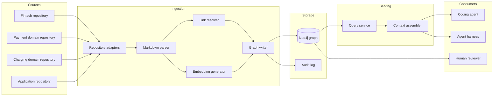
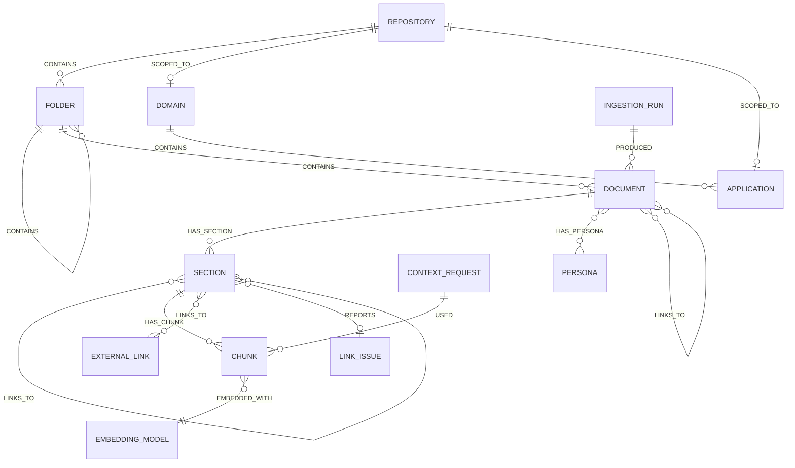
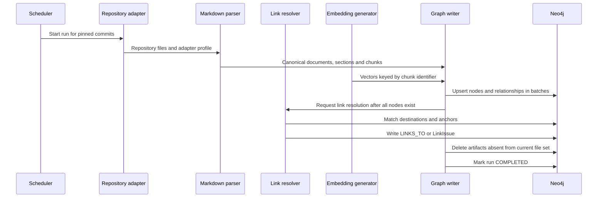
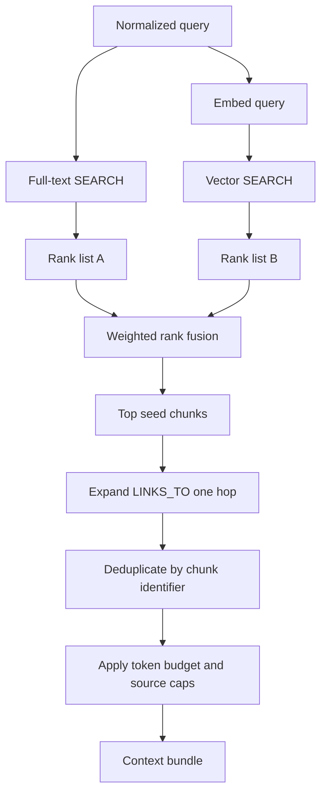
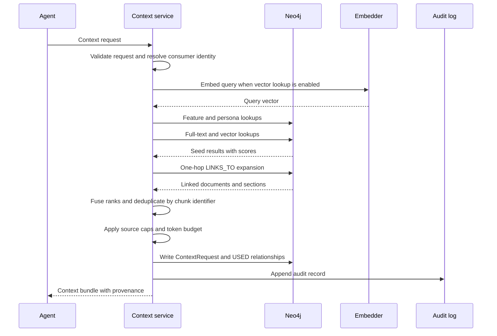

+++
date = '2026-11-21T12:00:45+10:00'
draft = false
title = 'Software Design Specification: Fintech Documentation Graph in Neo4j'
tags = ['AI', 'Context Engineering', 'Neo4j', 'Fintech', 'Software Design', 'Knowledge Graph', 'GraphRAG']
summary = "Design a Neo4j graph for fintech documentation and agent context."
+++

This specification defines a system that converts four Markdown documentation repositories into a Neo4j knowledge graph and a context service for coding agents. The Git repositories remain the source of truth. Neo4j stores a derived projection that preserves folder hierarchy, document structure, Markdown links, front matter metadata and semantic embeddings.

The system answers lookups by feature, persona, document type, full-text term, embedding similarity and graph path. The context service returns a ranked, budgeted bundle with provenance so an agent can build a feature from the documents linked to that feature.

## Purpose and scope

The software design specification covers the following responsibilities:

- Discover and ingest the four documentation repositories.
- Parse front matter, heading structure and Markdown links.
- Model repositories, domains, applications, documents, sections and chunks as graph nodes.
- Resolve internal links to graph nodes and record unresolved links as issues.
- Create embeddings and register the indexes that serve each lookup path.
- Expose query patterns and a context assembly API for agents and harnesses.
- Enforce access control, validation, observability and recovery procedures.

The specification excludes the following work:

- Authoring or approving documentation in Git.
- Generating application code from a feature document.
- Training or fine-tuning an embedding model.
- Selecting a hosted LLM for the consuming agent.

## Assumptions

The design uses the following assumptions. Each assumption is configuration, not a fixed schema constant.

| ID  | Assumption                                                                                                                                                              | Design consequence                                                                                  |
| --- | ----------------------------------------------------------------------------------------------------------------------------------------------------------------------- | --------------------------------------------------------------------------------------------------- |
| A1  | The current estate has four repositories: one fintech-level repository, a payment domain repository, a charging domain repository and one application-level repository. | The system stores repository count and level as data. Additional repositories use the same adapter. |
| A2  | Every hierarchy level uses defined folder paths and Markdown artifacts.                                                                                                 | Folder nodes and document nodes are derived from file paths.                                        |
| A3  | Front matter exists on every document and carries a `persona` value.                                                                                                    | The parser normalizes persona values into `Persona` nodes.                                          |
| A4  | Links use CommonMark inline links or reference links.                                                                                                                   | The parser handles both link forms.                                                                 |
| A5  | Markdown files in Git are the source of truth.                                                                                                                          | Neo4j is a rebuildable read model.                                                                  |
| A6  | The initial embedding model emits 1536-dimensional vectors and uses cosine similarity.                                                                                  | The vector index stores that dimension. A model change triggers a reindex procedure.                |
| A7  | Each consuming agent has an identity that the context service can read.                                                                                                 | The service applies per-repository access rules before returning context.                           |

A1 records the current estate only. The graph does not contain a four-repository limit.

## Goals and non-goals

| Goal                     | Measurable outcome                                                                                                                |
| ------------------------ | --------------------------------------------------------------------------------------------------------------------------------- |
| Preserve hierarchy       | Every repository, domain, application, folder, document and section has a node and an explicit incoming containment relationship. |
| Preserve navigation      | Every inline link and reference link produces either a `LINKS_TO` relationship or a `LinkIssue` node.                             |
| Support direct lookup    | Feature, persona and document type lookups return results without a vector index.                                                 |
| Support semantic lookup  | Embedding similarity returns chunks from the configured vector index.                                                             |
| Support connected lookup | A lookup expands one graph hop from every seed result.                                                                            |
| Assemble context         | The context endpoint returns a bundle that respects a token budget and carries source provenance.                                 |
| Rebuild safely           | A full rebuild from empty storage produces the same document set and link set as an incremental run at the same commits.          |
| Meet latency             | The context endpoint returns a feature bundle within 500 ms at p95 under the load profile defined by the capacity test.           |

The system does not replace Git as the source of truth. The system does not decide which document content is correct. The system does not write to documentation repositories.

## Stakeholders and use cases

| Actor                    | Need                                                            | Query path                                                       |
| ------------------------ | --------------------------------------------------------------- | ---------------------------------------------------------------- |
| AI coding agent          | Build a named feature with all relevant documents.              | `Feature` node to linked design, NFR, API and runbook documents. |
| Agent harness            | Fetch a bounded context bundle for one task.                    | Full-text seeds plus vector seeds plus one-hop graph expansion.  |
| Documentation maintainer | Find broken links after a refactor.                             | Incoming link relationships and `LinkIssue` nodes.               |
| Domain architect         | Find every document that references a section.                  | Reverse traversal of `LINKS_TO`.                                 |
| Compliance reviewer      | Verify that every published document names a persona and owner. | Property existence checks and report queries.                    |
| Platform engineer        | Detect documents that reference an old commit.                  | `updatedAt` and `commitSha` comparison across ingestion runs.    |

The primary use case starts with a feature name. The feature document links to the design, the non-functional requirements, the API contract and the test plan. The context service returns those documents with the exact sections that contain the links.

## Logical architecture



| Component           | Responsibility                                                                                                |
| ------------------- | ------------------------------------------------------------------------------------------------------------- |
| Repository adapter  | Reads one Git repository at a pinned commit and applies that repository's front matter profile and link base. |
| Markdown parser     | Produces canonical metadata, a heading tree, section text and link records from each Markdown file.           |
| Link resolver       | Maps each link destination to a document node, a section node, an external URL or a `LinkIssue` node.         |
| Embedding generator | Converts each chunk into a vector with a recorded model key.                                                  |
| Graph writer        | Applies idempotent Cypher upserts, removes stale artifacts and records the ingestion run.                     |
| Query service       | Executes parameterized Cypher for each lookup pattern.                                                        |
| Context assembler   | Deduplicates, ranks, budgets and returns results with provenance.                                             |
| Audit log           | Stores request identifiers, query hashes, consumer identities and returned chunk identifiers.                 |

## Source model

### Repository inventory

| Logical level | Current repository                   | Repository node property                     | Downward relationship                 |
| ------------- | ------------------------------------ | -------------------------------------------- | ------------------------------------- |
| Fintech       | Fintech documentation repository     | `level = 'fintech'`                          | `SCOPED_TO` the fintech domain scope. |
| Domain        | Payment domain repository            | `level = 'domain'`, `domainKey = 'payment'`  | `CONTAINS` payment applications.      |
| Domain        | Charging domain repository           | `level = 'domain'`, `domainKey = 'charging'` | `CONTAINS` charging applications.     |
| Application   | Application documentation repository | `level = 'application'`                      | `ABOUT` one application in a domain.  |

The adapter configuration declares `repoKey`, `level`, `sourceUrl`, `defaultBranch`, `frontMatterProfile`, `linkBase` and `crossRepoMap`. The `crossRepoMap` maps a repository name used in a Markdown link to a `repoKey`.

### Folder and document model

The parser maps a repository path to a chain of nodes. A path such as `domains/payment/applications/settlement/features/capture.md` produces a `Repository` node and `Folder` nodes for `domains`, `payment`, `applications`, `settlement` and `features`. The final artifact is a `Document` node for `capture.md`. The `CONTAINS` relationships preserve the path order.

Heading boundaries produce `Section` nodes. A document with headings `Capture flow`, `Retries` and `Retries > Backoff` produces three section nodes. The `HAS_SECTION` relationship from document to top-level section and `HAS_SUBSECTION` between nested sections preserve heading nesting. Each section stores its heading path, heading level, start line and end line.

Text splitting runs inside each section. Each `Chunk` node stores a contiguous slice of section text, the character offsets, the token count and the embedding. Adjacent chunks from one section use an overlap defined in configuration. The graph stores canonical text once in `Chunk`. `Section` nodes store metadata and offsets only.

### Front matter normalization

Source-specific front matter keys are mapped to canonical properties by the repository adapter. The canonical fields are fixed across all repositories.

| Canonical field | Type           | Required | Purpose                                                                                            |
| --------------- | -------------- | -------- | -------------------------------------------------------------------------------------------------- |
| `docId`         | STRING         | yes      | Derived key in the form `{repoKey}:{sourcePath}`.                                                  |
| `title`         | STRING         | yes      | Display title from front matter or the first heading.                                              |
| `docType`       | STRING         | yes      | One of `Feature`, `Design`, `NFR`, `ADR`, `Runbook`, `PersonaSpec`, `API`, `Glossary` or `Policy`. |
| `persona`       | LIST<STRING>   | yes      | Persona values normalized from a single value or a list.                                           |
| `status`        | STRING         | yes      | One of `DRAFT`, `REVIEW`, `PUBLISHED` or `DEPRECATED`.                                             |
| `owner`         | STRING         | no       | Named owner of the document.                                                                       |
| `version`       | STRING         | no       | Document version declared by the source repository.                                                |
| `sourcePath`    | STRING         | yes      | Path relative to the repository root.                                                              |
| `sourceUrl`     | STRING         | yes      | HTTPS URL to the file at the pinned commit.                                                        |
| `commitSha`     | STRING         | yes      | Commit used for this ingestion run.                                                                |
| `updatedAt`     | ZONED DATETIME | yes      | Update timestamp from front matter or Git history.                                                 |
| `summary`       | STRING         | no       | Short description used by full-text search.                                                        |
| `tags`          | LIST<STRING>   | no       | Repository-specific tags.                                                                          |

A document of type `Feature` receives both the `Document` and `Feature` labels. The same rule applies to `Design`, `NFR`, `ADR`, `Runbook`, `PersonaSpec`, `API`, `Glossary` and `Policy`. The property `docType` remains available for generic filtering.

### Markdown link model

The parser implements the CommonMark link forms defined in the [CommonMark specification](https://spec.commonmark.org/0.31.2/#links): inline links such as `[design](./design.md)` and reference links such as `[design][design-ref]` with a definition `[design-ref]: ./design.md`. Autolinks are stored as external links.

Resolution follows a fixed order:

1. Resolve a relative destination against the directory of the source file.
2. Resolve the remaining destination against the repository root.
3. Resolve a repository-qualified destination through `crossRepoMap`.
4. Treat an `https://` destination as an external link.
5. Record every unresolved internal destination as a `LinkIssue` node.

An anchor is resolved against the heading slugs of the target document. This system defines `slug(title)` as lowercase text, removal of characters outside letters, digits, spaces and hyphens, replacement of spaces with hyphens, collapse of repeated hyphens and a numeric suffix for duplicate headings inside one document. The resolver stores both `rawTarget` and `anchor`. A link to a section stores the section identifier. A link to a document with an unmatched anchor stores the document identifier and the anchor string.

Every `LINKS_TO` relationship stores `linkText`, `rawTarget`, `resolvedTarget`, `anchor`, `ordinal` and `chunkId`. Backlinks need no separate materialization because Cypher traverses incoming `LINKS_TO` relationships directly.

## Graph data model



### Node definitions

| Label            | Unique key  | Required properties                                                    | Purpose                                        |
| ---------------- | ----------- | ---------------------------------------------------------------------- | ---------------------------------------------- |
| `Repository`     | `repoKey`   | `level`, `name`, `sourceUrl`, `defaultBranch`                          | One source Git repository.                     |
| `Folder`         | `folderId`  | `repoKey`, `path`, `name`                                              | One directory in a repository.                 |
| `Domain`         | `domainKey` | `name`                                                                 | A fintech domain such as payment or charging.  |
| `Application`    | `appKey`    | `domainKey`, `name`                                                    | One application inside a domain.               |
| `Document`       | `docId`     | `repoKey`, `sourcePath`, `docType`, `status`, `commitSha`, `updatedAt` | One Markdown artifact.                         |
| `Section`        | `sectionId` | `docId`, `headingPath`, `level`, `startLine`, `endLine`                | One heading-scoped region.                     |
| `Chunk`          | `chunkId`   | `docId`, `sectionId`, `ordinal`, `text`, `tokenCount`, `embedding`     | One retrieval unit.                            |
| `Persona`        | `key`       | `displayName`                                                          | One canonical persona value.                   |
| `ExternalLink`   | `url`       | `host`                                                                 | One destination outside the four repositories. |
| `LinkIssue`      | `issueId`   | `rawTarget`, `sourceSectionId`, `reason`                               | One unresolved or invalid link.                |
| `EmbeddingModel` | `modelKey`  | `name`, `dimensions`, `version`                                        | One embedding model version.                   |
| `IngestionRun`   | `runId`     | `startedAt`, `finishedAt`, `status`, `commitSha`                       | One ingestion execution.                       |
| `ContextRequest` | `requestId` | `submittedAt`, `consumer`, `queryHash`, `tokenCount`                   | One served context bundle.                     |

`Chunk` carries denormalized `repoKey`, `domainKey`, `docType`, `status` and `updatedAt` properties. Those properties support in-index vector filtering. The graph writer sets them in the same transaction as the chunk upsert.

### Relationship definitions

| Relationship     | Source label             | Target label                            | Properties                                                                                    | Purpose                                           |
| ---------------- | ------------------------ | --------------------------------------- | --------------------------------------------------------------------------------------------- | ------------------------------------------------- |
| `CONTAINS`       | `Repository` or `Folder` | `Folder` or `Document`                  | none                                                                                          | Preserves source path hierarchy.                  |
| `SCOPED_TO`      | `Repository`             | `Domain` or `Application`               | `level`                                                                                       | Declares the repository scope.                    |
| `CONTAINS`       | `Domain`                 | `Application`                           | none                                                                                          | Preserves domain to application hierarchy.        |
| `ABOUT`          | `Document`               | `Application`                           | none                                                                                          | Declares the application described by a document. |
| `HAS_SECTION`    | `Document`               | `Section`                               | none                                                                                          | Links a document to a top-level section.          |
| `HAS_SUBSECTION` | `Section`                | `Section`                               | none                                                                                          | Preserves heading nesting.                        |
| `HAS_CHUNK`      | `Section`                | `Chunk`                                 | none                                                                                          | Links a section to its text slices.               |
| `HAS_PERSONA`    | `Document`               | `Persona`                               | `sourceField`                                                                                 | Links front matter persona values.                |
| `LINKS_TO`       | `Section`                | `Document`, `Section` or `ExternalLink` | `linkText`, `rawTarget`, `resolvedTarget`, `anchor`, `ordinal`, `chunkId`, `resolutionStatus` | Preserves Markdown navigation.                    |
| `REPORTS`        | `Section`                | `LinkIssue`                             | `detectedAt`                                                                                  | Records a broken link at its source.              |
| `EMBEDDED_WITH`  | `Chunk`                  | `EmbeddingModel`                        | `embeddedAt`                                                                                  | Records vector provenance.                        |
| `PRODUCED`       | `IngestionRun`           | `Document`                              | none                                                                                          | Records which run wrote a document.               |
| `USED`           | `ContextRequest`         | `Chunk`                                 | `rank`, `reasons`                                                                             | Records served evidence.                          |

## Schema: constraints and indexes

Create constraints before the first ingestion run. Index names and constraint names share one namespace in Neo4j. Add `IF NOT EXISTS` to every creation statement so migrations can run twice. The constraint syntax follows the [Cypher constraints manual](https://neo4j.com/docs/cypher-manual/current/constraints/).

```cypher
CREATE CONSTRAINT repository_key IF NOT EXISTS
FOR (r:Repository) REQUIRE r.repoKey IS UNIQUE;

CREATE CONSTRAINT folder_key IF NOT EXISTS
FOR (f:Folder) REQUIRE f.folderId IS UNIQUE;

CREATE CONSTRAINT domain_key IF NOT EXISTS
FOR (d:Domain) REQUIRE d.domainKey IS UNIQUE;

CREATE CONSTRAINT application_key IF NOT EXISTS
FOR (a:Application) REQUIRE a.appKey IS UNIQUE;

CREATE CONSTRAINT document_key IF NOT EXISTS
FOR (d:Document) REQUIRE d.docId IS UNIQUE;

CREATE CONSTRAINT section_key IF NOT EXISTS
FOR (s:Section) REQUIRE s.sectionId IS UNIQUE;

CREATE CONSTRAINT chunk_key IF NOT EXISTS
FOR (c:Chunk) REQUIRE c.chunkId IS UNIQUE;

CREATE CONSTRAINT persona_key IF NOT EXISTS
FOR (p:Persona) REQUIRE p.key IS UNIQUE;

CREATE CONSTRAINT external_link_url IF NOT EXISTS
FOR (e:ExternalLink) REQUIRE e.url IS UNIQUE;

CREATE CONSTRAINT link_issue_key IF NOT EXISTS
FOR (i:LinkIssue) REQUIRE i.issueId IS UNIQUE;

CREATE CONSTRAINT embedding_model_key IF NOT EXISTS
FOR (m:EmbeddingModel) REQUIRE m.modelKey IS UNIQUE;

CREATE CONSTRAINT ingestion_run_key IF NOT EXISTS
FOR (r:IngestionRun) REQUIRE r.runId IS UNIQUE;

CREATE CONSTRAINT context_request_key IF NOT EXISTS
FOR (r:ContextRequest) REQUIRE r.requestId IS UNIQUE;
```

Enterprise Edition also supports property existence and property type constraints. The deployment adds existence constraints for `Document.status`, `Document.commitSha` and `Chunk.embedding` when the target edition supports them. The Community Edition deployment enforces the same rules in the parser before the graph writer runs.

### Performance indexes

Range indexes serve equality, list membership, date ranges and `STARTS WITH` predicates. Composite range indexes serve predicates that filter all indexed properties together. The [index creation guide](https://neo4j.com/docs/cypher-manual/current/indexes/performance-indexes/create-indexes/) defines the default `CREATE INDEX` behaviour.

```cypher
CREATE INDEX document_status IF NOT EXISTS
FOR (d:Document) ON (d.status);

CREATE INDEX document_updated_at IF NOT EXISTS
FOR (d:Document) ON (d.updatedAt);

CREATE INDEX document_repo_path IF NOT EXISTS
FOR (d:Document) ON (d.repoKey, d.sourcePath);

CREATE INDEX section_doc_level IF NOT EXISTS
FOR (s:Section) ON (s.docId, s.level);

CREATE INDEX chunk_doc_ordinal IF NOT EXISTS
FOR (c:Chunk) ON (c.docId, c.ordinal);

CREATE INDEX link_resolution_status IF NOT EXISTS
FOR ()-[l:LINKS_TO]-() ON (l.resolutionStatus);

CREATE TEXT INDEX document_title_text IF NOT EXISTS
FOR (d:Document) ON (d.title);

CREATE TEXT INDEX section_heading_text IF NOT EXISTS
FOR (s:Section) ON (s.headingPath);
```

Text indexes serve `CONTAINS` and `ENDS WITH` predicates on strings. Full-text indexes serve word search with a relevance score. The following full-text index covers documents, sections and chunks in one definition. The analyzer is `standard-no-stop-words` because no language-specific stemming is required for identifiers such as `capture` and `chargeback`.

```cypher
CREATE FULLTEXT INDEX documentation_search IF NOT EXISTS
FOR (n:Document|Section|Chunk)
ON EACH [n.title, n.summary, n.headingPath, n.text]
OPTIONS {indexConfig: {`fulltext.analyzer`: 'standard-no-stop-words'}};
```

Vector search needs the denormalized chunk properties. The `WITH` clause lists the scalar properties available for filtering inside `SEARCH`.

```cypher
CREATE VECTOR INDEX chunk_embeddings IF NOT EXISTS
FOR (c:Chunk) ON (c.embedding)
WITH [c.repoKey, c.domainKey, c.docType, c.status, c.updatedAt]
OPTIONS {indexConfig: {
  `vector.dimensions`: 1536,
  `vector.similarity_function`: 'cosine'
}};
```

The [SEARCH clause](https://neo4j.com/docs/cypher-manual/current/clauses/search/) is available for vector indexes from Neo4j 2026.01 and for full-text indexes from Neo4j 2026.09. The deployment therefore requires Neo4j 2026.09 or later. Older deployments replace `SEARCH` with `db.index.fulltext.queryNodes()` and `db.index.vector.queryNodes()`, which are deprecated in Cypher 25 from Neo4j 2026.10. Verify each procedure name against the [Cypher manual](https://neo4j.com/docs/cypher-manual/current/) before using that fallback.

### Index coverage

Cypher 25 reports six index types through `SHOW INDEXES`: `RANGE`, `TEXT`, `POINT`, `LOOKUP`, `FULLTEXT` and `VECTOR`. The [Cypher indexes manual](https://neo4j.com/docs/cypher-manual/current/indexes/) separates performance indexes from search indexes.

| Index type        | Use in this system                                                 | Decision                                                            |
| ----------------- | ------------------------------------------------------------------ | ------------------------------------------------------------------- |
| Range             | Status, update time, document path, section level and chunk order. | Created with `CREATE INDEX`.                                        |
| Composite range   | Document repository and path plus section document and level.      | Created with `CREATE INDEX` on several properties.                  |
| Text              | Title substring and heading substring predicates.                  | Created with `CREATE TEXT INDEX`.                                   |
| Point             | No spatial predicate exists in the use case.                       | Not created.                                                        |
| Lookup            | Node label and relationship type lookups.                          | Created automatically by Neo4j and never dropped.                   |
| Full-text         | Word search over titles, summaries, headings and chunk text.       | Created with `CREATE FULLTEXT INDEX`.                               |
| Vector            | Semantic similarity over chunk embeddings.                         | Created with `CREATE VECTOR INDEX`.                                 |
| Unique constraint | All identifier properties listed above.                            | Enforced by uniqueness constraints and their backing range indexes. |

Composite indexes and relationship indexes are not separate index types. A composite index is a range index on several properties. `link_resolution_status` is a range index on relationship properties. Uniqueness is enforced by constraints because Cypher 25 has no standalone `CREATE UNIQUE INDEX` statement. The backing indexes appear in `SHOW INDEXES` with an `owningConstraint` value.

## Ingestion pipeline



The pipeline has seven stages.

1. **Discover.** The scheduler reads repository configuration and resolves each repository to one commit SHA. The adapter records the commit in an `IngestionRun` node with status `RUNNING`.
2. **Parse.** The Markdown parser emits one canonical record per document, one record per heading and one record per chunk. The parser rejects a document with a missing required canonical field and writes a `LinkIssue` with reason `INVALID_FRONT_MATTER`.
3. **Embed.** The embedding generator vectors each chunk and records the `modelKey`. A vector with a length other than the configured dimension stops the run before any graph write.
4. **Upsert nodes.** The graph writer applies one batched transaction per repository. Every node key uses `MERGE` so repeated runs at the same commit produce no duplicates.
5. **Resolve links.** The link resolver runs after all repositories have been written. Cross-repository links therefore find their targets in the same graph state.
6. **Remove stale artifacts.** The graph writer compares the current document identifier set with the set recorded by the previous successful run. Documents absent from the current set are removed with `DETACH DELETE`.
7. **Validate and publish.** The run writes counts for documents, sections, chunks, resolved links and unresolved links. The run status changes from `RUNNING` to `COMPLETED` or `FAILED`.

Batching uses `UNWIND` and `CALL { ... } IN TRANSACTIONS OF 1000 ROWS`. Short transactions release locks promptly and allow progress tracking. The [Cypher transaction guide](https://neo4j.com/docs/cypher-manual/current/introduction/cypher-neo4j/) and the [operations transaction guide](https://neo4j.com/docs/operations-manual/current/database-internals/transaction-management/) describe the commit model.

### Upsert statements

The run node and document nodes are created in one statement per batch.

```cypher
MERGE (run:IngestionRun {runId: $runId})
SET run.startedAt = coalesce(run.startedAt, datetime()),
    run.commitSha = $commitSha,
    run.status = 'RUNNING'
WITH run
UNWIND $documents AS doc
MATCH (repo:Repository {repoKey: doc.repoKey})
MERGE (d:Document {docId: doc.docId})
SET d += doc.properties
MERGE (run)-[:PRODUCED]->(d)
MERGE (repo)-[:CONTAINS]->(d);
```

The document label set from `doc.properties` is applied by a driver-side label setter because Cypher cannot parameterize labels. Section and chunk upserts use the same pattern.

```cypher
UNWIND $sections AS section
MATCH (d:Document {docId: section.docId})
MERGE (s:Section {sectionId: section.sectionId})
SET s += section.properties
MERGE (d)-[:HAS_SECTION]->(s)
WITH s, section
UNWIND section.chunks AS chunk
MERGE (c:Chunk {chunkId: chunk.chunkId})
SET c += chunk.properties
MERGE (s)-[:HAS_CHUNK]->(c)
MERGE (m:EmbeddingModel {modelKey: $modelKey})
MERGE (c)-[:EMBEDDED_WITH]->(m);
```

Link resolution uses the target kind to select the write path. The document target case is shown below. Section targets and external targets use the same `MERGE` pattern with their own labels and keys.

```cypher
UNWIND $links AS link
MATCH (s:Section {sectionId: link.sectionId})
MATCH (t:Document {docId: link.targetDocId})
MERGE (s)-[l:LINKS_TO {ordinal: link.ordinal}]->(t)
SET l += link.relationshipProperties;
```

Stale artifacts are removed by comparing identifier sets.

```cypher
MATCH (d:Document)
WHERE d.repoKey = $repoKey
  AND NOT d.docId IN $currentDocIds
DETACH DELETE d;
```

### Validation queries

```cypher
MATCH (s:Section)-[:REPORTS]->(i:LinkIssue)
RETURN i.reason AS reason, count(i) AS issueCount
ORDER BY issueCount DESC;

MATCH (c:Chunk)
RETURN DISTINCT size(c.embedding) AS dimensions, count(c) AS chunkCount;

MATCH (d:Document)
WHERE d.status = 'PUBLISHED'
  AND NOT (d)-[:HAS_PERSONA]->(:Persona)
RETURN d.docId AS docId, d.title AS title;

MATCH (r:IngestionRun {runId: $runId})
RETURN r.status AS status, r.startedAt AS startedAt, r.finishedAt AS finishedAt;
```

## Lookup and retrieval patterns

Every query uses parameters. No query concatenates user input into Cypher text.

### Feature lookup

A feature lookup starts at the feature document and returns every linked artifact. The result includes the link text from the feature document so the agent sees why each artifact is relevant.

```cypher
MATCH (f:Document:Feature {featureKey: $featureKey})
OPTIONAL MATCH (f)-[l:LINKS_TO]->(target)
RETURN f.docId AS featureDocId,
       f.title AS featureTitle,
       collect({
         linkText: l.linkText,
         targetKind: CASE WHEN target IS NULL THEN null ELSE labels(target)[0] END,
         targetId: coalesce(target.docId, target.sectionId, target.url),
         targetTitle: coalesce(target.title, target.headingPath)
       }) AS related;
```

The context assembler expands section targets to their parent document with a second statement.

```cypher
MATCH (:Document:Feature {featureKey: $featureKey})-[l:LINKS_TO]->(s:Section)
MATCH (d:Document)-[:HAS_SECTION]->(s)
RETURN DISTINCT d.docId AS docId,
                d.title AS title,
                d.docType AS docType,
                collect(l.linkText) AS linkTexts;
```

### Persona lookup

A persona lookup returns published documents that carry the requested persona in front matter.

```cypher
MATCH (p:Persona {key: $personaKey})<-[:HAS_PERSONA]-(d:Document)
WHERE d.status = 'PUBLISHED'
RETURN d.docId AS docId,
       d.title AS title,
       d.docType AS docType,
       d.updatedAt AS updatedAt
ORDER BY d.updatedAt DESC;
```

### Full-text lookup

Full-text lookup uses the `SEARCH` clause on `documentation_search`. The score is valid only within one full-text result set.

```cypher
MATCH (n:Document|Section|Chunk)
  SEARCH n IN (
    FULLTEXT INDEX documentation_search
    FOR $query
    LIMIT 50
  ) SCORE AS relevance
RETURN labels(n) AS nodeLabels,
       coalesce(n.docId, n.sectionId, n.chunkId) AS nodeId,
       coalesce(n.title, n.headingPath) AS label,
       relevance
ORDER BY relevance DESC;
```

### Vector similarity lookup

Vector lookup uses the `SEARCH` clause on `chunk_embeddings`. The `WHERE` clause inside `SEARCH` filters during vector search, so every property in that clause appears in the index definition. The over-fetch limit of 100 leaves enough candidates after filtering and before the final limit of 10.

```cypher
MATCH (c:Chunk)
  SEARCH c IN (
    VECTOR INDEX chunk_embeddings
    FOR $queryEmbedding
    WHERE c.repoKey IN $repoKeys AND c.status = 'PUBLISHED'
    LIMIT 100
  ) SCORE AS similarity
RETURN c.chunkId AS chunkId,
       c.docId AS docId,
       c.text AS text,
       c.sourceUrl AS sourceUrl,
       similarity
ORDER BY similarity DESC
LIMIT 10;
```

### Hybrid lookup

The query service runs full-text lookup and vector lookup as separate statements. Each statement returns its own score. The service converts each ordered result list to ranks and combines the ranks with weights stored in configuration. The service never compares a raw full-text score with a raw vector score. Every seed then expands one hop through `LINKS_TO` in a separate statement.



### Path and impact lookup

Impact analysis follows incoming `LINKS_TO` relationships from a changed document to the sections that reference it.

```cypher
MATCH (changed:Document {docId: $docId})<-[l:LINKS_TO]-(source:Section)
MATCH (sourceDoc:Document)-[:HAS_SECTION]->(source)
RETURN sourceDoc.docId AS sourceDocId,
       source.headingPath AS sourceSection,
       l.linkText AS linkText
ORDER BY sourceDoc.docId, source.headingPath;
```

### Freshness lookup

Freshness lookup finds published documents whose update timestamp precedes a cutoff supplied by the caller.

```cypher
MATCH (d:Document)
WHERE d.status = 'PUBLISHED' AND d.updatedAt < $cutoff
RETURN d.docId AS docId,
       d.title AS title,
       d.updatedAt AS updatedAt
ORDER BY d.updatedAt ASC;
```

## Context assembly service

The context service is the only supported read path for agents. Direct Bolt access from agents is disabled.

### Request contract

| Field          | Type         | Required | Meaning                                                 |
| -------------- | ------------ | -------- | ------------------------------------------------------- |
| `query`        | STRING       | yes      | Natural language task description.                      |
| `featureKey`   | STRING       | no       | Feature identifier that triggers direct feature lookup. |
| `personaKey`   | STRING       | no       | Persona that triggers front matter lookup.              |
| `repoKeys`     | LIST<STRING> | no       | Repositories included in the query.                     |
| `docTypes`     | LIST<STRING> | no       | Document types included in the query.                   |
| `maxTokens`    | INTEGER      | yes      | Token budget for the returned bundle.                   |
| `includeTrace` | BOOLEAN      | no       | Requests graph traversal detail in the response.        |

### Response contract

| Field               | Type         | Meaning                                                                      |
| ------------------- | ------------ | ---------------------------------------------------------------------------- |
| `requestId`         | STRING       | Identifier recorded in the `ContextRequest` node.                            |
| `items`             | LIST<OBJECT> | Ranked context entries.                                                      |
| `items[].chunkId`   | STRING       | Retrieval unit identifier.                                                   |
| `items[].text`      | STRING       | Exact chunk text from the graph.                                             |
| `items[].sourceUrl` | STRING       | Git URL at the pinned commit.                                                |
| `items[].docId`     | STRING       | Source document identifier.                                                  |
| `items[].reasons`   | LIST<STRING> | Retrieval sources such as `feature-link`, `persona`, `fulltext` or `vector`. |
| `items[].score`     | FLOAT        | Normalized rank score after fusion.                                          |
| `tokenCount`        | INTEGER      | Tokens consumed by all items.                                                |
| `provenance`        | OBJECT       | Run identifiers and commit SHAs used by the returned items.                  |
| `trace`             | LIST<OBJECT> | Traversal detail when `includeTrace` is true.                                |

### Assembly sequence



### Assembly rules

The assembler applies the following rules in order.

1. Reject a request that has neither `query` nor `featureKey` nor `personaKey`.
2. Filter every query by the repositories allowed for the consumer identity.
3. Add direct feature results when `featureKey` is present.
4. Add persona results when `personaKey` is present.
5. Add full-text and vector seeds for `query`.
6. Expand one graph hop from every seed.
7. Deduplicate by `chunkId`.
8. Merge adjacent chunks from one section when the combined text still fits the budget.
9. Sort by fused score descending, then by `sourceUrl` ascending for deterministic output.
10. Cap the number of chunks from one repository using configuration.
11. Stop adding chunks when the next chunk exceeds `maxTokens`.
12. Record every returned `chunkId` in `USED` relationships.
13. Return an empty `items` list with status `NO_EVIDENCE` when no seed survives filtering. The agent must report the absence instead of inferring document content.

Token counting uses the tokenizer version declared in deployment configuration. The service records that version with each `ContextRequest`.

## Security and access control

The deployment uses separate identities for ingestion and serving.

| Identity            | Privileges                                                                               | Scope                                                        |
| ------------------- | ---------------------------------------------------------------------------------------- | ------------------------------------------------------------ |
| `ingestion_service` | Database access, graph write, schema write and procedure execution for index validation. | Writes the documentation graph.                              |
| `context_service`   | Database access and graph read.                                                          | Reads the documentation graph through parameterized queries. |
| `admin_service`     | User and role administration.                                                            | Runs against the `system` database only.                     |

Agent processes receive credentials for `context_service`. Agent processes never receive credentials for `ingestion_service`. Repository visibility is enforced in the context service before Cypher executes by adding `c.repoKey IN $allowedRepoKeys` to every seed query. Neo4j role and privilege administration follows the [authentication and authorization guide](https://neo4j.com/docs/operations-manual/current/authentication-authorization/), the [manage users guide](https://neo4j.com/docs/operations-manual/current/authentication-authorization/manage-users/) and the [manage roles guide](https://neo4j.com/docs/operations-manual/current/authentication-authorization/manage-roles/). Bolt connections use encryption in production.

Every response carries `sourceUrl` and `commitSha` provenance. The audit log records the consumer identity, query hash and returned chunk identifiers. Sensitive values in documentation are handled by the source repositories; the graph stores text from those files without a separate redaction step. Repository owners must keep secrets out of documentation files.

## Quality, observability and validation

The following metrics are emitted by the ingestion worker and the context service.

| Metric                                | Source                                      | Alert condition                                                  |
| ------------------------------------- | ------------------------------------------- | ---------------------------------------------------------------- |
| `ingestion_run_duration_seconds`      | `IngestionRun.startedAt` and `finishedAt`.  | Run duration exceeds the configured limit.                       |
| `ingestion_documents_total`           | Count of produced `Document` nodes.         | Count drops by more than the configured percentage between runs. |
| `link_resolution_rate`                | Resolved links divided by all parsed links. | Rate falls below the configured threshold.                       |
| `link_issue_total`                    | Count of `LinkIssue` nodes.                 | New issue appears after a successful run.                        |
| `embedding_dimension_violations`      | Validation query result.                    | Value is greater than zero.                                      |
| `context_request_latency_seconds`     | Context service timing.                     | p95 exceeds the goal in the goals table.                         |
| `context_bundle_token_count`          | `ContextRequest.tokenCount`.                | Value exceeds `maxTokens`.                                       |
| `published_documents_without_persona` | Validation query result.                    | Value is greater than zero.                                      |

`SHOW INDEXES` confirms index availability and population state. `SHOW CONSTRAINTS` confirms schema state. The deployment stores expected schema definitions in version control and compares them with the live schema during deployment. Query logging follows the [Neo4j logging guide](https://neo4j.com/docs/operations-manual/current/monitoring/logging/).

## Deployment and operations

The target is a Neo4j 2026.09 or later database with the enterprise features required by the chosen hosting mode. The deployment records the Neo4j version, Cypher default version, store format and index configuration in the operations catalogue.

Backup and restore cover both the graph and the ingestion configuration. A full rebuild uses an empty database and replays all four repositories from pinned commits. The rebuild result is compared with the live graph using document counts, section counts, chunk counts and link counts.

An embedding model change follows a fixed procedure.

1. Register a new `EmbeddingModel` node with its dimension and version.
2. Create a new vector index with the new dimension and a new index name.
3. Backfill `Chunk.embedding` for every chunk with the new model.
4. Update the context service configuration to the new index name.
5. Drop the old vector index after the new index is ONLINE and the service passes its lookup tests.
6. Keep the previous model node for provenance of older ingestion runs.

Schema migrations run before ingestion. Application deployments run after the indexes required by that application version are ONLINE.

## Delivery plan

### Phase 1: repository registry and parser

The team creates adapter configuration for the four repositories and implements front matter normalization, heading parsing and link extraction. The output is a canonical JSON record per document. Acceptance requires exact reproduction of the folder tree and heading tree from a sample repository.

### Phase 2: graph schema and ingestion

The team applies constraints and indexes, then implements batched upserts, link resolution, stale artifact removal and validation queries. Acceptance requires a repeatable full rebuild and a clean validation report.

### Phase 3: lookup service

The team implements feature, persona, full-text, vector, path and freshness queries with parameterized Cypher. Acceptance requires one automated test per query pattern and profile output for each query.

### Phase 4: context assembly

The team implements the request contract, rank fusion, deduplication, source caps, token budgeting, provenance and audit writes. Acceptance requires the goals table to pass under the capacity test.

### Phase 5: hardening and operations

The team adds role separation, metrics, alerts, backup procedures, rebuild drills and the embedding model change procedure. Acceptance requires a successful restore drill and a successful rebuild drill.

## Acceptance criteria

| Criterion                                            | Verification                                                                   |
| ---------------------------------------------------- | ------------------------------------------------------------------------------ |
| Every Markdown file has one `Document` node.         | Compare parser output with `MATCH (d:Document) RETURN count(d)`.               |
| Every heading has one `Section` node.                | Compare heading records with `MATCH (s:Section) RETURN count(s)`.              |
| Every link has a destination or an issue.            | No section link record lacks either `LINKS_TO` or `REPORTS`.                   |
| Feature lookup returns linked artifacts.             | Automated test with a known feature document and expected linked documents.    |
| Persona lookup returns only published documents.     | Automated test that includes a draft document and asserts its absence.         |
| Vector lookup uses `chunk_embeddings`.               | `EXPLAIN` output shows the vector index.                                       |
| Full-text lookup uses `documentation_search`.        | `EXPLAIN` output shows the full-text index.                                    |
| Context bundles respect the token budget.            | Property test across budgets from 256 to 8192 tokens.                          |
| Context bundles carry provenance.                    | Every item contains `sourceUrl` and the response contains commit SHAs.         |
| Agents cannot write to the graph.                    | Connection test with `context_service` credentials fails on a write statement. |
| A rebuild from empty storage matches the live graph. | Node counts and relationship counts match across both graphs.                  |

## Risks and mitigations

| Risk                                            | Mitigation                                                                                                     |
| ----------------------------------------------- | -------------------------------------------------------------------------------------------------------------- |
| Link targets move between repositories.         | `crossRepoMap` and two-pass resolution keep link targets explicit. Unmatched targets become `LinkIssue` nodes. |
| Repository count changes.                       | Repository records are configuration. The schema stores level as a property.                                   |
| Embedding model changes.                        | `EmbeddingModel` nodes record model version and the reindex procedure switches index names.                    |
| One repository dominates results.               | Per-repository caps apply after fusion and before token budgeting.                                             |
| Stale graph content.                            | Every document stores `commitSha` and `updatedAt`. Freshness lookup and rebuild drills detect drift.           |
| Large ingestion transactions.                   | `CALL { ... } IN TRANSACTIONS OF 1000 ROWS` bounds each write batch.                                           |
| Front matter differs between repositories.      | Each adapter maps source keys to one canonical field set before graph write.                                   |
| Agents treat missing evidence as known content. | `NO_EVIDENCE` is an explicit response and the service returns an empty `items` list.                           |

## Open decisions

The following decisions require confirmation from the repository owners before Phase 2.

1. The exact mapping of four repositories to logical levels and domain names.
2. The source-specific front matter keys that map to `persona`, `status`, `owner` and `updatedAt`.
3. The embedding model name, dimension and hosting location.
4. The token budget, per-repository cap and latency target for the first deployment.
5. The repository visibility rules for each consumer identity.
6. The heading slug algorithm used by the documentation renderer, for comparison with `slug(title)`.

## References

- Neo4j Cypher: [indexes](https://neo4j.com/docs/cypher-manual/current/indexes/), [create indexes](https://neo4j.com/docs/cypher-manual/current/indexes/performance-indexes/create-indexes/), [full-text indexes](https://neo4j.com/docs/cypher-manual/current/indexes/search-indexes/full-text-indexes/), [vector indexes](https://neo4j.com/docs/cypher-manual/current/indexes/search-indexes/vector-indexes/), [SEARCH clause](https://neo4j.com/docs/cypher-manual/current/clauses/search/), [constraints](https://neo4j.com/docs/cypher-manual/current/constraints/) and [transactions](https://neo4j.com/docs/cypher-manual/current/introduction/cypher-neo4j/).
- Neo4j operations: [transaction management](https://neo4j.com/docs/operations-manual/current/database-internals/transaction-management/), [authentication and authorization](https://neo4j.com/docs/operations-manual/current/authentication-authorization/), [manage users](https://neo4j.com/docs/operations-manual/current/authentication-authorization/manage-users/), [manage roles](https://neo4j.com/docs/operations-manual/current/authentication-authorization/manage-roles/) and [logging](https://neo4j.com/docs/operations-manual/current/monitoring/logging/).
- Neo4j GenAI: [GraphRAG Python documentation](https://neo4j.com/docs/neo4j-graphrag-python/) and [embeddings and vector indexes](https://neo4j.com/docs/genai/tutorials/current/embeddings-vector-indexes/).
- Markdown: [CommonMark links](https://spec.commonmark.org/0.31.2/#links).
- Related posts in this repository: `content/english/blog/ai/graph-rag-neo4j.md` and `content/english/blog/system_design/neo4j-complete-tutorial.md`.
