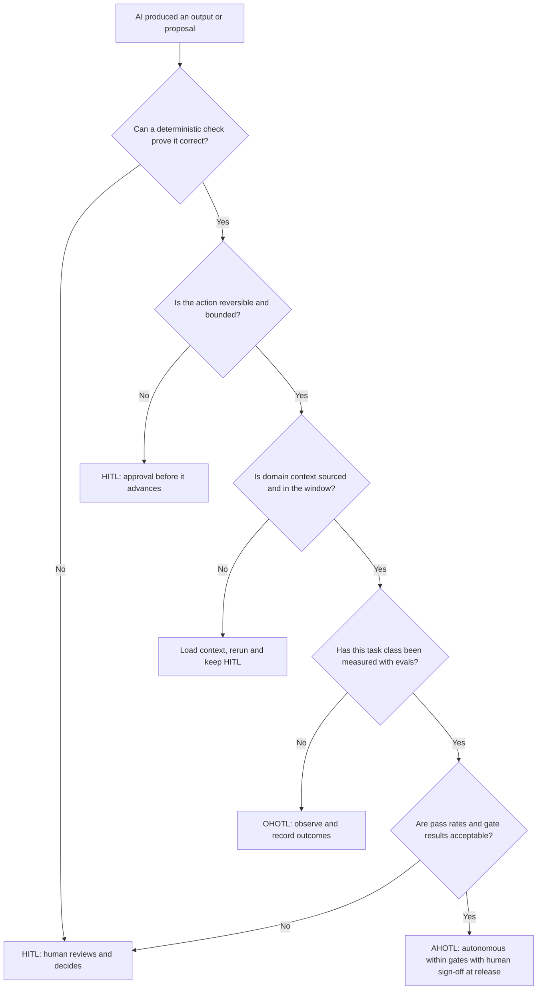

+++
date = '2026-11-18T09:30:00+10:00'
draft = false
title = 'Where to Trust AI in Software Delivery and the Practices That Earn It'
tags = ['AI','AI-DLC','Context Engineering','Trust','Software Delivery','Fintech','Engineering Practices']
summary = "Where to trust AI and the practices that earn it."
aliases = ['/blog/ai/fintech/trusting-ai/','/blog/ai/fintech/where-to-trust-ai/']
+++

## Introduction

AI-DLC for Inception, Construction and Operations, context engineering to decide what the model sees, prompt engineering to decide how it is asked, spec-driven development, evals and harness-enforced gates. Two questions came out of that work.

1. Where can AI be trusted?
2. What engineering practices must exist before that trust is warranted?

The short answer to both is that trust is not a property of a model. Trust is a property of the system built around the model. A model that is right 95% of the time is not trustworthy in a payment authorisation path without a verifier. The same model is trustworthy for drafting release notes that a person reads before publication. The difference is the cost of being wrong and the ability to detect the error.

The [2025 DORA State of AI-assisted Software Development report](https://dora.dev/research/2025/dora-report/) frames AI as an amplifier: it magnifies an organisation's existing strengths and weaknesses, and the largest returns come from the underlying system rather than the tool. A strong delivery system makes the model useful. A weak delivery system makes the model a faster way to produce the same mess.

This post is part of the fintech series. It builds on [The AI-DLC Approach to Fintech Software Development](/blog/ai/fintech/fintech-aidlc-approach/), [AI Skills and Tools by Phase](/blog/ai/fintech/ai-skills-by-phase/) and [Context Engineering](/blog/ai/fintech/context-engineering/).

## What "trust" means in this post

AI is trustworthy for a task when two conditions hold:

- You can rely on the output without repeating the work yourself.
- You can detect and contain a wrong output before it reaches a user, a ledger or a regulator.

These are separate claims. The first concerns accuracy. The second concerns control. A system with excellent control and mediocre accuracy can still be trustworthy in a bounded role, because the control catches the errors. A system with excellent accuracy and no control is not trustworthy in a regulated domain, because nobody can prove the error was absent.

Three variables decide how much trust a task can carry.

| Variable      | Question                                                 | Effect on trust                                                |
| ------------- | -------------------------------------------------------- | -------------------------------------------------------------- |
| Verifiability | Can a deterministic check tell right from wrong?         | Verifiable output can be trusted inside the scope of the check |
| Reversibility | Can the action be undone cheaply?                        | Reversible action can be trusted with lighter oversight        |
| Blast radius  | How many users, systems or records does one error touch? | A wide blast radius pushes the task toward human approval      |

Anthropic's [Building Effective Agents](https://www.anthropic.com/engineering/building-effective-agents) gives the clearest statement of the mechanism. Coding agents work because code solutions are verifiable through automated tests, agents can iterate using test results as feedback, the problem space is well-defined and output quality can be measured objectively. The same article states the boundary: automated testing verifies functionality, while human review remains crucial for ensuring solutions align with broader system requirements. Verification proves the code behaves as tested. Verification does not prove the team built the right thing.

The article also requires agents to gain ground truth from the environment at each step, such as tool results or code execution, to assess progress. Trust comes from that feedback loop. Trust does not come from the model's confidence.

## Where I have learned to trust AI

### Work with a built-in oracle

I trust generation when a pass/fail signal exists that the agent can run and read. That includes code generation against a green test suite, refactors guarded by typecheck and lint, test generation for known invariants, migration scripts with a rollback path, configuration changes validated by a schema and infrastructure code validated by a plan.

[Anthropic's best practices for coding agents](https://www.anthropic.com/engineering/claude-code-best-practices) makes the point directly: an agent that has nothing to run can only judge that work "looks done". Give it a test file, a build exit code, a linter, a script that diffs output against a fixture or a browser screenshot next to the mockup, and it can close the loop itself. The same source recommends asking for evidence, meaning the command and its output, rather than accepting "all tests pass".

OpenAI's [Learning to reason with LLMs](https://openai.com/index/learning-to-reason-with-llms/) provides a quantitative illustration. A competition-programming model sampled many candidate submissions and selected 50 using public test cases, model-generated test cases and a learned scoring function. That strategy scored about 213 points. Random submission scored about 156 points. Verification and selection were worth nearly 60 points even for a model at that reasoning level.

### Work where being wrong is cheap

I trust drafting, brainstorming, options analysis, first passes at requirements, competitor scans and adversarial "grill me" interrogation. No artifact has shipped at this stage. An error costs a correction in a conversation.

The [AI-DLC approach](/blog/ai/fintech/fintech-aidlc-approach/) places grill-me inside Mob Elaboration for exactly this reason. Catching a wrong assumption during Elaboration costs minutes. Catching the same assumption in Construction or Production costs a full rework cycle. Anthropic's guidance uses the same sequence: ask the agent to interview you until it can write the spec, write that spec to `SPEC.md`, then start a fresh session to build from the spec with a clean context and a written definition of done.

### Synthesis over supplied evidence

I trust summarisation and synthesis when the source material is supplied and the output carries references back to it. That covers interview transcripts, incident digests, log summaries, research packs and requirement clusters.

Trust here comes from checkability. [Context Engineering](/blog/ai/fintech/context-engineering/) requires source references on each retrieved passage so a reviewer can tell evidence from model-generated conclusions. A summary with citations can be audited. A summary without citations asks the reader to trust the model.

### Navigation and recall

I trust finding the file, the definition, the call site, the policy clause and the owning team. Errors surface immediately and cost little to correct. Just-in-time retrieval keeps lightweight identifiers such as file paths and record IDs in the window and loads the underlying data only when a step needs it. Code intelligence tooling lets the agent jump to a definition instead of reading many files.

### Classification and routing with clear categories

I trust routing when the categories are distinct and classification is accurate. Anthropic's routing workflow works well for complex tasks with separate input types, because optimising one type does not degrade another. Examples include directing support queries into different downstream processes and sending routine questions to a cheaper model while sending unusual questions to a stronger model. The trust stops at the router's boundary. Cases the router cannot classify go to a person.

### Repetitive analysis with explicit invariants

I trust anomaly triage, data quality checks and log analysis as detectors that surface candidates, not as authorities that close incidents. A deterministic threshold or an invariant supplies the pass/fail signal. A person confirms the finding and owns the response.

### The green zones at a glance

| Task type                                       | Why trust is warranted                              | What still needs a human                                        |
| ----------------------------------------------- | --------------------------------------------------- | --------------------------------------------------------------- |
| Code and test generation inside a verified loop | A test, typecheck or lint provides ground truth     | Decide whether the verified behaviour is the required behaviour |
| Refactors against a green suite                 | The suite detects regressions                       | Accept the resulting design and scope                           |
| Drafting and adversarial interrogation          | Errors cost a correction in conversation            | Approve the plan before build starts                            |
| Summarisation with source references            | The output can be checked against supplied evidence | Accept the summary as the record                                |
| Navigation and recall                           | Wrong answers are visible immediately               | Confirm the located artifact is authoritative                   |
| Routing with distinct categories                | Classification accuracy can be measured             | Handle cases outside the categories                             |
| Detection with explicit invariants              | The threshold is deterministic                      | Confirm and respond to the finding                              |

## Where I have learned not to trust AI

### Decisions that require accountable judgment

I do not delegate architecture trade-offs with unstated constraints, scope decisions, priority, business case or release approval. AI can draft the options and surface the trade-offs. A named person owns the decision.

In the AI-DLC [persona model](/blog/ai/fintech/fintech-aidlc-approach/), the Product Owner owns intent and sign-off, the Enterprise Architect and Security Architect approve at design gates, and GRC and the Data Protection Officer approve at compliance gates. These are approval cells, not contribution cells. Anthropic's coding-agent article states the same limit from the tool side: human review remains crucial for aligning solutions with broader system requirements.

### Security-sensitive code and security conclusions

I do not accept AI output in authentication, authorisation, cryptography, input validation or payment paths without adversarial review and scanning.

Perry, Srivastava, Kumar and Boneh, in [Do Users Write More Insecure Code with AI Assistants?](https://arxiv.org/abs/2211.03622) (CCS '23), ran a large user study across security-related tasks in several languages. Participants with an AI assistant wrote significantly less secure code than participants without one, and they were more likely to believe they had written secure code. Participants who trusted the assistant less and engaged more with the wording and format of their prompts produced fewer vulnerabilities. The dangerous combination is lower quality plus higher confidence. Security work needs SAST and DAST, dependency scanning, threat modelling and a reviewer who did not generate the code. The [fintech SDLC post](/blog/ai/fintech/fintech-software-engineering/) lists OWASP Top 10, OWASP ASVS, PCI DSS, SOC 2 and GDPR as the standing controls.

### Familiar repositories with high implicit context

The codebase you know best is a hard place to trust AI, because the relevant context lives in your head and not in the window.

The [METR randomized controlled trial](https://metr.org/blog/2025-07-10-early-2025-ai-experienced-os-dev-study/) recruited 16 experienced developers working on large open-source repositories averaging more than 22,000 stars and one million lines of code. Across 246 real issues using frontier tools for the period, developers allowed to use AI took 19% longer. Developers had forecast a 24% speedup and still believed AI had sped them up by 20% after experiencing the slowdown. METR's discussion says capabilities may be comparatively lower in settings with very high quality standards or many implicit requirements, such as documentation, testing coverage and linting, that take humans substantial time to learn.

METR's [February 2026 update](https://metr.org/blog/2026-02-24-uplift-update/) changes the picture without settling it. Selection effects made the later data unreliable: developers refused to participate because they did not want to work without AI, and 30% to 50% said they withheld tasks they wanted AI to handle. The estimate for returning developers was a speedup of 18% with a confidence interval from 38% faster to 9% slower. For newly recruited developers the estimate was a 4% speedup with a confidence interval from 15% faster to 9% slower. METR states that late-2025 tools likely accelerate these developers more than the early-2025 estimate, while the true magnitude remains weak evidence. The lesson is not "AI is slow" or "AI is fast". The lesson is that self-report is unreliable and direction and size must be measured in your own setting.

### The model's own verdict on its work

I do not accept a model's assessment of its own output as evidence.

Huang, Chen, Mishra, Zheng, Yu, Song and Zhou, in [Large Language Models Cannot Self-Correct Reasoning Yet](https://arxiv.org/abs/2310.01798) (ICLR 2024), studied intrinsic self-correction, where a model revises an answer using only its own capabilities and no external feedback. The paper found that models struggle to self-correct reasoning without external feedback and that performance can degrade after self-correction. An agent that says it checked its work has not supplied ground truth. Ask for the command and its output, or the screenshot. For higher confidence, use a reviewer that never saw the reasoning that produced the code. Anthropic recommends a subagent review in a fresh context for this reason, and notes that a reviewer asked to find problems will always find something, so the review prompt should target correctness and explicitly skip style.

### Irreversible and high-impact actions

I do not allow autonomous execution of production deploys, force pushes over other people's work, money movement or external messages.

Anthropic's permission guidance blocks production deploys, migrations and force pushes by default in its classifier, and its security guidance requires human approval for irreversible actions such as moving money or sending external messages. The classifier is itself a model making a judgment. The durable controls are deny rules, hooks, a sandbox, managed settings and branch protection. A deny rule holds in every permission mode. A hook runs on a fixed point in the loop regardless of what the model decided. A person approves the merge or the deploy.

### Greenfield ambiguity and the model's mental set

I do not trust the questions an agent asks in a greenfield intent as a complete statement of scope. The [AI-DLC approach](/blog/ai/fintech/fintech-aidlc-approach/) describes this as an Einstellung effect: the training corpus frames the solution space, so the questions bias the answers toward familiar patterns. Greenfield work carries the highest risk because no existing codebase or knowledge artifacts ground the questions. Context engineering loads domain knowledge and human oversight checks what the model cannot see.

### Compliance and people decisions

I do not allow final authority over privacy impact assessments, regulatory determinations, audit evidence or people decisions. AI assembles the evidence and drafts the document. The accountable role approves it and records the decision.

### The red zones at a glance

| Task type                   | Failure mode                                          | What to do instead                                     |
| --------------------------- | ----------------------------------------------------- | ------------------------------------------------------ |
| Accountable decisions       | Output looks complete but encodes unvalidated choices | AI drafts options; a named owner decides               |
| Security-sensitive code     | Confident but insecure output                         | Adversarial review, SAST and DAST, dependency scanning |
| High-implicit-context repos | Slowdown from missing undocumented conventions        | Load the conventions into context; measure locally     |
| Self-verification           | Performance degrades without external feedback        | Require command output and a fresh reviewer            |
| Irreversible actions        | An error cannot be undone                             | Deny rules, hooks, sandbox and human approval          |
| Greenfield ambiguity        | Question bias narrows the solution space              | Grill-me interrogation and domain context before build |
| Compliance approvals        | No accountable decision record                        | AI assembles evidence; the accountable role signs off  |

## The engineering practices that earn trust

### Layer 1: Delivery foundations

The DORA AI Capabilities Model identifies seven capabilities that amplify the benefits of AI adoption. The full list is published in the [survey questions for the model](https://dora.dev/ai/capabilities-model/questions/) and the [capabilities report](https://dora.dev/ai/capabilities-model/report/).

| DORA capability                  | What the survey measures                                                                                                               | Concrete practice                                                      |
| -------------------------------- | -------------------------------------------------------------------------------------------------------------------------------------- | ---------------------------------------------------------------------- |
| Clear and communicated AI stance | Training, peer demos, strategy importance, clarity of allowed tools and uses, support for experimentation                              | Written AI policy, mandatory onboarding and regular brown bags         |
| Healthy data ecosystems          | Access to internal data, silos, data quality, time to a definitive answer                                                              | Data catalogues, owners and a one-hour answer target                   |
| AI-accessible internal data      | Models accessing codebases, databases and wikis; outputs referencing internal terms                                                    | MCP servers or retrieval over the source of record with access control |
| Strong version control practices | Code, configurations, build automation, system config and prompts under version control; commit size and frequency; reliance on revert | Small frequent commits and a rehearsed rollback                        |
| Working in small batches         | Task duration, changes per deployment and commit size                                                                                  | Tasks under a day and few changes per release                          |
| User-centric focus               | Understanding user goals and using feedback to reprioritise                                                                            | User feedback in the backlog and in acceptance criteria                |
| Quality internal platform        | Predictable behaviour, abstraction, clear feedback, reliability, security and help following required processes                        | A platform that enforces code review and security sign-offs            |

DORA measures AI adoption as a factor of reliance, trust and reflexive use. The capabilities are the conditions under which that adoption produces the outcomes the organisation wants. Adding agents to a team with weak version control, large batches and siloed data amplifies those weaknesses.

### Layer 2: A pass/fail verification loop

This is the highest-leverage practice. A verification loop converts generation into evidence.

Build the loop in layers of increasing strength. A prompt such as "run the auth tests and keep going until they pass" works today and lets the model decide when it is satisfied. A goal condition has a separate model check the condition after every turn. A `Stop` hook is enforced by the harness: a script exits with code 2, the compiler output goes to standard error, and the turn does not end until the check passes. Anthropic documents these options in its [best practices guide](https://www.anthropic.com/engineering/claude-code-best-practices).

The check must be worth trusting. A suite that asserts the wrong behaviour supplies confident false evidence. The [METR discussion](https://metr.org/blog/2025-07-10-early-2025-ai-experienced-os-dev-study/) points to high implicit quality standards as a source of slowdown, and the [self-correction paper](https://arxiv.org/abs/2310.01798) shows why internal conviction is not a check. Write the assertion, then trust the assertion.

### Layer 3: Deterministic guardrails for non-negotiables

Anthropic divides instructions into two kinds. A non-deterministic instruction is a prompt, a `CLAUDE.md` line or a skill: the model reads it and decides what to do. A deterministic instruction is a hook, a deny rule or a managed setting: the harness applies it every time.

Use the two kinds for different jobs. Put preferences and judgments in instructions. Put rules with zero exceptions in configuration.

| Rule                                    | Deterministic mechanism                                        |
| --------------------------------------- | -------------------------------------------------------------- |
| Never read `.env` or secrets            | Deny rules, which hold in every permission mode                |
| Never edit generated or migration files | A `PreToolUse` hook that exits with code 2 for protected paths |
| Always format after editing             | A `PostToolUse` hook on `Edit`/`Write`                         |
| Restrict filesystem and network access  | A sandbox, with strict mode disabling retry outside it         |
| Enforce organisation security policy    | Managed settings that no personal settings file can override   |
| Control the final merge                 | Branch protection and a human approver                         |

Two diagnostics from the same source are worth keeping. If a line in `CLAUDE.md` keeps needing more emphasis and the model still misses it, the line belongs in a hook. If a hook encodes a mere preference, delete it and let the model decide. Keep the enforced set small, because every hook and deny rule fires incorrectly on some occasion.

### Layer 4: Context you can defend

Trust in the output is bounded by trust in the context. [Context Engineering](/blog/ai/fintech/context-engineering/) describes the operations that make context defensible: write durable information outside the window, select the smallest relevant set, compress while preserving what later steps need and isolate by task and access.

The specific rules that matter for trust are these:

- Load facts from a source of record and keep the source and timestamp with each passage.
- Select the smallest high-signal set for the next step rather than everything potentially relevant.
- Treat untrusted content as data rather than instructions. Gate write or send tools while untrusted content is in the window.
- Keep stable content first and dynamic content last so the prompt cache stays valid.
- Record what entered the window so an output can be traced back to its inputs.

A larger window does not remove these rules. The [Lost in the Middle](https://arxiv.org/abs/2307.03172) study found that models use information near the start and end of a long input more reliably than information in the middle. [Chroma's context rot research](https://research.trychroma.com/context-rot) found that performance becomes less reliable as input length grows. Capacity is not attention.

### Layer 5: Specs and completion criteria as the contract

A spec turns a vague request into a testable agreement. The sequence that works is brainstorm, write `SPEC.md`, start a clean session to build, then have a reviewer compare the diff against the spec.

AI-DLC calls the equivalent artifact Completion Criteria. The [approach post](/blog/ai/fintech/fintech-aidlc-approach/) gives the concrete form: not "code is reviewed" but "users can reset passwords, reset tokens expire after 15 minutes, all auth endpoints have tests and the security scan has no critical findings". Precision is what permits autonomy. Harness-enforced gates block progress until the criteria pass, and gates are add-only with a ratchet so unit-specific gates can be added during construction but never removed.

### Layer 6: Evals for the non-deterministic parts

Generated code can be checked deterministically. The behaviour of the agent that produced it cannot. [AI Skills and Tools by Phase](/blog/ai/fintech/ai-skills-by-phase/) places evals at Testing and Production: golden datasets, invariants, model-graded metrics and CI gates for non-deterministic output. The site's evaluation series covers the tooling in detail: [Evals](/blog/ai/evals/evals/), [Promptfoo](/blog/ai/evals/promptfoo/), [Braintrust](/blog/ai/evals/braintrust/) and [DeepEval](/blog/ai/evals/deepeval/).

Track the measures that locate a failure, not just a single quality score. [Context Engineering](/blog/ai/fintech/context-engineering/) lists tokens per step, retrieval quality, tool-call accuracy, groundedness, task success and escalation rate. An escalation rate is a direct measure of how often the system needed a human, which is the trust question in numerical form.

### Layer 7: Independent review and adversarial checks

Fresh eyes are a control, not a luxury. Anthropic suggests a reviewer subagent with only `Read`, `Grep` and `Glob` tools, asked to compare changed files against the spec and report only gaps that affect correctness. Limiting the tools is enforced by the harness, so the reviewer cannot edit the code it is judging.

AI-DLC applies the same idea twice. Grill-me interrogates intent and assumptions during Elaboration. A red-team and blue-team exercise attacks the implementation during Construction. The [approach post](/blog/ai/fintech/fintech-aidlc-approach/) notes that any tool can run adversarial review as a CI/CD gate, which is the most portable form.

### Layer 8: Operating modes and sign-off

The [AI-DLC approach](/blog/ai/fintech/fintech-aidlc-approach/) defines three modes. HITL pauses for approval before work advances. OHOTL observes and redirects in real time. AHOTL runs autonomously inside gates.

The mode belongs to the work, not the job title. A software engineer writing authentication is HITL. The same engineer refactoring a well-tested utility is AHOTL. Autonomy is earned as requirements stabilise and gates prove themselves. Every path ends at a release boundary where a person signs off.

### Layer 9: Security boundaries

Simon Willison's [lethal trifecta](https://simonwillison.net/2025/Jun/16/the-lethal-trifecta/) gives the test: an agent is at serious risk of data theft when it combines access to private data, exposure to untrusted content and the ability to communicate externally. Removing any one leg breaks the attack. [Context Engineering](/blog/ai/fintech/context-engineering/) turns this into practice: enforce permissions in the tool or application using the end user's identity, gate tools by workflow step, require human approval for irreversible actions, treat MCP tool descriptions as untrusted input and log what entered the context.

### The practices at a glance

| Practice                          | Earns trust by                                           | Failure it prevents                                          |
| --------------------------------- | -------------------------------------------------------- | ------------------------------------------------------------ |
| Version control and small batches | Making every change reviewable and reversible            | Large unreviewable diffs and hard rollbacks                  |
| Pass/fail verification loop       | Supplying ground truth from the environment              | "Looks done" claims and undetected regressions               |
| Deterministic guardrails          | Enforcing rules without relying on model memory          | Sensitive file reads, protected path edits and skipped steps |
| Defensible context                | Grounding output in sourced and current facts            | Guessing, stale facts and prompt injection                   |
| Specs and completion criteria     | Defining "done" precisely enough to check                | Scope creep and vague acceptance                             |
| Evals                             | Measuring non-deterministic behaviour                    | Silent quality regression                                    |
| Independent review                | Introducing a reviewer without the generator's reasoning | Self-confirmation and blind spots                            |
| Operating modes and sign-off      | Matching oversight to consequence                        | Unapproved high-risk decisions                               |
| Security boundaries               | Separating reading untrusted content from acting         | Data exfiltration and unauthorised actions                   |

## A decision procedure I use before trusting an output

I run the following checks in order. One negative answer drops the task to a lower operating mode. The mode is chosen per unit of work, never per team.

The order matters. Verifiability comes first because an unverifiable output cannot be promoted by any amount of context or observation. Reversibility comes second because a bounded mistake is affordable. Context and measurement come next because they determine whether the verifier is checking the right thing. Sign-off stays at the end of every path that reaches production.

## Questions I asked myself, and the answers

### Question 1: Can I trust AI to write production code?

Yes for generation inside a verified loop. No for deciding that the generated code is the right thing to build. Tests, typecheck and lint prove the implementation matches the assertions. A person decides whether the assertions describe the required behaviour.

### Question 2: Why did AI feel slower on the codebase I knew best?

The [METR trial](https://metr.org/blog/2025-07-10-early-2025-ai-experienced-os-dev-study/) measured a 19% slowdown among experienced developers on large repositories where requirements were implicit. The knowledge that makes you fast is in your head, so the agent works without it and you spend time correcting and re-explaining. The [2026 update](https://metr.org/blog/2026-02-24-uplift-update/) suggests late-2025 tools likely reverse the direction, but selection effects make the size unreliable. Measure your own work instead of trusting a study or a feeling.

### Question 3: Is "the agent says the tests pass" evidence?

No. It is a claim by the component whose output is in question. [Self-correction research](https://arxiv.org/abs/2310.01798) shows that internal revision without external feedback can degrade performance. Ask for the command and its output. For consequential changes, ask a fresh reviewer that did not see the generating conversation.

### Question 4: Does a larger context window remove the need to curate context?

No. [Lost in the Middle](https://arxiv.org/abs/2307.03172) and [context rot research](https://research.trychroma.com/context-rot) show that reliability falls with long and poorly ordered inputs. Every token also costs on every call. The goal remains the smallest high-signal set for the next step.

### Question 5: How much autonomy should I give an agent?

Give autonomy per unit of work based on verifiability, reversibility and blast radius. Mechanical work inside a strong gate can run in AHOTL mode. Judgment-heavy or irreversible work stays HITL. Move a unit to a higher mode only after the gates and evals for that task class have demonstrated they catch errors.

### Question 6: What about security-sensitive work?

Treat it as external code. [Perry and colleagues](https://arxiv.org/abs/2211.03622) found that AI assistance produced less secure code and more confidence in that code. Combine adversarial review, SAST and DAST, dependency scanning and deterministic deny rules. Never allow autonomous deployment of a change in an authentication or payment path.

### Question 7: What should I measure to decide whether trust is warranted?

Measure end-to-end outcomes and local eval results. The [fintech SDLC post](/blog/ai/fintech/fintech-software-engineering/) lists deployment frequency, lead time for changes, change failure rate and time to restore service. The [AI-DLC approach](/blog/ai/fintech/fintech-aidlc-approach/) adds requirements precision, design stability, code acceptance rate, defect escape rate and time from intent to launch. Add eval pass rates and escalation rate for the agent itself. Do not use lines generated or self-reported speedup as the measure.

### Question 8: What single practice gives the largest return?

A fast pass/fail verification loop combined with small batches. The loop turns generation into evidence. Small batches make the change reviewable and the rollback cheap. Both appear in the DORA capabilities list, as working in small batches and the version control foundation a verification loop depends on.

### Question 9: What changes in fintech and other regulated domains?

The verification bar stays the same and the evidence requirement rises. Every approval needs an audit trail. Context needs provenance. Money movement and production changes need human sign-off. [PCI DSS, SOC 2, ISO/IEC 27001 and GDPR](/blog/ai/fintech/fintech-software-engineering/) are standing constraints, not optional checks. The [AI-DLC approach](/blog/ai/fintech/fintech-aidlc-approach/) maps them to auditable checkpoints and human approval gates.

### Question 10: Do I trust the model or the system?

The system. The same model produces different outcomes in a team with small commits, fast tests and clear sign-off than in a team without them. That is the amplifier finding in the [DORA 2025 report](https://dora.dev/research/2025/dora-report/).

## What I changed in my own practice

- I write the spec before the build and start a fresh session from the spec.
- I ask for the command and its output instead of accepting a completion claim.
- I keep standing instructions short and move zero-exception rules into hooks and deny rules.
- I run a reviewer that has not seen the reasoning behind the diff.
- I keep batches small enough that a rollback is a routine action.
- I name the files and the desired end state in the prompt instead of describing the problem loosely.
- I scope review prompts to correctness and explicitly skip style.
- I load domain context from a source of record and keep the source with the passage.
- I measure eval pass rates, escalation rate and end-to-end delivery time instead of counting generated lines.
- I choose the operating mode for each unit of work and record who signs off at the release boundary.

## Anti-patterns I had to stop

| Symptom                                                                              | Fix                                                                   |
| ------------------------------------------------------------------------------------ | --------------------------------------------------------------------- |
| Asked to change a query, the agent rewrote the schema, migrations, ORM layer and API | Write a tight spec naming the files in scope and review against it    |
| A rule in `CLAUDE.md` keeps needing more emphasis                                    | Move the rule to a hook or deny rule                                  |
| An agent declares work complete with no evidence                                     | Require the command and its output                                    |
| A reviewer returns style nits on every pass                                          | Scope the prompt to correctness and add "skip style"                  |
| A wrong tool result becomes a fact in a later step                                   | Keep provenance, add a correction path and restart from the spec      |
| Generated lines are counted as productivity                                          | Measure end-to-end delivery time, eval pass rates and escalation rate |
| The model that wrote the code also reviews it                                        | Use a fresh subagent, a different model or a CI gate                  |
| Every gate is a suggestion in a prompt                                               | Enforce the gate in the harness with a `Stop` hook or a branch rule   |

## Conclusion

AI can be trusted where output is verifiable, actions are reversible and the blast radius is bounded. Trust cannot be granted to a model in the abstract, and it does not transfer from one task to another. It is earned per unit of work by the engineering system around the model.

The practical agenda is unglamorous: version control, small batches, a fast verification loop, deterministic guardrails, defensible context, precise specs, evals, independent review and a named sign-off. Those practices were worth having before AI. With AI they are the difference between acceleration and amplified rework.

## References

**Primary research and reports:**

- Becker, J., Rush, N., Barnes, B. and Rein, D. (2025). [Measuring the Impact of Early-2025 AI on Experienced Open-Source Developer Productivity](https://metr.org/blog/2025-07-10-early-2025-ai-experienced-os-dev-study/). METR.
- Becker, J., Rush, N., Cunningham, T., Rein, D. and Mahamud, K. (2026). [We are Changing our Developer Productivity Experiment Design](https://metr.org/blog/2026-02-24-uplift-update/). METR.
- Google Cloud (2025). [State of AI-assisted Software Development: DORA Report](https://dora.dev/research/2025/dora-report/).
- Google Cloud (2025). [DORA AI Capabilities Model report](https://dora.dev/ai/capabilities-model/report/) and [survey questions](https://dora.dev/ai/capabilities-model/questions/).
- Perry, N., Srivastava, M., Kumar, D. and Boneh, D. (2023). [Do Users Write More Insecure Code with AI Assistants?](https://arxiv.org/abs/2211.03622). CCS '23.
- Huang, J., Chen, X., Mishra, S., Zheng, H. S., Yu, A. W., Song, X. and Zhou, D. (2024). [Large Language Models Cannot Self-Correct Reasoning Yet](https://arxiv.org/abs/2310.01798). ICLR 2024.
- [Lost in the Middle: How Language Models Use Long Contexts](https://arxiv.org/abs/2307.03172).
- Chroma Research. [Context Rot](https://research.trychroma.com/context-rot).
- OpenAI (2024). [Learning to reason with LLMs](https://openai.com/index/learning-to-reason-with-llms/).

**Vendor and practitioner guidance:**

- Anthropic (2024). [Building Effective Agents](https://www.anthropic.com/engineering/building-effective-agents).
- Anthropic. [Best practices for Claude Code](https://www.anthropic.com/engineering/claude-code-best-practices).
- Willison, S. (2025). [The Lethal Trifecta](https://simonwillison.net/2025/Jun/16/the-lethal-trifecta/).

**Posts in this series:**

- [The AI-DLC Approach to Fintech Software Development](/blog/ai/fintech/fintech-aidlc-approach/)
- [Software Engineering in Fintech: Lifecycle, Personas and AI Practice](/blog/ai/fintech/fintech-software-engineering/)
- [AI Skills and Tools by Phase](/blog/ai/fintech/ai-skills-by-phase/)
- [Context Engineering - Ideas Organised](/blog/ai/fintech/context-engineering/)
