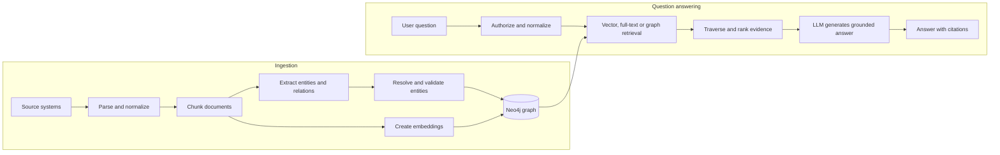

+++
date = '2026-11-15T12:00:05+10:00'
draft = false
title = 'GraphRAG with Neo4j: Architecture, Retrieval Patterns and Design'
tags = ['AI', 'GraphRAG', 'RAG', 'Neo4j', 'Knowledge Graphs', 'Cypher', 'Design Patterns']
summary = "A practical guide to GraphRAG with Neo4j: knowledge graph modeling, document ingestion, vector and hybrid retrieval, graph traversal, design patterns, evaluation, security and production operations."
+++

GraphRAG combines retrieval-augmented generation (RAG) with graph data. Instead of finding text only by semantic similarity, a GraphRAG system can use entities and their relationships to locate connected evidence. Neo4j can store the knowledge graph, document chunks, metadata and embeddings in one graph database, then use Cypher to retrieve relevant passages and their connected context.

This guide explains the architecture, the choices that shape a useful graph, the main retrieval patterns, a working starter design and the operational concerns that matter in production. It uses Neo4j Community Edition concepts and the Neo4j GraphRAG for Python package. Check the linked documentation for version-specific behavior before copying API calls into an application.

## 1. What GraphRAG means

RAG retrieves external context for a language model before the model answers. In basic vector RAG, the application embeds a question, searches for nearby text chunk embeddings and sends the best matching chunks to the model.

GraphRAG adds graph structure to one or more RAG stages. A graph represents things as **nodes** and the connections between them as **relationships**. For example, a graph might connect a policy document to a clause, a product, an owner and a regulation. Retrieval can use those paths to gather evidence that is connected to an initial match.

GraphRAG is a family of designs rather than one standard algorithm. Some systems use a graph only after vector search. Other systems search for entities, execute a structured graph query, summarize graph communities or combine several methods. Neo4j describes text-based retrieval, entity-based local retrieval, cluster-based global retrieval and natural-language-to-Cypher retrieval as distinct patterns. [Neo4j GraphRAG overview](https://neo4j.com/labs/genai-ecosystem/graphrag/)

### GraphRAG and vector RAG

| Capability         | Vector RAG                                   | GraphRAG with Neo4j                                                           |
| ------------------ | -------------------------------------------- | ----------------------------------------------------------------------------- |
| Main search signal | Similarity between text embeddings           | Semantic or lexical matches plus graph structure                              |
| Typical context    | Top matching chunks                          | Matching chunks, entities, relationships and connected chunks                 |
| Strong fit         | Questions answered in one passage            | Questions that depend on relationships, constraints or multiple sources       |
| Main risks         | Misses exact terms or multi-step connections | Poor graph modeling, extraction errors, noisy traversals and added complexity |

GraphRAG does not guarantee better answers. A graph helps when the relationships in the data are useful to the question. If answers are contained in isolated passages and vector search already retrieves them reliably, a graph may add work without improving results.

## 2. Why Neo4j?

Neo4j is a property graph database. Nodes and relationships can both carry labels, types and properties. A graph model can therefore represent documents, chunks, people, products, events and domain-specific concepts as connected records.

Cypher is Neo4j's graph query language. A Cypher query describes a pattern to match, such as a chunk that mentions an entity and that entity's relationship to a product. Neo4j Community Edition is GPLv3-licensed; Enterprise Edition uses a commercial license. Review the [Neo4j licensing page](https://neo4j.com/open-source-project/) for the current terms before selecting an edition for a project.

Neo4j supports vector indexes for approximate nearest-neighbor search and full-text indexes for lexical search. Graph queries can follow the search results to related nodes. Neo4j's official Python package, `neo4j-graphrag`, includes vector, hybrid, graph-aware and Text2Cypher retrievers, among other components. The package documentation currently lists Neo4j 5.18.1 or later as supported and recommends checking its current documentation for exact compatibility. [Neo4j GraphRAG for Python](https://neo4j.com/docs/neo4j-graphrag-python/current/)

Use Neo4j when the connected data is valuable to retrieval, the team can define and maintain a graph schema and graph queries are a useful way to express the application’s questions. The database does not automatically turn documents into a correct knowledge graph; ingestion and modeling remain application responsibilities.

## 3. A reference architecture

A production GraphRAG application has two broad paths: **ingestion** builds searchable data and **question answering** retrieves evidence and generates a response.



The graph database stores the relationships used by retrieval. An embedding model converts text into vectors. An LLM may extract entities during ingestion and generate the final answer. Those models are separate choices from Neo4j itself; they may be hosted locally or by a provider.

### Keep source evidence

The graph should point back to the original evidence. Store document identifiers, source URLs or paths, chunk identifiers, offsets or page numbers, timestamps and access-control metadata. A generated relationship is a derived claim. The original chunk is the evidence a reviewer can inspect.

## 4. Model the graph around questions

Do not begin by extracting every possible entity from every document. Start with the questions users need answered, then model the entities and paths that make those answers retrievable.

### A small document graph

An initial schema can use four core node types:

- `Document` represents a source file, web page, ticket or record.
- `Chunk` represents a bounded passage of source text and stores its embedding.
- Domain nodes such as `Person`, `Product`, `Policy` or `Service` represent normalized entities.
- Optional nodes such as `Claim`, `Event` or `Community` represent facts and higher-level summaries when a use case needs them.

Relationships connect source and domain data:

- `(d:Document)-[:HAS_CHUNK]->(c:Chunk)` preserves document structure.
- `(c:Chunk)-[:MENTIONS]->(e:Entity)` grounds an entity mention in a passage.
- `(e1:Entity)-[:RELATED_TO]->(e2:Entity)` represents a normalized domain relation, if the source supports it.
- `(c:Chunk)-[:NEXT_CHUNK]->(next:Chunk)` can preserve local sequence when neighboring text matters.

The generic `Entity` label is useful for a first prototype. A mature domain model should use clear labels and relationship types, such as `(:Employee)-[:REPORTS_TO]->(:Employee)` or `(:Product)-[:GOVERNED_BY]->(:Policy)`. Domain-specific types make queries and constraints easier to understand.

### Example property conventions

```text
Document: id, uri, title, sourceType, tenantId, createdAt, updatedAt, checksum
Chunk: id, text, ordinal, page, startOffset, endOffset, embedding, tenantId
Entity: id, name, canonicalName, type, tenantId
MENTIONS: confidence, extractionMethod, sourceChunkId
RELATED_TO: predicate, confidence, sourceChunkId, validFrom, validTo
```

Use stable source identifiers as IDs. A document checksum can detect unchanged content. A tenant or security scope should be explicit in the model when data is partitioned by customer or authorization boundary. Avoid using a database-generated internal node ID as a durable external identifier.

### Entity resolution is a first-class step

Extraction may produce different strings for the same entity: `Acme`, `Acme Ltd.` and `ACME Limited`. Entity resolution maps those strings to a canonical entity. A resolver can use exact identifiers, normalized names, domain rules, fuzzy matching or human review. Preserve the original mention and the resolution decision so that the system can trace and correct mistakes.

Do not merge entities only because their names look similar. Two people with the same name may be different people. Use identifiers and domain context and retain a confidence score or review state when the match is uncertain.

## 5. Ingestion: from documents to graph

Ingestion is often the most demanding part of a GraphRAG implementation. A basic pipeline contains the following stages.

1. **Collect** source records and capture access permissions and provenance.
2. **Parse** formats such as HTML, PDF, DOCX or database records into normalized text and metadata.
3. **Chunk** text into passages that retain enough context to stand alone.
4. **Embed** chunks using the same embedding model and preprocessing conventions used for questions.
5. **Extract** entities and relationships from chunks using deterministic rules, an LLM or a combination.
6. **Resolve** entity mentions to canonical nodes and validate relationships against an allowed schema.
7. **Write** documents, chunks, embeddings and graph edges using idempotent upserts.
8. **Index** the properties used for exact, lexical and semantic retrieval.
9. **Record** pipeline status, model versions, extraction versions and errors for reprocessing.

### Chunking choices

Chunk size and boundaries affect both retrieval quality and graph extraction. Very small chunks can lose the meaning of a pronoun or a definition. Very large chunks can dilute vector similarity and exceed prompt budgets. Use document structure where possible: headings, paragraphs, list boundaries and page breaks often make better boundaries than splitting on a fixed character count alone.

Store chunk order and document section metadata. At retrieval time, the system can expand from a matched chunk to its neighbors or its parent section when the initial passage lacks context.

### Extracting entities and relations

An LLM extractor should receive a constrained schema, clear definitions and examples. Validate its output before writing it. Useful validation includes allowed labels and relationship types, required properties, type compatibility, confidence thresholds and source span checks.

For example, a relation `(:Person)-[:OWNS]->(:Product)` may be allowed while `(:Policy)-[:REPORTS_TO]->(:Service)` is not. Schema validation prevents extraction output from creating arbitrary graph structures.

Extracted facts should retain provenance. Attach a relationship to its supporting chunk or store the source chunk ID and a quoted span. When multiple documents support the same relation, retain multiple evidence links rather than overwriting the only source.

### Idempotency and updates

Use a unique source ID and deterministic chunk IDs, such as a document ID plus a chunk ordinal or content hash. Upserts let a retry safely repeat a batch. When a source changes, mark the old version, replace its chunks and derived edges, then record the new checksum and processing version. Do not leave stale entity links attached to deleted text.

For large corpora, batch writes and monitor transaction sizes. Keep parsing, LLM extraction and database writes as separate stages so a failure can resume without repeating successful work. The exact batching strategy depends on document size and Neo4j deployment capacity.

## 6. Retrieval patterns

Choose a retrieval pattern based on the shape of the question. A system may route different questions to different retrievers, but each route should have a clear purpose and evaluation set.

### Pattern A: vector search followed by graph expansion

This is a practical default for questions that mention a concept indirectly but need connected facts. First, find relevant `Chunk` nodes by vector similarity. Then follow `MENTIONS` and domain relationships to gather supporting context.

```cypher
// The vector index name and embedding dimensions must match the database setup.
CALL db.index.vector.queryNodes('chunk_embedding', $topK, $queryEmbedding)
YIELD node AS chunk, score
MATCH (chunk)-[:MENTIONS]->(entity:Entity)
OPTIONAL MATCH (entity)-[rel:RELATED_TO]-(neighbor:Entity)
RETURN chunk.id AS chunkId,
       chunk.text AS text,
       score,
       collect(DISTINCT {
         name: entity.canonicalName,
         relation: type(rel),
         neighbor: neighbor.canonicalName
       }) AS graphContext
ORDER BY score DESC
LIMIT $resultLimit
```

This example uses the vector query procedure supported in Neo4j versions before the newer `SEARCH` clause. Neo4j documentation describes `SEARCH` for vector indexes starting in Neo4j 2026.01; choose the syntax supported by the database version you deploy. [Neo4j search index syntax](https://neo4j.com/docs/cypher-manual/current/indexes/syntax/)

The query deliberately limits the initial vector candidates and the returned context. Production queries should also apply tenant and authorization filters, avoid unbounded traversals and return evidence identifiers. A high vector score does not establish that a graph edge is true; the edge needs its own provenance and quality controls.

### Pattern B: hybrid lexical and vector search

Vector search helps with paraphrases. Full-text search helps with exact names, acronyms, product codes and quoted terms. Hybrid retrieval combines both result sets. Since the search methods produce scores on different scales, do not add raw scores without normalization or calibration. Rank each source independently, then combine ranks with a method such as reciprocal rank fusion or a learned reranker.

The Neo4j GraphRAG Python package provides `HybridRetriever` and `HybridCypherRetriever` for combining full-text and vector search, with graph retrieval queries available in the Cypher variant. [Neo4j RAG user guide](https://neo4j.com/docs/neo4j-graphrag-python/current/user_guide_rag.html)

### Pattern C: entity-centered local retrieval

Use this pattern when a question names one or more entities. Resolve the names, retrieve the matching entities and gather their descriptions, source chunks and a bounded neighborhood. This pattern is useful for questions such as “Which services depend on Product A?” or “What policies apply to the Atlas service?”

The important design choice is the neighborhood boundary. One hop may be enough for a direct relation. Two hops can answer dependency or ownership questions. Larger expansions can quickly produce irrelevant facts, so add allowed relationship types, direction, tenant scope and a maximum depth.

### Pattern D: structured graph query

Some questions need exact relational logic: “Which suppliers have an active contract and support a product affected by this incident?” A structured Cypher query can express conditions, date bounds and relationship paths more precisely than semantic similarity alone.

The application can use a fixed, reviewed query template with parameters. This is often safer and easier to evaluate than asking an LLM to invent arbitrary Cypher. The query returns records and source references; the LLM can turn those records into a readable answer.

### Pattern E: Text2Cypher

Text2Cypher translates a natural-language question into Cypher, executes the query and passes the results to an LLM. The Neo4j GraphRAG Python package includes a `Text2Cypher` retriever. [Neo4j RAG user guide](https://neo4j.com/docs/neo4j-graphrag-python/current/user_guide_rag.html)

Generated database queries require strict controls. Provide only the relevant schema, use a read-only database account, validate the generated statement, set a transaction timeout and result limit and reject writes or administrative commands. Add tenant and access filters in trusted application code rather than relying on the model to include them. For high-impact use cases, prefer reviewed query templates.

### Pattern F: global or corpus-level retrieval

Questions such as “What are the recurring reasons for customer churn?” ask about themes across a corpus rather than one entity or passage. One approach is to detect communities or clusters of related entities, create summaries grounded in the member evidence, then retrieve the relevant summaries and supporting passages.

Summaries are derived artifacts. Store their generation timestamp, model and prompt version, source membership and links to source chunks. Rebuild summaries when source data changes. Do not present a summary as a directly quoted fact; retrieve underlying evidence for the final answer.

### Pattern G: parent and neighboring context

Chunk retrieval may find the correct passage but omit a heading, definition or adjacent condition. Expand to a parent section, neighboring chunks or the whole short document section. Keep the expansion bounded and deduplicate text before building the prompt.

### Pattern H: multi-stage retrieval and reranking

A useful high-quality pipeline may retrieve a broad candidate set, expand graph context, remove duplicates, rerank the candidates and select evidence under a token budget. A cross-encoder or LLM reranker can improve ordering, but it adds latency and cost. Measure its effect against a baseline before adding it.

## 7. Building the graph schema in Neo4j

The following example creates uniqueness constraints and a vector index for chunk embeddings. The vector dimension must equal the output dimension of the embedding model. A mismatch prevents valid comparisons.

```cypher
CREATE CONSTRAINT document_id IF NOT EXISTS
FOR (d:Document) REQUIRE d.id IS UNIQUE;

CREATE CONSTRAINT chunk_id IF NOT EXISTS
FOR (c:Chunk) REQUIRE c.id IS UNIQUE;

CREATE CONSTRAINT entity_id IF NOT EXISTS
FOR (e:Entity) REQUIRE e.id IS UNIQUE;

CREATE VECTOR INDEX chunk_embedding IF NOT EXISTS
FOR (c:Chunk) ON (c.embedding)
OPTIONS {indexConfig: {
  `vector.dimensions`: 1536,
  `vector.similarity_function`: 'cosine'
}};
```

The `1536` dimension is an example only. Set it to the dimension produced by the selected embedding model. Neo4j vector search is approximate nearest-neighbor search, so evaluate recall and ranking on representative questions. [Neo4j GraphRAG package limitations](https://neo4j.com/docs/neo4j-graphrag-python/current/)

An ingestion transaction can create or update the document and chunks:

```cypher
MERGE (d:Document {id: $document.id})
SET d.title = $document.title,
    d.uri = $document.uri,
    d.tenantId = $document.tenantId,
    d.checksum = $document.checksum,
    d.updatedAt = datetime()
WITH d
UNWIND $chunks AS row
MERGE (c:Chunk {id: row.id})
SET c.text = row.text,
    c.ordinal = row.ordinal,
    c.embedding = row.embedding,
    c.tenantId = $document.tenantId
MERGE (d)-[:HAS_CHUNK]->(c);
```

Pass values as parameters through the Neo4j driver. Do not build Cypher by concatenating user input. In a real update pipeline, remove or version chunks that disappeared from the source document and update their graph edges in the same controlled workflow.

## 8. Use the official Neo4j GraphRAG package

The official `neo4j-graphrag` Python package offers reusable retrievers and pipeline components. It is a useful starting point when the application is Python-based and the retriever behavior matches the use case. It does not remove the need to design the graph, define access control or evaluate answer quality.

Install the package in a virtual environment and select the optional provider integration your application uses:

```bash
pip install neo4j-graphrag
```

The package documentation shows how to create an embedder and a `VectorRetriever`. The example below is intentionally compact; credentials and model configuration should come from a secret manager or environment configuration.

```python
import os
from neo4j import GraphDatabase
from neo4j_graphrag.embeddings.openai import OpenAIEmbeddings
from neo4j_graphrag.retrievers import VectorCypherRetriever

driver = GraphDatabase.driver(
    os.environ["NEO4J_URI"],
    auth=(os.environ["NEO4J_USERNAME"], os.environ["NEO4J_PASSWORD"]),
)
embedder = OpenAIEmbeddings(model="text-embedding-3-large")

retriever = VectorCypherRetriever(
    driver,
    "chunk_embedding",
    """
    WITH node AS chunk, score
    MATCH (chunk)-[:MENTIONS]->(entity:Entity)
    OPTIONAL MATCH (entity)-[:RELATED_TO]-(neighbor:Entity)
    RETURN chunk.id AS chunkId,
           chunk.text AS text,
           score,
           collect(DISTINCT neighbor.canonicalName) AS relatedEntities
    ORDER BY score DESC
    LIMIT 10
    """,
    embedder=embedder,
)

result = retriever.search(
    query_text="Which services are affected by the Atlas policy?",
    top_k=5,
)
```

Check the [package's current retriever documentation](https://neo4j.com/docs/neo4j-graphrag-python/current/user_guide_rag.html) for the exact constructor and retrieval query parameters supported by the installed release. Pin a package version and test upgrades in a staging environment. The example's embedding model is a provider choice, not a requirement of Neo4j.

The retriever returns evidence for an application to use. A complete RAG application still needs to format context, call a generation model, ask for evidence-based answers and expose citations or source links to the user.

## 9. Ground answers and citations

The prompt should tell the model to answer from retrieved evidence, state when evidence is insufficient and cite source IDs. Keep source IDs in the context object rather than asking the model to invent citations.

One evidence record might contain:

```json
{
  "chunk_id": "doc-42:chunk-7",
  "document_id": "doc-42",
  "source_uri": "https://intranet.example/policies/atlas",
  "text": "The Atlas service must complete a quarterly access review.",
  "matched_entities": ["Atlas service", "access review"],
  "graph_path": ["Atlas service", "GOVERNED_BY", "Access policy"]
}
```

Treat the path as a way to explain why the system retrieved the evidence. The path alone may not prove the answer. The source text and the reliability of the relation determine whether the answer is supported.

## 10. Design patterns and practical rules

### Keep graph facts and text evidence linked

Represent concepts as graph nodes and retain the text that supports extracted facts. This gives retrieval both structured connections and inspectable evidence.

### Use a bounded graph neighborhood

Set a maximum number of hops, an allowed relationship list, a per-entity fan-out limit and a total evidence budget. Unbounded traversals can return large amounts of weakly related context.

### Separate retrieval from generation

Keep retrieval as a component that returns ranked evidence records. Keep answer generation as a separate component that consumes those records. This makes retrieval measurable without an LLM and makes the answer prompt easier to change.

### Route by question shape

Use vector or hybrid retrieval for fuzzy questions, entity-centered retrieval for named entities, structured queries for exact constraints and global summaries for corpus-level themes. A simple router can use rules or a classifier. Log the chosen route and compare it with alternatives during evaluation.

### Preserve temporal facts

Relationships such as employment, ownership or policy applicability may change over time. Store valid-time fields where the domain requires historical questions. Make queries explicit about whether they ask for current or historical state.

### Make writes reproducible

Keep source version, parser version, chunking configuration, embedding model and extraction prompt version. These fields let a team determine why two graph builds differ and decide which data needs reprocessing.

### Do not over-model

An edge for every extracted verb can produce a dense graph with little retrieval value. Begin with a small ontology that supports actual question paths. Add labels and relationships when evaluation shows that the added structure improves retrieval or answer correctness.

## 11. Security, privacy and tenant isolation

RAG can expose information that a user is not authorized to read if retrieval ignores source permissions. Apply access filters before evidence reaches the language model. This applies to vector search, full-text search, graph traversal, summaries and cached results.

Useful controls include:

- Store tenant, classification and access metadata on source documents and propagate the relevant scope to chunks and derived nodes.
- Apply authorization in trusted application code and enforce it in every retrieval path.
- Use database credentials with only the required read or write privileges.
- Keep generated Cypher read-only and bounded when using Text2Cypher.
- Treat documents as untrusted input. Retrieved instructions must not override system policy or tool permissions.
- Avoid logging secrets or sensitive source text. Apply retention rules to prompts, traces and caches.
- Define deletion behavior for source removal, including chunks, embeddings, extracted edges, summaries and caches.

For strict isolation, separate databases or deployments may be more appropriate than relying only on a tenant property. The right boundary depends on the threat model, data sensitivity and operational constraints.

## 12. Evaluate the system

Evaluate retrieval and generation separately. A polished answer can hide poor evidence retrieval, and a good retrieval result can be undermined by an unreliable answer prompt.

### Retrieval evaluation

Create a representative question set with expected source chunks, entities or graph paths. Measure metrics such as recall at K, precision at K, reciprocal rank and whether the required relation path was retrieved. Include paraphrases, exact identifiers, ambiguous names, multi-hop questions and questions with no supported answer.

Compare at least these baselines:

1. Vector-only retrieval.
2. Hybrid vector and full-text retrieval.
3. Graph expansion from vector matches.
4. Entity-centered or structured retrieval where appropriate.

This shows whether graph structure improves the cases the application cares about. It can also reveal that an extraction or entity-resolution change harms results.

### Answer evaluation

Measure answer correctness, evidence relevance, citation accuracy, completeness and appropriate refusal when evidence is missing. Use human review for high-impact applications. Automated LLM judging can help triage results, but should not be the only quality control.

### Operational metrics

Track retrieval latency, generation latency, tokens per answer, number of graph rows returned, empty-result rate, model and database errors, and ingestion freshness. These metrics help explain regressions that an aggregate quality score can miss.

## 13. Performance and scale

Vector search is approximate and indexed for similarity rather than exact graph semantics. Candidate count, index settings, embedding choice and filters affect recall and latency. Start with a measured candidate count and tune against a fixed evaluation set.

Keep graph traversals selective. Use indexes and constraints for identifiers used in lookups, constrain edge types and depth, and avoid returning whole paths or large node properties unless the answer needs them. Inspect query plans for expensive Cypher and benchmark under expected concurrency.

Embedding generation and LLM extraction are often the slow and costly ingestion stages. Process independent documents in controlled parallel batches, retry transient failures and record a durable checkpoint. Reuse embeddings when the exact chunk text and embedding model have not changed.

Neo4j can store vectors and graph data together, while the GraphRAG package also documents retrievers that search external vector databases and use Neo4j for graph context. Keeping vectors in Neo4j simplifies the architecture. An external vector store may be appropriate when the existing system already depends on one or has requirements better served by that platform.

## 14. Common failure modes

| Failure                                                 | Why it happens                                                    | Improvement                                                             |
| ------------------------------------------------------- | ----------------------------------------------------------------- | ----------------------------------------------------------------------- |
| The graph contains many noisy edges                     | Extraction is unconstrained or entity resolution is weak          | Limit the ontology, validate types and retain confidence and provenance |
| Retrieval returns relevant chunks but misses the answer | The answer depends on a relation beyond the initial passage       | Add a targeted graph expansion pattern and test its hop boundary        |
| Exact identifiers are missed                            | Embedding similarity is weak for codes and names                  | Add full-text or identifier lookup and combine ranks carefully          |
| The prompt is flooded with context                      | Traversals or chunk expansion are unbounded                       | Limit candidates, neighbors and tokens; rerank and deduplicate          |
| Graph summaries become stale                            | Derived summaries are not tied to source versions                 | Track membership and rebuild after source changes                       |
| Text2Cypher returns unsafe or expensive queries         | The generated query has broad permissions or no limits            | Use read-only credentials, schema constraints, validation and timeouts  |
| Answers cite unsupported facts                          | Citations are generated as prose rather than attached to evidence | Pass source IDs with each evidence record and validate citations        |
| Results leak across tenants                             | A retrieval path omits the authorization filter                   | Centralize authorization and test every retriever and cache path        |

## 15. When GraphRAG is a good fit

GraphRAG is a strong candidate when users ask questions involving relationships across documents, when domain entities have stable identities, when answers require several connected facts or when reviewers need traceable evidence paths.

It may not be worth the added complexity when a small document collection can be searched adequately with vector or hybrid retrieval, when relationships are not important to the questions or when the team cannot maintain extraction quality and graph updates.

A sensible adoption path is to build a vector-RAG baseline, add provenance-rich graph relationships for a narrow domain, implement one graph-aware retriever and evaluate both systems on the same questions. Expand the graph only when measured results justify it.

## 16. Implementation checklist

- Define the question types and evidence required to answer each one.
- Select a graph schema that expresses those answer paths.
- Preserve source IDs, text, permissions and provenance.
- Choose a chunking and embedding strategy and record its version.
- Constrain entity and relation extraction to a validated schema.
- Resolve entity identity and preserve uncertain matches for review.
- Make ingestion idempotent and support source updates and deletions.
- Create the required uniqueness, lookup, vector and full-text indexes.
- Start with vector or hybrid retrieval, then add bounded graph expansion.
- Return evidence records with source identifiers and graph context.
- Enforce authorization before generation and in every retrieval branch.
- Evaluate retrieval, answers, citations, latency and cost against a baseline.
- Pin Neo4j, driver, GraphRAG package and model versions for releases.

## Conclusion

Neo4j GraphRAG combines semantic or lexical search with Cypher graph traversal. The graph is most useful when it captures relationships that help answer real questions, while chunks and provenance keep answers tied to source evidence. A small, validated graph with bounded retrieval and strong evaluation is a better starting point than extracting a huge graph without a retrieval goal.

### Further reading

- [Neo4j GraphRAG for Python documentation](https://neo4j.com/docs/neo4j-graphrag-python/current/)
- [Neo4j GraphRAG retriever guide](https://neo4j.com/docs/neo4j-graphrag-python/current/user_guide_rag.html)
- [Neo4j GraphRAG patterns](https://neo4j.com/labs/genai-ecosystem/graphrag/)
- [Neo4j Cypher search indexes](https://neo4j.com/docs/cypher-manual/current/indexes/search-indexes/)
- [Neo4j Community Edition licensing](https://neo4j.com/open-source-project/)
