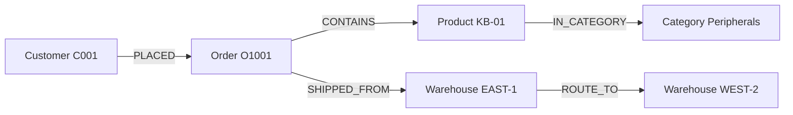
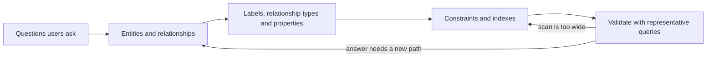
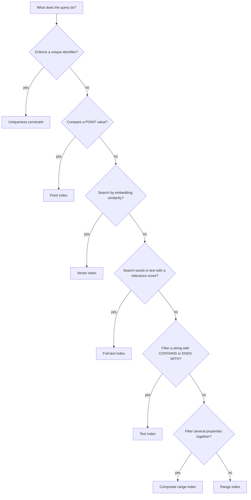
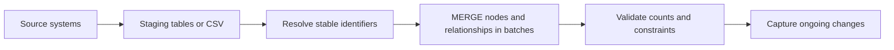
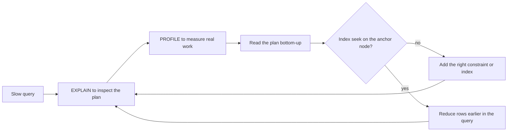
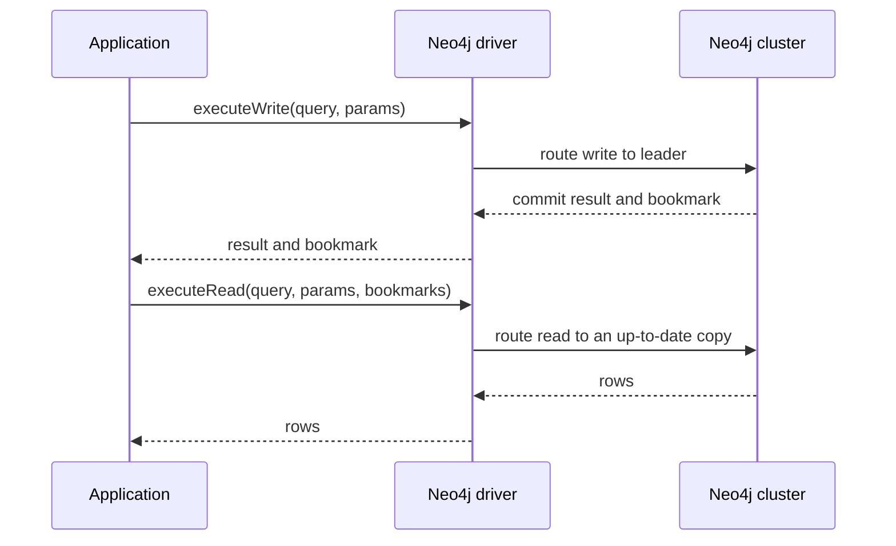
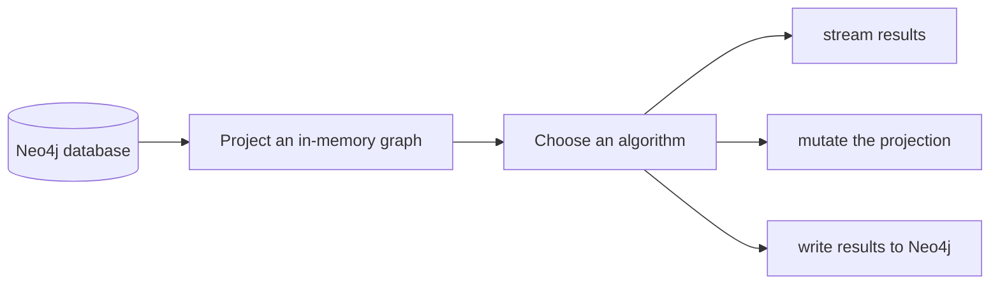
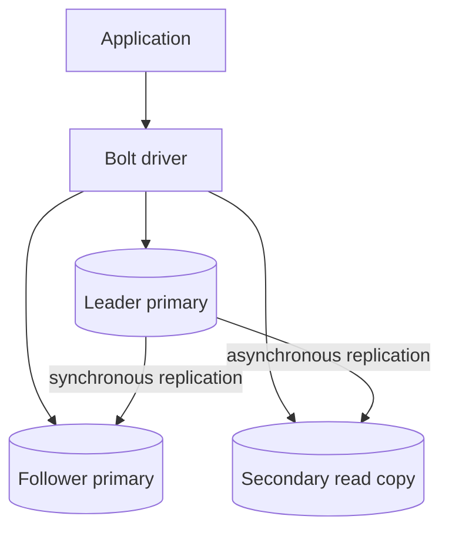

+++
date = '2026-11-21T12:00:30+10:00'
draft = false
title = 'Neo4j Complete Guide: From Graph Fundamentals to Production Operations'
tags = ['Neo4j', 'System Design', 'Cypher', 'Graph Database', 'Data Modeling', 'Design Patterns', 'Performance', 'Operations']
summary = "A complete Neo4j guide covering property graph modeling, Cypher, schema design, ingestion, query tuning, application patterns, graph analytics, security and production operations."
+++

Neo4j stores data as nodes and relationships. A query follows stored relationships instead of computing joins at read time. That changes how you model data, how you write queries and how you scale a system.

This guide covers the full path from graph fundamentals to production operations. It gives you a working vocabulary, a repeatable modeling method, a Cypher reference, ingestion and tuning patterns, application integration patterns, analytics, security and operations. Each section points to the official documentation for details that change between releases.

The versions below reflect the documentation available in November 2026. The operations manual lists **2026.10.2** as the latest Neo4j release. The Cypher manual documents **Cypher 25** as the current query language. Neo4j added all new Cypher features to Cypher 25 from Neo4j 2025.06, and new databases created from Neo4j 2026.02 set Cypher 25 as their query language. Check the [Cypher manual](https://neo4j.com/docs/cypher-manual/current/) and the [operations manual](https://neo4j.com/docs/operations-manual/current/) before applying a version-specific command.

## Choose the right problem for a graph database

A graph database stores the connections between records as first-class data. Use Neo4j when the path between records carries meaning and when queries ask about those paths.

Good fits include the following cases:

- Recommendation and "people also bought" queries that traverse shared relationships.
- Identity and access graphs where permissions flow through groups, roles and resources.
- Fraud detection that follows chains of accounts, devices and transactions.
- Dependency graphs for services, packages and deployments.
- Knowledge graphs that connect documents, entities and evidence.
- Network and route analysis where shortest path and centrality matter.

Poor fits include the following cases:

- Simple key-value lookups with no relationships.
- Large aggregations over flat tables with no traversal. Write those to an analytical store.
- Write-heavy time series that never query relationships. Use a time-series database.
- Transactions that require distributed across many independent graphs without a shared traversal.

Neo4j is a transactional database. It provides ACID transactions. It is not a replacement for a data warehouse or a search engine, although it includes full-text and vector indexes for specific search tasks. The [graph database concepts guide](https://neo4j.com/docs/getting-started/appendix/graphdb-concepts/) defines the model and the [documentation home](https://neo4j.com/docs/) lists the product boundaries.

### Editions and deployment choices

| Option                                                             | What it gives you                                                                             | When to choose it                                                            |
| ------------------------------------------------------------------ | --------------------------------------------------------------------------------------------- | ---------------------------------------------------------------------------- |
| AuraDB Free                                                        | An entry-level managed instance in the Neo4j cloud                                            | Learning and small prototypes                                                |
| AuraDB Professional, Business Critical and Virtual Dedicated Cloud | Managed capacity, isolation and support tiers                                                 | Managed production without a database operations team                        |
| Self-managed Community Edition                                     | A local or server installation under an open-source licence                                   | Development, embedded use and workloads that do not need Enterprise features |
| Self-managed Enterprise Edition                                    | Clustering, online backup, role-based access control, property existence and type constraints | Production clusters with operational staff                                   |

The [Aura documentation](https://neo4j.com/docs/aura/) lists the current products and tiers. The [deployment options guide](https://neo4j.com/docs/deployment-options/) covers local, Docker and Kubernetes installations.

## Understand the property graph model

Neo4j uses the property graph model. The model has four building blocks.

- **Nodes** represent entities. A node can have zero or more labels and zero or more properties.
- **Relationships** connect a source node to a target node. Each relationship has exactly one type and a direction. A relationship can carry properties.
- **Labels** group nodes into sets. Labels are case sensitive.
- **Properties** are key-value pairs on nodes and relationships. A property value can be a scalar or a homogeneous list.

A **path** is a sequence of nodes connected by relationships. The number of relationships in a path is its length. A single node has path length zero. These definitions come from the [graph database concepts guide](https://neo4j.com/docs/getting-started/appendix/graphdb-concepts/).

The example domain used throughout this guide is an order-management graph.



Cypher uses ASCII patterns to describe the same structure. Parentheses are nodes and arrows are relationships.

```cypher
(:Customer)-[:PLACED]->(:Order)-[:CONTAINS]->(:Product)
```

### Naming conventions

Neo4j documents the following naming conventions. Labels, relationship types and property keys are case sensitive.

| Element           | Convention           | Example         |
| ----------------- | -------------------- | --------------- |
| Node label        | PascalCase           | `:VehicleOwner` |
| Relationship type | SCREAMING_SNAKE_CASE | `:OWNS_VEHICLE` |
| Property key      | camelCase            | `firstName`     |

Apply these rules in every project. Mixed conventions force readers to check the schema for each query. See [naming rules and recommendations](https://neo4j.com/docs/cypher-manual/current/syntax/naming/).

### Decide between a property and a node

Model a value as a property when the query filters on it, returns it and never traverses to it. Model a value as a node when it has its own relationships, its own lifecycle or many shared references.

| Value                               | Model as                                        | Reason                                                                |
| ----------------------------------- | ----------------------------------------------- | --------------------------------------------------------------------- |
| `order.status`                      | Property                                        | Queries filter orders by status and never traverse to status          |
| `product.category`                  | Node                                            | Categories connect to many products and carry their own hierarchy     |
| `customer.city`                     | Property until a query needs city relationships | A city becomes a node when routes and regions attach to it            |
| `order.placedAt`                    | Property                                        | Time is returned and filtered, not traversed                          |
| `product.price` with validity dates | Relationship to a price node                    | A price has a validity window and can link to a currency and a source |

Relationship properties hold facts about the connection. `(:Order)-[:CONTAINS {quantity: 2}]->(:Product)` stores quantity on the relationship because quantity belongs to the order-product pair.

## Set up a local environment

Use one of three starting points.

1. Create an AuraDB Free instance from the [Aura console](https://console.neo4j.io/) and connect with Neo4j Browser.
2. Run Neo4j Desktop and create a local DBMS.
3. Run the official Docker image. Follow the [Docker installation guide](https://neo4j.com/docs/operations-manual/current/installation/docker/) for the current image tag, port mapping and persistent volume configuration.

A local Docker setup exposes HTTP on port 7474 for Neo4j Browser and Bolt on port 7687 for drivers. Persist both the `data` and `logs` directories in named volumes. Without a volume, removing the container removes the graph.

Connect with one of the following tools:

- **Neo4j Browser** for interactive Cypher and graph visualization.
- **cypher-shell** for scripts and terminal work.
- **Neo4j Bloom** for business-facing graph exploration.
- **A driver** for application code. The [create applications guide](https://neo4j.com/docs/create-applications/) lists the supported language libraries.

## Write Cypher with confidence

Cypher is a declarative query language. You describe the pattern you want and the planner decides how to find it. The [Cypher manual](https://neo4j.com/docs/cypher-manual/current/) is the authoritative reference.

### Read, create and update

The following statements build the example graph.

```cypher
CREATE (c:Customer {customerId: 'C001', name: 'Asha', email: 'asha@example.com'})
CREATE (o:Order {orderId: 'O1001', placedAt: datetime('2026-11-20T10:00:00Z'), status: 'SHIPPED'})
CREATE (p:Product {sku: 'KB-01', name: 'Mechanical keyboard', price: 89.00})
CREATE (w:Warehouse {code: 'EAST-1'})
CREATE (c)-[:PLACED]->(o)
CREATE (o)-[:CONTAINS {quantity: 1}]->(p)
CREATE (o)-[:SHIPPED_FROM]->(w)
RETURN c.customerId AS customer, o.orderId AS order, p.sku AS product;
```

Read the graph with `MATCH` and `RETURN`.

```cypher
MATCH (c:Customer {customerId: 'C001'})-[:PLACED]->(o:Order)
WHERE o.status = 'SHIPPED'
RETURN o.orderId AS orderId, o.placedAt AS placedAt
ORDER BY o.placedAt DESC
LIMIT 20;
```

Update properties with `SET` and remove them with `REMOVE`.

```cypher
MATCH (o:Order {orderId: 'O1001'})
SET o.status = 'DELIVERED', o.updatedAt = datetime()
RETURN o.status AS status;
```

Delete a node and its relationships with `DETACH DELETE`. A plain `DELETE` fails when the node still has relationships.

```cypher
MATCH (c:Customer {customerId: 'C002'})
DETACH DELETE c;
```

Never run an unbounded `MATCH (n) DETACH DELETE n` outside a disposable local database.

### Use parameters in every application query

Parameters separate query structure from data values. They allow the planner to reuse a query plan and they prevent Cypher injection.

```cypher
MATCH (c:Customer {customerId: $customerId})-[:PLACED]->(o:Order)
RETURN o
ORDER BY o.placedAt DESC
LIMIT $limit;
```

Pass values from the driver as a map. Never concatenate user input into a query string. Neo4j documents this risk in [Protecting against Cypher injection](https://neo4j.com/developer/kb/protecting-against-cypher-injection/).

Labels and relationship types cannot be passed as ordinary string parameters. Use dynamic patterns when the label or type comes from user input.

```cypher
MATCH (n:$(labelParam) {id: $id})
RETURN n;
```

The Cypher manual recommends dynamic labels and types as an injection mitigation. The `MERGE` documentation records version-specific performance caveats for dynamic patterns. See [MERGE using dynamic node labels and relationship types](https://neo4j.com/docs/cypher-manual/current/clauses/merge/).

### Match paths of variable length

A bounded variable-length pattern limits traversal work. Always set an upper bound in application queries.

```cypher
MATCH path = (a:Warehouse {code: 'EAST-1'})-[:ROUTE_TO*1..5]->(b:Warehouse {code: 'WEST-2'})
RETURN [node IN nodes(path) | node.code] AS route,
       reduce(total = 0, rel IN relationships(path) | total + rel.distanceKm) AS distanceKm
ORDER BY distanceKm
LIMIT 1;
```

Cypher 25 provides `SHORTEST` path patterns and controls for relationship re-traversal and acyclic paths. The [patterns chapter](https://neo4j.com/docs/cypher-manual/current/patterns/) describes fixed-length paths, variable-length paths and shortest paths.

### Aggregate and reshape results

`WITH` passes computed values to the next clause. `UNWIND` turns a list into rows. `collect()` builds a list from rows.

```cypher
MATCH (c:Customer)-[:PLACED]->(o:Order)-[:CONTAINS]->(p:Product)
WITH c, p, count(o) AS orderCount
ORDER BY orderCount DESC
RETURN c.name AS customer,
       collect({sku: p.sku, orders: orderCount})[0..3] AS topProducts;
```

### Use MERGE for idempotent writes

`MERGE` combines `MATCH` and `CREATE`. When the exact pattern exists, `MERGE` binds it. When the pattern does not exist, `MERGE` creates it. Use `ON CREATE` and `ON MATCH` to set different properties for each case.

```cypher
UNWIND $rows AS row
MERGE (p:Product {sku: row.sku})
ON CREATE SET p.name = row.name, p.price = row.price, p.createdAt = datetime()
ON MATCH  SET p.name = row.name, p.price = row.price, p.updatedAt = datetime()
RETURN count(p) AS productsTouched;
```

Two rules make `MERGE` safe under concurrent loads:

1. Create a uniqueness constraint on the identifying property before loading data. `MERGE` alone guarantees that a pattern exists; it does not guarantee uniqueness across different property values under concurrent writes.
2. Include only the identifying properties in the `MERGE` pattern. Put other values in `ON CREATE SET` and `ON MATCH SET`. When you add a non-identifying property to the `MERGE` pattern, a changed value creates a duplicate.

The [MERGE documentation](https://neo4j.com/docs/cypher-manual/current/clauses/merge/) gives examples of both failure modes and describes the locking behaviour for concurrent relationship merges.

## Model the graph around the questions

A graph model should answer the application's questions with short, bounded traversals. Start from queries, then design nodes, relationships and properties.



### Modeling workflow

1. Write the ten most important queries in plain language.
2. List the entities that appear in those queries. Make each entity a node.
3. Name each connection with a verb. Make each connection a directed relationship.
4. Place attributes on the node or relationship that owns them.
5. Add constraints for identifiers and indexes for filter properties.
6. Run each query on representative data and inspect the plan.
7. Change the model when a query needs more than a few hops or returns too many rows.

### Direction and inverse relationships

Relationships always have a direction. Choose the direction that reads naturally: `(:Customer)-[:PLACED]->(:Order)`.

Cypher traverses incoming and outgoing relationships when you omit the arrow: `(c)-[:PLACED]-(o)`. Do not create a second `PLACED_BY` relationship in the opposite direction. The [property graph concepts guide](https://neo4j.com/docs/getting-started/appendix/graphdb-concepts/) states that duplicate inverse relationships are unnecessary unless the model requires them.

### Model events as relationships

An event that connects two entities belongs on the relationship. A delivery event, a payment or a price change carries time and attributes.

```cypher
(:Supplier)-[:SUPPLIED {batchId: 'B9', shippedAt: datetime(), units: 500}]->(:Warehouse)
```

For an event that changes value over time, use a relationship with a validity window and query the active row.

```cypher
MATCH (:Product {sku: $sku})-[pr:PRICED_AT]->(price:Price)
WHERE pr.validFrom <= date() < pr.validTo
RETURN price.amount AS amount;
```

### Model many-to-many connections with a relationship node

Cypher cannot declare multiple relationship types on one relationship. When a connection needs its own properties, labels or relationships, turn it into a node. A job application between a person and a role becomes `(:Person)-[:SUBMITTED]->(:Application)-[:FOR_ROLE]->(:Role)`. The `Application` node holds status, submitted time and review decisions.

### Design for multi-tenancy

Choose one of three isolation levels.

| Approach                         | Isolation                         | When to use                                         |
| -------------------------------- | --------------------------------- | --------------------------------------------------- |
| Tenant property on every node    | Logical, enforced in every query  | Small tenant counts with shared data                |
| Separate database per tenant     | Physical within one DBMS          | Tenants with independent backup and retention needs |
| Composite database across graphs | Federated query across partitions | Data already partitioned across several graphs      |

Neo4j documents composite databases as the way to query partitioned graph data with a single Cypher statement. See the [composite database tutorial](https://neo4j.com/docs/operations-manual/current/tutorial/tutorial-composite-database/).

### Modeling anti-patterns

- **No constraints on identifiers.** Duplicate entities appear under concurrent writes.
- **Relationship type from a property value.** Types are part of the schema. Use a property on a single type instead of generating labels per customer.
- **Unbounded traversal.** `*1..` without an upper bound can explore the entire graph.
- **Supernode with millions of relationships.** Split the hub by time, region or category, or move the aggregate to a summary node.
- **Long list property.** A list of thousands of ids cannot be traversed or indexed per element. Model each item as a node.
- **Missing direction.** Undirected queries hide the meaning of the connection and make traversal costs hard to predict.
- **Storing derived values without a refresh path.** A cached count becomes wrong when writes bypass the code that maintains it.

## Define schema with constraints and indexes

Neo4j is schema optional. You can create data before defining a schema. Production systems define constraints and indexes first because they protect data and determine query plans. See [graph database concepts → schema](https://neo4j.com/docs/getting-started/appendix/graphdb-concepts/).

### Constraints

The [Cypher constraints manual](https://neo4j.com/docs/cypher-manual/current/constraints/) lists four constraint types.

| Constraint          | Effect                                                               | Edition                  |
| ------------------- | -------------------------------------------------------------------- | ------------------------ |
| Property uniqueness | Combined property values are unique for a label or relationship type | Community and Enterprise |
| Property existence  | A property exists for every matching node or relationship            | Enterprise               |
| Property type       | A property has a required type                                       | Enterprise               |
| Key                 | Properties exist and their combined values are unique                | Enterprise               |

Create uniqueness before ingestion.

```cypher
CREATE CONSTRAINT customer_id IF NOT EXISTS
FOR (c:Customer) REQUIRE c.customerId IS UNIQUE;

CREATE CONSTRAINT product_sku IF NOT EXISTS
FOR (p:Product) REQUIRE p.sku IS UNIQUE;

CREATE CONSTRAINT order_id IF NOT EXISTS
FOR (o:Order) REQUIRE o.orderId IS UNIQUE;
```

Verify the schema with `SHOW CONSTRAINTS`.

The Cypher manual recommends defining a schema with a **graph type** instead of relying on many individual `CREATE CONSTRAINT` statements. Graph types provide more constraint types and one place to maintain the shape of the data. Read [Graph types](https://neo4j.com/docs/cypher-manual/current/schema/graph-types/) before designing a large schema.

### Indexes

The [Cypher indexes manual](https://neo4j.com/docs/cypher-manual/current/indexes/) divides indexes into two categories.

- **Performance indexes** are selected automatically by the Cypher planner. They solve predicates without changing their meaning. The four types are range, text, point and token lookup.
- **Search indexes** are queried explicitly. They return ranked matches with a score. The two types are full-text and vector.

`SHOW INDEXES` confirms that these are the complete type values in Cypher 25: `RANGE`, `TEXT`, `POINT`, `LOOKUP`, `FULLTEXT` and `VECTOR`.

```cypher
SHOW INDEXES;
```

Composite indexes and relationship indexes are not separate types. A composite index is a range index on several properties. A relationship index is any index created on relationship properties.

Cypher 25 has no `CREATE PROPERTY INDEX` statement. When a Neo4j guide says "property index", it means an index on node or relationship properties. The default `CREATE INDEX` statement creates a range index on those properties.

#### Choose an index type

| Query need                                                | Index                         |
| --------------------------------------------------------- | ----------------------------- |
| Equality, `IN`, `IS NOT NULL`, numeric or date ranges     | Range index                   |
| Prefix search with `STARTS WITH` on a string              | Range index                   |
| Substring or suffix search with `CONTAINS` or `ENDS WITH` | Text index                    |
| Several properties filtered together in one query         | Composite range index         |
| `POINT` values inside a bounding box or within a distance | Point index                   |
| Label or relationship type lookup                         | Token lookup index, automatic |
| Word-based search with a relevance score                  | Full-text index               |
| Semantic similarity from an embedding                     | Vector index                  |
| Enforce a unique identifier                               | Uniqueness constraint         |



#### Range indexes

The [create indexes guide](https://neo4j.com/docs/cypher-manual/current/indexes/performance-indexes/create-indexes/) states that `CREATE INDEX` with no type creates a range index. Range indexes support equality checks, list membership checks, existence checks, range searches and `STARTS WITH`. They also store values in ascending order, so the planner can use them to satisfy `ORDER BY` without a separate sort.

```cypher
CREATE INDEX order_placed_at IF NOT EXISTS
FOR (o:Order) ON (o.placedAt);

CREATE INDEX order_status IF NOT EXISTS
FOR (o:Order) ON (o.status);

CREATE INDEX contains_quantity IF NOT EXISTS
FOR ()-[c:CONTAINS]-() ON (c.quantity);
```

Use a range index for identifiers, dates, numbers, booleans and exact string matches. It is Neo4j's default index and the first choice for most filters.

#### Composite range indexes

A range index on several properties is a composite index. Neo4j adds a node to the index only when the node has the label and **all** indexed properties. The same rule applies to relationships and their type. Text and point indexes support only one property.

```cypher
CREATE INDEX order_status_placed_at IF NOT EXISTS
FOR (o:Order) ON (o.status, o.placedAt);

CREATE INDEX contains_quantity_unit_price IF NOT EXISTS
FOR ()-[c:CONTAINS]-() ON (c.quantity, c.unitPrice);
```

The planner uses the composite index when the query filters on every indexed property.

```cypher
MATCH (o:Order)
WHERE o.status = $status AND o.placedAt >= $from
RETURN o.orderId AS orderId, o.placedAt AS placedAt
ORDER BY o.placedAt
LIMIT 50;
```

Property order changes the plan. The [composite index rules](https://neo4j.com/docs/cypher-manual/current/indexes/performance-indexes/using-indexes/) state the following:

- Equality and list membership predicates must use the first properties in the index.
- A query can use up to one range or prefix predicate.
- A query can use any number of existence checks.
- After a prefix or existence check, the planner treats later predicates as existence checks.
- Composite indexes work only for range indexes.

Put the most selective equality property first. Profile both orders before adding a composite index to production.

#### Text indexes

Text indexes solve string predicates by trigram indexing. A trigram is a sequence of three Unicode code points. This structure makes `CONTAINS` and `ENDS WITH` efficient. Text indexes also support `STARTS WITH`, equality and list membership on strings. They do not return a relevance score.

```cypher
CREATE TEXT INDEX product_name_text IF NOT EXISTS
FOR (p:Product) ON (p.name);

MATCH (p:Product)
WHERE p.name CONTAINS 'keyboard'
RETURN p.sku AS sku, p.name AS name;
```

When a range index and a text index exist on the same string property, the planner uses the text index for `CONTAINS` and `ENDS WITH`. It uses the range index for other supported predicates. Range indexes store strings lexicographically and have a key size limit near 8 kb. Text indexes have a key size limit near 32 kb. Use a [full-text index](#full-text-indexes) when you need to match words inside text and rank the results.

#### Point indexes

Point indexes solve predicates on `POINT` values. They support bounding box searches and distance searches.

```cypher
CREATE POINT INDEX warehouse_location IF NOT EXISTS
FOR (w:Warehouse) ON (w.location);

MATCH (w:Warehouse)
WHERE point.withinBBox(
  w.location,
  point({srid: 4326, x: 151.19, y: -33.87}),
  point({srid: 4326, x: 151.23, y: -33.85})
)
RETURN w.code AS code;

MATCH (w:Warehouse)
WHERE point.distance(w.location, point({srid: 4326, x: 151.21, y: -33.86})) <= 5000
RETURN w.code AS code;
```

Point indexes accept `spatial.cartesian.*`, `spatial.cartesian-3d.*`, `spatial.wgs-84.*` and `spatial.wgs-84-3d.*` bounds in `OPTIONS`. Restricting the indexed area improves spatial query performance. See [create a point index](https://neo4j.com/docs/cypher-manual/current/indexes/performance-indexes/create-indexes/) for each coordinate setting.

#### Token lookup indexes

Neo4j creates two token lookup indexes with every database. One stores node labels. The other stores relationship types. They solve `MATCH (n:Label)` and `MATCH ()-[r:TYPE]->()` predicates.

Only one node label lookup index and one relationship type lookup index can exist at a time. Recreate a dropped index with the following statements.

```cypher
CREATE LOOKUP INDEX node_label_lookup IF NOT EXISTS
FOR (n) ON EACH labels(n);

CREATE LOOKUP INDEX rel_type_lookup IF NOT EXISTS
FOR ()-[r]-() ON EACH type(r);
```

Do not drop token lookup indexes. The [index creation guide](https://neo4j.com/docs/cypher-manual/current/indexes/performance-indexes/create-indexes/) warns that dropping them causes severe performance degradation and slows the population of other indexes.

#### Full-text indexes

A [full-text index](https://neo4j.com/docs/cypher-manual/current/indexes/search-indexes/full-text-indexes/) stores individual words from `STRING` and `LIST<STRING>` properties. It uses Apache Lucene and returns a relevance score. Unlike a performance index, a full-text index can cover several labels or relationship types and several properties. An entity enters the index when it has at least one indexed label or type and at least one indexed property.

```cypher
CREATE FULLTEXT INDEX product_search IF NOT EXISTS
FOR (p:Product) ON EACH [p.name, p.description];

CREATE FULLTEXT INDEX communications IF NOT EXISTS
FOR ()-[r:REVIEWED|EMAILED]-() ON EACH [r.message];
```

Configure the analyzer with `OPTIONS`. The default analyzer is `standard-no-stop-words`. Full-text search is case insensitive with the default analyzer because the analyzer lowercases tokens.

```cypher
CREATE FULLTEXT INDEX peer_reviews IF NOT EXISTS
FOR (n:Employee|Manager) ON EACH [n.peerReviews]
OPTIONS {indexConfig: {`fulltext.analyzer`: 'english'}};
```

From Neo4j 2026.09, query full-text indexes with the [`SEARCH` clause](https://neo4j.com/docs/cypher-manual/current/clauses/search/). `SEARCH` is a subclause of `MATCH` or `OPTIONAL MATCH`.

```cypher
MATCH (p:Product)
  SEARCH p IN (
    FULLTEXT INDEX product_search
    FOR 'wireless keyboard'
    LIMIT 10
  ) SCORE AS relevance
RETURN p.sku AS sku, p.name AS name, relevance;
```

The query string supports Lucene syntax. Use `FOR '"exact phrase"'` to match terms in order and `AND`, `OR`, `NOT`, `+` and `-` for boolean logic. Prefix a property name to restrict the search to that property. The `SEARCH` clause constrains one bound node or relationship in a `MATCH` pattern of at most one relationship hop. Continue the traversal in a later clause.

```cypher
MATCH (n)
  SEARCH n IN (
    FULLTEXT INDEX namesAndTeams
    FOR 'team:"Operations"'
    LIMIT 5
  ) SCORE AS relevance
RETURN n.name AS name, relevance;
```

Scores are returned in descending order and are meaningful inside one full-text result set. Rank each source independently in hybrid search. Do not compare a raw full-text score with a raw vector score.

For Neo4j versions before 2026.09, use `db.index.fulltext.queryNodes()` or `db.index.fulltext.queryRelationships()`. These procedures are deprecated in Cypher 25 from Neo4j 2026.10.

```cypher
CALL db.index.fulltext.queryNodes('product_search', 'wireless keyboard') YIELD node, score
RETURN node.name AS name, score;
```

#### Vector indexes

A [vector index](https://neo4j.com/docs/cypher-manual/current/indexes/search-indexes/vector-indexes/) stores embeddings on nodes or relationships and returns approximate nearest neighbours. An embedding is a numeric representation of text, an image or graph structure. Neo4j indexes embeddings stored as `LIST<INTEGER | FLOAT>` properties. From Neo4j 2025.10, native `VECTOR` properties are also supported, and their block format requires Enterprise Edition or Aura.

```cypher
CREATE VECTOR INDEX product_embeddings IF NOT EXISTS
FOR (p:Product) ON (p.embedding)
OPTIONS {indexConfig: {
  `vector.dimensions`: 1536,
  `vector.similarity_function`: 'cosine'
}};
```

Set `vector.dimensions` to the dimension produced by your embedding model. A query vector with a different dimension fails when the index declares its dimension. `vector.similarity_function` accepts `'cosine'` and `'euclidean'`. Cosine similarity is the documented choice for text embeddings.

From Neo4j 2026.01, a vector index can cover multiple labels or relationship types and include additional scalar properties for in-index filtering.

```cypher
CREATE VECTOR INDEX content_embeddings IF NOT EXISTS
FOR (p:Product|Article) ON (p.embedding)
WITH [p.status, p.updatedAt]
OPTIONS {indexConfig: {
  `vector.dimensions`: 1536,
  `vector.similarity_function`: 'cosine'
}};
```

Vector search with `SEARCH` is available from Neo4j 2026.01.

```cypher
MATCH (p:Product)
  SEARCH p IN (
    VECTOR INDEX product_embeddings
    FOR $queryEmbedding
    LIMIT 10
  ) SCORE AS similarity
RETURN p.sku AS sku, p.name AS name, similarity;
```

The `WHERE` clause inside `SEARCH` filters during the vector search. The property must be listed in the index definition. A `WHERE` clause on the enclosing `MATCH` filters after the search. Over-fetch a larger `LIMIT` inside `SEARCH` when you apply filters so the final result still contains enough rows.

```cypher
MATCH (p:Product)
  SEARCH p IN (
    VECTOR INDEX content_embeddings
    FOR $queryEmbedding
    WHERE p.status = 'ACTIVE'
    LIMIT 50
  )
RETURN p.sku AS sku, p.name AS name
LIMIT 10;
```

Similarity scores are floats between `0.0` and `1.0`. A score near `1.0` means higher similarity. Compare vector scores only inside one vector result set. Quantization reduces memory use at the cost of accuracy. The `vector.quantization.type` setting accepts `'none'`, `'scalar'` and `'binary'`, and `'binary'` is the default from Neo4j 2026.08. See the [vector index configuration reference](https://neo4j.com/docs/cypher-manual/current/indexes/search-indexes/vector-indexes/) for current defaults and expansion settings.

#### Unique and constraint-backed indexes

Cypher 25 has no standalone `CREATE UNIQUE INDEX` command. Define a **property uniqueness constraint** instead. Neo4j backs that constraint with a range index and enforces uniqueness on writes.

```cypher
CREATE CONSTRAINT product_sku IF NOT EXISTS
FOR (p:Product) REQUIRE p.sku IS UNIQUE;
```

`SHOW INDEXES` lists the backing index with `type = 'RANGE'` and a value in `owningConstraint`.

```cypher
SHOW INDEXES
YIELD name, type, labelsOrTypes, properties, owningConstraint
RETURN name, type, labelsOrTypes, properties, owningConstraint;
```

You cannot create a second range index on the same label and property combination as an index-backed constraint. Use the constraint for identifiers and let its backing index serve equality lookups. Create the constraint before any `MERGE` load so concurrent writes cannot create duplicates. See the [constraints manual](https://neo4j.com/docs/cypher-manual/current/constraints/) for the full constraint list.

#### Inspect and maintain indexes

Neo4j creates an index in the background. The [index creation guide](https://neo4j.com/docs/cypher-manual/current/indexes/performance-indexes/create-indexes/) states that an index cannot be used while `state` is `POPULATING`. Check `state` and `populationPercent` before relying on a new index.

```cypher
SHOW INDEXES
YIELD name, state, populationPercent, type, entityType, labelsOrTypes, properties, readCount, lastRead
RETURN name, state, populationPercent, type, entityType, labelsOrTypes, properties, readCount, lastRead;
```

Useful `SHOW INDEXES` columns include the following:

| Column              | Meaning                                                          |
| ------------------- | ---------------------------------------------------------------- |
| `state`             | `ONLINE` when usable or `POPULATING` while the index is building |
| `populationPercent` | Index build progress                                             |
| `type`              | `RANGE`, `TEXT`, `POINT`, `LOOKUP`, `FULLTEXT` or `VECTOR`       |
| `entityType`        | `NODE` or `RELATIONSHIP`                                         |
| `owningConstraint`  | Constraint that owns the index, or `null`                        |
| `readCount`         | Number of reads since usage tracking started                     |
| `lastRead`          | Last time the index was read                                     |

Filter the output and drop an index with `DROP INDEX`.

```cypher
SHOW RANGE INDEXES WHERE owningConstraint IS NULL;

DROP INDEX order_status;
```

Index names must be unique across both indexes and constraints. Add `IF NOT EXISTS` to creation statements and `IF EXISTS` to drop statements when a migration may run twice. Creating an index requires the `CREATE INDEX` privilege. Showing indexes requires the `SHOW INDEX` privilege.

Every index is populated and updated when data changes. Each extra index increases write work and storage use. Use `readCount` and `lastRead` as evidence before removing an index. Keep token lookup indexes and constraint-backed indexes. Schema changes are migrations. Store constraint and index statements in version control and apply them in the same order as application migrations.

## Ingest data without corrupting the graph



### Ingestion checklist

1. Load into staging first. Clean and validate values before writing to the graph.
2. Choose a stable identifier for each entity. Reuse the source system key when it never changes.
3. Create constraints before the first load.
4. Batch writes with `UNWIND` and `CALL { ... } IN TRANSACTIONS`. Small batches avoid one large transaction and allow progress tracking.
5. Log source offsets or row identifiers so a failed load can resume.
6. Count nodes and relationships after each load and compare with the source.

```cypher
UNWIND $rows AS row
CALL {
  WITH row
  MERGE (o:Order {orderId: row.orderId})
  SET o.status = row.status,
      o.updatedAt = datetime()
} IN TRANSACTIONS OF 10000 ROWS;
```

### Loading from files and relational databases

`LOAD CSV` reads a CSV file from a file URL that the server can access. Use it for small and medium files. Use the official [import tool](https://neo4j.com/docs/import/) or APOC for larger datasets.

APOC Core provides procedures for import, export, schema introspection, dynamic Cypher and graph updates. APOC Core is supported in Neo4j from version 5 onward and is available in Aura. APOC Extended is a community project with best-effort support. See the [APOC overview](https://neo4j.com/labs/apoc/).

Neo4j documents a full method for moving relational data into a graph in [Import data from a relational database](https://neo4j.com/docs/getting-started/appendix/tutorials/guide-import-relational-and-etl/). Map primary keys to node identifiers and foreign keys to relationships.

For continuous ingestion, use the [Change Data Capture documentation](https://neo4j.com/docs/cdc/current/). CDC captures committed changes from a Neo4j database so a downstream system can react to them.

## Tune queries with evidence

Do not tune from intuition. Measure the plan, change one thing and measure again.



`EXPLAIN` plans a query without running it and shows estimated rows. `PROFILE` runs the query and reports actual rows and database hits. `PROFILE` can write data, so use it on a controlled dataset. The [query plan guide](https://neo4j.com/docs/cypher-manual/current/planning-and-tuning/execution-plans/) describes each column in the plan table.

### Read a plan

1. Read from the bottom up. The bottom row is the leaf operator that reads data. The top row is `ProduceResults`.
2. Look for `NodeIndexSeek` on the node that anchors the query. `AllNodesScan` and `NodeByLabelScan` read many nodes.
3. Compare `Estimated Rows` with `Rows`. A large gap means stale statistics or a selectivity error.
4. Check `DB Hits` at each operator. A low row count with high database hits points to property reads or wide expansions.
5. Check the `Indexes Used` column to confirm that the expected index ran.

### Tuning rules

- Anchor the query on a selective indexed property: `MATCH (c:Customer {customerId: $id})`.
- Put the most selective pattern first. `WITH` lets you reduce rows before the next expansion.
- Bound variable-length patterns and put a label or property predicate on the end node.
- Return only the properties the caller needs.
- Avoid `ORDER BY` over an unbounded set. Add `LIMIT` after a selective filter.
- Use parameters so the planner can reuse the compiled query.
- Check for Cartesian products when two `MATCH` clauses share no variables.
- Profile with production-sized data and a warm page cache. Plan costs depend on data distribution.

The [query tuning guide](https://neo4j.com/docs/cypher-manual/current/planning-and-tuning/query-tuning/) covers the full set of options.

## Connect applications with drivers

The driver is the boundary between application code and Neo4j. Follow these rules in every service.

1. Create one driver instance for the application process. Closing a driver closes its connection pool.
2. Use one session per unit of work and close it after the work completes.
3. Use `executeRead` for read queries and `executeWrite` for write queries in a cluster. The driver routes each request to the correct server.
4. Retry transient failures. Neo4j drivers expose retryable error codes for leader changes and temporary network faults.
5. Pass all data values as parameters.
6. Use bookmarks to preserve causal consistency when a later read must see an earlier write.

```python
from neo4j import GraphDatabase

driver = GraphDatabase.driver(uri, auth=(user, password))
driver.verify_connectivity()

QUERY = """
MATCH (c:Customer {customerId: $customer_id})-[:PLACED]->(o:Order)
RETURN o.orderId AS orderId, o.status AS status
ORDER BY o.placedAt DESC
LIMIT $limit
"""

def recent_orders(customer_id: str, limit: int = 20) -> list[dict]:
    records, summary, keys = driver.execute_query(
        QUERY, customer_id=customer_id, limit=limit
    )
    return [record.data() for record in records]
```

A **bookmark** is a marker that guarantees a client reads its own writes. A **session** is a causally linked sequence of transactions. See the operations manual [glossary](https://neo4j.com/docs/operations-manual/current/) for the precise definitions of bookmark, session, causal consistency and Bolt. The [create applications guide](https://neo4j.com/docs/create-applications/) links to the driver manual for each language.

### Application and cluster interaction



## Apply design patterns that survive growth

### Idempotent upsert

Use `MERGE` with a uniqueness constraint and an identifying property. Re-running the same load must produce the same graph.

### Entity resolution

Source systems use different identifiers for the same entity. Keep one canonical node per entity and store source keys as properties or as `(:ExternalId)-[:IDENTIFIES]->(:Entity)` relationships. Resolve identities before creating relationships. Never merge entities only because two names look similar.

### Temporal and bitemporal modeling

Store `validFrom` and `validTo` on a relationship when a fact changes over time. Store `recordedAt` when the fact entered the system. Valid time answers "what was true then". Recorded time answers "what did we know then". Both need explicit fields; Neo4j does not infer them.

### Incremental aggregation

Maintain summary nodes for expensive counts when reads dominate writes. Update the summary in the same transaction as the underlying write. Add a rebuild job that recalculates summaries from source data. Without the rebuild job, a missed write leaves a wrong count.

### Graph projection for analytics

Copy the subgraph needed for analytics into an in-memory projection. Run algorithms on the projection and write results back only when the application needs them as properties. This keeps analytical work separate from transactional queries.

### Multi-database separation

Use separate databases for data with different retention, access control or backup schedules. A multi-database DBMS runs one Neo4j installation with several independent graphs. The [operations manual](https://neo4j.com/docs/operations-manual/current/database-administration/) covers database management.

### Schema migration discipline

Keep every `CREATE CONSTRAINT`, `CREATE INDEX` and graph type definition in version control. Apply migrations on deployment. Add a check to CI that compares the expected schema with `SHOW CONSTRAINTS` and `SHOW INDEXES`.

## Run graph analytics with GDS

The Neo4j Graph Data Science library runs algorithms on in-memory graph projections. The [GDS getting started guide](https://neo4j.com/docs/graph-data-science/current/getting-started/) defines the workflow.



1. **Project** the nodes and relationships the algorithm needs. A narrow projection runs faster and uses less memory.
2. **Choose** an algorithm. PageRank ranks influence, community detection finds groups, shortest path finds routes and node similarity finds comparable nodes.
3. **Execute** with `stream` to inspect results, `mutate` to update the projection for a later algorithm or `write` to persist results to the database.
4. **Validate** the output on a known subgraph before acting on it.

Use GDS for questions about structure: influence, communities, paths and similarity. Use ordinary Cypher for point lookups and small traversals. The GDS library is a separate installation with its own version line. See [GDS installation](https://neo4j.com/docs/graph-data-science/current/installation/).

## Add vector and GenAI capabilities

Neo4j vector indexes retrieve nodes and relationships by embedding similarity. An embedding is a numeric list that represents the meaning of text. The [embeddings and vector indexes tutorial](https://neo4j.com/docs/genai/tutorials/embeddings-vector-indexes/) documents the full flow: generate embeddings, create the index and query it. That tutorial requires Neo4j 2026.01 or later with Cypher 25.

Use a vector index when the question is expressed in natural language and the answer lives in text. Combine it with graph traversal when connected context matters. A retrieved chunk can point to entities, and those entities can lead to related chunks.

This repository has a separate guide for that architecture: [GraphRAG with Neo4j: Architecture, Retrieval Patterns and Design](../../ai/graph-rag-neo4j/).

## Secure the database

1. Change the default password on the first start and store credentials in a secret manager.
2. Create one user per service or person. Do not share accounts.
3. Grant roles and privileges at the smallest scope that allows the work. The [authentication and authorization guide](https://neo4j.com/docs/operations-manual/current/authentication-authorization/) defines the model.
4. Use encrypted Bolt connections in production. The [Docker security guide](https://neo4j.com/docs/operations-manual/current/docker/security/) covers container configuration.
5. Keep audit logs and review access changes.
6. Validate all input before it reaches Cypher. Use parameters for values and dynamic patterns for label or type names.

Security is a release concern as well as a runtime concern. Apply Neo4j patches on a fixed schedule and read the [upgrade and migration guide](https://neo4j.com/docs/upgrade-migration-guide/current/) before changing a major version.

## Operate Neo4j in production

### Standalone or cluster

A standalone server runs one Neo4j instance. It is appropriate for development and for systems that accept a single point of failure.

A cluster spreads databases across servers. The operations manual defines the roles:

- A **leader** receives all write transactions for a database and replicates them synchronously to follower primaries.
- A **primary** can process writes and participates in the Raft majority.
- A **secondary** holds an asynchronously replicated copy used for read scaling.
- A **Raft group** is the set of servers hosting a database in primary mode.
- **Causal consistency** means servers agree on the order of transactions. A bookmark guarantees that a client reads its own writes.

The [clustering guide](https://neo4j.com/docs/operations-manual/current/clustering/) covers topology and failover.



### Backup and recovery

Define recovery objectives before choosing a method. The [backup and restore guide](https://neo4j.com/docs/operations-manual/current/backup-restore/) describes the available commands. Online backup requires Enterprise Edition. Aura handles backups as part of the managed service; confirm the retention and restore process for your tier.

Test a restore on a schedule. A backup that has never been restored is an unproven artifact.

### Monitoring

Track the following signals:

- Query latency and database hits for the top query templates.
- Transaction throughput and conflict or retry rates.
- Page cache hit ratio and store size growth.
- Heap usage and garbage collection pauses.
- Replication lag on secondary copies.
- Disk space on data and log volumes.

The [monitoring guide](https://neo4j.com/docs/operations-manual/current/monitoring/) lists the metrics and log sources. Alert on sustained change, not on a single spike.

### Capacity planning

Graph growth follows relationships. Each new order in the example domain adds one customer-to-order relationship and one or more order-to-product relationships. Estimate relationship count from the write rate and retention window. Size memory for the active subgraph and the page cache for the full working set. Test growth with production-like data before setting limits.

## Follow a learning path

Work through the material in this order.

1. Run a local instance and load the example graph from this guide.
2. Learn node and relationship patterns until `MATCH`, `WHERE`, `WITH` and `RETURN` feel natural.
3. Add constraints for every identifier and range indexes for every filter property.
4. Build one idempotent ingestion job with `UNWIND` and `MERGE`.
5. Write the ten application queries and profile each one.
6. Add a multi-tenant boundary and role-based access control.
7. Run a GDS algorithm on a projection and write one result back.
8. Create a backup, restore it into a second instance and verify the graph.
9. Deploy a cluster and test a controlled failover.

The free [GraphAcademy courses](https://graphacademy.neo4j.com/) provide guided practice for Neo4j fundamentals, Cypher, importing data, vector indexes and graph data science. The [Cypher cheat sheet](https://neo4j.com/docs/cypher-cheat-sheet/25/all/) is a useful reference during the first weeks.

## Final checklist

Use this list before calling a Neo4j design production ready.

- Every entity has a stable identifier with a uniqueness constraint.
- Every query uses parameters for data values.
- No variable-length traversal runs without an upper bound.
- `MERGE` patterns contain only identifying properties.
- Loads are batched, resumable and validated against source counts.
- The top query templates have measured plans and expected indexes.
- Drivers are long-lived, sessions are short-lived and retries are implemented.
- Temporal facts carry explicit validity and recorded timestamps.
- Roles grant the minimum required privileges.
- Backups are tested with a real restore.
- Monitoring covers latency, database hits, replication lag and disk space.

## References

- [Neo4j documentation home](https://neo4j.com/docs/)
- [Cypher Manual, Cypher 25](https://neo4j.com/docs/cypher-manual/current/)
- [Create indexes](https://neo4j.com/docs/cypher-manual/current/indexes/performance-indexes/create-indexes/)
- [Index impact on query performance](https://neo4j.com/docs/cypher-manual/current/indexes/performance-indexes/using-indexes/)
- [Show indexes](https://neo4j.com/docs/cypher-manual/current/indexes/performance-indexes/list-indexes/)
- [Search indexes](https://neo4j.com/docs/cypher-manual/current/indexes/search-indexes/)
- [Full-text indexes](https://neo4j.com/docs/cypher-manual/current/indexes/search-indexes/full-text-indexes/)
- [Vector indexes](https://neo4j.com/docs/cypher-manual/current/indexes/search-indexes/vector-indexes/)
- [SEARCH clause](https://neo4j.com/docs/cypher-manual/current/clauses/search/)
- [Operations Manual](https://neo4j.com/docs/operations-manual/current/)
- [Graph database concepts](https://neo4j.com/docs/getting-started/appendix/graphdb-concepts/)
- [Aura documentation](https://neo4j.com/docs/aura/)
- [Graph Data Science documentation](https://neo4j.com/docs/graph-data-science/current/)
- [Embeddings and vector indexes tutorial](https://neo4j.com/docs/genai/tutorials/embeddings-vector-indexes/)
- [APOC documentation](https://neo4j.com/docs/apoc/current/)
- [GraphAcademy](https://graphacademy.neo4j.com/)
