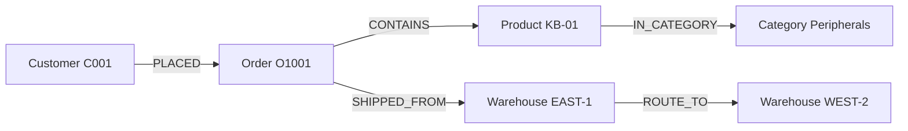
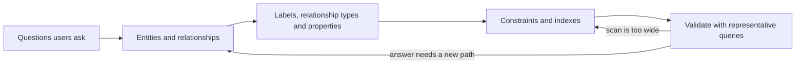
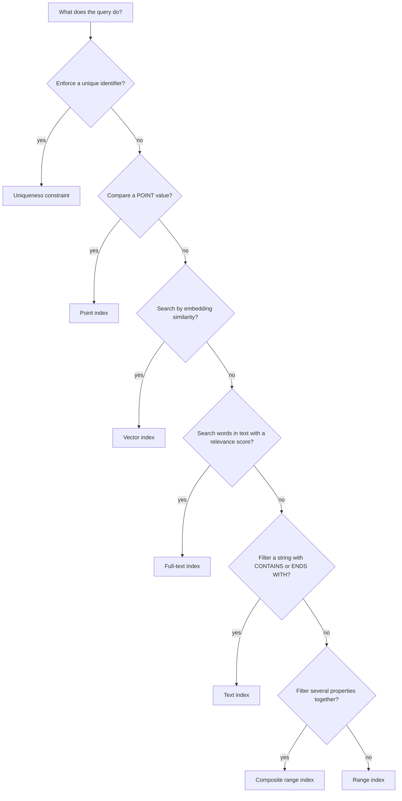
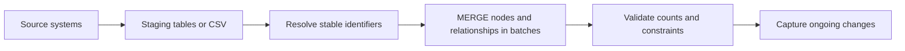
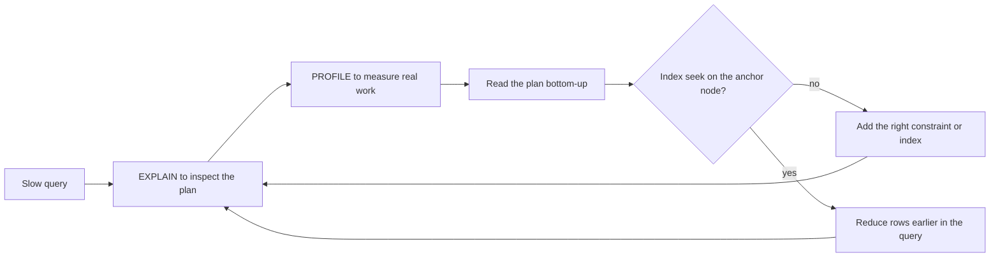
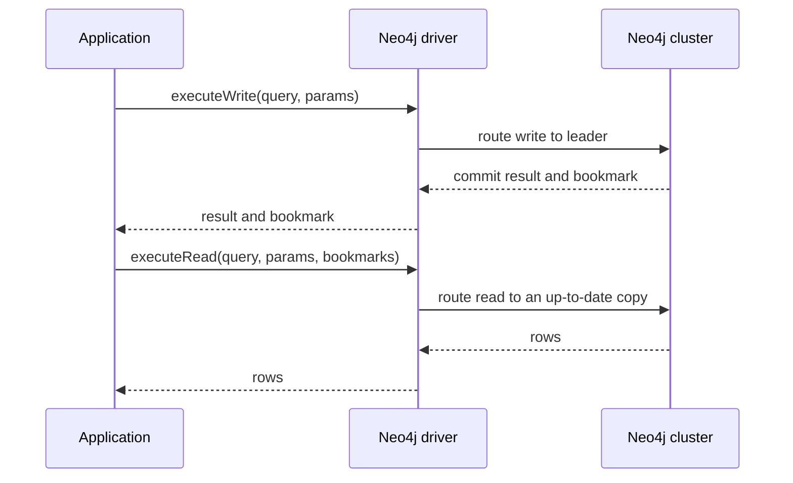
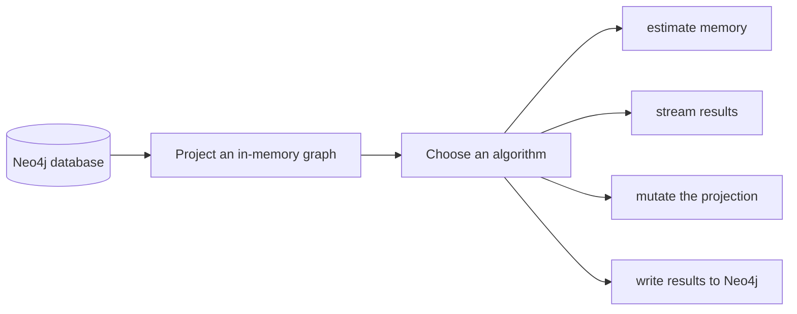
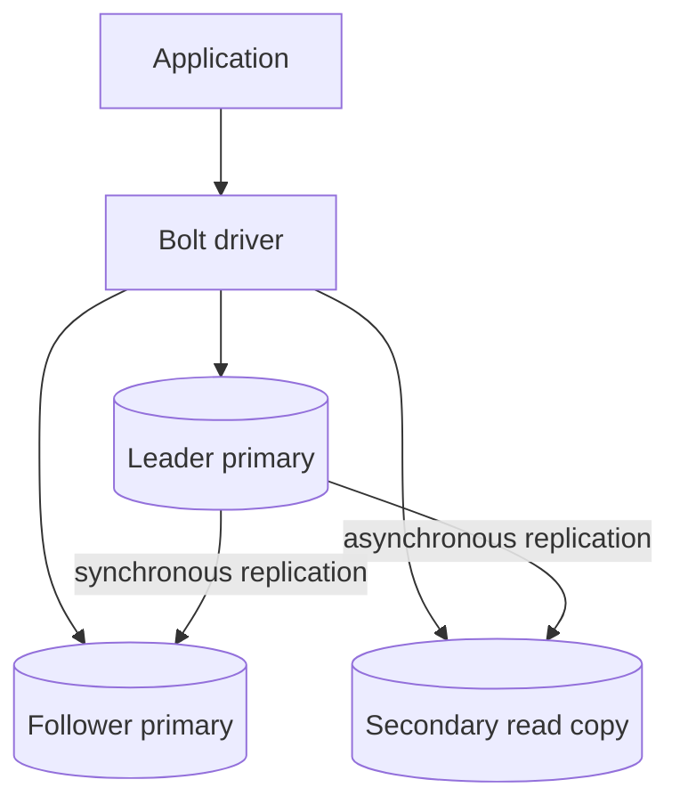

+++
date = '2026-11-21T12:00:30+10:00'
draft = false
title = 'Neo4j Complete Guide: From Graph Fundamentals to Production Operations'
tags = ['Neo4j', 'System Design', 'Cypher', 'Graph Database', 'Data Modeling', 'Design Patterns', 'Performance', 'Operations']
summary = "A complete Neo4j guide covering property graph modeling, Cypher, transactions, concurrency, schema design, ingestion, query tuning, application patterns, graph analytics, security and production operations."
+++

Neo4j stores data as nodes and relationships. A query follows stored relationships instead of computing joins at read time. That changes how you model data, how you write queries and how you scale a system.

This guide covers the full path from graph fundamentals to production operations. It gives you a working vocabulary, a repeatable modeling method, a Cypher reference, ingestion and tuning patterns, application integration patterns, analytics, security and operations. Each section points to the official documentation for details that change between releases.

The versions below reflect the documentation available in November 2026. The operations manual lists **2026.10.2** as the latest Neo4j release. The Cypher manual documents **Cypher 25** as the current query language. Neo4j added all new Cypher features to Cypher 25 from Neo4j 2025.06, and new databases created from Neo4j 2026.02 set Cypher 25 as their query language. Check the [Cypher manual](https://neo4j.com/docs/cypher-manual/current/) and the [operations manual](https://neo4j.com/docs/operations-manual/current/) before applying a version-specific command.

## Choose the right problem for a graph database

A graph database stores the connections between records as first-class data. Use Neo4j when the path between records carries meaning and when queries ask about those paths.

Good fits include the following cases:

- Recommendation and "people also bought" queries that traverse shared relationships.
- Identity and access graphs where permissions flow through groups, roles and resources.
- Fraud detection that follows chains of accounts, devices and transactions.
- Dependency graphs for services, packages and deployments.
- Knowledge graphs that connect documents, entities and evidence.
- Network and route analysis where shortest path and centrality matter.

Poor fits include the following cases:

- Simple key-value lookups with no relationships.
- Large aggregations over flat tables with no traversal. Write those to an analytical store.
- Write-heavy time series that never query relationships. Use a time-series database.
- Transactions that span many independent graphs without a shared traversal.

Neo4j is a transactional database. It provides ACID transactions. It is not a replacement for a data warehouse or a search engine, although it includes full-text and vector indexes for specific search tasks. The [graph database concepts guide](https://neo4j.com/docs/getting-started/appendix/graphdb-concepts/) defines the model and the [documentation home](https://neo4j.com/docs/) lists the product boundaries.

### Editions and deployment choices

| Option                                                             | What it gives you                                                                             | When to choose it                                                            |
| ------------------------------------------------------------------ | --------------------------------------------------------------------------------------------- | ---------------------------------------------------------------------------- |
| AuraDB Free                                                        | An entry-level managed instance in the Neo4j cloud                                            | Learning and small prototypes                                                |
| AuraDB Professional, Business Critical and Virtual Dedicated Cloud | Managed capacity, isolation and support tiers                                                 | Managed production without a database operations team                        |
| Self-managed Community Edition                                     | A local or server installation under an open-source licence                                   | Development, embedded use and workloads that do not need Enterprise features |
| Self-managed Enterprise Edition                                    | Clustering, online backup, role-based access control, property existence and type constraints | Production clusters with operational staff                                   |

The [Aura documentation](https://neo4j.com/docs/aura/) lists the current products and tiers. The [deployment options guide](https://neo4j.com/docs/deployment-options/) covers local, Docker and Kubernetes installations.

## Understand the property graph model

Neo4j uses the property graph model. The model has four building blocks.

- **Nodes** represent entities. A node can have zero or more labels and zero or more properties.
- **Relationships** connect a source node to a target node. Each relationship has exactly one type and a direction. A relationship can carry properties.
- **Labels** group nodes into sets. Labels are case sensitive.
- **Properties** are key-value pairs on nodes and relationships. A property value can be a scalar or a homogeneous list.

A **path** is a sequence of nodes connected by relationships. The number of relationships in a path is its length. A single node has path length zero. These definitions come from the [graph database concepts guide](https://neo4j.com/docs/getting-started/appendix/graphdb-concepts/).

The example domain used throughout this guide is an order-management graph.



Cypher uses ASCII patterns to describe the same structure. Parentheses are nodes and arrows are relationships.

```cypher
(:Customer)-[:PLACED]->(:Order)-[:CONTAINS]->(:Product)
```

### Naming conventions

Neo4j documents the following naming conventions. Labels, relationship types and property keys are case sensitive.

| Element           | Convention           | Example         |
| ----------------- | -------------------- | --------------- |
| Node label        | PascalCase           | `:VehicleOwner` |
| Relationship type | SCREAMING_SNAKE_CASE | `:OWNS_VEHICLE` |
| Property key      | camelCase            | `firstName`     |

Apply these rules in every project. Mixed conventions force readers to check the schema for each query. See [naming rules and recommendations](https://neo4j.com/docs/cypher-manual/current/syntax/naming/).

### Decide between a property and a node

Model a value as a property when the query filters on it, returns it and never traverses to it. Model a value as a node when it has its own relationships, its own lifecycle or many shared references.

| Value                               | Model as                                        | Reason                                                                |
| ----------------------------------- | ----------------------------------------------- | --------------------------------------------------------------------- |
| `order.status`                      | Property                                        | Queries filter orders by status and never traverse to status          |
| `product.category`                  | Node                                            | Categories connect to many products and carry their own hierarchy     |
| `customer.city`                     | Property until a query needs city relationships | A city becomes a node when routes and regions attach to it            |
| `order.placedAt`                    | Property                                        | Time is returned and filtered, not traversed                          |
| `product.price` with validity dates | Relationship to a price node                    | A price has a validity window and can link to a currency and a source |

Relationship properties hold facts about the connection. `(:Order)-[:CONTAINS {quantity: 2}]->(:Product)` stores quantity on the relationship because quantity belongs to the order-product pair.

## Set up a local environment

Use one of three starting points.

1. Create an AuraDB Free instance from the [Aura console](https://console.neo4j.io/) and connect with Neo4j Browser.
2. Run Neo4j Desktop and create a local DBMS.
3. Run the official Docker image. Follow the [Docker installation guide](https://neo4j.com/docs/operations-manual/current/installation/docker/) for the current image tag, port mapping and persistent volume configuration.

A local Docker setup exposes HTTP on port 7474 for Neo4j Browser and Bolt on port 7687 for drivers. Persist both the `data` and `logs` directories in named volumes. Without a volume, removing the container removes the graph.

Connect with one of the following tools:

- **Neo4j Browser** for interactive Cypher and graph visualization.
- **cypher-shell** for scripts and terminal work.
- **Neo4j Bloom** for business-facing graph exploration.
- **A driver** for application code. The [create applications guide](https://neo4j.com/docs/create-applications/) lists the supported language libraries.

## Write Cypher with confidence

Cypher is a declarative query language. You describe the pattern you want and the planner decides how to find it. The [Cypher manual](https://neo4j.com/docs/cypher-manual/current/) is the authoritative reference.

### Read, create and update

The following statements build the example graph.

```cypher
CREATE (c:Customer {customerId: 'C001', name: 'Asha', email: 'asha@example.com'})
CREATE (o:Order {orderId: 'O1001', placedAt: datetime('2026-11-20T10:00:00Z'), status: 'SHIPPED'})
CREATE (p:Product {sku: 'KB-01', name: 'Mechanical keyboard', price: 89.00})
CREATE (w:Warehouse {code: 'EAST-1'})
CREATE (c)-[:PLACED]->(o)
CREATE (o)-[:CONTAINS {quantity: 1}]->(p)
CREATE (o)-[:SHIPPED_FROM]->(w)
RETURN c.customerId AS customer, o.orderId AS order, p.sku AS product;
```

Read the graph with `MATCH` and `RETURN`.

```cypher
MATCH (c:Customer {customerId: 'C001'})-[:PLACED]->(o:Order)
WHERE o.status = 'SHIPPED'
RETURN o.orderId AS orderId, o.placedAt AS placedAt
ORDER BY o.placedAt DESC
LIMIT 20;
```

Update properties with `SET` and remove them with `REMOVE`.

```cypher
MATCH (o:Order {orderId: 'O1001'})
SET o.status = 'DELIVERED', o.updatedAt = datetime()
RETURN o.status AS status;
```

Delete a node and its relationships with `DETACH DELETE`. A plain `DELETE` fails when the node still has relationships.

```cypher
MATCH (c:Customer {customerId: 'C002'})
DETACH DELETE c;
```

Never run an unbounded `MATCH (n) DETACH DELETE n` outside a disposable local database.

### Understand transaction boundaries

Every graph read, write and schema operation runs in a transaction. Neo4j transactions comply with ACID: atomic, consistent, isolated and durable. A write-ahead transaction log supplies durability. Uncommitted modifications remain in memory and locks remain held until the transaction completes. Keep transactions short so memory and locks are released promptly. The [transaction management guide](https://neo4j.com/docs/operations-manual/current/database-internals/transaction-management/) documents the commit model and the [database internals guide](https://neo4j.com/docs/operations-manual/current/database-internals/) documents the write-ahead log.

Use an explicit transaction when several statements must commit or roll back together. Use an auto-commit transaction for one independent statement. An error during query evaluation or commit rolls the transaction back. Run `CALL { ... } IN TRANSACTIONS` in an implicit transaction, for example through `driver.execute_query()` or `cypher-shell`; prepend `:auto` in Neo4j Browser. A managed transaction function cannot contain `CALL { ... } IN TRANSACTIONS`. See [Cypher transactions](https://neo4j.com/docs/cypher-manual/current/introduction/cypher-neo4j/) and [CALL subqueries in transactions](https://neo4j.com/docs/cypher-manual/current/subqueries/subqueries-in-transactions/).

#### Isolation and anomalies

Neo4j uses **read-committed** isolation by default. A transaction that reads a node or relationship does not block another transaction from writing that entity. Read-committed isolation permits three anomalies that affect application logic:

- **Non-repeatable reads.** Two reads of the same property inside one transaction can return different values when another transaction commits between the reads. Read the property once into a variable and keep that value for the rest of the query.
- **Missing and double reads.** An index scan can skip an entity or return it twice when a concurrent update moves the entity to another position in the index. Treat index-scan results under concurrent writes as candidates and validate the rows that the application will change.
- **Unprotected traversals.** Traversal data is not protected from changes made by other transactions. Design retry and validation logic for paths that several clients update at the same time.

The [concurrent data access guide](https://neo4j.com/docs/operations-manual/current/database-internals/concurrent-data-access/) documents each anomaly and its example queries.

#### Locks and lost updates

Neo4j takes locks automatically. Changing a node property takes a `NODE` write lock. Changing a relationship property takes a `RELATIONSHIP` write lock. Creating or deleting a relationship takes locks on the relationship and both connected nodes. Locks are released when the transaction finishes. Administrators can inspect the locks held by one running query.

```cypher
SHOW TRANSACTIONS YIELD currentQueryId, currentQuery;
CALL dbms.listActiveLocks("query-614");
```

A `SET` clause takes a write lock automatically when the right-hand side depends on the property that the query reads.

```cypher
MATCH (n:Example {id: 42})
SET n.prop = n.prop + 1;
```

A query that reads a value in one statement and writes a derived value in a later statement has no direct dependency. Concurrent clients can then produce lost updates. Acquire the write lock before the read by writing and removing a dummy property.

```cypher
MATCH (n:Example {id: 42})
SET n._dummy_ = true
REMOVE n._dummy_
WITH n.prop AS p
// Application logic derives k from p.
SET n.prop = k + 1;
```

The dummy property exists only to acquire the lock. The [lost updates section](https://neo4j.com/docs/operations-manual/current/database-internals/concurrent-data-access/#transactions-isolation-lostupdates) documents the pattern.

#### Deadlocks and retries

A deadlock occurs when two transactions each wait for a lock held by the other transaction. Neo4j terminates one transaction with `Neo.TransientError.Transaction.DeadlockDetected`. From Neo4j 5.25 onward, the error also contains GQLSTATUS `50N05`. Apply four rules to deadlocks:

1. Retry a limited number of times and fail after the limit.
2. Pause between attempts so the competing transaction can finish.
3. Update shared entities in one order, for example `A → B → C`.
4. Prefer `CREATE` over `MERGE` when `MERGE` would lock shared entities out of order. `MERGE` takes locks out of order to enforce uniqueness.

`db.lock.acquisition.timeout` sets the maximum wait for one lock and defaults to `0`, which disables the timeout. `db.transaction.timeout` defaults to `0`, which disables the transaction timeout. Concurrency document sources: [concurrent data access](https://neo4j.com/docs/operations-manual/current/database-internals/concurrent-data-access/) and [transaction management](https://neo4j.com/docs/operations-manual/current/database-internals/transaction-management/).

#### Dense nodes and relationship locks

A node becomes dense when its relationship count or relationship data passes an internal threshold. Record formats use a node-level threshold of 50 relationships. Block format decides density per relationship type at approximately 50 relationships of that type and also considers property size. Dense nodes use concurrent data structures for most relationship changes and take coarse shared locks instead of one exclusive node lock. Split a hub by time, region or category when application writes repeatedly target the same node. See [locks for dense nodes](https://neo4j.com/docs/operations-manual/current/database-internals/concurrent-data-access/#locks-for-dense-nodes).

### Use parameters in every application query

Parameters separate query structure from data values. They allow the planner to reuse a query plan and they prevent Cypher injection.

```cypher
MATCH (c:Customer {customerId: $customerId})-[:PLACED]->(o:Order)
RETURN o
ORDER BY o.placedAt DESC
LIMIT $limit;
```

Pass values from the driver as a map. Never concatenate user input into a query string. Neo4j documents this risk in [Protecting against Cypher injection](https://neo4j.com/developer/kb/protecting-against-cypher-injection/).

Labels and relationship types cannot be passed as ordinary string parameters. Use dynamic patterns when the label or type comes from user input.

```cypher
MATCH (n:$(labelParam) {id: $id})
RETURN n;
```

The Cypher manual recommends dynamic labels and types as an injection mitigation. The `MERGE` documentation records version-specific performance caveats for dynamic patterns. See [MERGE using dynamic node labels and relationship types](https://neo4j.com/docs/cypher-manual/current/clauses/merge/).

### Match paths of variable length

A bounded variable-length pattern limits traversal work. Always set an upper bound in application queries.

```cypher
MATCH path = (a:Warehouse {code: 'EAST-1'})-[:ROUTE_TO*1..5]->(b:Warehouse {code: 'WEST-2'})
RETURN [node IN nodes(path) | node.code] AS route,
       reduce(total = 0, rel IN relationships(path) | total + rel.distanceKm) AS distanceKm
ORDER BY distanceKm
LIMIT 1;
```

Cypher 25 provides `SHORTEST` path patterns and controls for relationship re-traversal and acyclic paths. The [patterns chapter](https://neo4j.com/docs/cypher-manual/current/patterns/) describes fixed-length paths, variable-length paths and shortest paths.

### Aggregate and reshape results

`WITH` passes computed values to the next clause. `UNWIND` turns a list into rows. `collect()` builds a list from rows.

```cypher
MATCH (c:Customer)-[:PLACED]->(o:Order)-[:CONTAINS]->(p:Product)
WITH c, p, count(o) AS orderCount
ORDER BY orderCount DESC
RETURN c.name AS customer,
       collect({sku: p.sku, orders: orderCount})[0..3] AS topProducts;
```

### Use MERGE for idempotent writes

`MERGE` combines `MATCH` and `CREATE`. When the exact pattern exists, `MERGE` binds it. When the pattern does not exist, `MERGE` creates it. Use `ON CREATE` and `ON MATCH` to set different properties for each case.

```cypher
UNWIND $rows AS row
MERGE (p:Product {sku: row.sku})
ON CREATE SET p.name = row.name, p.price = row.price, p.createdAt = datetime()
ON MATCH  SET p.name = row.name, p.price = row.price, p.updatedAt = datetime()
RETURN count(p) AS productsTouched;
```

Two rules make `MERGE` safe under concurrent loads:

1. Create a uniqueness constraint on the identifying property before loading data. `MERGE` alone guarantees that a pattern exists; it does not guarantee uniqueness across different property values under concurrent writes.
2. Include only the identifying properties in the `MERGE` pattern. Put other values in `ON CREATE SET` and `ON MATCH SET`. When you add a non-identifying property to the `MERGE` pattern, a changed value creates a duplicate.

The [MERGE documentation](https://neo4j.com/docs/cypher-manual/current/clauses/merge/) gives examples of both failure modes and describes the locking behaviour for concurrent relationship merges.

## Reference the Cypher language

The current manual documents **Cypher 25**. From Neo4j 2025.06, new Cypher features are added only to Cypher 25 and Cypher 5 is frozen. Prefix a query with `CYPHER 25` or `CYPHER 5` to select the parser version. Cypher supports most mandatory features of GQL, the ISO/IEC 39075:2024 standard. Neo4j returns GQL-compliant status codes for errors from 5.25 and notifications from 5.23. Branch application error handling on the stable status code, not on the changeable description. See [select a Cypher version](https://neo4j.com/docs/cypher-manual/current/queries/select-version/), [GQL conformance](https://neo4j.com/docs/cypher-manual/current/appendix/gql-conformance/) and [status codes](https://neo4j.com/docs/status-codes/current/).

```cypher
CYPHER 25
MATCH (n:Order)-[r:SHIPPED_TO]->(:Address)
SET n = properties(r)
RETURN n;
```

### Values and types

| Family   | Types and rules                                                                                                                                      | Source                                                                                    |
| -------- | ---------------------------------------------------------------------------------------------------------------------------------------------------- | ----------------------------------------------------------------------------------------- |
| Scalar   | `INTEGER`, `FLOAT`, `STRING`, `BOOLEAN`                                                                                                              | [values and types](https://neo4j.com/docs/cypher-manual/current/values-and-types/)        |
| Temporal | `DATE`, `ZONED TIME`, `LOCAL TIME`, `ZONED DATETIME`, `LOCAL DATETIME`, `DURATION`; all are indexable and instant types support range lookups        | [temporal types](https://neo4j.com/docs/cypher-manual/current/values-and-types/temporal/) |
| Spatial  | `POINT` in a cartesian or WGS-84 coordinate system; comparisons across coordinate systems return `null` and `point.distance()` requires the same CRS | [spatial values](https://neo4j.com/docs/cypher-manual/current/values-and-types/spatial/)  |
| Vector   | `VECTOR` is Enterprise only, was introduced in Neo4j 2025.10 and supports 1 to 4096 dimensions; Community Edition cannot store `VECTOR` properties   | [vector type](https://neo4j.com/docs/cypher-manual/current/values-and-types/vector/)      |
| List     | Zero-based indexing; `list[1..3]` includes index 1 and excludes index 3; negative indexes count from the end; out-of-bounds access returns `null`    | [lists](https://neo4j.com/docs/cypher-manual/current/values-and-types/lists/)             |
| Map      | `map[key]` reads a dynamic key; map addition with `+` is Cypher 25 from Neo4j 2026.10 and the right-hand map wins on duplicate keys                  | [maps](https://neo4j.com/docs/cypher-manual/current/values-and-types/maps/)               |

Only homogeneous lists can be stored as node or relationship properties. Use `valueType()` to inspect a value at runtime.

```cypher
CREATE (n:Event {occurredAt: datetime('2026-11-20T10:00:00Z')})
SET n.day = date('2026-11-20'),
    n.location = point({latitude: -33.87, longitude: 151.21})
RETURN valueType(n.day) AS dateType,
       point.distance(n.location, point({latitude: -33.86, longitude: 151.21})) AS distanceMetres;

RETURN range(0, 10)[2..5] AS slice,
       [x IN range(0, 10) WHERE x % 2 = 0] AS evenNumbers,
       vector([1, 2, 3], 3, INTEGER) AS embedding;
```

#### Null semantics

`null = null` evaluates to `null`. `AND`, `OR`, `XOR`, `NOT` and `IN` follow three-valued logic. A `WHERE` predicate that evaluates to `null` does not return the row. Test missing values with `IS NULL` and `IS NOT NULL`. See [working with null](https://neo4j.com/docs/cypher-manual/current/values-and-types/working-with-null/).

```cypher
MATCH (p:Product)
WHERE p.name IS NOT NULL
RETURN p.sku AS sku,
       CASE WHEN p.price IS NULL THEN 0 ELSE p.price END AS price;
```

### Expressions and predicates

| Feature                | Verified behavior                                                                              | Source                                                                                                                    |
| ---------------------- | ---------------------------------------------------------------------------------------------- | ------------------------------------------------------------------------------------------------------------------------- | ------------------------------------------------------------------------------------------------------------------------------- |
| `CASE`                 | Simple `CASE` cannot match `null`; the extended form with `WHEN <predicate>` can handle `null` | [conditional expressions](https://neo4j.com/docs/cypher-manual/current/expressions/conditional-expressions/)              |
| List comprehension     | `[x IN list WHERE predicate \| expression]` builds a new list in one expression                | [list expressions](https://neo4j.com/docs/cypher-manual/current/expressions/list-expressions/)                            |
| Pattern comprehension  | `[(a)-[:R]->(b) \| b.prop]` builds a list from matched patterns                                | [list expressions](https://neo4j.com/docs/cypher-manual/current/expressions/list-expressions/)                            |
| Map projection         | `n{.propA, .propB}` returns a map with selected properties                                     | [map expressions](https://neo4j.com/docs/cypher-manual/current/expressions/map-expressions/)                              |
| Predicate functions    | `all()`, `any()`, `none()`, `single()` and `exists()` return a boolean from a list or pattern  | [predicate functions](https://neo4j.com/docs/cypher-manual/current/functions/predicate/)                                  |
| `reduce()`             | `reduce(acc = 0, x IN list \| acc + x)` computes one accumulated value                         | [list functions](https://neo4j.com/docs/cypher-manual/current/functions/list/)                                            |
| Pattern predicate      | A pattern in `WHERE` tests graph structure and introduces no new variables                     | [path pattern expressions](https://neo4j.com/docs/cypher-manual/current/expressions/predicates/path-pattern-expressions/) |
| Type predicate `IS ::` | `null IS :: INTEGER` returns `true`; add `IS NOT NULL` when the value must exist               | [type predicates](https://neo4j.com/docs/cypher-manual/current/expressions/predicates/type-predicate-expressions/)        |
| Label expressions      | `&`, `                                                                                         | `, `!`and`%`express label logic;`IS LABELED` is Cypher 25 from Neo4j 2026.04                                              | [label expression predicates](https://neo4j.com/docs/cypher-manual/current/expressions/predicates/label-expression-predicates/) |

```cypher
MATCH (p:Person)-[:ACTED_IN]->(m:Movie)
RETURN p.name AS actor, collect(m{.title, .released}) AS movies;

MATCH (employee:Person)
WHERE (employee)-[:WORKS_FOR]->(:Person {name: 'Alice'})
RETURN employee.name AS employee;

UNWIND [42, true, 'abc', null] AS val
RETURN val, val IS :: INTEGER AS isInteger;

MATCH path = (:Warehouse {code: 'EAST-1'})-[:ROUTE_TO*1..5]->(:Warehouse {code: 'WEST-2'})
RETURN reduce(total = 0, r IN relationships(path) | total + coalesce(r.distanceKm, 0)) AS distanceKm;
```

### Advanced patterns

A quantified path pattern repeats a whole pattern with a bounded quantifier. Keep the bound small and put predicates inside the repeated unit so the planner can prune paths early.

```cypher
MATCH (:Station {name: 'Denmark Hill'})<-[:CALLS_AT]-(d:Stop)
      ((:Stop)-[:NEXT]->(:Stop)){1,3}
      (a:Stop)-[:CALLS_AT]->(:Station {name: 'Clapham Junction'})
RETURN d.name AS departure, a.name AS arrival;
```

Path selectors control which shortest paths a query returns. Cypher 25 provides `SHORTEST k`, `ALL SHORTEST`, `SHORTEST k GROUPS`, `ANY k` and `ALL`. The older `shortestPath()` and `allShortestPaths()` functions remain available and are not GQL conformant. See [shortest paths](https://neo4j.com/docs/cypher-manual/current/patterns/shortest-paths/).

Inline `WHERE` inside a node or relationship pattern filters the pattern before the clause expands it. A trailing `WHERE` filters complete matches.

```cypher
MATCH (n:Station WHERE n.name STARTS WITH 'Preston')
      -[r WHERE 10 < r.distance < 100]->(m:Station)
RETURN n.name AS fromStation, m.name AS toStation, r.distance AS distance;
```

Cypher 25 also adds path modes. `MATCH REPEATABLE ELEMENTS` allows repeated relationships and nodes with bounded quantifiers. `MATCH p = ACYCLIC ...` prevents a node from appearing twice in one path. See [match modes and path modes](https://neo4j.com/docs/cypher-manual/current/patterns/reference/match-modes-and-path-modes/).

### Subqueries

| Subquery           | Use                                                                          | Source                                                                                         |
| ------------------ | ---------------------------------------------------------------------------- | ---------------------------------------------------------------------------------------------- |
| `CALL (x) { ... }` | Run a subquery once per incoming row and return variables to the outer query | [CALL subquery](https://neo4j.com/docs/cypher-manual/current/subqueries/call-subquery/)        |
| `EXISTS { ... }`   | Test whether a pattern exists without changing the row count                 | [existential subqueries](https://neo4j.com/docs/cypher-manual/current/subqueries/existential/) |
| `COUNT { ... }`    | Count matches of a pattern without adding rows                               | [COUNT subqueries](https://neo4j.com/docs/cypher-manual/current/subqueries/count/)             |
| `COLLECT { ... }`  | Return a list from a subquery whose final clause is a single-column `RETURN` | [COLLECT subqueries](https://neo4j.com/docs/cypher-manual/current/subqueries/collect/)         |

Use explicit scope with `CALL (variable)`. The older `WITH` import form is deprecated.

```cypher
MATCH (c:Customer)
CALL (c) {
  MATCH (c)-[:PLACED]->(o:Order)
  RETURN count(o) AS orderCount
}
RETURN c.name AS customer, orderCount;

MATCH (p:Person)
WHERE EXISTS { (p)-[:WORKS_FOR]->(:Company) }
  AND COUNT { (p)-[:HAS_DOG]->(:Dog) } > 1
RETURN p.name AS name, COLLECT { MATCH (p)-[:ACTED_IN]->(m:Movie) RETURN m.title } AS titles;
```

### Clauses worth knowing

| Clause                    | Verified behavior                                                                                                                       | Source                                                                                                      |
| ------------------------- | --------------------------------------------------------------------------------------------------------------------------------------- | ----------------------------------------------------------------------------------------------------------- |
| `OPTIONAL MATCH`          | Keeps rows when the pattern is absent and binds missing parts to `null`                                                                 | [OPTIONAL MATCH](https://neo4j.com/docs/cypher-manual/current/clauses/optional-match/)                      |
| `UNION` / `UNION ALL`     | Branches must return the same column names and count. `UNION` removes duplicates; `UNION ALL` keeps them                                | [combined queries](https://neo4j.com/docs/cypher-manual/current/queries/composed-queries/combined-queries/) |
| `FOREACH`                 | Applies `SET`, `REMOVE`, `CREATE`, `MERGE` or `DELETE` to each item without multiplying rows                                            | [FOREACH](https://neo4j.com/docs/cypher-manual/current/clauses/foreach/)                                    |
| `USE`                     | Selects a database or a composite graph, including `USE graph.byName($graphName)`                                                       | [USE](https://neo4j.com/docs/cypher-manual/current/clauses/use/)                                            |
| `SHOW`                    | Returns metadata; `YIELD` is mandatory when a `RETURN` follows                                                                          | [SHOW](https://neo4j.com/docs/cypher-manual/current/clauses/show/)                                          |
| `CALL procedure`          | Calls a procedure and filters results with `YIELD`, `WHERE` and `RETURN`; this is not the `CALL { ... }` subquery                       | [call procedures](https://neo4j.com/docs/operations-manual/current/procedures/call-procedures/)             |
| `SKIP` / `OFFSET`         | Skips rows for pagination; `OFFSET` is the GQL synonym for `SKIP`                                                                       | [SKIP](https://neo4j.com/docs/cypher-manual/current/clauses/skip/)                                          |
| `LIMIT`                   | Limits returned rows. `LIMIT` does not stop `CREATE`, `SET` or `DELETE` side effects in the same query part; split the work with `WITH` | [LIMIT](https://neo4j.com/docs/cypher-manual/current/clauses/limit/)                                        |
| `DISTINCT` / `RETURN ALL` | `DISTINCT` removes duplicate rows; `RETURN ALL` is the GQL-conformant form that keeps duplicates                                        | [RETURN](https://neo4j.com/docs/cypher-manual/current/clauses/return/)                                      |
| Query options             | `CYPHER` options such as `planner=cost`, `planner=idp` and `planner=dp` precede the query                                               | [query tuning](https://neo4j.com/docs/cypher-manual/current/planning-and-tuning/query-tuning/)              |

## Model the graph around the questions

A graph model should answer the application's questions with short, bounded traversals. Start from queries, then design nodes, relationships and properties.



### Modeling workflow

1. Write the ten most important queries in plain language.
2. List the entities that appear in those queries. Make each entity a node.
3. Name each connection with a verb. Make each connection a directed relationship.
4. Place attributes on the node or relationship that owns them.
5. Add constraints for identifiers and indexes for filter properties.
6. Run each query on representative data and inspect the plan.
7. Change the model when a query needs more than a few hops or returns too many rows.

### Direction and inverse relationships

Relationships always have a direction. Choose the direction that reads naturally: `(:Customer)-[:PLACED]->(:Order)`.

Cypher traverses incoming and outgoing relationships when you omit the arrow: `(c)-[:PLACED]-(o)`. Do not create a second `PLACED_BY` relationship in the opposite direction. The [property graph concepts guide](https://neo4j.com/docs/getting-started/appendix/graphdb-concepts/) states that duplicate inverse relationships are unnecessary unless the model requires them.

### Model events as relationships

An event that connects two entities belongs on the relationship. A delivery event, a payment or a price change carries time and attributes.

```cypher
(:Supplier)-[:SUPPLIED {batchId: 'B9', shippedAt: datetime(), units: 500}]->(:Warehouse)
```

For an event that changes value over time, use a relationship with a validity window and query the active row.

```cypher
MATCH (:Product {sku: $sku})-[pr:PRICED_AT]->(price:Price)
WHERE pr.validFrom <= date() < pr.validTo
RETURN price.amount AS amount;
```

### Model many-to-many connections with a relationship node

Cypher cannot declare multiple relationship types on one relationship. When a connection needs its own properties, labels or relationships, turn it into a node. A job application between a person and a role becomes `(:Person)-[:SUBMITTED]->(:Application)-[:FOR_ROLE]->(:Role)`. The `Application` node holds status, submitted time and review decisions.

### Design for multi-tenancy

Choose one of three isolation levels.

| Approach                         | Isolation                         | When to use                                         |
| -------------------------------- | --------------------------------- | --------------------------------------------------- |
| Tenant property on every node    | Logical, enforced in every query  | Small tenant counts with shared data                |
| Separate database per tenant     | Physical within one DBMS          | Tenants with independent backup and retention needs |
| Composite database across graphs | Federated query across partitions | Data already partitioned across several graphs      |

Neo4j documents composite databases as the way to query partitioned graph data with a single Cypher statement. See the [composite database tutorial](https://neo4j.com/docs/operations-manual/current/tutorial/tutorial-composite-database/).

### Modeling anti-patterns

- **No constraints on identifiers.** Duplicate entities appear under concurrent writes.
- **Relationship type from a property value.** Types are part of the schema. Use a property on a single type instead of generating labels per customer.
- **Unbounded traversal.** `*1..` without an upper bound can explore the entire graph.
- **Supernode with millions of relationships.** Split the hub by time, region or category, or move the aggregate to a summary node.
- **Long list property.** A list of thousands of ids cannot be traversed or indexed per element. Model each item as a node.
- **Missing direction.** Undirected queries hide the meaning of the connection and make traversal costs hard to predict.
- **Storing derived values without a refresh path.** A cached count becomes wrong when writes bypass the code that maintains it.

### Understand path uniqueness

Cypher's default `MATCH` result never traverses the same relationship twice, regardless of direction. Nodes can appear more than once in one matched path. `MATCH DIFFERENT RELATIONSHIPS` states the default match mode explicitly; the keyword is available in Cypher 25 from Neo4j 2025.06 and follows GQL match semantics.

```cypher
MATCH DIFFERENT RELATIONSHIPS p = (:Warehouse {code: 'EAST-1'})-[:ROUTE_TO]-{1..5}()
RETURN [n IN nodes(p) | n.code] AS route;
```

Use `REPEATABLE ELEMENTS` when a query must traverse the same relationship more than once. Use `ACYCLIC` when a query must not revisit a node. Route analysis and Eulerian path problems depend on these match modes. See [paths with unique relationships](https://neo4j.com/docs/cypher-manual/current/patterns/unique-relationship-paths/) and [match modes](https://neo4j.com/docs/cypher-manual/current/patterns/reference/match-modes-and-path-modes/#match-modes).

### Refactor a graph model

A model changes when a new query appears or when a traversal reads too much data. Move a repeated property into a node when many entities share the same value.

```cypher
MATCH (m:Movie)
WITH m, m.languages AS languages
UNWIND languages AS language
MERGE (l:Language {name: language})
MERGE (m)-[:IN_LANGUAGE]->(l)
REMOVE m.languages;
```

After the migration, rewrite application queries to traverse the new path and profile them again. The [refactoring tutorial](https://neo4j.com/docs/getting-started/data-modeling/tutorial-refactoring/) documents this migration and the performance check.

Neo4j does not support a relationship that connects more than two nodes. Model that structure as an **intermediate node**. An employment event connects a person, a company and a role. An email node connects a sender, recipients and shared content. An intermediate node removes duplicated content and reduces dense-node fanout. See [modeling designs](https://neo4j.com/docs/getting-started/data-modeling/modeling-designs/).

Use a **linked list** when sequence matters. A simple list stores `NEXT` relationships. An interleaved list stores two independent orders over the same items, such as air date and production date. Avoid a double-linked list because the backward relationship duplicates the forward relationship and Cypher matches relationships in both directions.

Use one of four versioning designs when history must remain queryable:

| Design                | Structure                                                         | Use case                                        |
| --------------------- | ----------------------------------------------------------------- | ----------------------------------------------- |
| Entity versioning     | An immutable entity connects to version nodes and a `LATEST` node | Retrieve the current version or a named version |
| Time-based versioning | Each state carries `validFrom` and `validTo`                      | Snapshot a graph at a point in time             |
| Linked list           | Each version points to `NEXT`                                     | Walk an ordered change history                  |
| Timeline tree         | Year, month and day nodes connect to dated events                 | Query events inside a calendar period           |

Combine these designs when a query requires both temporal snapshots and ordered history. See [versioning](https://neo4j.com/docs/getting-started/data-modeling/versioning/).

## Define schema with constraints and indexes

Neo4j is schema optional. You can create data before defining a schema. Production systems define constraints and indexes first because they protect data and determine query plans. See [graph database concepts → schema](https://neo4j.com/docs/getting-started/appendix/graphdb-concepts/).

### Constraints

The [Cypher constraints manual](https://neo4j.com/docs/cypher-manual/current/constraints/) lists four constraint types.

| Constraint          | Effect                                                               | Edition                  |
| ------------------- | -------------------------------------------------------------------- | ------------------------ |
| Property uniqueness | Combined property values are unique for a label or relationship type | Community and Enterprise |
| Property existence  | A property exists for every matching node or relationship            | Enterprise               |
| Property type       | A property has a required type                                       | Enterprise               |
| Key                 | Properties exist and their combined values are unique                | Enterprise               |

Create uniqueness before ingestion.

```cypher
CREATE CONSTRAINT customer_id IF NOT EXISTS
FOR (c:Customer) REQUIRE c.customerId IS UNIQUE;

CREATE CONSTRAINT product_sku IF NOT EXISTS
FOR (p:Product) REQUIRE p.sku IS UNIQUE;

CREATE CONSTRAINT order_id IF NOT EXISTS
FOR (o:Order) REQUIRE o.orderId IS UNIQUE;
```

The other constraint forms enforce existence, type and key rules.

```cypher
CREATE CONSTRAINT customer_email_exists IF NOT EXISTS
FOR (c:Customer) REQUIRE c.email IS NOT NULL;

CREATE CONSTRAINT order_status_string IF NOT EXISTS
FOR (o:Order) REQUIRE o.status IS :: STRING;

CREATE CONSTRAINT product_id_country_key IF NOT EXISTS
FOR (p:Product) REQUIRE (p.productId, p.country) IS NODE KEY;

CREATE CONSTRAINT review_message_exists IF NOT EXISTS
FOR ()-[r:REVIEWED]-() REQUIRE r.message IS NOT NULL;
```

Adding a constraint is atomic and scans all existing data before the constraint becomes active. Create constraints before bulk ingestion and schedule later additions as migrations. Verify the schema with `SHOW CONSTRAINTS`. See [create constraints](https://neo4j.com/docs/cypher-manual/current/schema/constraints/create-constraints/).

Cypher 25 also provides **graph types** for whole-graph structure rules. A graph type sets an open schema and can enforce node label existence and relationship source and target labels. `CREATE CONSTRAINT` cannot express those rules. Graph types require Enterprise Edition, were introduced in Neo4j 2026.02 and became generally available in Neo4j 2026.06. Setting a graph type overwrites previous graph types and constraints, so define the whole structure in one statement. The Cypher manual recommends graph types over many individual constraints for large schemas. Read [graph types](https://neo4j.com/docs/cypher-manual/current/schema/graph-types/) and [set graph types](https://neo4j.com/docs/cypher-manual/current/schema/graph-types/set-graph-types/) before designing a large schema.

### Indexes

The [Cypher indexes manual](https://neo4j.com/docs/cypher-manual/current/indexes/) divides indexes into two categories.

- **Performance indexes** are selected automatically by the Cypher planner. They solve predicates without changing their meaning. The four types are range, text, point and token lookup.
- **Search indexes** are queried explicitly. They return ranked matches with a score. The two types are full-text and vector.

`SHOW INDEXES` confirms that these are the complete type values in Cypher 25: `RANGE`, `TEXT`, `POINT`, `LOOKUP`, `FULLTEXT` and `VECTOR`.

```cypher
SHOW INDEXES;
```

Composite indexes and relationship indexes are not separate types. A composite index is a range index on several properties. A relationship index is any index created on relationship properties.

Cypher 25 has no `CREATE PROPERTY INDEX` statement. When a Neo4j guide says "property index", it means an index on node or relationship properties. The default `CREATE INDEX` statement creates a range index on those properties.

#### Choose an index type

| Query need                                                | Index                         |
| --------------------------------------------------------- | ----------------------------- |
| Equality, `IN`, `IS NOT NULL`, numeric or date ranges     | Range index                   |
| Prefix search with `STARTS WITH` on a string              | Range index                   |
| Substring or suffix search with `CONTAINS` or `ENDS WITH` | Text index                    |
| Several properties filtered together in one query         | Composite range index         |
| `POINT` values inside a bounding box or within a distance | Point index                   |
| Label or relationship type lookup                         | Token lookup index, automatic |
| Word-based search with a relevance score                  | Full-text index               |
| Semantic similarity from an embedding                     | Vector index                  |
| Enforce a unique identifier                               | Uniqueness constraint         |



#### Range indexes

The [create indexes guide](https://neo4j.com/docs/cypher-manual/current/indexes/performance-indexes/create-indexes/) states that `CREATE INDEX` with no type creates a range index. Range indexes support equality checks, list membership checks, existence checks, range searches and `STARTS WITH`. They also store values in ascending order, so the planner can use them to satisfy `ORDER BY` without a separate sort.

```cypher
CREATE INDEX order_placed_at IF NOT EXISTS
FOR (o:Order) ON (o.placedAt);

CREATE INDEX order_status IF NOT EXISTS
FOR (o:Order) ON (o.status);

CREATE INDEX contains_quantity IF NOT EXISTS
FOR ()-[c:CONTAINS]-() ON (c.quantity);
```

Use a range index for identifiers, dates, numbers, booleans and exact string matches. It is Neo4j's default index and the first choice for most filters.

#### Composite range indexes

A range index on several properties is a composite index. Neo4j adds a node to the index only when the node has the label and **all** indexed properties. The same rule applies to relationships and their type. Text and point indexes support only one property.

```cypher
CREATE INDEX order_status_placed_at IF NOT EXISTS
FOR (o:Order) ON (o.status, o.placedAt);

CREATE INDEX contains_quantity_unit_price IF NOT EXISTS
FOR ()-[c:CONTAINS]-() ON (c.quantity, c.unitPrice);
```

The planner uses the composite index when the query filters on every indexed property.

```cypher
MATCH (o:Order)
WHERE o.status = $status AND o.placedAt >= $from
RETURN o.orderId AS orderId, o.placedAt AS placedAt
ORDER BY o.placedAt
LIMIT 50;
```

Property order changes the plan. The [composite index rules](https://neo4j.com/docs/cypher-manual/current/indexes/performance-indexes/using-indexes/) state the following:

- Equality and list membership predicates must use the first properties in the index.
- A query can use up to one range or prefix predicate.
- A query can use any number of existence checks.
- After a prefix or existence check, the planner treats later predicates as existence checks.
- Composite indexes work only for range indexes.

Put the most selective equality property first. Profile both orders before adding a composite index to production.

#### Text indexes

Text indexes solve string predicates by trigram indexing. A trigram is a sequence of three Unicode code points. This structure makes `CONTAINS` and `ENDS WITH` efficient. Text indexes also support `STARTS WITH`, equality and list membership on strings. They do not return a relevance score.

```cypher
CREATE TEXT INDEX product_name_text IF NOT EXISTS
FOR (p:Product) ON (p.name);

MATCH (p:Product)
WHERE p.name CONTAINS 'keyboard'
RETURN p.sku AS sku, p.name AS name;
```

When a range index and a text index exist on the same string property, the planner uses the text index for `CONTAINS` and `ENDS WITH`. It uses the range index for other supported predicates. Range indexes store strings lexicographically and have a key size limit around 8 kb. Text indexes have a key size limit around 32 kb. Use a [full-text index](#full-text-indexes) when you need to match words inside text and rank the results.

#### Point indexes

Point indexes solve predicates on `POINT` values. They support bounding box searches and distance searches.

```cypher
CREATE POINT INDEX warehouse_location IF NOT EXISTS
FOR (w:Warehouse) ON (w.location);

MATCH (w:Warehouse)
WHERE point.withinBBox(
  w.location,
  point({srid: 4326, x: 151.19, y: -33.87}),
  point({srid: 4326, x: 151.23, y: -33.85})
)
RETURN w.code AS code;

MATCH (w:Warehouse)
WHERE point.distance(w.location, point({srid: 4326, x: 151.21, y: -33.86})) <= 5000
RETURN w.code AS code;
```

Point indexes accept `spatial.cartesian.*`, `spatial.cartesian-3d.*`, `spatial.wgs-84.*` and `spatial.wgs-84-3d.*` bounds in `OPTIONS`. Restricting the indexed area improves spatial query performance. See [create a point index](https://neo4j.com/docs/cypher-manual/current/indexes/performance-indexes/create-indexes/) for each coordinate setting.

#### Token lookup indexes

Neo4j creates two token lookup indexes with every database. One stores node labels. The other stores relationship types. They solve `MATCH (n:Label)` and `MATCH ()-[r:TYPE]->()` predicates.

Only one node label lookup index and one relationship type lookup index can exist at a time. Recreate a dropped index with the following statements.

```cypher
CREATE LOOKUP INDEX node_label_lookup IF NOT EXISTS
FOR (n) ON EACH labels(n);

CREATE LOOKUP INDEX rel_type_lookup IF NOT EXISTS
FOR ()-[r]-() ON EACH type(r);
```

Do not drop token lookup indexes. The [index creation guide](https://neo4j.com/docs/cypher-manual/current/indexes/performance-indexes/create-indexes/) warns that dropping them causes severe performance degradation and slows the population of other indexes.

#### Full-text indexes

A [full-text index](https://neo4j.com/docs/cypher-manual/current/indexes/search-indexes/full-text-indexes/) stores individual words from `STRING` and `LIST<STRING>` properties. It uses Apache Lucene and returns a relevance score. Unlike a performance index, a full-text index can cover several labels or relationship types and several properties. An entity enters the index when it has at least one indexed label or type and at least one indexed property.

```cypher
CREATE FULLTEXT INDEX product_search IF NOT EXISTS
FOR (p:Product) ON EACH [p.name, p.description];

CREATE FULLTEXT INDEX communications IF NOT EXISTS
FOR ()-[r:REVIEWED|EMAILED]-() ON EACH [r.message];
```

Configure the analyzer with `OPTIONS`. The default analyzer is `standard-no-stop-words`. Full-text search is case insensitive with the default analyzer because the analyzer lowercases tokens.

```cypher
CREATE FULLTEXT INDEX peer_reviews IF NOT EXISTS
FOR (n:Employee|Manager) ON EACH [n.peerReviews]
OPTIONS {indexConfig: {`fulltext.analyzer`: 'english'}};
```

From Neo4j 2026.09, query full-text indexes with the [`SEARCH` clause](https://neo4j.com/docs/cypher-manual/current/clauses/search/). `SEARCH` is a subclause of `MATCH` or `OPTIONAL MATCH`.

```cypher
MATCH (p:Product)
  SEARCH p IN (
    FULLTEXT INDEX product_search
    FOR 'wireless keyboard'
    LIMIT 10
  ) SCORE AS relevance
RETURN p.sku AS sku, p.name AS name, relevance;
```

The query string supports Lucene syntax. Use `FOR '"exact phrase"'` to match terms in order and `AND`, `OR`, `NOT`, `+` and `-` for boolean logic. Prefix a property name to restrict the search to that property. The `SEARCH` clause constrains one bound node or relationship in a `MATCH` pattern of at most one relationship hop. Continue the traversal in a later clause.

```cypher
MATCH (n)
  SEARCH n IN (
    FULLTEXT INDEX namesAndTeams
    FOR 'team:"Operations"'
    LIMIT 5
  ) SCORE AS relevance
RETURN n.name AS name, relevance;
```

Scores are returned in descending order and are meaningful inside one full-text result set. Rank each source independently in hybrid search. Do not compare a raw full-text score with a raw vector score.

For Neo4j versions before 2026.09, use `db.index.fulltext.queryNodes()` or `db.index.fulltext.queryRelationships()`. These procedures are deprecated in Cypher 25 from Neo4j 2026.10.

```cypher
CALL db.index.fulltext.queryNodes('product_search', 'wireless keyboard') YIELD node, score
RETURN node.name AS name, score;
```

#### Vector indexes

A [vector index](https://neo4j.com/docs/cypher-manual/current/indexes/search-indexes/vector-indexes/) stores embeddings on nodes or relationships and returns approximate nearest neighbours. An embedding is a numeric representation of text, an image or graph structure. Neo4j indexes embeddings stored as `LIST<INTEGER | FLOAT>` properties. From Neo4j 2025.10, native `VECTOR` properties are also supported, and their block format requires Enterprise Edition or Aura.

```cypher
CREATE VECTOR INDEX product_embeddings IF NOT EXISTS
FOR (p:Product) ON (p.embedding)
OPTIONS {indexConfig: {
  `vector.dimensions`: 1536,
  `vector.similarity_function`: 'cosine'
}};
```

Set `vector.dimensions` to the dimension produced by your embedding model. A query vector with a different dimension fails when the index declares its dimension. `vector.similarity_function` accepts `'cosine'` and `'euclidean'`. Cosine similarity is the documented choice for text embeddings.

From Neo4j 2026.01, a vector index can cover multiple labels or relationship types and include additional scalar properties for in-index filtering.

```cypher
CREATE VECTOR INDEX content_embeddings IF NOT EXISTS
FOR (p:Product|Article) ON (p.embedding)
WITH [p.status, p.updatedAt]
OPTIONS {indexConfig: {
  `vector.dimensions`: 1536,
  `vector.similarity_function`: 'cosine'
}};
```

Vector search with `SEARCH` is available from Neo4j 2026.01.

```cypher
MATCH (p:Product)
  SEARCH p IN (
    VECTOR INDEX product_embeddings
    FOR $queryEmbedding
    LIMIT 10
  ) SCORE AS similarity
RETURN p.sku AS sku, p.name AS name, similarity;
```

The `WHERE` clause inside `SEARCH` filters during the vector search. The property must be listed in the index definition. A `WHERE` clause on the enclosing `MATCH` filters after the search. Over-fetch a larger `LIMIT` inside `SEARCH` when you apply filters so the final result still contains enough rows.

```cypher
MATCH (p:Product)
  SEARCH p IN (
    VECTOR INDEX content_embeddings
    FOR $queryEmbedding
    WHERE p.status = 'ACTIVE'
    LIMIT 50
  )
RETURN p.sku AS sku, p.name AS name
LIMIT 10;
```

Similarity scores are floats between `0.0` and `1.0`. A score near `1.0` means higher similarity. Compare vector scores only inside one vector result set. Quantization reduces memory use at the cost of accuracy. The `vector.quantization.type` setting accepts `'none'`, `'scalar'` and `'binary'`, and `'binary'` is the default from Neo4j 2026.08. See the [vector index configuration reference](https://neo4j.com/docs/cypher-manual/current/indexes/search-indexes/vector-indexes/) for current defaults and expansion settings.

#### Unique and constraint-backed indexes

Cypher 25 has no standalone `CREATE UNIQUE INDEX` command. Define a **property uniqueness constraint** instead. Neo4j backs that constraint with a range index and enforces uniqueness on writes.

```cypher
CREATE CONSTRAINT product_sku IF NOT EXISTS
FOR (p:Product) REQUIRE p.sku IS UNIQUE;
```

`SHOW INDEXES` lists the backing index with `type = 'RANGE'` and a value in `owningConstraint`.

```cypher
SHOW INDEXES
YIELD name, type, labelsOrTypes, properties, owningConstraint
RETURN name, type, labelsOrTypes, properties, owningConstraint;
```

You cannot create a second range index on the same label and property combination as an index-backed constraint. Use the constraint for identifiers and let its backing index serve equality lookups. Create the constraint before any `MERGE` load so concurrent writes cannot create duplicates. See the [constraints manual](https://neo4j.com/docs/cypher-manual/current/constraints/) for the full constraint list.

#### Inspect and maintain indexes

Neo4j creates an index in the background. The [index creation guide](https://neo4j.com/docs/cypher-manual/current/indexes/performance-indexes/create-indexes/) states that an index cannot be used while `state` is `POPULATING`. Check `state` and `populationPercent` before relying on a new index.

```cypher
SHOW INDEXES
YIELD name, state, populationPercent, type, entityType, labelsOrTypes, properties, readCount, lastRead
RETURN name, state, populationPercent, type, entityType, labelsOrTypes, properties, readCount, lastRead;
```

Useful `SHOW INDEXES` columns include the following:

| Column              | Meaning                                                          |
| ------------------- | ---------------------------------------------------------------- |
| `state`             | `ONLINE` when usable or `POPULATING` while the index is building |
| `populationPercent` | Index build progress                                             |
| `type`              | `RANGE`, `TEXT`, `POINT`, `LOOKUP`, `FULLTEXT` or `VECTOR`       |
| `entityType`        | `NODE` or `RELATIONSHIP`                                         |
| `owningConstraint`  | Constraint that owns the index, or `null`                        |
| `readCount`         | Number of reads since usage tracking started                     |
| `lastRead`          | Last time the index was read                                     |

Filter the output and drop an index with `DROP INDEX`.

```cypher
SHOW RANGE INDEXES WHERE owningConstraint IS NULL;

DROP INDEX order_status;
```

Index names must be unique across both indexes and constraints. Add `IF NOT EXISTS` to creation statements and `IF EXISTS` to drop statements when a migration may run twice. Creating an index requires the `CREATE INDEX` privilege. Showing indexes requires the `SHOW INDEX` privilege.

Every index is populated and updated when data changes. Each extra index increases write work and storage use. Use `readCount` and `lastRead` as evidence before removing an index. Keep token lookup indexes and constraint-backed indexes. Schema changes are migrations. Store constraint and index statements in version control and apply them in the same order as application migrations.

## Ingest data without corrupting the graph



### Ingestion checklist

1. Load into staging first. Clean and validate values before writing to the graph.
2. Choose a stable identifier for each entity. Reuse the source system key when it never changes.
3. Create constraints before the first load.
4. Batch writes with `UNWIND` and `CALL { ... } IN TRANSACTIONS`. Small batches avoid one large transaction and allow progress tracking.
5. Log source offsets or row identifiers so a failed load can resume.
6. Count nodes and relationships after each load and compare with the source.

```cypher
UNWIND $rows AS row
CALL (row) {
  MERGE (o:Order {orderId: row.orderId})
  SET o.status = row.status,
      o.updatedAt = datetime()
} IN TRANSACTIONS OF 10000 ROWS;
```

#### Batch boundaries and error handling

`CALL { ... } IN TRANSACTIONS` creates inner transactions with intermediate commits. The default batch size is `1000` input rows; `OF n ROWS` sets the size. Batching applies to the rows fed into the subquery, so place `MATCH`, filtering and `UNWIND` before the subquery. Cancelling the outer transaction cancels the inner transactions.

Errors in inner transactions follow four modes:

| Mode                | Behavior                                                                                   |
| ------------------- | ------------------------------------------------------------------------------------------ |
| `ON ERROR CONTINUE` | Ignore a recoverable error and run the later batches                                       |
| `ON ERROR BREAK`    | Stop after the first recoverable error and leave the outer transaction successful          |
| `ON ERROR FAIL`     | Stop after the first recoverable error and fail the outer transaction; this is the default |
| `ON ERROR RETRY`    | Retry transient errors with exponential backoff and an optional fallback                   |

`ON ERROR RETRY` uses a default maximum retry duration of `30` seconds. Add `FOR n SECONDS` to set the duration and `THEN CONTINUE`, `THEN BREAK` or `THEN FAIL` to choose the fallback. `REPORT STATUS AS status` returns `started`, `committed`, `transactionId` and `errorMessage` for each batch; it cannot be combined with `ON ERROR FAIL`.

Successful inner commits remain after a later batch fails. Design the load as restartable work and use the reported status to identify failed batches.

```cypher
UNWIND $rows AS row
CALL (row) {
  MERGE (o:Order {orderId: row.orderId})
  SET o.status = row.status
} IN TRANSACTIONS OF 10000 ROWS
  ON ERROR RETRY FOR 30 SECONDS THEN CONTINUE
  REPORT STATUS AS status
RETURN row.orderId AS orderId, status.committed AS committed, status.errorMessage AS error;
```

Use `IN CONCURRENT TRANSACTIONS` for batches without dependencies. Concurrent batches commit in an undefined order, so each batch must produce a deterministic result. Cypher 25 adds `DISJOINT BY` from Neo4j 2026.06 to schedule batches that share resources at different times. See [CALL subqueries in transactions](https://neo4j.com/docs/cypher-manual/current/subqueries/subqueries-in-transactions/).

### Loading from files and relational databases

`LOAD CSV` reads a CSV file from a local file URL or remote URL that the server can access. Use `LOAD CSV` for online imports that fit the batch design. Use `neo4j-admin database import` for a clean initial load with millions or billions of records: the command writes directly to Neo4j's native store format and is intended for an empty database or an offline import. Use APOC only for import steps that Cypher and the administrative importer do not provide. Keep node and relationship CSV files separate, create identifiers and constraints deliberately, then validate imported counts. See the [import hub](https://neo4j.com/docs/import/), [administrative import guide](https://neo4j.com/docs/data-ingestion-guide/ingestion-methods/admin-import/) and [LOAD CSV guide](https://neo4j.com/docs/cypher-manual/current/clauses/load-csv/) for URL access and batching requirements.

APOC Core provides procedures for import, export, schema introspection, dynamic Cypher and graph updates. APOC Core is supported in Neo4j from version 5 onward and is available in Aura. APOC Extended is a community project with best-effort support. See the [APOC overview](https://neo4j.com/labs/apoc/).

Neo4j documents a full method for moving relational data into a graph in [Import data from a relational database](https://neo4j.com/docs/getting-started/appendix/tutorials/guide-import-relational-and-etl/). Map primary keys to node identifiers and foreign keys to relationships.

For continuous ingestion, use the [Change Data Capture documentation](https://neo4j.com/docs/cdc/current/). CDC captures committed changes from a Neo4j database so a downstream system can react to them.

## Tune queries with evidence

Do not tune from intuition. Measure the plan, change one thing and measure again.



`EXPLAIN` plans a query without running it and shows estimated rows. `PROFILE` runs the query and reports actual rows and database hits. `PROFILE` can write data, so use it on a controlled dataset. The [query plan guide](https://neo4j.com/docs/cypher-manual/current/planning-and-tuning/execution-plans/) describes each column in the plan table.

### Read a plan

1. Read from the bottom up. The bottom row is the leaf operator that reads data. The top row is `ProduceResults`.
2. Look for `NodeIndexSeek` on the node that anchors the query. `AllNodesScan` and `NodeByLabelScan` read many nodes.
3. Compare `Estimated Rows` with `Rows`. A large gap means stale statistics or a selectivity error.
4. Check `DB Hits` at each operator. A low row count with high database hits points to property reads or wide expansions.
5. Check the `Indexes Used` column to confirm that the expected index ran.

### Tuning rules

- Anchor the query on a selective indexed property: `MATCH (c:Customer {customerId: $id})`.
- Put the most selective pattern first. `WITH` lets you reduce rows before the next expansion.
- Bound variable-length patterns and put a label or property predicate on the end node.
- Return only the properties the caller needs.
- Avoid `ORDER BY` over an unbounded set. Add `LIMIT` after a selective filter.
- Use parameters so the planner can reuse the compiled query.
- Check for Cartesian products when two `MATCH` clauses share no variables.
- Profile with production-sized data and a warm page cache. Plan costs depend on data distribution.

The [query tuning guide](https://neo4j.com/docs/cypher-manual/current/planning-and-tuning/query-tuning/) covers the full set of options.

### Planner statistics and replanning

The planner collects node counts by label, relationship counts by type, relationship counts by type between labels and selectivity per index. Background index sampling is enabled with `db.index_sampling.background_enabled=true` and starts after `db.index_sampling.update_percentage` percent of index updates. The default percentage is `5`. A plan is replanned when its statistics diverge by more than `dbms.cypher.statistics_divergence_threshold`, default `0.75`, after the minimum interval `dbms.cypher.min_replan_interval`, default `10s`.

```cypher
CALL db.resampleIndex("order_status");
CALL db.resampleOutdatedIndexes();
CALL db.clearQueryCaches();
CALL db.prepareForReplanning();
```

`db.clearQueryCaches()` clears caches without changing statistics. `db.prepareForReplanning()` resamples indexes, waits for completion, clears caches and forces the next queries to plan with fresh statistics. See [statistics and execution plans](https://neo4j.com/docs/operations-manual/current/performance/statistics-execution-plans/).

### Query cache lifecycle

Neo4j caches a query at several stages: pre-parsed query text, abstract syntax tree, logical plan, physical plan and executable query. The executable query cache key contains the query text and parameter types. Two structurally equal queries with different text do not share the executable cache entry. A `null` parameter creates a separate entry from an `INTEGER` parameter.

Creating an index clears the query caches when the index comes online. Creating a constraint clears the caches immediately. Cache memory is allocated on the JVM heap. Caches are per database by default; Enterprise Edition can share cache space across databases with `server.memory.query_cache.sharing_enabled=true`. The default query text limit for caching is 128 KiB. Prefix a query with `CYPHER cache=force` to cache a larger query or `CYPHER cache=skip` to bypass the cache. See [query caches](https://neo4j.com/docs/cypher-manual/current/planning-and-tuning/caching/).

### Index providers

`SHOW INDEXES YIELD indexProvider` reports the implementation behind each index. Documented provider values include `range-1.0`, `text-2.0`, `point-1.0` and `token-lookup-1.0`. Read the provider column when comparing plans across Neo4j versions because the planner and the provider can change independently. See [index configuration](https://neo4j.com/docs/operations-manual/current/performance/index-configuration/) and [list indexes](https://neo4j.com/docs/cypher-manual/current/indexes/performance-indexes/list-indexes/).

## Connect applications with drivers

The driver is the boundary between application code and Neo4j. Follow these rules in every service.

1. Create one driver instance for the application process. Closing a driver closes its connection pool.
2. Use one session per unit of work and close it after the work completes.
3. Use `executeRead` for read queries and `executeWrite` for write queries in a cluster. The driver routes each request to the correct server.
4. Managed transaction functions can be retried after transient failures. Make their application-side work idempotent: do not send email, charge a card or mutate external state inside a callback that the driver may rerun.
5. Pass all data values as parameters.
6. Use bookmarks to preserve causal consistency when a later read must see an earlier write.

```python
from neo4j import GraphDatabase

driver = GraphDatabase.driver(uri, auth=(user, password))
driver.verify_connectivity()

QUERY = """
MATCH (c:Customer {customerId: $customer_id})-[:PLACED]->(o:Order)
RETURN o.orderId AS orderId, o.status AS status
ORDER BY o.placedAt DESC
LIMIT $limit
"""

def recent_orders(customer_id: str, limit: int = 20) -> list[dict]:
    records, summary, keys = driver.execute_query(
        QUERY, customer_id=customer_id, limit=limit
    )
    return [record.data() for record in records]
```

A **bookmark** is a marker that guarantees a client reads its own writes. A **session** is a causally linked sequence of transactions. Primaries replicate transactions synchronously before commit. Secondaries replicate asynchronously and can lag. A bookmark restricts later reads to servers that have applied the bookmarked transaction. A driver carries bookmarks inside one session; pass bookmarks explicitly when a later request uses a new session. See the [clustering introduction](https://neo4j.com/docs/operations-manual/current/clustering/introduction/) and the operations manual [glossary](https://neo4j.com/docs/operations-manual/current/) for the precise definitions of bookmark, session, causal consistency and Bolt. The [create applications guide](https://neo4j.com/docs/create-applications/) links to the driver manual for each language.

Close the driver when the application process shuts down. Drivers own connection pools and should be shared across requests; sessions are short-lived and should be closed after each unit of work. The driver's retry behavior and callback requirements are described in the [driver transaction guide](https://neo4j.com/docs/python-manual/current/transactions/).

### Application and cluster interaction



## Apply design patterns that survive growth

### Idempotent upsert

Use `MERGE` with a uniqueness constraint and an identifying property. Re-running the same load must produce the same graph.

### Entity resolution

Source systems use different identifiers for the same entity. Keep one canonical node per entity and store source keys as properties or as `(:ExternalId)-[:IDENTIFIES]->(:Entity)` relationships. Resolve identities before creating relationships. Never merge entities only because two names look similar.

### Temporal and bitemporal modeling

Store `validFrom` and `validTo` on a relationship when a fact changes over time. Store `recordedAt` when the fact entered the system. Valid time answers "what was true then". Recorded time answers "what did we know then". Both need explicit fields; Neo4j does not infer them.

### Incremental aggregation

Maintain summary nodes for expensive counts when reads dominate writes. Update the summary in the same transaction as the underlying write. Add a rebuild job that recalculates summaries from source data. Without the rebuild job, a missed write leaves a wrong count.

### Graph projection for analytics

Copy the subgraph needed for analytics into an in-memory projection. Run algorithms on the projection and write results back only when the application needs them as properties. This keeps analytical work separate from transactional queries.

### Multi-database separation

Use separate databases for data with different retention, access control or backup schedules. A multi-database DBMS runs one Neo4j installation with several independent graphs. The [operations manual](https://neo4j.com/docs/operations-manual/current/database-administration/) covers database management.

### Schema migration discipline

Keep every `CREATE CONSTRAINT`, `CREATE INDEX` and graph type definition in version control. Apply migrations on deployment. Add a check to CI that compares the expected schema with `SHOW CONSTRAINTS` and `SHOW INDEXES`.

## Run graph analytics with GDS

The Neo4j Graph Data Science library runs algorithms on in-memory graph projections. The [GDS getting started guide](https://neo4j.com/docs/graph-data-science/current/getting-started/) defines the workflow.



1. **Project** the nodes and relationships the algorithm needs. A native projection selects labels and relationship types directly. A Cypher projection builds a graph from an arbitrary query when filtering or computed data is required.
2. **Estimate** memory with the `.estimate` procedure before running a large algorithm.
3. **Execute** with `stream` to inspect results, `stats` to return summary data, `mutate` to store a property in the projected graph or `write` to persist a property in Neo4j. Only `write` changes database data.
4. **Validate** the output on a known subgraph before acting on it.

```cypher
CALL gds.graph.project('persons', 'Person', 'KNOWS');

CALL gds.pageRank.mutate.estimate('persons', {mutateProperty: 'pagerank'})
YIELD requiredMemory, bytesMin, bytesMax
RETURN requiredMemory, bytesMin, bytesMax;

CALL gds.pageRank.mutate('persons', {
  maxIterations: 20,
  dampingFactor: 0.85,
  mutateProperty: 'pagerank'
});

CALL gds.pageRank.write('persons', {
  maxIterations: 20,
  dampingFactor: 0.85,
  writeProperty: 'pagerank'
});

CALL gds.louvain.stream('persons')
YIELD nodeId, communityId, intermediateCommunityIds
RETURN gds.util.asNode(nodeId).name AS person, communityId;
```

A Cypher projection uses the following function signature. A graph built from arbitrary node IDs cannot use `write` mode.

```cypher
RETURN gds.graph.project(graphName, sourceNode, targetNode, dataConfig, configuration)
```

GDS documents algorithm families for centrality, community detection, similarity, path finding, DAG analysis, node embeddings, topological link prediction and the Pregel API. Manage the graph catalog with `gds.graph.list()` and `gds.graph.drop()`. See [native projections](https://neo4j.com/docs/graph-data-science/current/management-ops/graph-creation/graph-project/), [Cypher projections](https://neo4j.com/docs/graph-data-science/current/management-ops/graph-creation/graph-project-cypher-projection/), [algorithm syntax](https://neo4j.com/docs/graph-data-science/current/algorithms/syntax/), [running algorithms](https://neo4j.com/docs/graph-data-science/current/common-usage/running-algos/), [memory estimation](https://neo4j.com/docs/graph-data-science/current/common-usage/memory-estimation/) and [graph management](https://neo4j.com/docs/graph-data-science/current/management-ops/).

For Python applications, the [GDS Python client](https://neo4j.com/docs/graph-data-science-client/current/graph-object/) exposes projected graphs as Python objects.

```python
G, result = gds.graph.project.native(
    graph_name="offices",
    node_label_filter=["City"],
    relationship_type_filter=["FLY_TO"],
    node_properties=["population"],
    relationship_properties=["cost"],
)
```

GDS on a Neo4j cluster requires Enterprise Edition, runs on secondary servers and connects with `bolt://`; write procedures are routed to the writer through server-side routing. Aura Graph Analytics uses ephemeral sessions with remote projection and remote write-back, and offers memory sizes from 2 GB to 512 GB. See [cluster deployment](https://neo4j.com/docs/graph-data-science/current/production-deployment/neo4j-cluster/) and [Aura Graph Analytics](https://neo4j.com/docs/graph-data-science/current/aura-graph-analytics/).

Use GDS for questions about structure: influence, communities, paths and similarity. Use ordinary Cypher for point lookups and bounded traversals. The GDS library is a separate installation with its own version line. See [GDS installation](https://neo4j.com/docs/graph-data-science/current/installation/).

## Add vector and GenAI capabilities

Neo4j vector indexes retrieve nodes and relationships by embedding similarity. An embedding is a numeric list that represents the meaning of text. The [embeddings and vector indexes tutorial](https://neo4j.com/docs/genai/tutorials/current/embeddings-vector-indexes/) documents the full flow: generate embeddings, create the index and query it. That tutorial requires Neo4j 2026.01 or later with Cypher 25.

The [GenAI plugin](https://neo4j.com/docs/genai/plugin/current/) supplies procedures and functions for embeddings and text generation. Aura enables the plugin by default. Self-managed installations copy `neo4j-genai-plugin-<version>.jar` into `<NEO4J_HOME>/plugins`; Docker installations set `NEO4J_PLUGINS='["genai"]'`. Most GenAI features require Cypher 25.

```cypher
RETURN ai.text.embed('Neo4j is a graph database', 'openai') AS embedding;
```

`ai.text.embed(resource, provider, configuration)` returns a `VECTOR`. `ai.text.embedBatch` embeds several inputs in one call. `genai.vector.encode` is deprecated from Neo4j 2025.11. Providers include OpenAI, Azure OpenAI, Vertex AI and Bedrock Titan. `ai.text.completion(prompt, provider, configuration)` returns a `STRING`, and `ai.text.chat(prompt, chatId, provider, configuration)` returns a `MAP`. See [embeddings](https://neo4j.com/docs/genai/plugin/current/embeddings/) and [text generation](https://neo4j.com/docs/genai/plugin/current/generate-text/).

For Python GraphRAG applications, install `neo4j-graphrag` and use the documented retriever and graph pipeline.

```python
retriever = VectorRetriever(driver, INDEX_NAME, embedder)
rag = GraphRAG(retriever=retriever, llm=llm)
response = rag.search(query_text=query_text, retriever_config={"top_k": 5})
```

The package supports Neo4j 5.18.1 or later, Aura 5.18.0 or later and Neo4j 2026.01 or later for the `SEARCH` clause. `neo4j-genai` is deprecated. Use `HybridRetriever(driver, vector_index_name, fulltext_index_name, embedder)` to combine vector and full-text retrieval. See the [GraphRAG Python documentation](https://neo4j.com/docs/neo4j-graphrag-python/) and its [RAG quickstart](https://neo4j.com/docs/neo4j-graphrag-python/current/user_guide_rag.html).

The [Neo4j MCP server](https://neo4j.com/docs/mcp/current/) connects AI assistants to a running Neo4j instance. MCP requires the APOC plugin and an MCP client, and exposes schema exploration, Cypher queries and data inspection.

Use a vector index when the question is expressed in natural language and the answer lives in text. Combine it with graph traversal when connected context matters. A retrieved chunk can point to entities, and those entities can lead to related chunks.

This repository has a separate guide for that architecture: [GraphRAG with Neo4j: Architecture, Retrieval Patterns and Design](../../ai/graph-rag-neo4j/).

## Integrate Neo4j with applications and data platforms

### APIs and client tools

| Interface         | Current guidance                                                                                                                                | Source                                                                                           |
| ----------------- | ----------------------------------------------------------------------------------------------------------------------------------------------- | ------------------------------------------------------------------------------------------------ |
| Bolt              | Official drivers use Bolt and PackStream. Check the compatibility matrix before upgrading a driver or server                                    | [Bolt documentation](https://neo4j.com/docs/bolt/)                                               |
| Query API         | Query API was introduced in 5.19 and supersedes the deprecated HTTP API. Self-managed servers older than 5.25 need `QUERY_API_ENDPOINTS`        | [Query API](https://neo4j.com/docs/query-api/current/)                                           |
| GraphQL           | GraphQL v7 is current and v5 is LTS. `@node` and `@relationship` generate an executable schema. One Cypher query per operation avoids N+1 reads | [GraphQL](https://neo4j.com/docs/graphql/current/)                                               |
| Python driver     | `pip install neo4j`, `driver.verify_connectivity()` and `driver.execute_query()` form the documented path                                       | [Python manual](https://neo4j.com/docs/python-manual/current/)                                   |
| Browser and Bloom | Browser executes Cypher and visualizes results. Bloom supports visual exploration without writing a traversal per question                      | [Browser](https://neo4j.com/docs/browser/) and [Bloom](https://neo4j.com/docs/bloom-user-guide/) |
| Desktop           | Desktop 2.x manages local and offline databases and includes Import, Query, Bloom and Dashboards                                                | [Desktop manual](https://neo4j.com/docs/desktop-manual/current/)                                 |
| Cypher Shell      | Connects over Bolt. `cat some-cypher.txt \| cypher-shell` runs a script; options include `-f FILE`, `-P PARAM` and `--non-interactive`          | [Cypher Shell](https://neo4j.com/docs/operations-manual/current/tools/cypher-shell/)             |

### Connectors and change data capture

Neo4j documents connectors for AWS Glue, Spark, Kafka, CDC, BI Connector, BigQuery and Google Dataflow. See the [connectors overview](https://neo4j.com/docs/connectors/).

- **Kafka.** The Kafka sink consumes topics into Neo4j. The source publishes changes through CDC or a custom query. Kafka Connect 4.3 or later and Java 17 are required. See the [Kafka documentation](https://neo4j.com/docs/kafka/).
- **Spark.** The connector reads graphs into DataFrames, writes DataFrames to Neo4j and runs custom Cypher reads and writes. Connector 6.2 supports Neo4j 5.x, 2025.x and 2026.x with Spark 4.0 to 4.2. See the [Spark documentation](https://neo4j.com/docs/spark/current/).
- **AWS Glue.** The connector uses a custom JDBC connector with the Neo4j JDBC driver and SQL translator. See the [AWS Glue documentation](https://neo4j.com/docs/neo4j-aws-glue/).
- **CDC.** Change Data Capture was introduced in 5.13 and captures creates, updates and deletes. It is not an exact database copy mechanism. Modes are `OFF`, `DIFF` and `FULL`. Enable full enrichment with `CREATE DATABASE orders IF NOT EXISTS OPTIONS {txLogEnrichment: "FULL"}`. Consume events with `db.cdc.earliest()`, `db.cdc.current()` and `db.cdc.query(from, selectors)`. Disabling enrichment breaks change identifier continuity. See [CDC](https://neo4j.com/docs/cdc/current/), [CDC setup](https://neo4j.com/docs/cdc/current/get-started/self-managed/) and [CDC procedures](https://neo4j.com/docs/cdc/current/procedures/).

### Import and extension points

The [import hub](https://neo4j.com/docs/import/) lists Aura Import, `LOAD CSV`, `UNWIND`, relational-to-graph import, connectors, Data Importer, `neo4j-admin import` and APOC import. Administrative import uses `neo4j-admin database import` to write store files directly. The command bypasses the transaction layer, performs no rollback or constraint checking and requires an offline target database. Node headers use forms such as `productId:ID(Product),productName,unitPrice:float,:LABEL`; relationship headers use forms such as `:START_ID(Product),:END_ID(Category),:TYPE,since:date`. See the [administrative import guide](https://neo4j.com/docs/data-ingestion-guide/ingestion-methods/admin-import/). `neo4j-admin database load` restores a dump created by `neo4j-admin database dump` or an Enterprise full backup, and CDC does not capture load changes. See [restore a dump](https://neo4j.com/docs/operations-manual/current/backup-restore/restore-dump/).

APOC Core and APOC Extended have separate manuals. Many APOC procedures are deprecated when Cypher provides an equivalent, so check the [APOC documentation](https://neo4j.com/docs/apoc/current/) before adding a dependency. The [Java Reference](https://neo4j.com/docs/java-reference/current/) documents custom procedures and functions, authentication plugins and server extensions. See [extending Neo4j](https://neo4j.com/docs/java-reference/current/extending-neo4j/) for the supported extension points.

### Development and test workflow

Use the documented test commands for GraphRAG projects: `uv run pytest`, `uv run pytest tests/unit` and `uv run pytest tests/e2e`. End-to-end tests use `docker compose -f tests/e2e/docker-compose.yml --profile vectordb up -d --wait`. See the [GraphRAG Python repository documentation](https://neo4j.com/docs/neo4j-graphrag-python/).

GDS tests can use a deterministic random graph in the catalog.

```cypher
CALL gds.graph.generate('graph', 5, 2, {relationshipSeed: 19})
YIELD name, nodes, relationships, relationshipDistribution
RETURN name, nodes, relationships, relationshipDistribution;
```

Generated graphs cannot be persisted in Neo4j and `write` mode produces unexpected results. See [graph generation](https://neo4j.com/docs/graph-data-science/current/management-ops/graph-creation/graph-generation/).

## Secure the database

1. Change the default password on the first start and store credentials in a secret manager.
2. Create one user per service or person. Do not share accounts.
3. Grant roles and privileges at the smallest scope that allows the work. The [authentication and authorization guide](https://neo4j.com/docs/operations-manual/current/authentication-authorization/) defines the model.
4. Use encrypted Bolt connections in production. The [Docker security guide](https://neo4j.com/docs/operations-manual/current/docker/security/) covers container configuration.
5. Keep audit logs and review access changes.
6. Validate all input before it reaches Cypher. Use parameters for values and dynamic patterns for label or type names.

Security is a release concern as well as a runtime concern. Apply Neo4j patches on a fixed schedule and read the [upgrade and migration guide](https://neo4j.com/docs/upgrade-migration-guide/current/) before changing a major version.

## Operate Neo4j in production

### Standalone or cluster

A standalone server runs one Neo4j instance. Use a standalone server for development and for systems that accept a single point of failure.

A cluster spreads databases across servers. The operations manual defines the roles:

- A **leader** receives all write transactions for a database and replicates them synchronously to follower primaries.
- A **primary** can process writes and participates in the Raft majority.
- A **secondary** holds an asynchronously replicated copy used for read scaling.
- A **Raft group** is the set of servers hosting a database in primary mode.
- **Causal consistency** means servers agree on the order of transactions. A bookmark guarantees that a client reads its own writes.

The [clustering guide](https://neo4j.com/docs/operations-manual/current/clustering/) covers topology and failover.

### ACID transactions and CAP tradeoffs

Neo4j transactions provide **ACID** guarantees. Neo4j's default isolation level is read committed; ACID does not mean every transaction uses serializable isolation. Neo4j is not a BASE database. ACID describes transaction guarantees, while CAP describes the tradeoff a distributed system faces during a network partition.

In CAP, **consistency** means a read sees the latest successful write (linearizability), and **availability** means every request to a non-failing node receives a response. When a partition prevents cluster members from coordinating, a database cannot guarantee both for every request. A Neo4j database with multiple primaries needs a majority of its primary copies to remain available for writes. A minority partition cannot safely elect a writer, so it stops accepting writes. Secondary copies replicate asynchronously and can serve reads, but those reads can lag behind committed writes. These behaviors are why a single CAP label for every Neo4j deployment is misleading. See Neo4j's [clustering architecture](https://neo4j.com/docs/operations-manual/current/clustering/introduction/) and [transaction isolation documentation](https://neo4j.com/docs/operations-manual/current/database-internals/concurrent-data-access/).

Choose routing based on what each read must guarantee:

| Read requirement | Routing choice | Tradeoff |
| --- | --- | --- |
| Read-your-writes | Pass the write bookmark to the subsequent read. Neo4j routes only to a database copy that has applied that bookmark. | A read may wait or fail if no eligible copy is available. |
| Prefer fresh data | Route reads to primary copies. | Primary copies also handle write traffic, which can limit read throughput. |
| Scale read throughput | Route eligible reads to secondary copies. | Results can be stale while the secondary catches up. |

Use bookmarks when a user or request must observe its own preceding writes. Do not use a secondary read for a decision that requires the latest committed state unless the application also verifies freshness. A cluster cannot provide both fresh reads and successful responses from every partition during a network split. See the [bookmark definition](https://neo4j.com/docs/operations-manual/current/database-internals/) and [cluster routing guide](https://neo4j.com/docs/operations-manual/current/clustering/setup/routing/).



### Manage databases and aliases

Community Edition runs exactly one standard database. Enterprise Edition runs any number of databases. The default database is `neo4j`. The `system` database stores DBMS metadata and security configuration. Run database and security administration commands against the `system` database. See [database administration](https://neo4j.com/docs/operations-manual/current/database-administration/).

| Task                  | Command                                                                                    |
| --------------------- | ------------------------------------------------------------------------------------------ |
| List databases        | `SHOW DATABASES`                                                                           |
| Create a database     | `CREATE DATABASE orders IF NOT EXISTS`                                                     |
| Change access mode    | `ALTER DATABASE orders SET ACCESS READ ONLY`                                               |
| Stop a database       | `STOP DATABASE orders`                                                                     |
| Start a database      | `START DATABASE orders`                                                                    |
| Drop a database       | `DROP DATABASE orders IF EXISTS`                                                           |
| List aliases          | `SHOW ALIASES FOR DATABASES`                                                               |
| Create a local alias  | `CREATE ALIAS current_orders FOR DATABASE orders`                                          |
| Create a remote alias | `CREATE ALIAS remote_orders FOR DATABASE orders AT 'bolt://host:7687' USER u PASSWORD 'p'` |

A **composite database** contains aliases to constituent graphs. Composite databases require Enterprise Edition and are not available on Aura. Query a fixed constituent with `USE cineasts.latest` and a dynamic constituent with `USE graph.byName(graphName)`; `graph.names()` lists the constituents. One transaction can update only one constituent graph. See [composite databases](https://neo4j.com/docs/operations-manual/current/scalability/composite-databases/) and [querying composite databases](https://neo4j.com/docs/operations-manual/current/scalability/composite-databases/querying-composite-databases/). The full syntax set also includes sharded property databases and replica databases. See the [administration syntax reference](https://neo4j.com/docs/operations-manual/current/database-administration/syntax/).

AuraDB Business Critical and Virtual Dedicated Cloud support multiple databases. Aura databases are created through the Aura API and console, not with Cypher database management commands. The API uses `POST /organizations/{orgId}/projects/{projectId}/instances/{instanceId}/databases`. See [Aura multiple databases](https://neo4j.com/docs/aura/managing-instances/multiple-databases/).

### Manage users and privileges

Create one user per service or person and grant roles that contain only the required privileges. Run user and role administration commands against the `system` database.

```cypher
CREATE ROLE analyst IF NOT EXISTS;
CREATE ROLE reporting IF NOT EXISTS AS COPY OF analyst;
GRANT ROLE analyst TO bob;
REVOKE ROLE analyst FROM bob;
SHOW ROLES;
SHOW ROLE analyst PRIVILEGES;
DROP ROLE reporting IF EXISTS;
```

Neo4j documents native authentication, user auth providers, LDAP, SSO and OpenID Connect, custom plugins, Kerberos and mixed-mode authentication. Choose one provider per deployment and document the recovery path for each service account. See [authentication and authorization](https://neo4j.com/docs/operations-manual/current/authentication-authorization/), [manage users](https://neo4j.com/docs/operations-manual/current/authentication-authorization/manage-users/) and [manage roles](https://neo4j.com/docs/operations-manual/current/authentication-authorization/manage-roles/).

Logs live in the `logs` directory. Set `server.directories.logs` to change the path. Enterprise Edition writes security events to `security.log`. Setting `dbms.security.log_successful_authentication=false` disables logging of successful authentications. See [logging](https://neo4j.com/docs/operations-manual/current/monitoring/logging/).

### Configure memory, storage and transaction logs

Configure memory in `neo4j.conf`. Heap uses `server.memory.heap.initial_size` and `server.memory.heap.max_size`. Page cache uses `server.memory.pagecache.size`. Transaction memory uses `dbms.memory.transaction.total.max`, `db.memory.transaction.total.max` and `db.memory.transaction.max`. Query caches use JVM heap. Run `bin/neo4j-admin server memory-recommendation` for a sizing baseline. See [memory configuration](https://neo4j.com/docs/operations-manual/current/performance/memory-configuration/).

`block` is the default and recommended store format in Enterprise Edition. `aligned` is the default in Community Edition. `standard` and `high_limit` were deprecated in Neo4j 5.23. Verify the physical format with `SHOW DATABASES YIELD name, store`. Changing a store format is an offline operation, changes internal node and relationship IDs and requires index repopulation. Do not persist internal IDs across a format migration. See [store formats](https://neo4j.com/docs/operations-manual/current/database-internals/store-formats/).

A write-ahead transaction log supplies durability. Do not delete transaction log files manually. The default retention policy is `2 days 2G`. Change retention with `db.tx_log.rotation.retention_policy`. Pruning happens after a checkpoint; trigger one with `CALL db.checkpoint()`. See [transaction logs](https://neo4j.com/docs/operations-manual/current/database-internals/transaction-logs/).

### Backup, restore and consistency

Define recovery objectives before choosing a method. The backup client supports a full backup and differential backups; start with a full backup. Online backup requires Enterprise Edition. An offline dump with `bin/neo4j-admin database dump neo4j --to-path=/full/path/to/dumps` captures the database but not user and role metadata. Restore a dump with `bin/neo4j-admin database load --from-path=/full-path/data/dumps neo4j --overwrite-destination=true` after shutting down the target database.

Check consistency with `bin/neo4j-admin database check neo4j`. The checker cannot check a database that is in use, but it can check a dump or a full recovered backup. See [backup modes](https://neo4j.com/docs/operations-manual/current/backup-restore/modes/), [offline backup](https://neo4j.com/docs/operations-manual/current/backup-restore/offline-backup/), [restore a dump](https://neo4j.com/docs/operations-manual/current/backup-restore/restore-dump/) and the [consistency checker](https://neo4j.com/docs/operations-manual/current/backup-restore/consistency-checker/).

Aura supports snapshots, export, restore, restore from file and multi-database restore points. Split backup archives and dump archives are not supported in Aura. Confirm the workflow for the Aura tier in use. See [Aura backup, export and restore](https://neo4j.com/docs/aura/managing-instances/backup-restore-export/).

Test a restore on a schedule. A backup that has never been restored is an unproven artifact.

### Monitor clusters and logs

Track the following signals:

- Query latency and database hits for the top query templates.
- Transaction throughput and conflict or retry rates.
- Page cache hit ratio and store size growth.
- Heap usage and garbage collection pauses.
- Replication lag on secondary copies.
- Disk space on data and log volumes.

Use `SHOW SERVERS YIELD name, address, state, health, hosting` to check cluster membership and server health. Use `SHOW DATABASES YIELD *` to read role, writer status, primary and secondary counts, `lastCommittedTxn`, `replicationLag` and `store`. See [show servers](https://neo4j.com/docs/operations-manual/current/clustering/monitoring/show-servers-monitoring/) and [show databases](https://neo4j.com/docs/operations-manual/current/clustering/monitoring/show-databases-monitoring/).

The [monitoring guide](https://neo4j.com/docs/operations-manual/current/monitoring/) lists the metrics and log sources. Alert on sustained change, not on a single spike. AuraDB Free has no metrics. Other Aura tiers expose Resources, Instance and Database metrics over 6-hour, 24-hour, 3-day, 7-day and 30-day intervals. The Aura query log analyzer provides a query timeline and summary table, retains query logs for 30 days and accepts a 24-hour window per request. See [Aura metrics](https://neo4j.com/docs/aura/metrics/view-metrics/) and [Aura query log analyzer](https://neo4j.com/docs/aura/logging/query-log-analyzer/).

### Kubernetes, Aura and upgrades

The Neo4j Helm charts replace the Labs Helm charts project and are the recommended path for Kubernetes. The Kubernetes chapter covers persistent volumes, SSL, authentication, monitoring, dump and load, backup and restore, upgrades, scaling and troubleshooting. See [Kubernetes operations](https://neo4j.com/docs/operations-manual/current/kubernetes/).

Aura clients connect with `neo4j+s://` by default and fall back to `https://`. External clients need the URI, username, password and database name. The Aura API base URL is `https://api.neo4j.io` and the current version is `v1`; `GET https://api.neo4j.io/v1/instances` lists instances. Aura lifecycle actions include pause, resume, delete, reset, clone, upgrade, mark as production, resize and custom endpoints. See [Aura connection](https://neo4j.com/docs/aura/getting-started/connect-instance/), [Aura API](https://neo4j.com/docs/aura/api/overview/) and [instance actions](https://neo4j.com/docs/aura/managing-instances/instance-actions/).

Apply Neo4j patches on a fixed schedule and read the [upgrade and migration guide](https://neo4j.com/docs/upgrade-migration-guide/current/) before changing a major version. Record the Cypher default language and store format before an upgrade; both affect query semantics and migration paths.

### Capacity planning

Graph growth follows relationships. Each new order in the example domain adds one customer-to-order relationship and one or more order-to-product relationships. Estimate relationship count from the write rate and retention window. Size memory for the active subgraph and the page cache for the full working set. Test growth with production-like data before setting limits.

## Follow a learning path

Work through the material in this order.

1. Run a local instance and load the example graph from this guide.
2. Learn node and relationship patterns until `MATCH`, `WHERE`, `WITH` and `RETURN` feel natural.
3. Practice temporal and spatial values, `null` semantics, comprehensions, `CASE`, predicate functions, subqueries and bounded path patterns.
4. Add constraints for every identifier and range indexes for every filter property.
5. Build one idempotent ingestion job with `UNWIND`, `MERGE`, explicit batch boundaries and error status reporting.
6. Write the ten application queries and profile each one. Compare `EXPLAIN` and `PROFILE`, then check planner statistics and query cache behavior.
7. Run two concurrent writers against the same node. Implement deterministic update order and bounded retries.
8. Add a multi-tenant boundary and role-based access control.
9. Run a GDS algorithm on a projection and write one result back.
10. Create a backup, restore it into a second instance and verify the graph with the consistency checker.
11. Deploy a cluster and test a controlled failover. Verify causal consistency with bookmarks.
12. Configure heap, page cache and transaction memory. Record the Cypher default version, store format and transaction log retention policy.

The free [GraphAcademy courses](https://graphacademy.neo4j.com/) provide guided practice for Neo4j fundamentals, Cypher, importing data, vector indexes and graph data science. The [Cypher cheat sheet](https://neo4j.com/docs/cypher-cheat-sheet/25/all/) is a useful reference during the first weeks.

## Final checklist

Use this list before calling a Neo4j design production ready.

- Every entity has a stable identifier with a uniqueness constraint.
- The active Cypher version is recorded, and syntax that relies on Cypher 25 or a specific Neo4j release is verified.
- Graph types or constraints describe the full schema, and migrations keep them in version control.
- Every query uses parameters for data values.
- No variable-length traversal runs without an upper bound.
- Path modes and match modes express the required relationship and node repetition rules.
- `MERGE` patterns contain only identifying properties.
- Loads use explicit batch boundaries, error modes and restartable status reporting.
- Transactions stay short. Concurrent updates use a deterministic lock order and bounded retries.
- Application code handles read-committed anomalies and passes bookmarks across requests that must read earlier writes.
- External side effects stay outside transaction callbacks that the driver may retry.
- The top query templates have measured `EXPLAIN` and `PROFILE` plans, expected indexes and current planner statistics.
- The index inventory contains only indexes with evidence of use. Token lookup indexes and constraint-backed indexes remain in place.
- Query cache behavior has been checked with production-shaped query text and parameter types.
- GDS jobs use an explicit projection, `.estimate` and the intended `stream`, `stats`, `mutate` or `write` mode.
- Vector and full-text indexes use the correct clause, and version-gated features are available in the target edition and release.
- Roles grant the minimum required privileges, and authentication and audit logging are configured.
- Heap, page cache, transaction memory, store format and transaction log retention are recorded.
- Backups are tested with a real restore and the consistency checker.
- Monitoring covers latency, database hits, conflict and retry rates, replication lag and disk space.

## References

- **Documentation hubs:** [Neo4j documentation home](https://neo4j.com/docs/), [Cypher Manual, Cypher 25](https://neo4j.com/docs/cypher-manual/current/), [Operations Manual](https://neo4j.com/docs/operations-manual/current/), [Graph database concepts](https://neo4j.com/docs/getting-started/appendix/graphdb-concepts/), [Aura documentation](https://neo4j.com/docs/aura/) and [GraphAcademy](https://graphacademy.neo4j.com/).
- **Cypher language:** [Select a Cypher version](https://neo4j.com/docs/cypher-manual/current/queries/select-version/), [GQL conformance](https://neo4j.com/docs/cypher-manual/current/appendix/gql-conformance/), [status codes](https://neo4j.com/docs/status-codes/current/), [values and types](https://neo4j.com/docs/cypher-manual/current/values-and-types/), [temporal types](https://neo4j.com/docs/cypher-manual/current/values-and-types/temporal/), [spatial values](https://neo4j.com/docs/cypher-manual/current/values-and-types/spatial/), [vector type](https://neo4j.com/docs/cypher-manual/current/values-and-types/vector/), [lists](https://neo4j.com/docs/cypher-manual/current/values-and-types/lists/), [maps](https://neo4j.com/docs/cypher-manual/current/values-and-types/maps/) and [working with null](https://neo4j.com/docs/cypher-manual/current/values-and-types/working-with-null/).
- **Patterns and subqueries:** [variable-length paths](https://neo4j.com/docs/cypher-manual/current/patterns/variable-length-paths/), [shortest paths](https://neo4j.com/docs/cypher-manual/current/patterns/shortest-paths/), [match modes and path modes](https://neo4j.com/docs/cypher-manual/current/patterns/reference/match-modes-and-path-modes/), [paths with unique relationships](https://neo4j.com/docs/cypher-manual/current/patterns/unique-relationship-paths/), [CALL subquery](https://neo4j.com/docs/cypher-manual/current/subqueries/call-subquery/) and [CALL subqueries in transactions](https://neo4j.com/docs/cypher-manual/current/subqueries/subqueries-in-transactions/).
- **Transactions and concurrency:** [transaction management](https://neo4j.com/docs/operations-manual/current/database-internals/transaction-management/), [database internals](https://neo4j.com/docs/operations-manual/current/database-internals/) and [concurrent data access](https://neo4j.com/docs/operations-manual/current/database-internals/concurrent-data-access/).
- **Modeling:** [refactoring tutorial](https://neo4j.com/docs/getting-started/data-modeling/tutorial-refactoring/), [modeling designs](https://neo4j.com/docs/getting-started/data-modeling/modeling-designs/) and [versioning](https://neo4j.com/docs/getting-started/data-modeling/versioning/).
- **Schema:** [create constraints](https://neo4j.com/docs/cypher-manual/current/schema/constraints/create-constraints/), [graph types](https://neo4j.com/docs/cypher-manual/current/schema/graph-types/) and [set graph types](https://neo4j.com/docs/cypher-manual/current/schema/graph-types/set-graph-types/).
- **Indexes:** [indexes](https://neo4j.com/docs/cypher-manual/current/indexes/), [create indexes](https://neo4j.com/docs/cypher-manual/current/indexes/performance-indexes/create-indexes/), [index impact on query performance](https://neo4j.com/docs/cypher-manual/current/indexes/performance-indexes/using-indexes/), [show indexes](https://neo4j.com/docs/cypher-manual/current/indexes/performance-indexes/list-indexes/), [search indexes](https://neo4j.com/docs/cypher-manual/current/indexes/search-indexes/), [full-text indexes](https://neo4j.com/docs/cypher-manual/current/indexes/search-indexes/full-text-indexes/), [vector indexes](https://neo4j.com/docs/cypher-manual/current/indexes/search-indexes/vector-indexes/), [SEARCH clause](https://neo4j.com/docs/cypher-manual/current/clauses/search/) and [index configuration](https://neo4j.com/docs/operations-manual/current/performance/index-configuration/).
- **Ingestion:** [import hub](https://neo4j.com/docs/import/), [LOAD CSV](https://neo4j.com/docs/cypher-manual/current/clauses/load-csv/) and [administrative import](https://neo4j.com/docs/data-ingestion-guide/ingestion-methods/admin-import/).
- **Query tuning:** [execution plans](https://neo4j.com/docs/cypher-manual/current/planning-and-tuning/execution-plans/), [query tuning](https://neo4j.com/docs/cypher-manual/current/planning-and-tuning/query-tuning/), [statistics and execution plans](https://neo4j.com/docs/operations-manual/current/performance/statistics-execution-plans/) and [query caches](https://neo4j.com/docs/cypher-manual/current/planning-and-tuning/caching/).
- **Applications and clients:** [Bolt](https://neo4j.com/docs/bolt/), [Query API](https://neo4j.com/docs/query-api/current/), [GraphQL](https://neo4j.com/docs/graphql/current/), [Python manual](https://neo4j.com/docs/python-manual/current/), [Python transactions](https://neo4j.com/docs/python-manual/current/transactions/), [Browser](https://neo4j.com/docs/browser/), [Bloom](https://neo4j.com/docs/bloom-user-guide/), [Desktop](https://neo4j.com/docs/desktop-manual/current/) and [Cypher Shell](https://neo4j.com/docs/operations-manual/current/tools/cypher-shell/).
- **Connectors:** [connectors overview](https://neo4j.com/docs/connectors/), [Kafka](https://neo4j.com/docs/kafka/), [Spark](https://neo4j.com/docs/spark/current/), [AWS Glue](https://neo4j.com/docs/neo4j-aws-glue/) and [change data capture](https://neo4j.com/docs/cdc/current/).
- **Graph Data Science:** [GDS documentation](https://neo4j.com/docs/graph-data-science/current/), [native projections](https://neo4j.com/docs/graph-data-science/current/management-ops/graph-creation/graph-project/), [Cypher projections](https://neo4j.com/docs/graph-data-science/current/management-ops/graph-creation/graph-project-cypher-projection/), [algorithm syntax](https://neo4j.com/docs/graph-data-science/current/algorithms/syntax/), [running algorithms](https://neo4j.com/docs/graph-data-science/current/common-usage/running-algos/), [memory estimation](https://neo4j.com/docs/graph-data-science/current/common-usage/memory-estimation/), [graph management](https://neo4j.com/docs/graph-data-science/current/management-ops/), [graph generation](https://neo4j.com/docs/graph-data-science/current/management-ops/graph-creation/graph-generation/), [GDS Python client](https://neo4j.com/docs/graph-data-science-client/current/graph-object/), [cluster deployment](https://neo4j.com/docs/graph-data-science/current/production-deployment/neo4j-cluster/) and [Aura Graph Analytics](https://neo4j.com/docs/graph-data-science/current/aura-graph-analytics/).
- **GenAI:** [GenAI plugin](https://neo4j.com/docs/genai/plugin/current/), [embeddings](https://neo4j.com/docs/genai/plugin/current/embeddings/), [text generation](https://neo4j.com/docs/genai/plugin/current/generate-text/), [embeddings and vector indexes tutorial](https://neo4j.com/docs/genai/tutorials/current/embeddings-vector-indexes/), [GraphRAG Python](https://neo4j.com/docs/neo4j-graphrag-python/), [RAG quickstart](https://neo4j.com/docs/neo4j-graphrag-python/current/user_guide_rag.html), [GraphRAG API](https://neo4j.com/docs/neo4j-graphrag-python/current/api.html) and [Neo4j MCP server](https://neo4j.com/docs/mcp/current/).
- **Security:** [authentication and authorization](https://neo4j.com/docs/operations-manual/current/authentication-authorization/), [manage users](https://neo4j.com/docs/operations-manual/current/authentication-authorization/manage-users/), [manage roles](https://neo4j.com/docs/operations-manual/current/authentication-authorization/manage-roles/) and [logging](https://neo4j.com/docs/operations-manual/current/monitoring/logging/).
- **Databases and clustering:** [database administration](https://neo4j.com/docs/operations-manual/current/database-administration/), [administration syntax](https://neo4j.com/docs/operations-manual/current/database-administration/syntax/), [composite databases](https://neo4j.com/docs/operations-manual/current/scalability/composite-databases/), [querying composite databases](https://neo4j.com/docs/operations-manual/current/scalability/composite-databases/querying-composite-databases/), [clustering introduction](https://neo4j.com/docs/operations-manual/current/clustering/introduction/), [show servers](https://neo4j.com/docs/operations-manual/current/clustering/monitoring/show-servers-monitoring/) and [show databases](https://neo4j.com/docs/operations-manual/current/clustering/monitoring/show-databases-monitoring/).
- **Storage and recovery:** [memory configuration](https://neo4j.com/docs/operations-manual/current/performance/memory-configuration/), [store formats](https://neo4j.com/docs/operations-manual/current/database-internals/store-formats/), [transaction logs](https://neo4j.com/docs/operations-manual/current/database-internals/transaction-logs/), [backup modes](https://neo4j.com/docs/operations-manual/current/backup-restore/modes/), [offline backup](https://neo4j.com/docs/operations-manual/current/backup-restore/offline-backup/), [restore a dump](https://neo4j.com/docs/operations-manual/current/backup-restore/restore-dump/) and [consistency checker](https://neo4j.com/docs/operations-manual/current/backup-restore/consistency-checker/).
- **Managed and container operations:** [Aura connection](https://neo4j.com/docs/aura/getting-started/connect-instance/), [Aura multiple databases](https://neo4j.com/docs/aura/managing-instances/multiple-databases/), [Aura API](https://neo4j.com/docs/aura/api/overview/), [instance actions](https://neo4j.com/docs/aura/managing-instances/instance-actions/), [Aura backup, export and restore](https://neo4j.com/docs/aura/managing-instances/backup-restore-export/), [Aura metrics](https://neo4j.com/docs/aura/metrics/view-metrics/), [query log analyzer](https://neo4j.com/docs/aura/logging/query-log-analyzer/), [secure connections](https://neo4j.com/docs/aura/security/secure-connections/), [Kubernetes operations](https://neo4j.com/docs/operations-manual/current/kubernetes/) and [upgrade and migration guide](https://neo4j.com/docs/upgrade-migration-guide/current/).
- **Extending Neo4j:** [APOC documentation](https://neo4j.com/docs/apoc/current/), [Java Reference](https://neo4j.com/docs/java-reference/current/) and [extending Neo4j](https://neo4j.com/docs/java-reference/current/extending-neo4j/).
